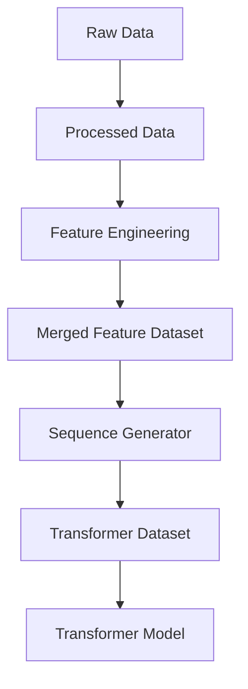
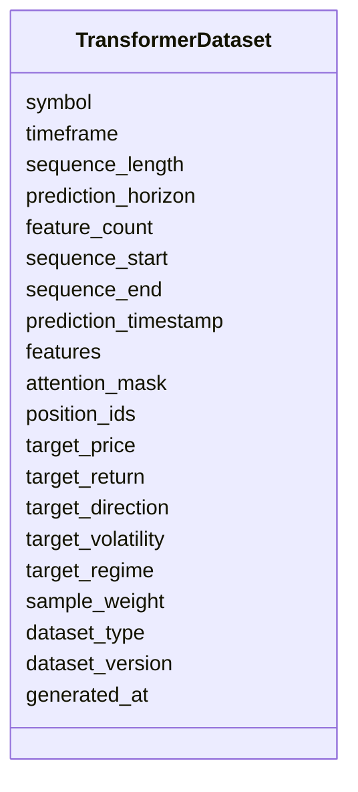

# Transformer Dataset Schema

## Overview

The **Transformer Dataset Schema** defines the standardized dataset format used to train, validate, test, and run inference with **Transformer-based models** in the ETH Bot.

Unlike tabular models such as XGBoost or LightGBM, Transformer models operate on **sequences of historical observations**. They learn relationships between all time steps using **self-attention**, making them well-suited for capturing long-range dependencies in financial time-series data.

This schema stores **sequence inputs and prediction targets only**.

---

# Pipeline Position



---

# Purpose

The Transformer dataset is responsible for:

- Converting feature vectors into historical sequences
- Providing attention-ready inputs
- Supporting supervised learning targets
- Enabling training, validation, testing, and inference
- Standardizing sequence data for Transformer models

---

# Dataset Structure



---

# Dataset Components

## Dataset Metadata

| Field | Description |
|--------|-------------|
| symbol | Trading symbol |
| timeframe | Candle timeframe |
| sequence_length | Number of historical observations |
| prediction_horizon | Forecast horizon |
| feature_count | Number of engineered features |

---

## Sequence Information

| Field | Description |
|--------|-------------|
| sequence_start | Beginning of input sequence |
| sequence_end | End of input sequence |
| prediction_timestamp | Future timestamp being predicted |

---

## Input Features

The model receives a sequence of feature vectors.

```text
(sequence_length × feature_count)
```

Example:

```text
60 × 145
```

Meaning:

- 60 historical candles
- 145 engineered features per candle

---

## Attention Mask

The attention mask specifies which sequence positions are valid.

| Value | Meaning |
|--------|---------|
| 1 | Valid observation |
| 0 | Padding |

When all sequences have equal length, the attention mask is typically all ones.

---

## Position IDs

Position IDs identify the order of observations.

Example:

```text
0

1

2

...

59
```

These are used together with positional encodings so the Transformer can distinguish earlier observations from later ones.

---

## Target Labels

The prediction target depends on the task.

Supported targets include:

| Target | Description |
|---------|-------------|
| target_price | Future price |
| target_return | Future return |
| target_direction | Bullish / Neutral / Bearish |
| target_volatility | Future volatility |
| target_regime | Market regime |

---

## Dataset Split

| Value | Purpose |
|--------|---------|
| train | Model training |
| validation | Hyperparameter tuning |
| test | Model evaluation |
| inference | Live prediction |

---

## Metadata

| Field | Description |
|--------|-------------|
| dataset_version | Dataset schema version |
| generated_at | Dataset creation timestamp |

---

# Sequence Generation

```mermaid
flowchart LR

Merged Feature Dataset

-->

Sliding Window

-->

Sequence

-->

Attention Mask

-->

Position IDs

-->

Transformer Dataset
```

---

# Sliding Window Example

Suppose:

```text
Sequence Length = 5
Prediction Horizon = 1
```

Input sequence:

```text
T1

T2

T3

T4

T5
```

Target:

```text
Predict T6
```

Next sample:

```text
T2

T3

T4

T5

T6
```

Target:

```text
Predict T7
```

---

# Example Shape

Training samples:

```text
100000
```

Input tensor:

```text
(100000,60,145)
```

Attention mask:

```text
(100000,60)
```

Position IDs:

```text
(100000,60)
```

Target:

```text
(100000,1)
```

---

# Data Sources

The Transformer dataset is generated from the merged feature dataset.

```mermaid
mindmap

root((Merged Features))

    Price Features

    Volume Features

    Derivative Features

    Order Book Features

    Sentiment Features

    On-Chain Features

    Time Features
```

---

# Training Pipeline

```mermaid
flowchart TD

Merged Feature Dataset

-->

Sequence Generator

-->

Attention Mask Generator

-->

Position Generator

-->

Train Validation Test Split

-->

Transformer Dataset

-->

Transformer Model

-->

Training
```

---

# Inference Pipeline

```mermaid
flowchart TD

Latest Feature Window

-->

Sequence Generator

-->

Attention Mask

-->

Position IDs

-->

Transformer Dataset

-->

Trained Transformer

-->

Prediction
```

---

# Example Dataset Record

```json
{
  "symbol": "ETHUSDT",
  "timeframe": "1h",

  "sequence_length": 60,
  "prediction_horizon": 1,
  "feature_count": 145,

  "sequence_start": "2026-08-03T00:00:00Z",
  "sequence_end": "2026-08-05T11:00:00Z",
  "prediction_timestamp": "2026-08-05T12:00:00Z",

  "features": [
    [0.42, 0.61, 0.18, "..."],
    [0.44, 0.59, 0.22, "..."],
    "... 60 rows ..."
  ],

  "attention_mask": [
    1,1,1,1,1,1,1,1,1,1,
    1,1,1,1,1,1,1,1,1,1,
    1,1,1,1,1,1,1,1,1,1,
    1,1,1,1,1,1,1,1,1,1,
    1,1,1,1,1,1,1,1,1,1,
    1,1,1,1,1,1,1,1,1,1
  ],

  "position_ids": [
    0,1,2,3,4,5,6,7,8,9,
    10,11,12,13,14,15,16,17,18,19,
    20,21,22,23,24,25,26,27,28,29,
    30,31,32,33,34,35,36,37,38,39,
    40,41,42,43,44,45,46,47,48,49,
    50,51,52,53,54,55,56,57,58,59
  ],

  "target_price": 3658.42,
  "target_return": 0.014,
  "target_direction": 1,
  "target_volatility": 0.028,
  "target_regime": 2,

  "sample_weight": 1.0,
  "dataset_type": "train",
  "dataset_version": "1.0",
  "generated_at": "2026-08-05T12:05:00Z"
}
```

---

# Relationship with Other Schemas

```mermaid
flowchart TD

Raw Schemas

-->

Processed Schemas

-->

Feature Schemas

-->

Merged Dataset

Merged Dataset

-->

Transformer Dataset

Transformer Dataset

-->

Transformer Model

Transformer Model

-->

Predictions
```

---

# LSTM vs Transformer Dataset

| Feature | LSTM Dataset | Transformer Dataset |
|---------|--------------|---------------------|
| Input | Sequential windows | Sequential windows |
| Shape | `(sequence_length, feature_count)` | `(sequence_length, feature_count)` |
| Attention mask | No | Yes |
| Position IDs | No | Yes |
| Self-attention | No | Yes |
| Long-range dependency modeling | Moderate | Strong |
| Parallel sequence processing | No | Yes |

---

# Design Principles

```mermaid
mindmap

root((Transformer Dataset))

    Sequence Based

    Attention Ready

    Time-Series Native

    AI Ready

    Deterministic

    Scalable

    Reproducible

    Modular
```

---

# Future Enhancements

Future versions may support:

- Multi-horizon forecasting
- Encoder–decoder architectures
- Multi-timeframe sequences (e.g., 1H + 1D)
- Variable-length sequences
- Dynamic attention masks
- Cross-asset attention
- Event-aware embeddings
- Relative positional encoding
- Time embeddings
- Streaming inference

---

# Summary

The **Transformer Dataset Schema** bridges the merged feature dataset and Transformer-based models by converting engineered market features into standardized historical sequences enriched with attention masks and positional information.

This design enables efficient training, validation, testing, and live inference while supporting long-range temporal learning. It fits naturally into the modular ETH Bot pipeline and can evolve with more advanced Transformer architectures without changing the underlying feature engineering process.

```mermaid
flowchart TD

Raw Data

-->

Processed Data

-->

Feature Engineering

-->

Merged Feature Dataset

-->

Sequence Generator

-->

Transformer Dataset

-->

Transformer Model

-->

Prediction

-->

Strategy Engine

-->

Risk Engine

-->

Execution Engine
```