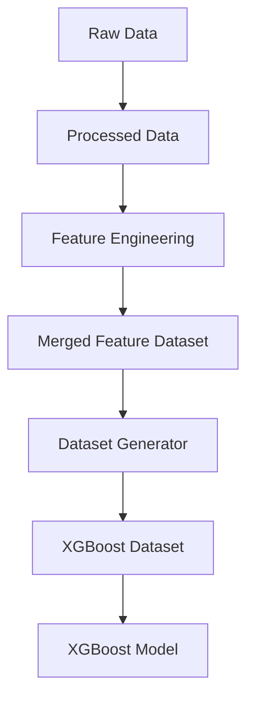
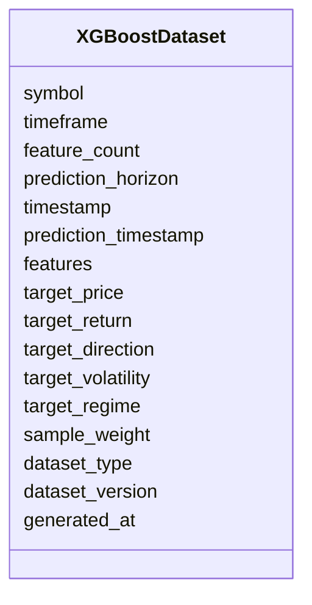

# XGBoost Dataset Schema

## Overview

The **XGBoost Dataset Schema** defines the standardized dataset format used to train, validate, test, and run inference with **XGBoost** models in the ETH Bot.

Unlike sequence-based models such as LSTM, XGBoost operates on **tabular feature vectors**, where each sample represents a single point in time with its associated engineered features.

This schema stores **feature vectors and prediction targets only**.

---

# Pipeline Position



---

# Purpose

The XGBoost dataset is responsible for:

- Preparing tabular feature vectors
- Defining supervised learning targets
- Supporting model training
- Supporting validation and testing
- Supporting live inference
- Providing a standardized dataset format for tree-based models

---

# Dataset Structure



---

# Dataset Components

## Dataset Metadata

| Field | Description |
|--------|-------------|
| symbol | Trading symbol |
| timeframe | Candle timeframe |
| feature_count | Number of engineered features |
| prediction_horizon | Forecast horizon |

---

## Sample Information

| Field | Description |
|--------|-------------|
| timestamp | Current observation timestamp |
| prediction_timestamp | Future timestamp being predicted |

---

## Input Features

The input consists of a **one-dimensional feature vector**.

```text
(feature_count,)
```

Example:

```text
145 features
```

Each feature vector is generated from the merged feature dataset.

---

## Target Labels

The target depends on the prediction task.

Possible targets include:

| Target | Description |
|---------|-------------|
| target_price | Future price |
| target_return | Future percentage return |
| target_direction | Bullish / Neutral / Bearish |
| target_volatility | Future volatility |
| target_regime | Market regime |

A single model may predict one or multiple targets depending on the training objective.

---

## Dataset Split

| Value | Purpose |
|--------|---------|
| train | Model training |
| validation | Hyperparameter tuning |
| test | Model evaluation |
| inference | Live prediction |

---

## Metadata

| Field | Description |
|--------|-------------|
| dataset_version | Dataset schema version |
| generated_at | Dataset creation timestamp |

---

# Dataset Generation

```mermaid
flowchart LR

Merged Feature Dataset

-->

Feature Selection

-->

Feature Vector

-->

Target

-->

XGBoost Dataset
```

---

# Example Feature Vector

```text
Timestamp

↓

[

Price Features

Volume Features

Derivative Features

Order Book Features

Sentiment Features

On-Chain Features

Time Features

]

↓

Target
```

---

# Example Shape

Suppose:

```text
145 engineered features
```

Training samples:

```text
100000
```

Input shape:

```text
(100000,145)
```

Target:

```text
(100000,1)
```

Unlike LSTM, no sequence dimension exists.

---

# Data Sources

The XGBoost dataset is built from the merged feature dataset.

```mermaid
mindmap

root((Merged Features))

    Price Features

    Volume Features

    Derivative Features

    Order Book Features

    Sentiment Features

    On-Chain Features

    Time Features
```

---

# Training Pipeline

```mermaid
flowchart TD

Merged Feature Dataset

-->

Feature Selection

-->

Normalization (Optional)

-->

Train Validation Test Split

-->

XGBoost Dataset

-->

XGBoost Model

-->

Training
```

---

# Inference Pipeline

```mermaid
flowchart TD

Latest Feature Vector

-->

Feature Selection

-->

XGBoost Dataset

-->

Trained Model

-->

Prediction
```

---

# Example Dataset Record

```json
{
  "symbol": "ETHUSDT",

  "timeframe": "1h",

  "feature_count": 145,

  "prediction_horizon": 1,

  "timestamp": "2026-08-05T11:00:00Z",

  "prediction_timestamp": "2026-08-05T12:00:00Z",

  "features": [
    0.42,
    0.61,
    0.18,
    0.73,
    0.51,
    "... 145 values ..."
  ],

  "target_price": 3658.42,

  "target_return": 0.014,

  "target_direction": 1,

  "target_volatility": 0.028,

  "target_regime": 2,

  "sample_weight": 1.0,

  "dataset_type": "train",

  "dataset_version": "1.0",

  "generated_at": "2026-08-05T12:05:00Z"
}
```

---

# Relationship with Other Schemas

```mermaid
flowchart TD

Raw Schemas

-->

Processed Schemas

Processed Schemas

-->

Feature Schemas

Feature Schemas

-->

Merged Dataset

Merged Dataset

-->

XGBoost Dataset

XGBoost Dataset

-->

XGBoost Model

XGBoost Model

-->

Predictions
```

---

# LSTM vs XGBoost Dataset

| Feature | LSTM Dataset | XGBoost Dataset |
|---------|--------------|-----------------|
| Data structure | Sequential windows | Tabular feature vectors |
| Input shape | `(sequence_length, feature_count)` | `(feature_count,)` |
| Learns temporal dependencies | Yes | Indirectly through engineered lag features |
| Typical use | Deep learning | Gradient boosting |
| Training samples | Sliding windows | Independent observations |

---

# Design Principles

```mermaid
mindmap

root((XGBoost Dataset))

    Tabular

    AI Ready

    Deterministic

    Lightweight

    Reproducible

    Scalable

    Model Focused

    Feature Rich
```

---

# Future Enhancements

Future versions may support:

- Multi-output regression
- Multi-class classification
- Lag feature generation
- Rolling statistical features
- Automatic feature selection
- Feature importance tracking
- Sample balancing
- Dynamic sample weighting
- Online dataset generation
- Cross-validation folds

---

# Summary

The **XGBoost Dataset Schema** serves as the interface between the merged feature dataset and XGBoost models. It converts engineered market features into standardized tabular samples with associated prediction targets, enabling efficient training, validation, testing, and live inference.

By separating dataset preparation from feature engineering and model implementation, the ETH Bot maintains a modular and scalable machine learning pipeline that supports XGBoost and other tree-based algorithms such as LightGBM, CatBoost, and Random Forest.

```mermaid
flowchart TD

Raw Data

-->

Processed Data

-->

Feature Engineering

-->

Merged Feature Dataset

-->

Dataset Generator

-->

XGBoost Dataset

-->

XGBoost Model

-->

Prediction

-->

Strategy Engine

-->

Risk Engine

-->

Execution Engine
```