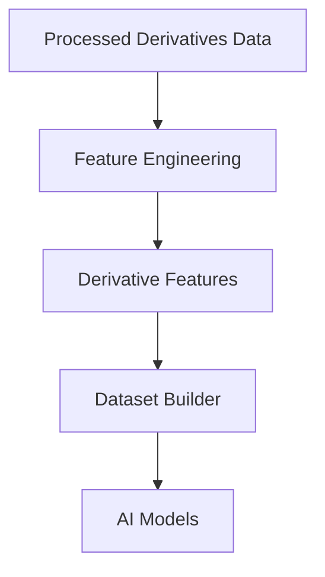
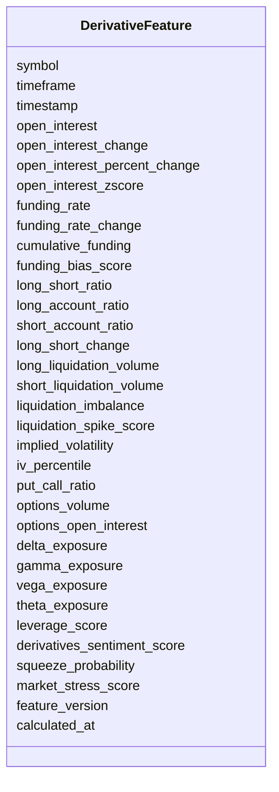

# Derivative Features Schema

## Overview

The **Derivative Features Schema** defines standardized machine learning features engineered from processed derivatives market data.

These features summarize futures market positioning, leverage, funding conditions, liquidation activity, options market behavior, and market stress into AI-ready numerical features.

Unlike raw derivatives data, these features are optimized for:

- AI model training
- Market regime detection
- Trend prediction
- Volatility prediction
- Strategy selection
- Risk management
- Position sizing
- Trade filtering

This schema stores **engineered features only**.

---

# Pipeline Position



---

# Feature Categories

```mermaid
mindmap

root((Derivative Features))

    Open Interest

    Funding Rate

    Long Short Positioning

    Liquidations

    Options

    Greeks

    Market Stress

    Composite Scores
```

---

# Schema Structure



---

# Field Definitions

## Asset Information

| Field | Description |
|--------|-------------|
| symbol | Trading symbol |
| timeframe | Candle timeframe |
| timestamp | Candle timestamp |

---

## Open Interest Features

| Field | Description |
|--------|-------------|
| open_interest | Current open interest |
| open_interest_change | Change in open interest |
| open_interest_percent_change | Percentage change |
| open_interest_zscore | Normalized open interest |

These features measure capital entering or leaving the futures market.

---

## Funding Rate Features

| Field | Description |
|--------|-------------|
| funding_rate | Current funding rate |
| funding_rate_change | Funding rate change |
| cumulative_funding | Rolling cumulative funding |
| funding_bias_score | Composite funding sentiment |

Funding features help estimate market positioning and leverage.

---

## Long / Short Features

| Field | Description |
|--------|-------------|
| long_short_ratio | Ratio of long to short positions |
| long_account_ratio | Percentage of long accounts |
| short_account_ratio | Percentage of short accounts |
| long_short_change | Change in positioning |

Useful for identifying crowded trades.

---

## Liquidation Features

| Field | Description |
|--------|-------------|
| long_liquidation_volume | Total long liquidations |
| short_liquidation_volume | Total short liquidations |
| liquidation_imbalance | Difference between long and short liquidations |
| liquidation_spike_score | Liquidation intensity score |

Large liquidation events often indicate high volatility.

---

## Options Features

| Field | Description |
|--------|-------------|
| implied_volatility | Current implied volatility |
| iv_percentile | Historical IV percentile |
| put_call_ratio | Put/Call ratio |
| options_volume | Total options volume |
| options_open_interest | Options open interest |

These features provide insight into market expectations and hedging activity.

---

## Greeks Features

| Field | Description |
|--------|-------------|
| delta_exposure | Net delta exposure |
| gamma_exposure | Net gamma exposure |
| vega_exposure | Net vega exposure |
| theta_exposure | Net theta exposure |

Greeks summarize options sensitivity and dealer positioning.

---

## Composite Features

| Field | Description |
|--------|-------------|
| leverage_score | Estimated leverage intensity |
| derivatives_sentiment_score | Composite derivatives sentiment |
| squeeze_probability | Probability of a long or short squeeze |
| market_stress_score | Overall derivatives market stress |

These engineered scores combine multiple derivatives metrics into AI-friendly features.

---

## Metadata

| Field | Description |
|--------|-------------|
| feature_version | Feature calculation version |
| calculated_at | Feature generation timestamp |

---

# Feature Engineering Flow

```mermaid
flowchart LR

Processed Futures Data

-->

Open Interest Features

-->

Funding Features

-->

Positioning Features

-->

Liquidation Features

-->

Composite Scores

-->

Derivative Features
```

---

# Example Record

```json
{
  "symbol": "ETHUSDT",
  "timeframe": "1h",

  "timestamp": "2026-08-05T12:00:00Z",

  "open_interest": 1432587.22,
  "open_interest_change": 24871.12,
  "open_interest_percent_change": 1.77,
  "open_interest_zscore": 1.24,

  "funding_rate": 0.00014,
  "funding_rate_change": 0.00002,
  "cumulative_funding": 0.0038,
  "funding_bias_score": 0.74,

  "long_short_ratio": 1.28,
  "long_account_ratio": 0.56,
  "short_account_ratio": 0.44,
  "long_short_change": 0.08,

  "long_liquidation_volume": 684512.0,
  "short_liquidation_volume": 215443.0,
  "liquidation_imbalance": 469069.0,
  "liquidation_spike_score": 0.81,

  "implied_volatility": 0.63,
  "iv_percentile": 71.8,
  "put_call_ratio": 0.86,
  "options_volume": 28456.4,
  "options_open_interest": 128945.2,

  "delta_exposure": 21542.1,
  "gamma_exposure": 984.3,
  "vega_exposure": 14583.6,
  "theta_exposure": -3521.8,

  "leverage_score": 0.79,
  "derivatives_sentiment_score": 0.73,
  "squeeze_probability": 0.42,
  "market_stress_score": 0.35,

  "feature_version": "1.0",

  "calculated_at": "2026-08-05T12:00:12Z"
}
```

---

# Downstream Usage

```mermaid
mindmap

root((Derivative Features))

    AI Models

    Trend Prediction

    Volatility Prediction

    Market Regime Detection

    Strategy Engine

    Risk Engine

    Position Sizing

    Backtesting
```

---

# Relationship with Other Schemas

```mermaid
flowchart TD

Processed Derivatives

-->

Derivative Features

Derivative Features

-->

Merged Feature Dataset

Merged Feature Dataset

-->

AI Models

AI Models

-->

Strategy Engine

Strategy Engine

-->

Risk Engine
```

---

# Storage Flow

```mermaid
flowchart TD

Processed Derivatives

-->

Feature Engineering

-->

Derivative Features

-->

Feature Store

-->

Training Dataset

-->

Model Repository
```

---

# Design Principles

```mermaid
mindmap

root((Derivative Features))

    Deterministic

    AI Ready

    Time-Series Ready

    Modular

    Lightweight

    Reproducible

    Extensible

    Exchange Independent
```

---

# Future Enhancements

Future engineered derivative features may include:

- Cross-exchange Open Interest divergence
- Funding Rate momentum
- Liquidation cascade probability
- Dealer Gamma Exposure (GEX)
- Dealer Delta Exposure (DEX)
- Max Pain distance
- Options Skew
- Volatility Smile features
- Basis spread features
- Futures premium features
- Stablecoin leverage ratio
- Cross-market leverage score

---

# Summary

The **Derivative Features Schema** stores engineered machine learning features derived from futures and options market data.

These features capture leverage, positioning, funding dynamics, liquidation activity, options behavior, and market stress, providing high-quality numerical inputs for feature engineering, AI model training, market regime detection, strategy generation, risk management, position sizing, backtesting, paper trading, and live trading throughout the ETH Bot pipeline.

```mermaid
flowchart TD

Processed Derivatives Data

-->

Feature Engineering

-->

Derivative Features

-->

Dataset Builder

-->

AI Models

-->

Strategy Engine

-->

Risk Engine

-->

Execution Engine
```