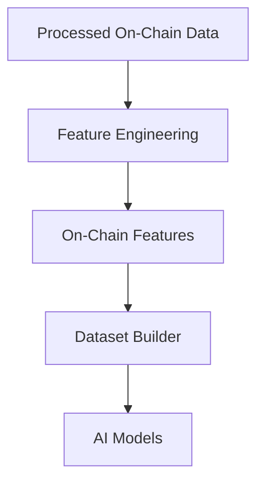
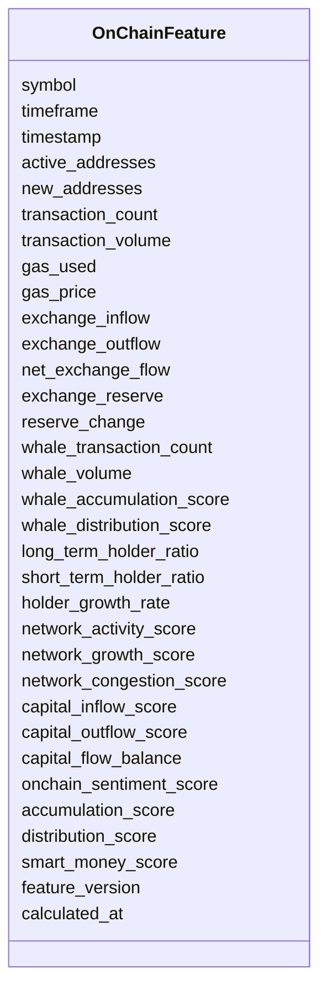

# On-Chain Features Schema

## Overview

The **On-Chain Features Schema** defines standardized machine learning features engineered from processed Ethereum blockchain data.

These features transform raw on-chain metrics into AI-ready numerical features that describe network activity, capital movement, whale behavior, exchange flows, holder activity, and overall blockchain health.

Unlike raw blockchain data, these engineered features are optimized for:

- AI model training
- Trend prediction
- Volatility prediction
- Market regime detection
- Strategy generation
- Risk management
- Position sizing
- Trade filtering

This schema stores **engineered features only**.

---

# Pipeline Position



---

# Feature Categories

```mermaid
mindmap

root((On-Chain Features))

    Network Activity

    Exchange Flow

    Whale Activity

    Holder Metrics

    Network Health

    Capital Flow

    Composite Scores
```

---

# Schema Structure



---

# Field Definitions

## Asset Information

| Field | Description |
|--------|-------------|
| symbol | Trading symbol |
| timeframe | Candle timeframe |
| timestamp | Feature timestamp |

---

## Network Activity

| Field | Description |
|--------|-------------|
| active_addresses | Number of active wallet addresses |
| new_addresses | Newly created addresses |
| transaction_count | Total blockchain transactions |
| transaction_volume | Total value transferred |
| gas_used | Total gas consumed |
| gas_price | Average gas price |

These features measure blockchain usage and network demand.

---

## Exchange Flow

| Field | Description |
|--------|-------------|
| exchange_inflow | Assets transferred to exchanges |
| exchange_outflow | Assets transferred from exchanges |
| net_exchange_flow | Inflow minus outflow |
| exchange_reserve | Exchange-held reserves |
| reserve_change | Change in exchange reserves |

Exchange flow is often used to estimate buying or selling pressure.

---

## Whale Activity

| Field | Description |
|--------|-------------|
| whale_transaction_count | Number of whale transactions |
| whale_volume | Total whale transaction volume |
| whale_accumulation_score | Whale buying score |
| whale_distribution_score | Whale selling score |

These features estimate large-holder activity.

---

## Holder Metrics

| Field | Description |
|--------|-------------|
| long_term_holder_ratio | Percentage of long-term holders |
| short_term_holder_ratio | Percentage of short-term holders |
| holder_growth_rate | Growth rate of holders |

Useful for understanding investor behavior.

---

## Network Health

| Field | Description |
|--------|-------------|
| network_activity_score | Overall network activity |
| network_growth_score | Network growth score |
| network_congestion_score | Network congestion level |

These summarize blockchain health and utilization.

---

## Capital Flow

| Field | Description |
|--------|-------------|
| capital_inflow_score | Capital entering the ecosystem |
| capital_outflow_score | Capital leaving the ecosystem |
| capital_flow_balance | Net capital movement |

These features describe how capital moves through the Ethereum ecosystem.

---

## Composite Features

| Field | Description |
|--------|-------------|
| onchain_sentiment_score | Overall blockchain sentiment |
| accumulation_score | Composite accumulation score |
| distribution_score | Composite distribution score |
| smart_money_score | Smart money activity score |

These combine multiple on-chain metrics into AI-friendly numerical features.

---

## Metadata

| Field | Description |
|--------|-------------|
| feature_version | Feature calculation version |
| calculated_at | Feature generation timestamp |

---

# Feature Engineering Flow

```mermaid
flowchart LR

Processed On-Chain Data

-->

Network Metrics

-->

Exchange Flow

-->

Whale Metrics

-->

Holder Metrics

-->

Composite Scores

-->

On-Chain Features
```

---

# Example Record

```json
{
  "symbol": "ETHUSDT",
  "timeframe": "1h",

  "timestamp": "2026-08-05T12:00:00Z",

  "active_addresses": 582341,
  "new_addresses": 18421,
  "transaction_count": 1298542,
  "transaction_volume": 2458371.42,

  "gas_used": 28763491,
  "gas_price": 21.8,

  "exchange_inflow": 24812.6,
  "exchange_outflow": 31658.9,
  "net_exchange_flow": -6846.3,

  "exchange_reserve": 18324567.4,
  "reserve_change": -0.52,

  "whale_transaction_count": 162,
  "whale_volume": 62481.2,
  "whale_accumulation_score": 0.78,
  "whale_distribution_score": 0.21,

  "long_term_holder_ratio": 0.64,
  "short_term_holder_ratio": 0.36,
  "holder_growth_rate": 0.015,

  "network_activity_score": 0.81,
  "network_growth_score": 0.72,
  "network_congestion_score": 0.29,

  "capital_inflow_score": 0.69,
  "capital_outflow_score": 0.41,
  "capital_flow_balance": 0.28,

  "onchain_sentiment_score": 0.74,
  "accumulation_score": 0.77,
  "distribution_score": 0.23,
  "smart_money_score": 0.82,

  "feature_version": "1.0",

  "calculated_at": "2026-08-05T12:00:12Z"
}
```

---

# Downstream Usage

```mermaid
mindmap

root((On-Chain Features))

    AI Models

    Trend Prediction

    Volatility Prediction

    Market Regime Detection

    Strategy Engine

    Risk Engine

    Position Sizing

    Trade Filtering
```

---

# Relationship with Other Schemas

```mermaid
flowchart TD

Processed On-Chain Data

-->

On-Chain Features

Price Features

-->

Merged Feature Dataset

Volume Features

-->

Merged Feature Dataset

Derivative Features

-->

Merged Feature Dataset

Order Book Features

-->

Merged Feature Dataset

Sentiment Features

-->

Merged Feature Dataset

On-Chain Features

-->

Merged Feature Dataset

Merged Feature Dataset

-->

AI Models
```

---

# Storage Flow

```mermaid
flowchart TD

Processed On-Chain Data

-->

Feature Engineering

-->

On-Chain Features

-->

Feature Store

-->

Training Dataset

-->

Model Repository
```

---

# Design Principles

```mermaid
mindmap

root((On-Chain Features))

    Deterministic

    AI Ready

    Time-Series Ready

    Ethereum Focused

    Modular

    Lightweight

    Reproducible

    Extensible
```

---

# Future Enhancements

Future engineered Ethereum on-chain features may include:

- MVRV Z-Score
- NVT Ratio
- Realized Price Distance
- SOPR (Spent Output Profit Ratio)
- Dormancy Flow
- Coin Days Destroyed (CDD)
- Exchange Whale Ratio
- Stablecoin Supply Ratio (SSR)
- ETH Staking Inflow / Outflow
- Validator Activity Score
- Layer-2 Activity Score
- Bridge Flow Metrics
- Smart Contract Interaction Score
- DeFi TVL Change
- NFT Activity Score
- MEV Activity Score

---

# Summary

The **On-Chain Features Schema** stores engineered machine learning features derived from processed Ethereum blockchain data.

These features quantify network activity, exchange flows, whale behavior, holder dynamics, capital movement, and blockchain health into standardized numerical values that support AI model training, market regime detection, trend and volatility prediction, strategy generation, risk management, position sizing, trade filtering, backtesting, paper trading, and live trading throughout the ETH Bot pipeline.

```mermaid
flowchart TD

Processed On-Chain Data

-->

Feature Engineering

-->

On-Chain Features

-->

Dataset Builder

-->

AI Models

-->

Strategy Engine

-->

Risk Engine

-->

Execution Engine
```