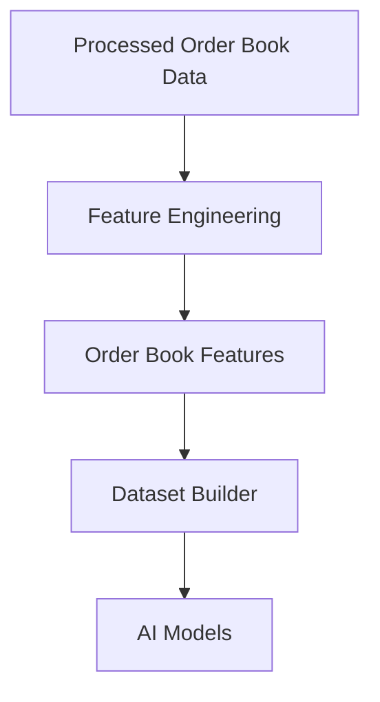
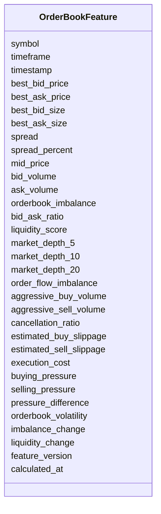

# Order Book Features Schema

## Overview

The **Order Book Features Schema** defines standardized machine learning features engineered from processed order book data.

Unlike raw order book snapshots, these features summarize market microstructure, liquidity, bid/ask dynamics, and execution quality into numerical values that can be directly consumed by AI models and trading engines.

These features are primarily used for:

- AI model training
- Short-term price prediction
- Market microstructure analysis
- Liquidity estimation
- Execution optimization
- Slippage prediction
- Strategy generation
- Risk management

This schema stores **engineered features only**.

---

# Pipeline Position



---

# Feature Categories

```mermaid
mindmap

root((Order Book Features))

    Best Bid Ask

    Spread

    Market Depth

    Liquidity

    Order Book Imbalance

    Order Flow

    Price Pressure

    Slippage

    Market Dynamics
```

---

# Schema Structure



---

# Field Definitions

## Asset Information

| Field | Description |
|--------|-------------|
| symbol | Trading symbol |
| timeframe | Candle timeframe |
| timestamp | Feature timestamp |

---

## Best Bid / Ask

| Field | Description |
|--------|-------------|
| best_bid_price | Highest bid price |
| best_ask_price | Lowest ask price |
| best_bid_size | Quantity at best bid |
| best_ask_size | Quantity at best ask |
| spread | Bid-ask spread |
| spread_percent | Spread as percentage |
| mid_price | Midpoint between best bid and ask |

These values represent the current executable market.

---

## Order Book Imbalance

| Field | Description |
|--------|-------------|
| bid_volume | Total bid-side volume |
| ask_volume | Total ask-side volume |
| orderbook_imbalance | Net bid vs ask imbalance |
| bid_ask_ratio | Bid volume divided by ask volume |

These features estimate buying or selling dominance.

---

## Liquidity Features

| Field | Description |
|--------|-------------|
| liquidity_score | Composite liquidity score |
| market_depth_5 | Liquidity within top 5 price levels |
| market_depth_10 | Liquidity within top 10 price levels |
| market_depth_20 | Liquidity within top 20 price levels |

Useful for execution quality and position sizing.

---

## Order Flow Features

| Field | Description |
|--------|-------------|
| order_flow_imbalance | Net aggressive buying vs selling |
| aggressive_buy_volume | Market buy volume |
| aggressive_sell_volume | Market sell volume |
| cancellation_ratio | Ratio of cancelled orders |

These describe short-term market pressure.

---

## Slippage Features

| Field | Description |
|--------|-------------|
| estimated_buy_slippage | Estimated slippage for buy orders |
| estimated_sell_slippage | Estimated slippage for sell orders |
| execution_cost | Estimated execution cost |

These features help optimize order execution.

---

## Price Pressure

| Field | Description |
|--------|-------------|
| buying_pressure | Estimated buying pressure |
| selling_pressure | Estimated selling pressure |
| pressure_difference | Difference between buying and selling pressure |

Useful for predicting short-term price movement.

---

## Market Dynamics

| Field | Description |
|--------|-------------|
| orderbook_volatility | Volatility of the order book |
| imbalance_change | Change in order book imbalance |
| liquidity_change | Change in available liquidity |

These capture how the order book evolves over time.

---

## Metadata

| Field | Description |
|--------|-------------|
| feature_version | Feature calculation version |
| calculated_at | Feature generation timestamp |

---

# Feature Engineering Flow

```mermaid
flowchart LR

Processed Order Book

-->

Best Bid Ask

-->

Market Depth

-->

Order Flow

-->

Liquidity Analysis

-->

Order Book Features
```

---

# Example Record

```json
{
  "symbol": "ETHUSDT",
  "timeframe": "1m",
  "timestamp": "2026-08-05T12:00:00Z",

  "best_bid_price": 3652.45,
  "best_ask_price": 3652.58,

  "best_bid_size": 18.6,
  "best_ask_size": 15.1,

  "spread": 0.13,
  "spread_percent": 0.0036,

  "mid_price": 3652.515,

  "bid_volume": 824.3,
  "ask_volume": 706.8,

  "orderbook_imbalance": 0.077,
  "bid_ask_ratio": 1.17,

  "liquidity_score": 0.89,

  "market_depth_5": 148.3,
  "market_depth_10": 296.8,
  "market_depth_20": 583.2,

  "order_flow_imbalance": 0.14,

  "aggressive_buy_volume": 152.4,
  "aggressive_sell_volume": 118.2,

  "cancellation_ratio": 0.31,

  "estimated_buy_slippage": 0.05,
  "estimated_sell_slippage": 0.06,

  "execution_cost": 0.08,

  "buying_pressure": 0.61,
  "selling_pressure": 0.39,

  "pressure_difference": 0.22,

  "orderbook_volatility": 0.18,

  "imbalance_change": 0.04,

  "liquidity_change": 0.07,

  "feature_version": "1.0",

  "calculated_at": "2026-08-05T12:00:02Z"
}
```

---

# Downstream Usage

```mermaid
mindmap

root((Order Book Features))

    AI Models

    Scalping Strategies

    High Frequency Signals

    Strategy Engine

    Risk Engine

    Execution Engine

    Slippage Prediction

    Liquidity Analysis
```

---

# Relationship with Other Schemas

```mermaid
flowchart TD

Processed Order Book

-->

Order Book Features

Order Book Features

-->

Merged Feature Dataset

Price Features

-->

Merged Feature Dataset

Volume Features

-->

Merged Feature Dataset

Derivative Features

-->

Merged Feature Dataset

Merged Feature Dataset

-->

AI Models
```

---

# Storage Flow

```mermaid
flowchart TD

Processed Order Book

-->

Feature Engineering

-->

Order Book Features

-->

Feature Store

-->

Training Dataset

-->

Model Repository
```

---

# Design Principles

```mermaid
mindmap

root((Order Book Features))

    Deterministic

    AI Ready

    Time-Series Ready

    Microstructure Focused

    Lightweight

    Modular

    Reproducible

    Exchange Independent
```

---

# Future Enhancements

Potential future engineered order book features include:

- Multi-level Order Book Imbalance
- Queue Position Score
- Hidden Liquidity Estimate
- Iceberg Order Detection
- Spoofing Probability
- Order Book Resiliency
- Microprice
- Weighted Mid Price
- Order Arrival Rate
- Order Cancellation Rate
- Market Impact Score
- Cross-Exchange Liquidity Score

---

# Summary

The **Order Book Features Schema** stores engineered machine learning features derived from processed order book data.

These features summarize liquidity, bid/ask dynamics, market depth, order flow, price pressure, execution costs, and market microstructure, providing high-frequency, AI-ready inputs for short-term forecasting, strategy generation, execution optimization, risk management, backtesting, paper trading, and live trading throughout the ETH Bot pipeline.

```mermaid
flowchart TD

Processed Order Book

-->

Feature Engineering

-->

Order Book Features

-->

Dataset Builder

-->

AI Models

-->

Strategy Engine

-->

Risk Engine

-->

Execution Engine
```