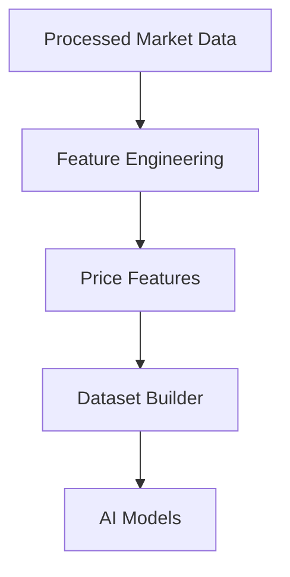
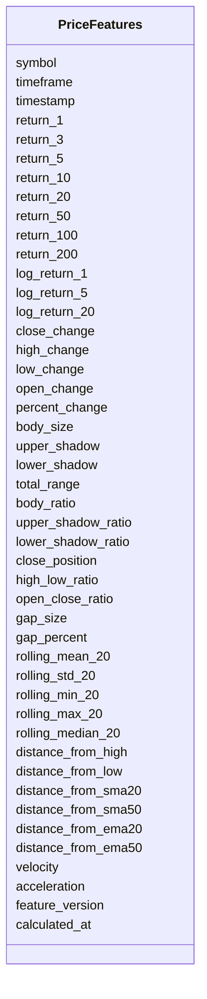

# Price Features Schema

## Overview

The **Price Features Schema** defines standardized engineered features derived directly from processed OHLCV market data.

Unlike technical indicators, price features are **mathematical transformations of price data** that help machine learning models understand price behavior, market structure, and short-term dynamics.

These features are generated by the **Feature Engineering Pipeline** and are primarily used for:

- AI model training
- Strategy generation
- Risk management
- Market regime detection
- Backtesting
- Paper trading
- Live trading

This schema stores **engineered feature values only**.

---

# Pipeline Position



---

# Feature Categories

```mermaid
mindmap

root((Price Features))

    Returns

    Price Change

    Candle Features

    Price Position

    Gap Features

    Rolling Statistics

    Distance Features

    Price Velocity
```

---

# Schema Structure



---

# Field Definitions

## Asset Information

| Field | Description |
|--------|-------------|
| symbol | Trading symbol |
| timeframe | Candle timeframe |
| timestamp | Candle timestamp |

---

## Returns

| Field | Description |
|--------|-------------|
| return_1 | 1-period return |
| return_3 | 3-period return |
| return_5 | 5-period return |
| return_10 | 10-period return |
| return_20 | 20-period return |
| return_50 | 50-period return |
| return_100 | 100-period return |
| return_200 | 200-period return |
| log_return_1 | 1-period logarithmic return |
| log_return_5 | 5-period logarithmic return |
| log_return_20 | 20-period logarithmic return |

Returns describe historical price performance over multiple lookback windows.

---

## Price Change

| Field | Description |
|--------|-------------|
| close_change | Change in closing price |
| high_change | Change in high price |
| low_change | Change in low price |
| open_change | Change in opening price |
| percent_change | Percentage price change |

---

## Candle Features

| Field | Description |
|--------|-------------|
| body_size | Candle body size |
| upper_shadow | Upper wick size |
| lower_shadow | Lower wick size |
| total_range | High-low range |
| body_ratio | Body relative to total range |
| upper_shadow_ratio | Upper wick ratio |
| lower_shadow_ratio | Lower wick ratio |

These describe candle shape and market sentiment.

---

## Price Position

| Field | Description |
|--------|-------------|
| close_position | Close position within candle |
| high_low_ratio | High-low ratio |
| open_close_ratio | Open-close ratio |

---

## Gap Features

| Field | Description |
|--------|-------------|
| gap_size | Absolute price gap |
| gap_percent | Percentage gap |

Useful for detecting overnight or session gaps.

---

## Rolling Statistics

| Field | Description |
|--------|-------------|
| rolling_mean_20 | 20-period rolling mean |
| rolling_std_20 | 20-period rolling standard deviation |
| rolling_min_20 | Lowest value in rolling window |
| rolling_max_20 | Highest value in rolling window |
| rolling_median_20 | Rolling median |

---

## Distance Features

| Field | Description |
|--------|-------------|
| distance_from_high | Distance from recent high |
| distance_from_low | Distance from recent low |
| distance_from_sma20 | Distance from SMA 20 |
| distance_from_sma50 | Distance from SMA 50 |
| distance_from_ema20 | Distance from EMA 20 |
| distance_from_ema50 | Distance from EMA 50 |

---

## Price Velocity

| Field | Description |
|--------|-------------|
| velocity | Rate of price movement |
| acceleration | Change in velocity |

Useful for detecting rapidly changing market conditions.

---

## Metadata

| Field | Description |
|--------|-------------|
| feature_version | Feature calculation version |
| calculated_at | Feature generation timestamp |

---

# Feature Engineering Flow

```mermaid
flowchart LR

Processed OHLCV

-->

Return Features

-->

Candle Features

-->

Rolling Statistics

-->

Distance Features

-->

Price Features
```

---

# Example Record

```json
{
  "symbol": "ETHUSDT",
  "timeframe": "1h",
  "timestamp": "2026-08-05T12:00:00Z",

  "return_1": 0.0048,
  "return_5": 0.0214,
  "return_20": 0.0837,

  "log_return_1": 0.0047,

  "close_change": 17.84,
  "high_change": 22.11,
  "low_change": 11.24,
  "percent_change": 0.48,

  "body_size": 16.8,
  "upper_shadow": 4.5,
  "lower_shadow": 2.2,
  "total_range": 23.5,
  "body_ratio": 0.71,

  "close_position": 0.86,

  "gap_size": 1.42,
  "gap_percent": 0.04,

  "rolling_mean_20": 3628.84,
  "rolling_std_20": 41.18,

  "distance_from_high": -18.6,
  "distance_from_low": 121.5,

  "distance_from_sma20": 12.8,
  "distance_from_ema20": 8.2,

  "velocity": 15.3,
  "acceleration": 2.1,

  "feature_version": "1.0",

  "calculated_at": "2026-08-05T12:00:10Z"
}
```

---

# Downstream Usage

```mermaid
mindmap

root((Price Features))

    Feature Selection

    AI Models

    Trend Prediction

    Volatility Prediction

    Market Regime Detection

    Strategy Engine

    Risk Engine

    Backtesting
```

---

# Relationship with Other Schemas

```mermaid
flowchart TD

Processed Market Data

-->

Price Features

Price Features

-->

Indicator Features

Price Features

-->

Merged Feature Dataset

Merged Feature Dataset

-->

AI Models
```

---

# Storage Flow

```mermaid
flowchart TD

Processed Market Data

-->

Feature Engineering

-->

Price Features

-->

Feature Store

-->

Training Dataset

-->

Model Repository
```

---

# Design Principles

```mermaid
mindmap

root((Price Features))

    Deterministic

    Time-Series Ready

    AI Ready

    Lightweight

    Modular

    Reproducible

    Extensible

    Exchange Independent
```

---

# Future Enhancements

Future engineered price features may include:

- Multi-timeframe returns
- Rolling skewness
- Rolling kurtosis
- Fractal dimension
- Hurst exponent
- Price entropy
- Trend persistence
- Swing high/low distance
- Support and resistance distance
- Fibonacci retracement distance

---

# Summary

The **Price Features Schema** stores engineered price-based features derived from processed OHLCV market data.

These features capture price movement, candle structure, rolling statistics, relative positioning, and market dynamics, providing rich numerical inputs for feature engineering, AI model training, market regime detection, strategy generation, risk management, and automated trading across the ETH Bot pipeline.

```mermaid
flowchart TD

Processed Market Data

-->

Feature Engineering

-->

Price Features

-->

Dataset Builder

-->

AI Models

-->

Strategy Engine

-->

Risk Engine

-->

Execution Engine
```