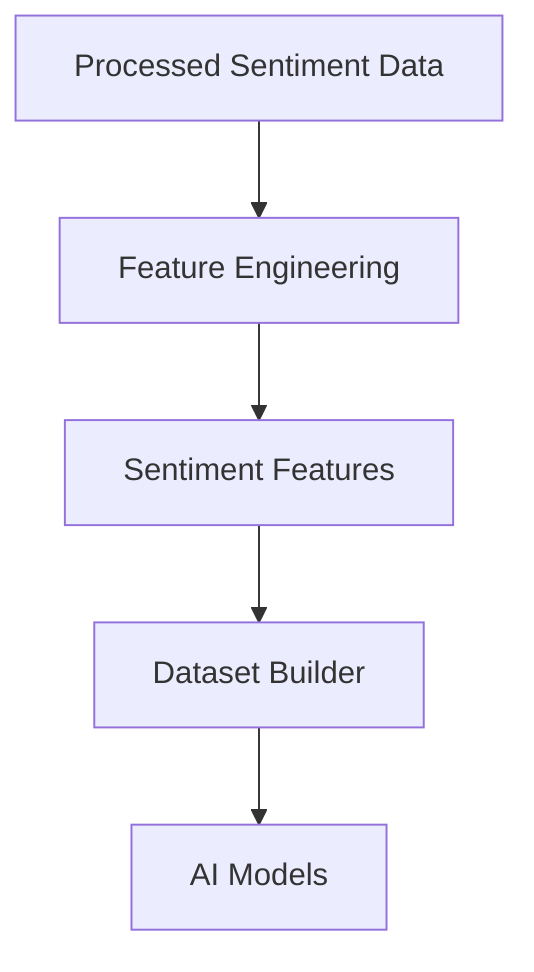
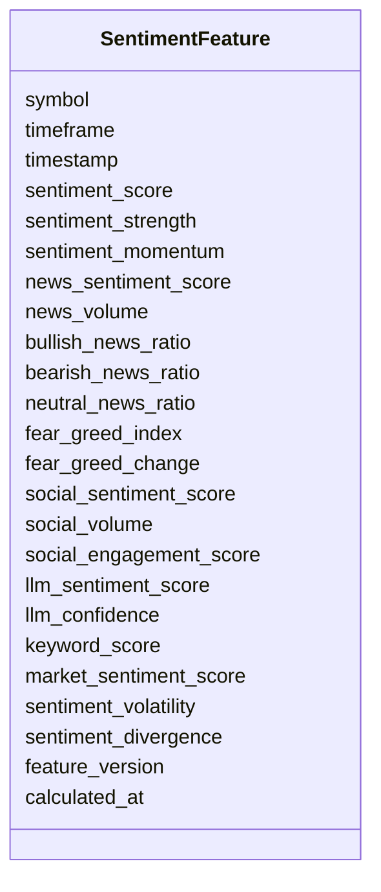

# Sentiment Features Schema

## Overview

The **Sentiment Features Schema** defines standardized machine learning features engineered from processed sentiment data.

These features summarize market psychology by combining information from multiple sources, including news, Fear & Greed Index, social media, and NLP/LLM analysis.

Unlike raw sentiment datasets, these features are optimized for AI models and quantitative trading strategies.

Primary objectives:

- AI model training
- Trend prediction
- Market regime detection
- Volatility prediction
- Risk management
- Strategy selection
- Trade filtering

This schema stores **engineered features only**.

---

# Pipeline Position



---

# Feature Categories

```mermaid
mindmap

root((Sentiment Features))

    Overall Sentiment

    News Sentiment

    Fear & Greed

    Social Media

    NLP / LLM

    Composite Scores
```

---

# Schema Structure



---

# Field Definitions

## Asset Information

| Field | Description |
|--------|-------------|
| symbol | Trading symbol |
| timeframe | Candle timeframe |
| timestamp | Feature timestamp |

---

## Overall Sentiment

| Field | Description |
|--------|-------------|
| sentiment_score | Overall normalized sentiment score |
| sentiment_strength | Magnitude of sentiment |
| sentiment_momentum | Rate of sentiment change |

These features summarize the market's current emotional state.

---

## News Features

| Field | Description |
|--------|-------------|
| news_sentiment_score | Aggregate sentiment from news articles |
| news_volume | Number of relevant news items |
| bullish_news_ratio | Percentage of bullish news |
| bearish_news_ratio | Percentage of bearish news |
| neutral_news_ratio | Percentage of neutral news |

Useful for identifying news-driven market moves.

---

## Fear & Greed Features

| Field | Description |
|--------|-------------|
| fear_greed_index | Current Fear & Greed Index |
| fear_greed_change | Change from previous value |

Measures market psychology from extreme fear to extreme greed.

---

## Social Media Features

| Field | Description |
|--------|-------------|
| social_sentiment_score | Aggregate social sentiment |
| social_volume | Number of social mentions |
| social_engagement_score | Engagement-weighted sentiment |

Captures retail investor behavior across social platforms.

---

## LLM / NLP Features

| Field | Description |
|--------|-------------|
| llm_sentiment_score | LLM-derived sentiment score |
| llm_confidence | Confidence of LLM prediction |
| keyword_score | Score based on extracted financial keywords |

Generated using NLP pipelines and LLM analysis.

---

## Composite Features

| Field | Description |
|--------|-------------|
| market_sentiment_score | Combined market sentiment score |
| sentiment_volatility | Variability of sentiment over time |
| sentiment_divergence | Difference between sentiment sources |

These combine multiple sentiment inputs into AI-friendly numerical features.

---

## Metadata

| Field | Description |
|--------|-------------|
| feature_version | Feature calculation version |
| calculated_at | Feature generation timestamp |

---

# Feature Engineering Flow

```mermaid
flowchart LR

News

-->

News Features

Fear & Greed

-->

Fear Features

Social Media

-->

Social Features

LLM / NLP

-->

LLM Features

News Features

-->

Composite Scores

Fear Features

-->

Composite Scores

Social Features

-->

Composite Scores

LLM Features

-->

Composite Scores

Composite Scores

-->

Sentiment Features
```

---

# Example Record

```json
{
  "symbol": "ETHUSDT",
  "timeframe": "1h",

  "timestamp": "2026-08-05T12:00:00Z",

  "sentiment_score": 0.71,
  "sentiment_strength": 0.83,
  "sentiment_momentum": 0.12,

  "news_sentiment_score": 0.74,
  "news_volume": 38,

  "bullish_news_ratio": 0.66,
  "bearish_news_ratio": 0.18,
  "neutral_news_ratio": 0.16,

  "fear_greed_index": 72,
  "fear_greed_change": 4,

  "social_sentiment_score": 0.69,
  "social_volume": 1543,
  "social_engagement_score": 0.77,

  "llm_sentiment_score": 0.81,
  "llm_confidence": 0.93,
  "keyword_score": 0.74,

  "market_sentiment_score": 0.75,
  "sentiment_volatility": 0.18,
  "sentiment_divergence": 0.09,

  "feature_version": "1.0",

  "calculated_at": "2026-08-05T12:00:12Z"
}
```

---

# Downstream Usage

```mermaid
mindmap

root((Sentiment Features))

    AI Models

    Trend Prediction

    Volatility Prediction

    Market Regime Detection

    Strategy Engine

    Risk Engine

    Trade Filtering

    Backtesting
```

---

# Relationship with Other Schemas

```mermaid
flowchart TD

Processed Sentiment

-->

Sentiment Features

Price Features

-->

Merged Feature Dataset

Volume Features

-->

Merged Feature Dataset

Derivative Features

-->

Merged Feature Dataset

Order Book Features

-->

Merged Feature Dataset

Sentiment Features

-->

Merged Feature Dataset

Merged Feature Dataset

-->

AI Models
```

---

# Storage Flow

```mermaid
flowchart TD

Processed Sentiment

-->

Feature Engineering

-->

Sentiment Features

-->

Feature Store

-->

Training Dataset

-->

Model Repository
```

---

# Design Principles

```mermaid
mindmap

root((Sentiment Features))

    Deterministic

    AI Ready

    Time-Series Ready

    Multi-Source

    Lightweight

    Modular

    Reproducible

    Extensible
```

---

# Future Enhancements

Future engineered sentiment features may include:

- Cross-source sentiment agreement score
- News impact score
- Breaking news urgency score
- Entity-level sentiment (ETH, BTC, Fed, ETF, etc.)
- Topic modeling features
- Event detection score
- Influencer sentiment score
- Reddit sentiment score
- Telegram sentiment score
- Sentiment shock index
- Narrative momentum score
- Market attention score

---

# Summary

The **Sentiment Features Schema** stores engineered machine learning features derived from processed news, Fear & Greed, social media, and NLP/LLM analysis.

These features quantify market psychology, investor behavior, and information flow into standardized numerical values that support AI model training, market regime detection, strategy generation, risk management, trade filtering, backtesting, paper trading, and live trading across the ETH Bot pipeline.

```mermaid
flowchart TD

Processed Sentiment

-->

Feature Engineering

-->

Sentiment Features

-->

Dataset Builder

-->

AI Models

-->

Strategy Engine

-->

Risk Engine

-->

Execution Engine
```