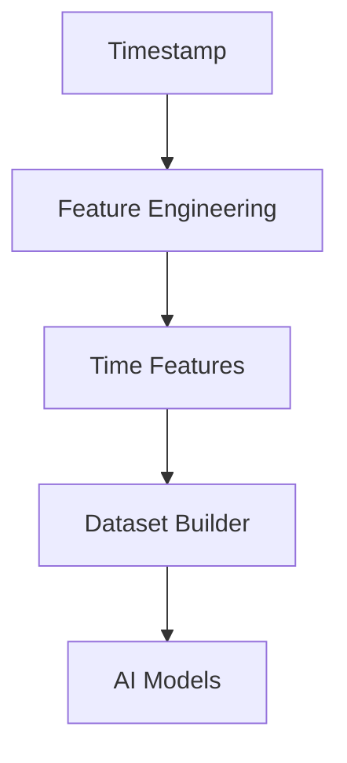
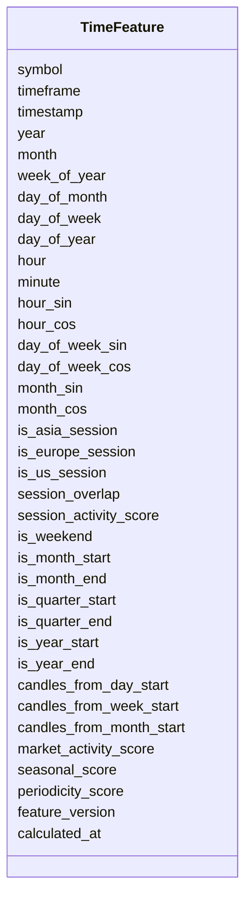

# Time Features Schema

## Overview

The **Time Features Schema** defines standardized machine learning features engineered from timestamps.

Although the cryptocurrency market trades **24 hours a day, 7 days a week**, market behavior still changes depending on the hour, trading session, weekday, month, and seasonal effects.

These engineered features allow AI models to learn recurring temporal patterns without relying on raw timestamps.

Primary objectives:

- AI model training
- Market seasonality detection
- Trading session analysis
- Volatility prediction
- Liquidity prediction
- Strategy selection
- Market regime detection

This schema stores **engineered features only**.

---

# Pipeline Position



---

# Feature Categories

```mermaid
mindmap

root((Time Features))

    Calendar

    Cyclical Encoding

    Trading Sessions

    Weekend

    Month Effects

    Quarter Effects

    Seasonality

    Activity Scores
```

---

# Schema Structure



---

# Field Definitions

## Asset Information

| Field | Description |
|--------|-------------|
| symbol | Trading symbol |
| timeframe | Candle timeframe |
| timestamp | Feature timestamp |

---

## Calendar Features

| Field | Description |
|--------|-------------|
| year | Calendar year |
| month | Month number |
| week_of_year | ISO week number |
| day_of_month | Day within month |
| day_of_week | Day of week (0–6) |
| day_of_year | Day within year |
| hour | Hour of day |
| minute | Minute of hour |

These provide the basic temporal context.

---

## Cyclical Encoding

| Field | Description |
|--------|-------------|
| hour_sin | Sine encoding of hour |
| hour_cos | Cosine encoding of hour |
| day_of_week_sin | Sine encoding of weekday |
| day_of_week_cos | Cosine encoding of weekday |
| month_sin | Sine encoding of month |
| month_cos | Cosine encoding of month |

Cyclical encoding preserves the circular nature of time and is preferred over raw integer values for machine learning models.

---

## Trading Session Features

| Field | Description |
|--------|-------------|
| is_asia_session | Asian trading session |
| is_europe_session | European trading session |
| is_us_session | US trading session |
| session_overlap | Europe–US session overlap |
| session_activity_score | Relative activity score |

Different trading sessions exhibit different liquidity and volatility characteristics.

---

## Calendar Effect Features

| Field | Description |
|--------|-------------|
| is_weekend | Weekend indicator |
| is_month_start | Beginning of month |
| is_month_end | End of month |
| is_quarter_start | Beginning of quarter |
| is_quarter_end | End of quarter |
| is_year_start | Beginning of year |
| is_year_end | End of year |

These capture recurring calendar effects.

---

## Rolling Time Features

| Field | Description |
|--------|-------------|
| candles_from_day_start | Candles elapsed since start of day |
| candles_from_week_start | Candles elapsed since start of week |
| candles_from_month_start | Candles elapsed since start of month |

Useful for identifying intraday and intraweek patterns.

---

## Composite Features

| Field | Description |
|--------|-------------|
| market_activity_score | Estimated market activity level |
| seasonal_score | Seasonal market behavior score |
| periodicity_score | Strength of repeating temporal patterns |

These combine multiple temporal characteristics into AI-ready numerical features.

---

## Metadata

| Field | Description |
|--------|-------------|
| feature_version | Feature calculation version |
| calculated_at | Feature generation timestamp |

---

# Feature Engineering Flow

```mermaid
flowchart LR

Timestamp

-->

Calendar Features

-->

Session Features

-->

Cyclical Encoding

-->

Composite Scores

-->

Time Features
```

---

# Example Record

```json
{
  "symbol": "ETHUSDT",
  "timeframe": "1h",

  "timestamp": "2026-08-05T12:00:00Z",

  "year": 2026,
  "month": 8,
  "week_of_year": 32,
  "day_of_month": 5,
  "day_of_week": 3,
  "day_of_year": 217,

  "hour": 12,
  "minute": 0,

  "hour_sin": 0.0,
  "hour_cos": -1.0,

  "day_of_week_sin": 0.434,
  "day_of_week_cos": -0.901,

  "month_sin": -0.866,
  "month_cos": -0.500,

  "is_asia_session": false,
  "is_europe_session": true,
  "is_us_session": false,
  "session_overlap": false,

  "session_activity_score": 0.74,

  "is_weekend": false,
  "is_month_start": false,
  "is_month_end": false,

  "is_quarter_start": false,
  "is_quarter_end": false,

  "is_year_start": false,
  "is_year_end": false,

  "candles_from_day_start": 12,
  "candles_from_week_start": 84,
  "candles_from_month_start": 108,

  "market_activity_score": 0.72,
  "seasonal_score": 0.66,
  "periodicity_score": 0.81,

  "feature_version": "1.0",

  "calculated_at": "2026-08-05T12:00:05Z"
}
```

---

# Downstream Usage

```mermaid
mindmap

root((Time Features))

    AI Models

    Trend Prediction

    Volatility Prediction

    Market Regime Detection

    Strategy Engine

    Risk Engine

    Position Sizing

    Backtesting
```

---

# Relationship with Other Schemas

```mermaid
flowchart TD

Timestamp

-->

Time Features

Price Features

-->

Merged Feature Dataset

Volume Features

-->

Merged Feature Dataset

Derivative Features

-->

Merged Feature Dataset

Order Book Features

-->

Merged Feature Dataset

Sentiment Features

-->

Merged Feature Dataset

On-Chain Features

-->

Merged Feature Dataset

Time Features

-->

Merged Feature Dataset

Merged Feature Dataset

-->

AI Models
```

---

# Storage Flow

```mermaid
flowchart TD

Timestamp

-->

Feature Engineering

-->

Time Features

-->

Feature Store

-->

Training Dataset

-->

Model Repository
```

---

# Design Principles

```mermaid
mindmap

root((Time Features))

    Deterministic

    AI Ready

    Time-Series Native

    Cyclical Encoding

    Lightweight

    Modular

    Reproducible

    Exchange Independent
```

---

# Future Enhancements

Future engineered temporal features may include:

- Holiday calendar indicators
- Major economic event proximity
- Options expiry countdown
- Futures funding interval countdown
- Time since previous volatility spike
- Time since last liquidation cascade
- Time since major news event
- Time-to-daily close
- Time-to-weekly close
- Seasonal decomposition features
- Fourier time features
- Wavelet-based periodicity features

---

# Summary

The **Time Features Schema** stores engineered machine learning features derived from timestamps and calendar information.

These features capture cyclical behavior, trading sessions, calendar effects, seasonality, and market activity patterns, providing AI-ready temporal context for trend prediction, volatility forecasting, market regime detection, strategy generation, risk management, backtesting, paper trading, and live trading throughout the ETH Bot pipeline.

```mermaid
flowchart TD

Timestamp

-->

Feature Engineering

-->

Time Features

-->

Dataset Builder

-->

AI Models

-->

Strategy Engine

-->

Risk Engine

-->

Execution Engine
```