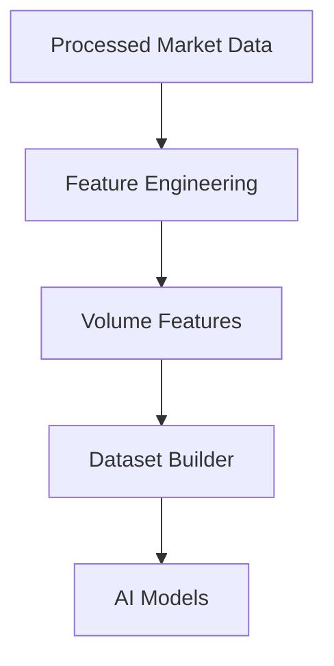
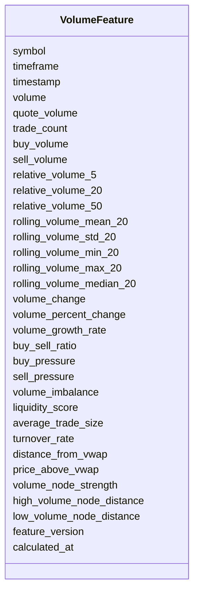

# Volume Features Schema

## Overview

The **Volume Features Schema** defines standardized engineered features derived from processed market data and volume-related indicators.

Unlike traditional technical indicators, volume features are **machine learning features** created by transforming raw trading activity into meaningful numerical representations.

These features help AI models understand:

- Market participation
- Liquidity
- Buying and selling pressure
- Volume anomalies
- Institutional activity
- Market efficiency

This schema stores **engineered feature values only**.

---

# Pipeline Position



---

# Feature Categories

```mermaid
mindmap

root((Volume Features))

    Raw Volume

    Relative Volume

    Volume Statistics

    Volume Change

    Buying Pressure

    Liquidity

    VWAP Features

    Volume Profile
```

---

# Schema Structure



---

# Field Definitions

## Asset Information

| Field | Description |
|--------|-------------|
| symbol | Trading symbol |
| timeframe | Candle timeframe |
| timestamp | Candle timestamp |

---

## Raw Volume Features

| Field | Description |
|--------|-------------|
| volume | Trading volume |
| quote_volume | Quote asset volume |
| trade_count | Number of executed trades |
| buy_volume | Buy-side volume |
| sell_volume | Sell-side volume |

---

## Relative Volume

| Field | Description |
|--------|-------------|
| relative_volume_5 | Relative volume over 5 periods |
| relative_volume_20 | Relative volume over 20 periods |
| relative_volume_50 | Relative volume over 50 periods |

Relative volume compares current activity with historical averages.

---

## Volume Statistics

| Field | Description |
|--------|-------------|
| rolling_volume_mean_20 | 20-period rolling average volume |
| rolling_volume_std_20 | Rolling standard deviation |
| rolling_volume_min_20 | Rolling minimum volume |
| rolling_volume_max_20 | Rolling maximum volume |
| rolling_volume_median_20 | Rolling median volume |

---

## Volume Change

| Field | Description |
|--------|-------------|
| volume_change | Absolute change in volume |
| volume_percent_change | Percentage volume change |
| volume_growth_rate | Rate of volume growth |

---

## Buying / Selling Pressure

| Field | Description |
|--------|-------------|
| buy_sell_ratio | Buy volume divided by sell volume |
| buy_pressure | Buying pressure score |
| sell_pressure | Selling pressure score |
| volume_imbalance | Buy vs sell imbalance |

These features estimate market participation by buyers and sellers.

---

## Liquidity Features

| Field | Description |
|--------|-------------|
| liquidity_score | Estimated market liquidity |
| average_trade_size | Average size of executed trades |
| turnover_rate | Trading turnover |

Useful for execution quality and slippage estimation.

---

## VWAP Features

| Field | Description |
|--------|-------------|
| distance_from_vwap | Distance between market price and VWAP |
| price_above_vwap | Whether current price is above VWAP |

Often used by institutional traders to evaluate execution quality and trend direction.

---

## Volume Profile Features

| Field | Description |
|--------|-------------|
| volume_node_strength | Strength of nearby volume node |
| high_volume_node_distance | Distance to nearest High Volume Node (HVN) |
| low_volume_node_distance | Distance to nearest Low Volume Node (LVN) |

These features summarize volume concentration across price levels.

---

## Metadata

| Field | Description |
|--------|-------------|
| feature_version | Feature calculation version |
| calculated_at | Feature generation timestamp |

---

# Feature Engineering Flow

```mermaid
flowchart LR

Processed Trades

-->

Volume Statistics

-->

Liquidity Features

-->

Buying Pressure

-->

VWAP Features

-->

Volume Features
```

---

# Example Record

```json
{
  "symbol": "ETHUSDT",
  "timeframe": "1h",

  "timestamp": "2026-08-05T12:00:00Z",

  "volume": 15281.44,
  "quote_volume": 55783291.12,
  "trade_count": 8421,

  "buy_volume": 8212.53,
  "sell_volume": 7068.91,

  "relative_volume_20": 1.38,

  "rolling_volume_mean_20": 11854.22,
  "rolling_volume_std_20": 2487.18,

  "volume_change": 1832.52,
  "volume_percent_change": 13.62,

  "buy_sell_ratio": 1.16,
  "buy_pressure": 0.61,
  "sell_pressure": 0.39,
  "volume_imbalance": 0.22,

  "liquidity_score": 0.88,
  "average_trade_size": 1.81,

  "turnover_rate": 0.14,

  "distance_from_vwap": 12.83,
  "price_above_vwap": true,

  "volume_node_strength": 0.84,
  "high_volume_node_distance": 8.41,
  "low_volume_node_distance": 27.54,

  "feature_version": "1.0",

  "calculated_at": "2026-08-05T12:00:12Z"
}
```

---

# Downstream Usage

```mermaid
mindmap

root((Volume Features))

    Feature Selection

    Liquidity Analysis

    AI Models

    Strategy Engine

    Risk Engine

    Position Sizing

    Backtesting

    Live Trading
```

---

# Relationship with Other Schemas

```mermaid
flowchart TD

Processed Market Data

-->

Volume Features

Volume Indicators

-->

Volume Features

Volume Features

-->

Merged Feature Dataset

Merged Feature Dataset

-->

AI Models
```

---

# Storage Flow

```mermaid
flowchart TD

Processed Market Data

-->

Feature Engineering

-->

Volume Features

-->

Feature Store

-->

Training Dataset

-->

Model Repository
```

---

# Design Principles

```mermaid
mindmap

root((Volume Features))

    Deterministic

    AI Ready

    Time-Series Ready

    Lightweight

    Modular

    Reproducible

    Extensible

    Exchange Independent
```

---

# Future Enhancements

Future engineered volume features may include:

- Cumulative Volume Delta (CVD)
- Delta Volume
- Bid/Ask Imbalance
- Order Flow Imbalance
- Iceberg Order Detection
- Absorption Score
- Volume Spike Score
- Liquidity Heatmap Features
- Market Impact Estimate
- Smart Money Activity Score

---

# Summary

The **Volume Features Schema** stores engineered volume-based features derived from processed trading activity and volume indicators.

These features describe liquidity, participation, buying and selling pressure, VWAP relationships, and volume distribution, providing high-quality numerical inputs for feature engineering, AI model training, strategy generation, risk management, backtesting, paper trading, and live trading throughout the ETH Bot pipeline.

```mermaid
flowchart TD

Processed Market Data

-->

Feature Engineering

-->

Volume Features

-->

Dataset Builder

-->

AI Models

-->

Strategy Engine

-->

Risk Engine

-->

Execution Engine
```