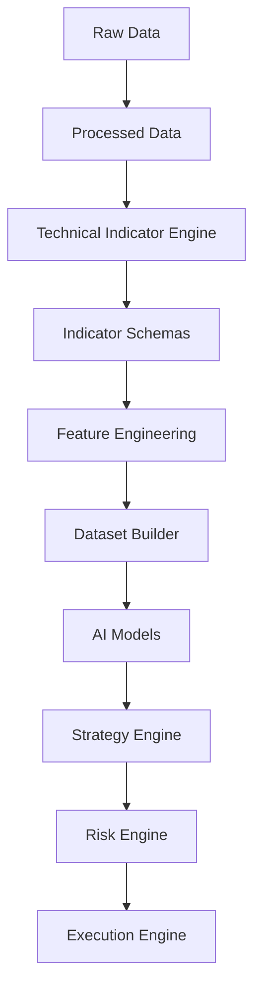

# Technical Indicators Schema

## Overview

The **Technical Indicators Schema** defines the standardized data structures for all technical indicators used throughout the ETH Bot trading system.

These schemas represent the output of the **Technical Indicator Engine**, which transforms processed market data into standardized indicator datasets for downstream AI and trading components.

The schemas **do not calculate indicators**. They only define how calculated indicator values are stored.

---

# Directory Structure

```text
indicators/
│
├── README.md
│
├── trend.py
├── trend.md
│
├── momentum.py
├── momentum.md
│
├── volatility.py
├── volatility.md
│
├── volume.py
├── volume.md
│
├── custom.py
└── custom.md
```

---

# Pipeline Position



---

# Available Schemas

## Trend Indicators

**File**

```
trend.py
```

Contains long-term trend-related indicators.

Examples:

- SMA
- EMA
- MACD
- ADX
- DMI
- Ichimoku Cloud
- Parabolic SAR

Purpose

- Trend detection
- Trend strength
- Trend confirmation

---

## Momentum Indicators

**File**

```
momentum.py
```

Measures the speed and acceleration of price movement.

Examples

- RSI
- Stochastic RSI
- ROC
- CCI
- Momentum
- PPO
- TSI
- Williams %R

Purpose

- Reversal detection
- Momentum confirmation
- Entry timing

---

## Volatility Indicators

**File**

```
volatility.py
```

Measures market volatility.

Examples

- ATR
- Bollinger Bands
- Keltner Channels
- Donchian Channels
- Historical Volatility
- Chaikin Volatility

Purpose

- Stop-loss sizing
- Breakout detection
- Position sizing

---

## Volume Indicators

**File**

```
volume.py
```

Measures market participation and liquidity.

Examples

- VWAP
- OBV
- CMF
- MFI
- ADL
- Volume Oscillator
- Force Index

Purpose

- Trend confirmation
- Liquidity analysis
- Institutional activity

---

## Custom Indicators

**File**

```
custom.py
```

Contains proprietary indicators created specifically for the ETH Bot.

Examples

- Trend Score
- Momentum Score
- Volatility Score
- Liquidity Score
- Market Regime
- Trade Quality Score
- Long Probability
- Short Probability
- Hold Probability

Purpose

- AI features
- Trade filtering
- Risk scoring
- Decision support

---

# Data Flow

```mermaid
flowchart LR

Processed Market Data

-->

Trend Indicators

Processed Market Data

-->

Momentum Indicators

Processed Market Data

-->

Volatility Indicators

Processed Market Data

-->

Volume Indicators

Trend Indicators

-->

Custom Indicators

Momentum Indicators

-->

Custom Indicators

Volatility Indicators

-->

Custom Indicators

Volume Indicators

-->

Custom Indicators

Custom Indicators

-->

Feature Engineering

Feature Engineering

-->

Dataset Builder

Dataset Builder

-->

AI Models
```

---

# Indicator Categories

```mermaid
mindmap

root((Technical Indicators))

    Trend

        SMA

        EMA

        MACD

        ADX

        Ichimoku

    Momentum

        RSI

        ROC

        PPO

        TSI

    Volatility

        ATR

        Bollinger Bands

        Donchian

        Historical Volatility

    Volume

        VWAP

        OBV

        CMF

        MFI

    Custom

        Trend Score

        Market Regime

        Risk Score

        Trade Quality

        AI Signals
```

---

# Downstream Consumers

The indicator schemas are consumed by:

- Feature Engineering
- Dataset Builder
- AI Models
- Strategy Engine
- Risk Engine
- Backtesting Engine
- Paper Trading Engine
- Live Trading Engine
- Monitoring Engine

---

# Design Principles

```mermaid
mindmap

root((Indicator Schemas))

    Deterministic

    Modular

    Exchange Independent

    AI Ready

    Time-Series Ready

    Extensible

    Version Controlled

    Strongly Typed

    Reproducible
```

---

# Future Expansion

Additional indicator modules can be added without changing the existing structure.

Examples:

```text
market_structure.py

pattern.py

cycle.py

orderflow.py

microstructure.py

statistics.py

seasonality.py
```

Each module should include:

```
module.py

module.md
```

---

# Storage Flow

```mermaid
flowchart TD

Processed Data

-->

Technical Indicator Engine

-->

Indicator Schemas

-->

Feature Store

-->

Training Dataset

-->

Model Repository

-->

AI Models
```

---

# Summary

The **Technical Indicators Schema** provides a modular, standardized, and extensible framework for storing calculated technical indicators.

By separating **trend**, **momentum**, **volatility**, **volume**, and **custom** indicators into dedicated schemas, the ETH Bot maintains a clean architecture that supports feature engineering, AI model development, strategy generation, risk management, and automated execution while remaining easy to extend as new indicators are introduced.