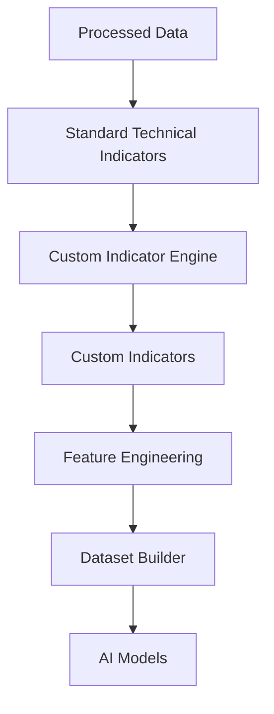
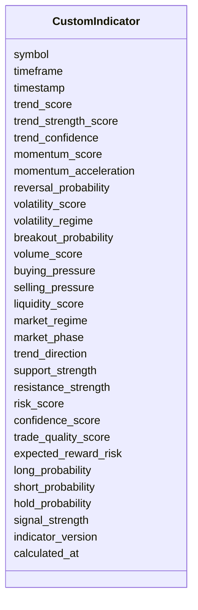

# Custom Technical Indicators Schema

## Overview

The **Custom Technical Indicators Schema** defines the structure for proprietary indicators developed specifically for the ETH Bot trading system.

Unlike traditional technical indicators (RSI, MACD, ATR, Bollinger Bands, etc.), custom indicators are derived by combining multiple market, derivatives, sentiment, on-chain, and technical signals into higher-level features.

These indicators are designed to improve AI model performance, trading decisions, risk management, and execution quality.

This schema stores **calculated custom indicator values only**. Indicator calculations are performed by the **Technical Indicator Engine**.

---

# Pipeline Position



---

# Data Sources

```mermaid
mindmap

root((Custom Indicators))

    Market Data

    Derivatives

    On-Chain

    Sentiment

    Trend Indicators

    Momentum Indicators

    Volatility Indicators

    Volume Indicators
```

---

# Schema Structure



---

# Field Definitions

## Asset Information

| Field | Description |
|--------|-------------|
| symbol | Trading symbol |
| timeframe | Candle timeframe |
| timestamp | Candle timestamp |

---

## Trend Scores

| Field | Description |
|--------|-------------|
| trend_score | Composite trend score |
| trend_strength_score | Overall trend strength |
| trend_confidence | Confidence in trend prediction |

These combine multiple trend indicators into a single quantitative score.

---

## Momentum Scores

| Field | Description |
|--------|-------------|
| momentum_score | Overall momentum score |
| momentum_acceleration | Change in momentum |
| reversal_probability | Estimated reversal probability |

Used to evaluate the quality of momentum-based signals.

---

## Volatility Scores

| Field | Description |
|--------|-------------|
| volatility_score | Composite volatility score |
| volatility_regime | Current volatility regime |
| breakout_probability | Probability of a breakout |

Supports volatility forecasting and breakout strategies.

---

## Volume Scores

| Field | Description |
|--------|-------------|
| volume_score | Composite volume score |
| buying_pressure | Estimated buying pressure |
| selling_pressure | Estimated selling pressure |
| liquidity_score | Overall market liquidity |

Represents market participation and liquidity conditions.

---

## Market Structure

| Field | Description |
|--------|-------------|
| market_regime | Trending, ranging, or volatile market |
| market_phase | Accumulation, markup, distribution, markdown |
| trend_direction | Bullish, bearish, or sideways |
| support_strength | Confidence in nearby support |
| resistance_strength | Confidence in nearby resistance |

These features summarize the current market environment.

---

## Risk Metrics

| Field | Description |
|--------|-------------|
| risk_score | Estimated trade risk |
| confidence_score | Confidence in overall signal |
| trade_quality_score | Overall trade quality |
| expected_reward_risk | Expected reward-to-risk ratio |

Used primarily by the Risk Engine.

---

## AI Signals

| Field | Description |
|--------|-------------|
| long_probability | Probability of long setup |
| short_probability | Probability of short setup |
| hold_probability | Probability of taking no trade |
| signal_strength | Overall AI signal strength |

These values are typically generated after combining multiple indicators and ML outputs.

---

## Metadata

| Field | Description |
|--------|-------------|
| indicator_version | Indicator calculation version |
| calculated_at | Indicator generation timestamp |

---

# Indicator Generation Flow

```mermaid
flowchart LR

Processed Data

-->

Technical Indicators

-->

Custom Indicator Engine

-->

Composite Scores

-->

Custom Indicator Schema
```

---

# Example Record

```json
{
  "symbol": "ETHUSDT",
  "timeframe": "1h",
  "timestamp": "2026-08-05T12:00:00Z",

  "trend_score": 0.86,
  "trend_strength_score": 0.79,
  "trend_confidence": 0.91,

  "momentum_score": 0.74,
  "momentum_acceleration": 0.31,
  "reversal_probability": 0.12,

  "volatility_score": 0.63,
  "volatility_regime": "Moderate",
  "breakout_probability": 0.27,

  "volume_score": 0.81,
  "buying_pressure": 0.72,
  "selling_pressure": 0.28,
  "liquidity_score": 0.93,

  "market_regime": "Trending",
  "market_phase": "Markup",
  "trend_direction": "Bullish",
  "support_strength": 0.84,
  "resistance_strength": 0.38,

  "risk_score": 0.22,
  "confidence_score": 0.91,
  "trade_quality_score": 0.88,
  "expected_reward_risk": 2.8,

  "long_probability": 0.87,
  "short_probability": 0.09,
  "hold_probability": 0.04,
  "signal_strength": 0.90,

  "indicator_version": "1.0",
  "calculated_at": "2026-08-05T12:00:08Z"
}
```

---

# Trading Decision Flow

```mermaid
flowchart TD

Technical Indicators

-->

Custom Indicator Engine

-->

Composite Scores

-->

AI Models

-->

Strategy Engine

-->

Risk Engine

-->

Execution Engine
```

---

# Downstream Usage

```mermaid
mindmap

root((Custom Indicators))

    Feature Engineering

    AI Models

    Strategy Engine

    Risk Engine

    Position Sizing

    Signal Filtering

    Backtesting

    Paper Trading

    Live Trading
```

---

# Relationship with Other Schemas

```mermaid
flowchart TD

Trend Indicators

-->

Custom Indicators

Momentum Indicators

-->

Custom Indicators

Volatility Indicators

-->

Custom Indicators

Volume Indicators

-->

Custom Indicators

Processed Sentiment

-->

Custom Indicators

Processed On-Chain

-->

Custom Indicators

Custom Indicators

-->

Feature Engineering

-->

Dataset Builder

-->

AI Models
```

---

# Storage Flow

```mermaid
flowchart TD

Processed Data

-->

Indicator Engine

-->

Custom Indicators

-->

Feature Store

-->

Training Dataset

-->

Model Repository
```

---

# Design Principles

```mermaid
mindmap

root((Custom Indicators))

    Proprietary

    AI Focused

    Modular

    Deterministic

    Explainable

    Extensible

    Version Controlled

    Exchange Independent
```

---

# Future Enhancements

Potential future additions include:

- Multi-timeframe trend score
- Cross-exchange confidence score
- Whale activity score
- Funding pressure score
- Liquidation pressure score
- Smart money score
- Order flow imbalance score
- Market stress index
- Liquidity risk score
- AI ensemble confidence score

---

# Summary

The **Custom Technical Indicators Schema** stores proprietary, high-level indicators generated by combining standard technical indicators with processed market, derivatives, sentiment, and on-chain data.

These indicators act as intelligent features for AI models and support trade filtering, market regime detection, position sizing, risk assessment, and execution decisions throughout the ETH Bot trading pipeline.

```mermaid
flowchart TD

Processed Data

-->

Technical Indicators

-->

Custom Indicators

-->

Feature Engineering

-->

Dataset Builder

-->

AI Models

-->

Strategy Engine

-->

Risk Engine

-->

Execution Engine
```