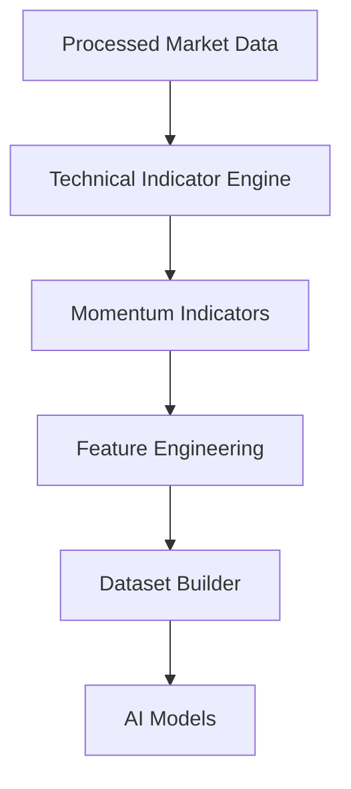
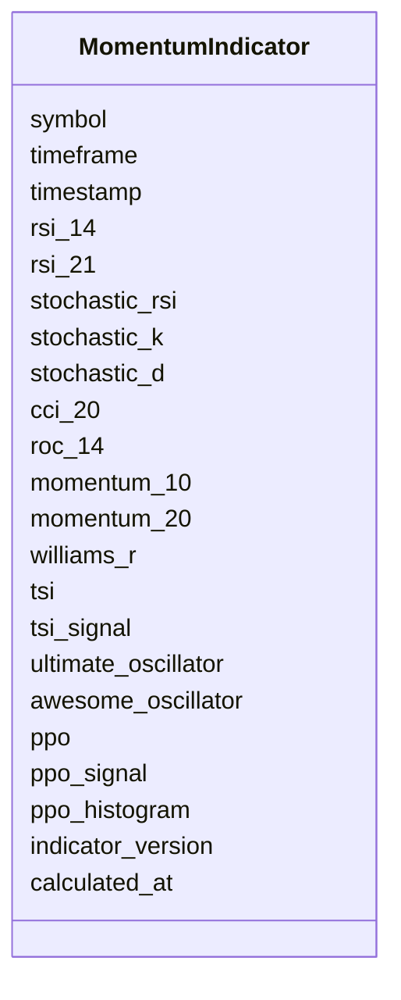

# Momentum Technical Indicators Schema

## Overview

The **Momentum Technical Indicators Schema** defines the standardized structure for momentum-related technical indicators calculated from processed market data.

Momentum indicators measure the **speed**, **strength**, and **acceleration** of price movements. They help identify:

- Overbought conditions
- Oversold conditions
- Bullish momentum
- Bearish momentum
- Trend continuation
- Trend exhaustion
- Potential reversals

This schema stores **calculated indicator values only**. It does **not** perform indicator calculations.

---

# Pipeline Position



---

# Momentum Indicators

```mermaid
mindmap

root((Momentum Indicators))

    RSI

    Stochastic RSI

    CCI

    ROC

    Momentum

    Williams %R

    TSI

    Ultimate Oscillator

    Awesome Oscillator

    PPO
```

---

# Schema Structure



---

# Field Definitions

## Asset Information

| Field | Description |
|--------|-------------|
| symbol | Trading symbol |
| timeframe | Candle timeframe |
| timestamp | Candle timestamp |

---

## Relative Strength Index (RSI)

| Field | Description |
|--------|-------------|
| rsi_14 | 14-period RSI |
| rsi_21 | 21-period RSI |

Typical interpretation:

| RSI | Market Condition |
|-----|------------------|
| >70 | Overbought |
| 30-70 | Neutral |
| <30 | Oversold |

---

## Stochastic RSI

| Field | Description |
|--------|-------------|
| stochastic_rsi | Stochastic RSI |
| stochastic_k | %K Line |
| stochastic_d | %D Line |

Used to detect momentum shifts and short-term reversals.

---

## Commodity Channel Index (CCI)

| Field | Description |
|--------|-------------|
| cci_20 | 20-period Commodity Channel Index |

Typical interpretation:

| CCI | Market Condition |
|------|------------------|
| >100 | Strong bullish momentum |
| <-100 | Strong bearish momentum |

---

## Rate of Change (ROC)

| Field | Description |
|--------|-------------|
| roc_14 | 14-period Rate of Change |

Measures percentage price change over a specified period.

---

## Momentum

| Field | Description |
|--------|-------------|
| momentum_10 | 10-period Momentum |
| momentum_20 | 20-period Momentum |

Positive values indicate bullish momentum, while negative values indicate bearish momentum.

---

## Williams %R

| Field | Description |
|--------|-------------|
| williams_r | Williams Percent Range |

Typical interpretation:

| Value | Condition |
|--------|-----------|
| >-20 | Overbought |
| <-80 | Oversold |

---

## True Strength Index (TSI)

| Field | Description |
|--------|-------------|
| tsi | True Strength Index |
| tsi_signal | Signal Line |

Used to identify momentum direction and signal crossovers.

---

## Ultimate Oscillator

| Field | Description |
|--------|-------------|
| ultimate_oscillator | Ultimate Oscillator |

Combines multiple timeframes to reduce false signals.

---

## Awesome Oscillator

| Field | Description |
|--------|-------------|
| awesome_oscillator | Awesome Oscillator |

Measures market momentum using moving averages.

---

## Percentage Price Oscillator (PPO)

| Field | Description |
|--------|-------------|
| ppo | PPO Line |
| ppo_signal | Signal Line |
| ppo_histogram | PPO Histogram |

Percentage-based alternative to MACD.

---

## Metadata

| Field | Description |
|--------|-------------|
| indicator_version | Indicator calculation version |
| calculated_at | Indicator generation timestamp |

---

# Indicator Calculation Flow

```mermaid
flowchart LR

Processed OHLCV

-->

Indicator Engine

-->

RSI

-->

Stochastic RSI

-->

CCI

-->

ROC

-->

Momentum

-->

Momentum Schema
```

---

# Example Record

```json
{
  "symbol": "ETHUSDT",
  "timeframe": "1h",
  "timestamp": "2026-08-05T12:00:00Z",

  "rsi_14": 64.28,
  "rsi_21": 60.41,

  "stochastic_rsi": 0.82,
  "stochastic_k": 81.4,
  "stochastic_d": 77.2,

  "cci_20": 116.4,

  "roc_14": 2.81,

  "momentum_10": 48.61,
  "momentum_20": 94.52,

  "williams_r": -17.42,

  "tsi": 23.81,
  "tsi_signal": 20.35,

  "ultimate_oscillator": 63.81,

  "awesome_oscillator": 14.52,

  "ppo": 2.31,
  "ppo_signal": 1.98,
  "ppo_histogram": 0.33,

  "indicator_version": "1.0",
  "calculated_at": "2026-08-05T12:00:03Z"
}
```

---

# Trading Interpretation

```mermaid
flowchart TD

RSI

-->

Overbought Oversold

Stochastic RSI

-->

Momentum Shift

CCI

-->

Trend Strength

ROC

-->

Price Acceleration

Momentum

-->

Price Velocity

TSI

-->

Signal Confirmation

PPO

-->

Momentum Trend
```

---

# Downstream Usage

```mermaid
mindmap

root((Momentum Indicators))

    Feature Engineering

    Reversal Detection

    Entry Signals

    Exit Signals

    AI Models

    Strategy Engine

    Risk Engine

    Backtesting
```

---

# Relationship with Other Schemas

```mermaid
flowchart TD

Processed Market Data

-->

Momentum Indicators

Momentum Indicators

-->

Feature Engineering

Feature Engineering

-->

Dataset Builder

Dataset Builder

-->

AI Models
```

---

# Storage Flow

```mermaid
flowchart TD

Processed Market Data

-->

Indicator Engine

-->

Momentum Indicators

-->

Feature Store

-->

Training Dataset

-->

Model Repository
```

---

# Design Principles

```mermaid
mindmap

root((Momentum Indicators))

    Deterministic

    Time-Series Ready

    AI Ready

    Modular

    Reproducible

    Extensible

    Version Controlled

    Exchange Independent
```

---

# Future Enhancements

Future momentum indicators may include:

- Relative Vigor Index (RVI)
- Connors RSI
- Chande Momentum Oscillator (CMO)
- DeMarker Indicator
- Fisher Transform
- Schaff Trend Cycle (STC)
- KST Oscillator
- Elder Ray Index
- Relative Momentum Index (RMI)
- Squeeze Momentum Indicator

---

# Summary

The **Momentum Technical Indicators Schema** stores standardized momentum-related indicators generated from processed market data.

These indicators quantify the strength, speed, and acceleration of price movements, providing essential inputs for feature engineering, AI model training, strategy generation, risk management, backtesting, paper trading, and live trading.

```mermaid
flowchart TD

Processed Market Data

-->

Technical Indicator Engine

-->

Momentum Indicators

-->

Feature Engineering

-->

Dataset Builder

-->

AI Models

-->

Strategy Engine

-->

Risk Engine

-->

Execution Engine
```