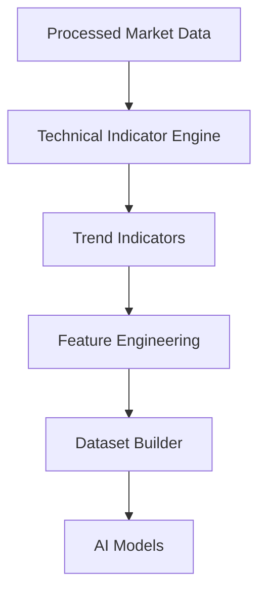
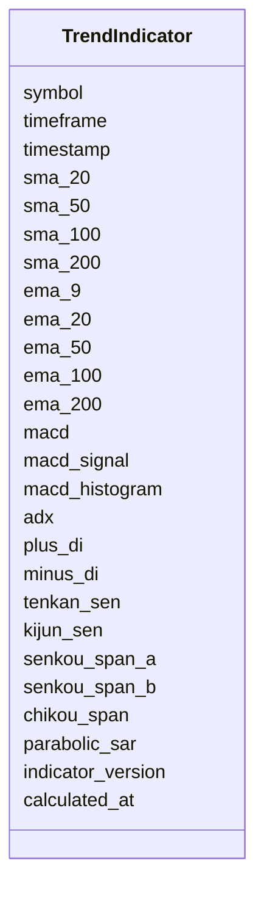

# Trend Technical Indicators Schema

## Overview

The **Trend Technical Indicators Schema** defines the standardized structure for trend-related technical indicators calculated from processed market data.

Trend indicators help identify:

- Market direction
- Trend strength
- Trend reversals
- Trend continuation
- Dynamic support and resistance
- Long-term market structure

This schema stores **calculated indicator values only**. It does **not** perform any calculations.

---

# Pipeline Position



---

# Trend Indicators

```mermaid
mindmap

root((Trend Indicators))

    Moving Averages

        SMA

        EMA

    MACD

    ADX

    DMI

    Ichimoku Cloud

    Parabolic SAR
```

---

# Schema Structure



---

# Field Definitions

## Asset Information

| Field | Description |
|--------|-------------|
| symbol | Trading symbol |
| timeframe | Candle timeframe |
| timestamp | Candle timestamp |

---

## Simple Moving Averages (SMA)

| Field | Description |
|--------|-------------|
| sma_20 | 20-period SMA |
| sma_50 | 50-period SMA |
| sma_100 | 100-period SMA |
| sma_200 | 200-period SMA |

Used for identifying medium- and long-term trends.

---

## Exponential Moving Averages (EMA)

| Field | Description |
|--------|-------------|
| ema_9 | 9-period EMA |
| ema_20 | 20-period EMA |
| ema_50 | 50-period EMA |
| ema_100 | 100-period EMA |
| ema_200 | 200-period EMA |

EMAs react faster to price changes than SMAs.

---

## MACD

| Field | Description |
|--------|-------------|
| macd | MACD line |
| macd_signal | Signal line |
| macd_histogram | Histogram |

Used to detect trend momentum and reversals.

---

## ADX & Directional Movement

| Field | Description |
|--------|-------------|
| adx | Average Directional Index |
| plus_di | Positive Directional Indicator |
| minus_di | Negative Directional Indicator |

ADX measures trend strength.

Typical interpretation:

| ADX | Trend Strength |
|------|----------------|
| <20 | Weak trend |
| 20–40 | Moderate trend |
| >40 | Strong trend |

---

## Ichimoku Cloud

| Field | Description |
|--------|-------------|
| tenkan_sen | Conversion Line |
| kijun_sen | Base Line |
| senkou_span_a | Leading Span A |
| senkou_span_b | Leading Span B |
| chikou_span | Lagging Span |

Provides a complete trend-following system.

---

## Parabolic SAR

| Field | Description |
|--------|-------------|
| parabolic_sar | Current SAR value |

Useful for identifying trend reversals and trailing stops.

---

## Metadata

| Field | Description |
|--------|-------------|
| indicator_version | Indicator calculation version |
| calculated_at | Indicator generation timestamp |

---

# Indicator Calculation Flow

```mermaid
flowchart LR

Processed OHLCV

-->

Indicator Engine

-->

Moving Averages

-->

MACD

-->

ADX

-->

Ichimoku

-->

Parabolic SAR

-->

Trend Schema
```

---

# Example Record

```json
{
  "symbol": "ETHUSDT",
  "timeframe": "1h",
  "timestamp": "2026-08-05T12:00:00Z",

  "sma_20": 3645.12,
  "sma_50": 3598.44,
  "sma_100": 3521.78,
  "sma_200": 3386.90,

  "ema_9": 3650.81,
  "ema_20": 3640.54,
  "ema_50": 3605.91,
  "ema_100": 3534.11,
  "ema_200": 3392.45,

  "macd": 14.28,
  "macd_signal": 10.64,
  "macd_histogram": 3.64,

  "adx": 31.72,
  "plus_di": 28.43,
  "minus_di": 16.27,

  "tenkan_sen": 3647.50,
  "kijun_sen": 3608.20,
  "senkou_span_a": 3627.85,
  "senkou_span_b": 3575.40,
  "chikou_span": 3610.22,

  "parabolic_sar": 3591.84,

  "indicator_version": "1.0",
  "calculated_at": "2026-08-05T12:00:02Z"
}
```

---

# Trading Interpretation

```mermaid
flowchart TD

Moving Averages

-->

Trend Direction

MACD

-->

Momentum Confirmation

ADX

-->

Trend Strength

Ichimoku

-->

Support Resistance

Parabolic SAR

-->

Exit Signals
```

---

# Downstream Usage

```mermaid
mindmap

root((Trend Indicators))

    Feature Engineering

    Trend Prediction

    Market Regime Detection

    Strategy Engine

    Risk Engine

    AI Models

    Backtesting

    Paper Trading
```

---

# Relationship with Other Schemas

```mermaid
flowchart TD

Processed Market Data

-->

Trend Indicators

Trend Indicators

-->

Feature Engineering

Feature Engineering

-->

Dataset Builder

Dataset Builder

-->

AI Models
```

---

# Storage Flow

```mermaid
flowchart TD

Processed Market Data

-->

Indicator Engine

-->

Trend Indicators

-->

Feature Store

-->

Training Dataset

-->

Model Repository
```

---

# Design Principles

```mermaid
mindmap

root((Trend Indicators))

    Deterministic

    Reproducible

    Time-Series Ready

    AI Ready

    Modular

    Extensible

    Version Controlled

    Exchange Independent
```

---

# Future Enhancements

Possible future additions:

- Hull Moving Average (HMA)
- Triple EMA (TEMA)
- Double EMA (DEMA)
- SuperTrend
- Aroon Indicator
- Vortex Indicator
- Linear Regression Trend
- Moving Average Ribbon
- Kaufman's Adaptive Moving Average (KAMA)
- Zero-Lag EMA (ZLEMA)

---

# Summary

The **Trend Technical Indicators Schema** stores standardized trend-related technical indicators generated from processed market data.

These indicators provide quantitative measures of market direction, trend strength, and reversal signals, serving as essential inputs for feature engineering, AI model training, strategy generation, risk management, and automated trading.

```mermaid
flowchart TD

Processed Market Data

-->

Technical Indicator Engine

-->

Trend Indicators

-->

Feature Engineering

-->

Dataset Builder

-->

AI Models

-->

Strategy Engine

-->

Risk Engine

-->

Execution Engine
```