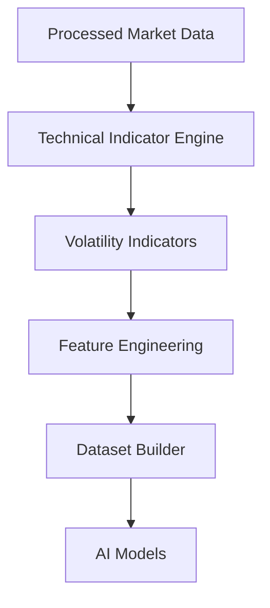
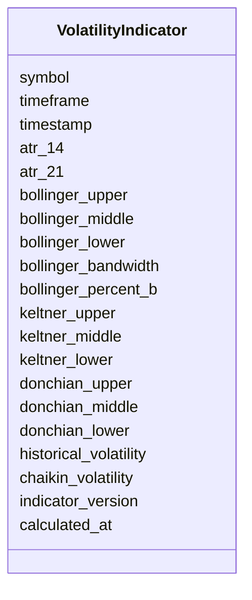

# Volatility Technical Indicators Schema

## Overview

The **Volatility Technical Indicators Schema** defines the standardized structure for volatility-related technical indicators calculated from processed market data.

Volatility indicators measure the **magnitude of price movement**, **market uncertainty**, and **price expansion or contraction**.

These indicators help identify:

- High-volatility markets
- Low-volatility markets
- Breakout opportunities
- Volatility contractions
- Volatility expansions
- Dynamic support and resistance
- Risk levels

This schema stores **calculated indicator values only**. It does **not** perform indicator calculations.

---

# Pipeline Position



---

# Volatility Indicators

```mermaid
mindmap

root((Volatility Indicators))

    ATR

    Bollinger Bands

    Keltner Channels

    Donchian Channels

    Historical Volatility

    Chaikin Volatility
```

---

# Schema Structure



---

# Field Definitions

## Asset Information

| Field | Description |
|--------|-------------|
| symbol | Trading symbol |
| timeframe | Candle timeframe |
| timestamp | Candle timestamp |

---

## Average True Range (ATR)

| Field | Description |
|--------|-------------|
| atr_14 | 14-period ATR |
| atr_21 | 21-period ATR |

ATR measures average price movement over a specified period and is commonly used for position sizing and stop-loss calculations.

---

## Bollinger Bands

| Field | Description |
|--------|-------------|
| bollinger_upper | Upper Bollinger Band |
| bollinger_middle | Middle Band (SMA) |
| bollinger_lower | Lower Bollinger Band |
| bollinger_bandwidth | Band width |
| bollinger_percent_b | Percent B |

Typical interpretation:

| Condition | Meaning |
|-----------|---------|
| Narrow Bands | Low volatility |
| Wide Bands | High volatility |
| %B > 1 | Price above upper band |
| %B < 0 | Price below lower band |

---

## Keltner Channels

| Field | Description |
|--------|-------------|
| keltner_upper | Upper channel |
| keltner_middle | Middle EMA |
| keltner_lower | Lower channel |

Keltner Channels use ATR to create dynamic volatility envelopes.

---

## Donchian Channels

| Field | Description |
|--------|-------------|
| donchian_upper | Highest high |
| donchian_middle | Midpoint |
| donchian_lower | Lowest low |

Useful for breakout and trend-following systems.

---

## Historical Volatility

| Field | Description |
|--------|-------------|
| historical_volatility | Historical volatility estimate |

Represents realized volatility over a historical window.

---

## Chaikin Volatility

| Field | Description |
|--------|-------------|
| chaikin_volatility | Chaikin Volatility |

Measures changes in the trading range over time.

---

## Metadata

| Field | Description |
|--------|-------------|
| indicator_version | Indicator calculation version |
| calculated_at | Indicator generation timestamp |

---

# Indicator Calculation Flow

```mermaid
flowchart LR

Processed OHLCV

-->

Indicator Engine

-->

ATR

-->

Bollinger Bands

-->

Keltner Channels

-->

Donchian Channels

-->

Historical Volatility

-->

Volatility Schema
```

---

# Example Record

```json
{
  "symbol": "ETHUSDT",
  "timeframe": "1h",
  "timestamp": "2026-08-05T12:00:00Z",

  "atr_14": 42.61,
  "atr_21": 39.83,

  "bollinger_upper": 3672.91,
  "bollinger_middle": 3640.42,
  "bollinger_lower": 3607.93,
  "bollinger_bandwidth": 0.082,
  "bollinger_percent_b": 0.74,

  "keltner_upper": 3665.24,
  "keltner_middle": 3638.11,
  "keltner_lower": 3610.98,

  "donchian_upper": 3681.84,
  "donchian_middle": 3640.12,
  "donchian_lower": 3598.40,

  "historical_volatility": 0.57,

  "chaikin_volatility": 8.21,

  "indicator_version": "1.0",
  "calculated_at": "2026-08-05T12:00:04Z"
}
```

---

# Trading Interpretation

```mermaid
flowchart TD

ATR

-->

Position Sizing

Bollinger Bands

-->

Volatility Expansion

Keltner Channels

-->

Trend Confirmation

Donchian Channels

-->

Breakout Detection

Historical Volatility

-->

Risk Assessment

Chaikin Volatility

-->

Volatility Momentum
```

---

# Downstream Usage

```mermaid
mindmap

root((Volatility Indicators))

    Feature Engineering

    Volatility Forecasting

    Position Sizing

    Stop Loss Optimization

    Risk Engine

    Strategy Engine

    AI Models

    Backtesting
```

---

# Relationship with Other Schemas

```mermaid
flowchart TD

Processed Market Data

-->

Volatility Indicators

Volatility Indicators

-->

Feature Engineering

Feature Engineering

-->

Dataset Builder

Dataset Builder

-->

AI Models
```

---

# Storage Flow

```mermaid
flowchart TD

Processed Market Data

-->

Indicator Engine

-->

Volatility Indicators

-->

Feature Store

-->

Training Dataset

-->

Model Repository
```

---

# Design Principles

```mermaid
mindmap

root((Volatility Indicators))

    Deterministic

    Time-Series Ready

    AI Ready

    Modular

    Reproducible

    Extensible

    Version Controlled

    Exchange Independent
```

---

# Future Enhancements

Future volatility indicators may include:

- Normalized ATR (NATR)
- Realized Volatility
- Parkinson Volatility
- Garman-Klass Volatility
- Rogers-Satchell Volatility
- Yang-Zhang Volatility
- Squeeze Momentum Indicator
- Volatility Ratio
- Ulcer Index
- Standard Deviation Channels

---

# Summary

The **Volatility Technical Indicators Schema** stores standardized volatility-related indicators generated from processed market data.

These indicators quantify market uncertainty, price expansion, and contraction, providing essential inputs for feature engineering, volatility forecasting, position sizing, AI model training, strategy generation, risk management, backtesting, paper trading, and live trading.

```mermaid
flowchart TD

Processed Market Data

-->

Technical Indicator Engine

-->

Volatility Indicators

-->

Feature Engineering

-->

Dataset Builder

-->

AI Models

-->

Strategy Engine

-->

Risk Engine

-->

Execution Engine
```