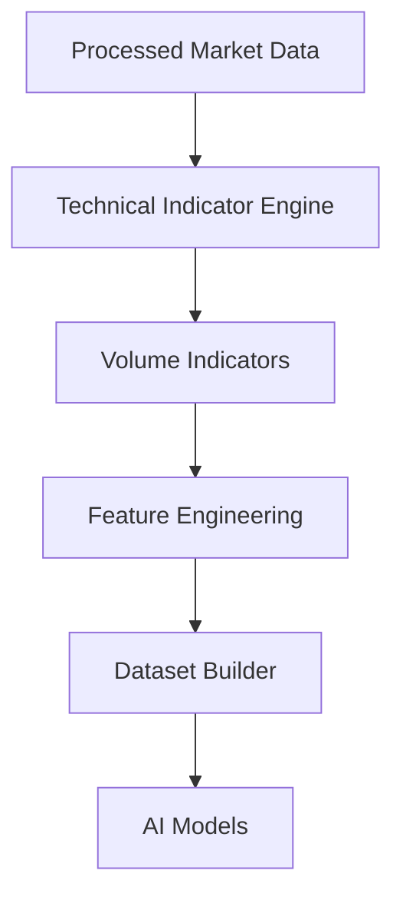
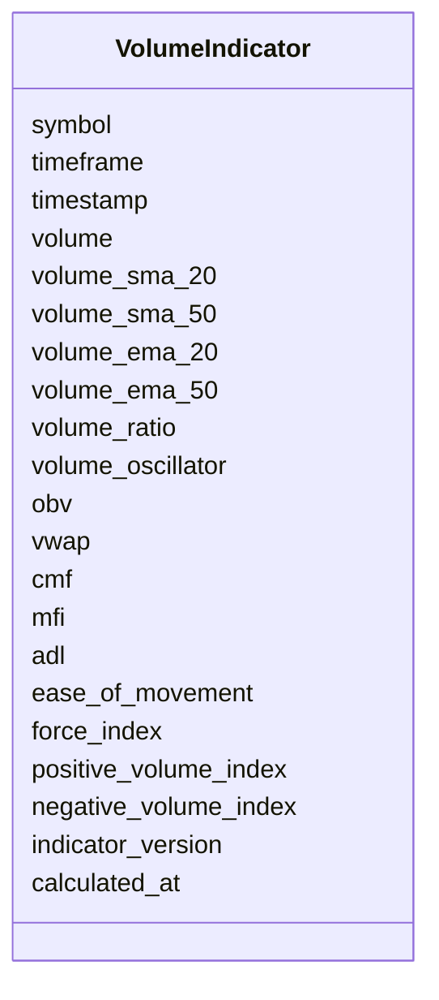

# Volume Technical Indicators Schema

## Overview

The **Volume Technical Indicators Schema** defines the standardized structure for volume-based technical indicators calculated from processed market data.

Volume indicators measure **trading activity**, **buying and selling pressure**, **money flow**, and **trend confirmation**.

They help identify:

- Strength of a price move
- Weak or strong breakouts
- Accumulation
- Distribution
- Institutional activity
- Liquidity
- Volume anomalies

This schema stores **calculated indicator values only**. It does **not** perform indicator calculations.

---

# Pipeline Position



---

# Volume Indicators

```mermaid
mindmap

root((Volume Indicators))

    Volume SMA

    Volume EMA

    Volume Ratio

    Volume Oscillator

    OBV

    VWAP

    CMF

    MFI

    ADL

    Ease of Movement

    Force Index

    PVI

    NVI
```

---

# Schema Structure



---

# Field Definitions

## Asset Information

| Field | Description |
|--------|-------------|
| symbol | Trading symbol |
| timeframe | Candle timeframe |
| timestamp | Candle timestamp |

---

## Volume Statistics

| Field | Description |
|--------|-------------|
| volume | Current trading volume |
| volume_sma_20 | 20-period volume SMA |
| volume_sma_50 | 50-period volume SMA |
| volume_ema_20 | 20-period volume EMA |
| volume_ema_50 | 50-period volume EMA |
| volume_ratio | Current volume divided by average volume |

High volume often confirms price movements, while low volume may indicate weak conviction.

---

## Volume Oscillator

| Field | Description |
|--------|-------------|
| volume_oscillator | Difference between short-term and long-term volume averages |

Measures changes in trading activity.

---

## On-Balance Volume (OBV)

| Field | Description |
|--------|-------------|
| obv | On-Balance Volume |

Tracks cumulative buying and selling pressure.

---

## Volume Weighted Average Price (VWAP)

| Field | Description |
|--------|-------------|
| vwap | Volume Weighted Average Price |

Frequently used by institutional traders as a benchmark for execution quality and intraday trend analysis.

---

## Chaikin Money Flow (CMF)

| Field | Description |
|--------|-------------|
| cmf | Chaikin Money Flow |

Typical interpretation:

| CMF | Meaning |
|------|---------|
| >0 | Buying pressure |
| <0 | Selling pressure |

---

## Money Flow Index (MFI)

| Field | Description |
|--------|-------------|
| mfi | Money Flow Index |

Typical interpretation:

| MFI | Market Condition |
|------|------------------|
| >80 | Overbought |
| 20–80 | Neutral |
| <20 | Oversold |

---

## Accumulation / Distribution Line (ADL)

| Field | Description |
|--------|-------------|
| adl | Accumulation/Distribution Line |

Measures cumulative money flow into and out of an asset.

---

## Ease of Movement (EOM)

| Field | Description |
|--------|-------------|
| ease_of_movement | Ease of Movement |

Evaluates how easily price moves relative to trading volume.

---

## Force Index

| Field | Description |
|--------|-------------|
| force_index | Force Index |

Combines price movement and volume to estimate buying or selling force.

---

## Positive / Negative Volume Index

| Field | Description |
|--------|-------------|
| positive_volume_index | Positive Volume Index (PVI) |
| negative_volume_index | Negative Volume Index (NVI) |

Used to study how price behaves during increasing or decreasing volume.

---

## Metadata

| Field | Description |
|--------|-------------|
| indicator_version | Indicator calculation version |
| calculated_at | Indicator generation timestamp |

---

# Indicator Calculation Flow

```mermaid
flowchart LR

Processed OHLCV

-->

Indicator Engine

-->

Volume Statistics

-->

OBV

-->

VWAP

-->

CMF

-->

MFI

-->

ADL

-->

Volume Indicator Schema
```

---

# Example Record

```json
{
  "symbol": "ETHUSDT",
  "timeframe": "1h",
  "timestamp": "2026-08-05T12:00:00Z",

  "volume": 12841.52,

  "volume_sma_20": 11763.21,
  "volume_sma_50": 11280.42,

  "volume_ema_20": 11802.15,
  "volume_ema_50": 11331.72,

  "volume_ratio": 1.41,

  "volume_oscillator": 9.62,

  "obv": 18452142,

  "vwap": 3642.28,

  "cmf": 0.27,

  "mfi": 68.42,

  "adl": 6241521,

  "ease_of_movement": 0.84,

  "force_index": 23145.81,

  "positive_volume_index": 1185.31,

  "negative_volume_index": 942.63,

  "indicator_version": "1.0",

  "calculated_at": "2026-08-05T12:00:05Z"
}
```

---

# Trading Interpretation

```mermaid
flowchart TD

Volume Ratio

-->

Trend Confirmation

OBV

-->

Buying Selling Pressure

VWAP

-->

Institutional Benchmark

CMF

-->

Money Flow

MFI

-->

Overbought Oversold

ADL

-->

Accumulation Distribution

Force Index

-->

Buying Force
```

---

# Downstream Usage

```mermaid
mindmap

root((Volume Indicators))

    Feature Engineering

    Breakout Confirmation

    Liquidity Analysis

    Institutional Flow

    AI Models

    Strategy Engine

    Risk Engine

    Backtesting
```

---

# Relationship with Other Schemas

```mermaid
flowchart TD

Processed Market Data

-->

Volume Indicators

Volume Indicators

-->

Feature Engineering

Feature Engineering

-->

Dataset Builder

Dataset Builder

-->

AI Models
```

---

# Storage Flow

```mermaid
flowchart TD

Processed Market Data

-->

Indicator Engine

-->

Volume Indicators

-->

Feature Store

-->

Training Dataset

-->

Model Repository
```

---

# Design Principles

```mermaid
mindmap

root((Volume Indicators))

    Deterministic

    Time-Series Ready

    AI Ready

    Modular

    Reproducible

    Extensible

    Version Controlled

    Exchange Independent
```

---

# Future Enhancements

Possible future additions:

- Volume Profile
- Fixed Range Volume Profile
- Anchored VWAP
- Cumulative Volume Delta (CVD)
- Bid/Ask Volume Imbalance
- Order Flow Imbalance
- Delta Volume
- Liquidity Heatmap Metrics
- Tick Volume Statistics
- Volume-at-Price Distribution

---

# Summary

The **Volume Technical Indicators Schema** stores standardized volume-related indicators generated from processed market data.

These indicators quantify trading activity, money flow, liquidity, and buying or selling pressure, providing essential inputs for feature engineering, AI model training, strategy generation, risk management, backtesting, paper trading, and live trading.

```mermaid
flowchart TD

Processed Market Data

-->

Technical Indicator Engine

-->

Volume Indicators

-->

Feature Engineering

-->

Dataset Builder

-->

AI Models

-->

Strategy Engine

-->

Risk Engine

-->

Execution Engine
```