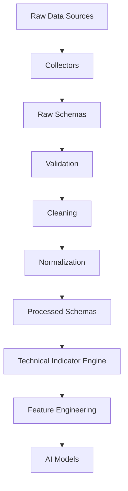

# Processed Data Schema

## Overview

The **Processed Data Schema** defines the standardized structure for cleaned, validated, normalized, and enriched datasets generated from the raw data pipeline.

Raw market data from exchanges and external providers is transformed into consistent, high-quality datasets that serve as the foundation for technical indicator calculation, feature engineering, AI model training, backtesting, paper trading, and live trading.

These schemas represent the **output of the Data Processing Pipeline** and the **input to the Technical Indicator Engine**.

---

# Directory Structure

```text
processed/
│
├── README.md
│
├── market_data.py
├── market_data.md
│
├── derivatives.py
├── derivatives.md
│
├── sentiment.py
├── sentiment.md
│
├── onchain.py
├── onchain.md
│
├── merged_dataset.py
└── merged_dataset.md
```

---

# Pipeline Position



---

# Available Schemas

## Market Data

**File**

```
market_data.py
```

Contains cleaned spot and futures market data.

Examples

- OHLCV
- Trades
- Order Book
- VWAP
- Spread
- Mid Price

Purpose

- Market analysis
- Indicator calculation
- Strategy input

---

## Derivatives Data

**File**

```
derivatives.py
```

Contains processed futures and options market data.

Examples

- Funding Rate
- Open Interest
- Long/Short Ratio
- Liquidations
- Option Chain
- Greeks
- Implied Volatility

Purpose

- Futures analysis
- Positioning analysis
- Volatility analysis

---

## Sentiment Data

**File**

```
sentiment.py
```

Contains processed sentiment information.

Examples

- Fear & Greed Index
- News Sentiment
- Social Sentiment
- Market Sentiment Score

Purpose

- Market psychology
- AI features
- Risk assessment

---

## On-Chain Data

**File**

```
onchain.py
```

Contains blockchain-related metrics.

Examples

- Exchange Inflows
- Exchange Outflows
- Whale Transactions
- Active Addresses
- Gas Usage
- Network Activity

Purpose

- Fundamental analysis
- Whale monitoring
- Long-term trend analysis

---

## Merged Dataset

**File**

```
merged_dataset.py
```

Combines all processed datasets into a synchronized dataset using timestamp and symbol.

Sources

- Market Data
- Derivatives
- Sentiment
- On-Chain

Purpose

- Technical indicator calculation
- Feature engineering
- AI model training
- Dataset generation

---

# Data Processing Flow

```mermaid
flowchart LR

Raw OHLCV

-->

Cleaning

-->

Normalization

-->

Validation

-->

Processed Market Data

Raw Derivatives

-->

Cleaning

-->

Processed Derivatives

Raw Sentiment

-->

Cleaning

-->

Processed Sentiment

Raw On-Chain

-->

Cleaning

-->

Processed On-Chain

Processed Market Data

-->

Merged Dataset

Processed Derivatives

-->

Merged Dataset

Processed Sentiment

-->

Merged Dataset

Processed On-Chain

-->

Merged Dataset
```

---

# Data Categories

```mermaid
mindmap

root((Processed Data))

    Market

        OHLCV

        Trades

        Order Book

    Derivatives

        Funding

        OI

        Liquidations

        Options

    Sentiment

        Fear & Greed

        News

        Social

    On-Chain

        Whales

        Addresses

        Exchange Flow

    Merged Dataset
```

---

# Downstream Consumers

Processed datasets are consumed by:

- Technical Indicator Engine
- Feature Engineering
- Dataset Builder
- AI Models
- Strategy Engine
- Risk Engine
- Backtesting Engine
- Paper Trading Engine
- Live Trading Engine
- Monitoring Engine

---

# Design Principles

```mermaid
mindmap

root((Processed Schemas))

    Clean

    Validated

    Normalized

    Time-Series Ready

    AI Ready

    Modular

    Reproducible

    Exchange Independent

    Strongly Typed
```

---

# Future Expansion

Additional processed datasets may include:

```text
macro.py

orderflow.py

market_microstructure.py

cross_exchange.py

liquidity.py

volatility_surface.py

economic_calendar.py
```

Each module should include:

```
module.py

module.md
```

---

# Storage Flow

```mermaid
flowchart TD

Raw Data

-->

Data Validation

-->

Data Cleaning

-->

Normalization

-->

Processed Schemas

-->

Technical Indicator Engine

-->

Indicator Schemas

-->

Feature Engineering

-->

Training Dataset
```

---

# Relationship with Other Schemas

```mermaid
flowchart TD

Raw Schemas

-->

Processed Schemas

Processed Schemas

-->

Indicator Schemas

Indicator Schemas

-->

Feature Engineering

Feature Engineering

-->

AI Models

AI Models

-->

Strategy Engine

Strategy Engine

-->

Risk Engine

Risk Engine

-->

Execution Engine
```

---

# Summary

The **Processed Data Schema** provides a standardized, validated, and normalized representation of market, derivatives, sentiment, and on-chain data.

It serves as the central data layer between raw data collection and technical indicator generation, ensuring that all downstream components—including feature engineering, AI models, strategy generation, risk management, backtesting, paper trading, and live trading—operate on consistent and high-quality datasets.