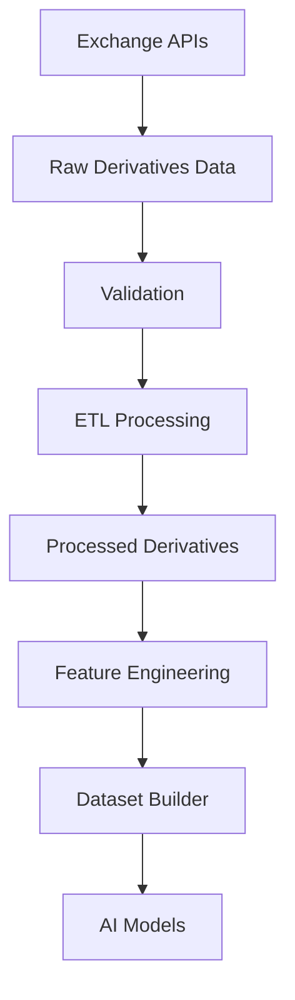
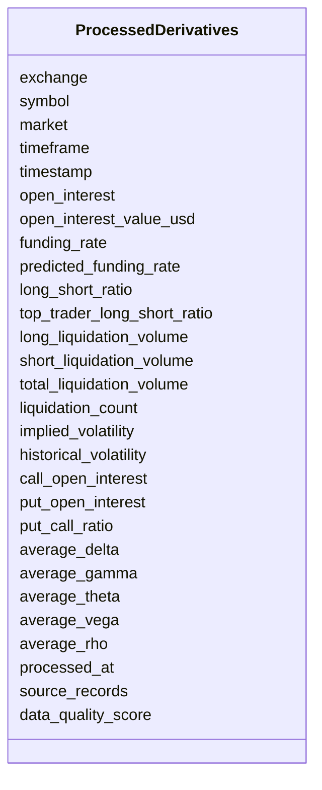

# Processed Derivatives Schema

## Overview

The **Processed Derivatives Schema** is the standardized representation of derivatives market data after completing the ETL (Extract, Transform, Load) pipeline.

It combines multiple raw derivatives datasets into a single normalized structure that is optimized for:

- Feature Engineering
- Quantitative Research
- AI Model Training
- Risk Management
- Strategy Development
- Backtesting
- Live Trading

Unlike the Raw Schemas, this layer contains validated, cleaned, synchronized, and exchange-independent derivatives data.

---

# Pipeline Position



---

# Raw Data Sources

The Processed Derivatives Schema integrates data from multiple raw schemas.

```mermaid
flowchart TD

Open Interest

-->

Processed Derivatives

Funding Rate

-->

Processed Derivatives

Long/Short Ratio

-->

Processed Derivatives

Liquidations

-->

Processed Derivatives

Option Chain

-->

Processed Derivatives

Greeks

-->

Processed Derivatives

Implied Volatility

-->

Processed Derivatives
```

---

# Processing Objectives

The ETL pipeline performs:

- Exchange normalization
- Timestamp alignment
- Missing value handling
- Duplicate removal
- Data validation
- Quality scoring
- Metric aggregation

---

# Schema Structure



---

# Field Definitions

| Field | Type | Description |
|--------|------|-------------|
| exchange | string | Exchange name |
| symbol | string | Trading symbol |
| market | string | Futures or Options |
| timeframe | string | Aggregation interval |
| timestamp | datetime | Candle/record timestamp |
| open_interest | float | Total open contracts |
| open_interest_value_usd | float | USD value of OI |
| funding_rate | float | Current funding rate |
| predicted_funding_rate | float | Forecast funding |
| long_short_ratio | float | Overall long/short ratio |
| top_trader_long_short_ratio | float | Top trader ratio |
| long_liquidation_volume | float | Long liquidation volume |
| short_liquidation_volume | float | Short liquidation volume |
| total_liquidation_volume | float | Total liquidations |
| liquidation_count | integer | Number of liquidations |
| implied_volatility | float | Average implied volatility |
| historical_volatility | float | Historical volatility |
| call_open_interest | float | Call option OI |
| put_open_interest | float | Put option OI |
| put_call_ratio | float | Put/Call ratio |
| average_delta | float | Mean Delta |
| average_gamma | float | Mean Gamma |
| average_theta | float | Mean Theta |
| average_vega | float | Mean Vega |
| average_rho | float | Mean Rho |
| processed_at | datetime | Processing timestamp |
| source_records | integer | Number of raw records |
| data_quality_score | float | Quality score (0–1) |

---

# ETL Workflow

```mermaid
flowchart LR

Raw Data

-->

Cleaning

-->

Normalization

-->

Aggregation

-->

Validation

-->

Quality Check

-->

Processed Derivatives
```

---

# Validation Rules

```mermaid
flowchart TD

Incoming Data

-->

Exchange Validation

-->

Market Validation

-->

Timeframe Validation

-->

Quality Score

-->

Accept
```

Validation ensures:

- Supported exchange
- Supported market
- Valid timeframe
- Timestamp exists
- Positive source record count
- Data quality score between 0 and 1

---

# Supported Markets

```
Futures

Options
```

---

# Supported Exchanges

```
Binance

Bybit

OKX
```

---

# Supported Timeframes

```
1m

5m

15m

30m

1h

4h

1d
```

---

# Example Record

```json
{
  "exchange": "binance",
  "symbol": "ETHUSDT",
  "market": "futures",
  "timeframe": "1h",
  "timestamp": "2026-08-05T12:00:00Z",

  "open_interest": 125643.84,
  "open_interest_value_usd": 458400123.12,

  "funding_rate": 0.00018,
  "predicted_funding_rate": 0.00021,

  "long_short_ratio": 1.21,
  "top_trader_long_short_ratio": 1.34,

  "long_liquidation_volume": 1523000,
  "short_liquidation_volume": 824000,
  "total_liquidation_volume": 2347000,
  "liquidation_count": 612,

  "implied_volatility": 0.61,
  "historical_volatility": 0.55,

  "call_open_interest": 254000,
  "put_open_interest": 182000,
  "put_call_ratio": 0.72,

  "average_delta": 0.46,
  "average_gamma": 0.0018,
  "average_theta": -3.24,
  "average_vega": 17.52,
  "average_rho": 1.86,

  "processed_at": "2026-08-05T12:00:08Z",
  "source_records": 8,
  "data_quality_score": 0.99
}
```

---

# Derivatives Analytics

```mermaid
flowchart TD

Funding Rate

-->

Market Sentiment

Open Interest

-->

Market Participation

Liquidations

-->

Forced Position Analysis

Options Data

-->

Volatility Analysis

Greeks

-->

Risk Analysis
```

---

# Market Interpretation

| Metric | Interpretation |
|---------|----------------|
| Funding Rate > 0 | Longs pay shorts (bullish sentiment) |
| Funding Rate < 0 | Shorts pay longs (bearish sentiment) |
| Rising Open Interest | New positions entering market |
| Falling Open Interest | Positions closing |
| High Put/Call Ratio | Bearish positioning |
| Low Put/Call Ratio | Bullish positioning |
| Rising IV | Higher expected volatility |
| Large Liquidations | Increased market stress |

---

# Downstream Usage

```mermaid
mindmap

root((Processed Derivatives))

    Feature Engineering

    Volatility Models

    Risk Engine

    Strategy Engine

    AI Models

    Market Regime Detection

    Position Sizing

    Signal Generation
```

---

# Relationship with Other Schemas

```mermaid
flowchart TD

Processed Market Data

-->

Feature Engineering

Processed Derivatives

-->

Feature Engineering

Processed Sentiment

-->

Feature Engineering

Processed On Chain

-->

Feature Engineering

Feature Engineering

-->

Dataset Builder

-->

AI Models
```

---

# Storage Flow

```mermaid
flowchart TD

Raw Storage

-->

ETL Pipeline

-->

Processed Storage

-->

Feature Store

-->

Training Dataset

-->

Model Repository
```

---

# Design Principles

```mermaid
mindmap

root((Processed Derivatives))

    Exchange Independent

    Standardized

    Validated

    Aggregated

    Time-Series Ready

    AI Ready

    Extensible

    Version Controlled
```

---

# Future Enhancements

Planned improvements:

- Volatility Surface
- IV Rank
- IV Percentile
- Gamma Exposure (GEX)
- Delta Exposure (DEX)
- Dealer Positioning
- Funding Rate Momentum
- Open Interest Delta
- Options Flow Analytics
- Cross-exchange Aggregation

---

# Summary

The **Processed Derivatives Schema** provides a unified, validated, and high-quality view of futures and options market data.

It combines Open Interest, Funding Rate, Long/Short Ratio, Liquidations, Options Chain, Greeks, and Implied Volatility into a standardized structure for quantitative analysis, feature engineering, AI model training, and risk management.

```mermaid
flowchart TD

Raw Derivatives

-->

Validation

-->

ETL Processing

-->

Processed Derivatives

-->

Feature Engineering

-->

Dataset Builder

-->

AI Models

-->

Strategy Engine

-->

Risk Engine

-->

Execution Engine
```