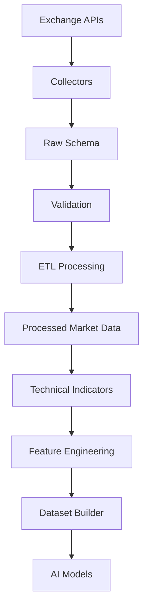
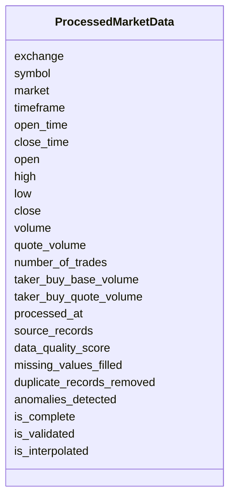

# Processed Market Data Schema

## Overview

The **Processed Market Data Schema** is the standardized representation of market data after completing the ETL (Extract, Transform, Load) pipeline.

Unlike the Raw Schema, this layer contains **clean, validated, normalized, and quality-assured** market data that is ready for:

- Technical Indicator Calculation
- Feature Engineering
- AI/ML Model Training
- Backtesting
- Paper Trading
- Live Trading

This schema acts as the **single source of truth** for all downstream components.

---

# Data Pipeline Position



---

# Processing Objectives

The Processed Market Data layer aims to:

- Standardize exchange formats
- Remove duplicate records
- Handle missing values
- Align timestamps
- Normalize symbols
- Verify OHLC consistency
- Improve data quality
- Produce AI-ready datasets

---

# Processing Steps

```mermaid
flowchart LR

Raw Data

-->

Cleaning

-->

Validation

-->

Normalization

-->

Deduplication

-->

Gap Filling

-->

Timestamp Alignment

-->

Processed Data
```

---

# Schema Structure



---

# Field Definitions

| Field | Type | Description |
|--------|------|-------------|
| exchange | string | Exchange name |
| symbol | string | Trading pair |
| market | string | Spot/Futures market |
| timeframe | string | Candle interval |
| open_time | datetime | Candle open time |
| close_time | datetime | Candle close time |
| open | float | Opening price |
| high | float | Highest price |
| low | float | Lowest price |
| close | float | Closing price |
| volume | float | Base asset volume |
| quote_volume | float | Quote asset volume |
| number_of_trades | integer | Number of executed trades |
| taker_buy_base_volume | float | Taker buy volume |
| taker_buy_quote_volume | float | Quote taker buy volume |
| processed_at | datetime | Processing timestamp |
| source_records | integer | Number of raw records used |
| data_quality_score | float | Data quality score (0–1) |
| missing_values_filled | integer | Filled missing values |
| duplicate_records_removed | integer | Removed duplicates |
| anomalies_detected | integer | Detected anomalies |
| is_complete | bool | Complete record flag |
| is_validated | bool | Validation status |
| is_interpolated | bool | Missing values interpolated |

---

# ETL Processing Workflow

```mermaid
flowchart TD

Raw Data

-->

Remove Duplicates

-->

Validate Fields

-->

Normalize Exchange Format

-->

Fill Missing Values

-->

Align Time

-->

Detect Anomalies

-->

Quality Check

-->

Processed Market Data
```

---

# Validation Rules

```mermaid
flowchart TD

Incoming Data

-->

OHLC Validation

-->

Volume Validation

-->

Timestamp Validation

-->

Quality Score

-->

Accept
```

Validation includes:

- Exchange supported
- Symbol exists
- Market supported
- Timeframe supported
- OHLC consistency
- Positive prices
- Non-negative volume
- Quality score between 0 and 1

---

# Candle Validation

```
High >= Open

High >= Close

Low <= Open

Low <= Close

High >= Low
```

---

# Data Quality Score

The `data_quality_score` summarizes overall data quality.

Typical interpretation:

| Score | Quality |
|--------|----------|
| 1.00 | Perfect |
| 0.95–0.99 | Excellent |
| 0.90–0.95 | Good |
| 0.80–0.89 | Acceptable |
| <0.80 | Needs Review |

---

# Supported Exchanges

```
Binance

Bybit

OKX
```

---

# Supported Markets

```
Spot

USDT Futures

Coin-M Futures
```

---

# Supported Timeframes

```
1m

5m

15m

30m

1h

4h

1d

1w
```

---

# Example Record

```json
{
  "exchange": "binance",
  "symbol": "ETHUSDT",
  "market": "futures",
  "timeframe": "1h",
  "open_time": "2026-08-05T10:00:00Z",
  "close_time": "2026-08-05T11:00:00Z",
  "open": 3640.12,
  "high": 3658.71,
  "low": 3628.45,
  "close": 3650.34,
  "volume": 12841.52,
  "quote_volume": 46881234.55,
  "number_of_trades": 81245,
  "taker_buy_base_volume": 7023.15,
  "taker_buy_quote_volume": 25614897.14,
  "processed_at": "2026-08-05T11:00:08Z",
  "source_records": 1,
  "data_quality_score": 1.0,
  "missing_values_filled": 0,
  "duplicate_records_removed": 0,
  "anomalies_detected": 0,
  "is_complete": true,
  "is_validated": true,
  "is_interpolated": false
}
```

---

# Quality Assurance Pipeline

```mermaid
flowchart LR

Raw Data

-->

Quality Check

-->

Validation

-->

Anomaly Detection

-->

Quality Score

-->

Processed Data
```

---

# Downstream Usage

```mermaid
mindmap

root((Processed Market Data))

    Technical Indicators

    Feature Engineering

    Dataset Builder

    Backtesting

    Paper Trading

    Live Trading

    AI Models

    Strategy Engine

    Risk Engine
```

---

# Relationship with Other Schemas

```mermaid
flowchart TD

Raw OHLCV

-->

Processed Market Data

-->

Technical Indicators

-->

Feature Engineering

-->

Dataset Builder

-->

LSTM

-->

Transformer

-->

XGBoost

-->

Trading Strategy
```

---

# Storage Flow

```mermaid
flowchart TD

Raw Storage

-->

ETL Pipeline

-->

Processed Storage

-->

Feature Store

-->

Training Dataset

-->

Model Repository
```

---

# Design Principles

```mermaid
mindmap

root((Processed Market Data))

    Standardized

    Validated

    Time-Series Ready

    Exchange Independent

    AI Ready

    High Quality

    Extensible

    Version Controlled
```

---

# Future Enhancements

Planned improvements:

- Multi-exchange merged candles
- Cross-exchange price validation
- Liquidity-adjusted prices
- VWAP calculation
- Session statistics
- Market regime labels
- Confidence score
- Data lineage tracking
- Corporate action handling (for traditional assets)
- Incremental processing metadata

---

# Summary

The **Processed Market Data Schema** is the foundation for all quantitative analysis in the ETH Bot system.

It transforms raw exchange data into a consistent, validated, and high-quality dataset suitable for technical analysis, feature engineering, AI model training, backtesting, paper trading, and live trading.

```mermaid
flowchart TD

Exchange

-->

Collector

-->

Raw Schema

-->

Validation

-->

ETL Processing

-->

Processed Market Data

-->

Technical Indicators

-->

Feature Engineering

-->

Dataset Builder

-->

AI Models

-->

Strategy Engine

-->

Risk Engine

-->

Execution Engine
```