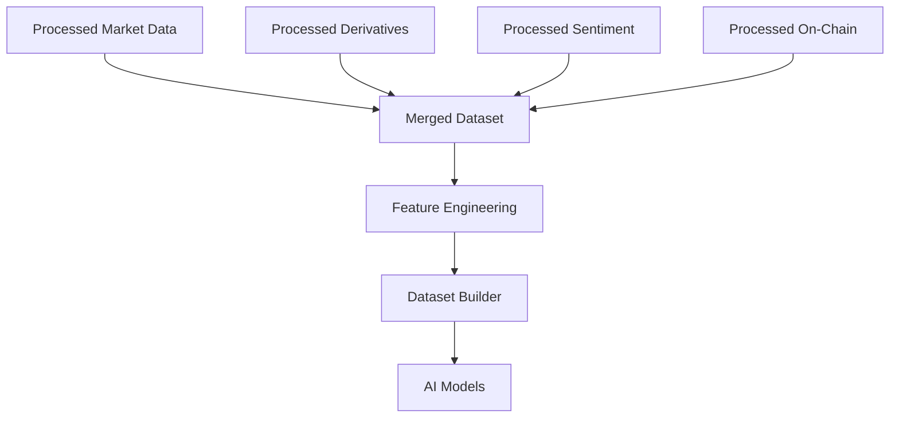
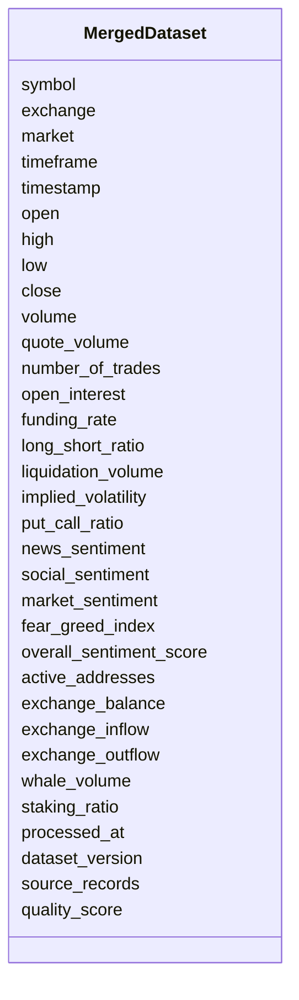

# Merged Dataset Schema

## Overview

The **Merged Dataset Schema** is the final unified dataset created by combining all processed data sources into a single, time-aligned structure.

This dataset serves as the central input for downstream components before feature engineering and machine learning.

The merged dataset integrates:

- Processed Market Data
- Processed Derivatives Data
- Processed Sentiment Data
- Processed On-Chain Data

Each record represents a single asset, timeframe, and timestamp with synchronized information from all available processed sources.

---

# Pipeline Position



---

# Merge Objectives

The merge process aims to:

- Synchronize timestamps
- Align multiple data sources
- Remove duplicate records
- Handle missing values
- Produce one unified dataset
- Prepare data for feature engineering

---

# Merge Workflow

```mermaid
flowchart LR

Processed Market

-->

Timestamp Alignment

Processed Derivatives

-->

Timestamp Alignment

Processed Sentiment

-->

Timestamp Alignment

Processed On-Chain

-->

Timestamp Alignment

Timestamp Alignment

-->

Merge

-->

Quality Validation

-->

Merged Dataset
```

---

# Schema Structure



---

# Field Definitions

## Asset Information

| Field | Description |
|--------|-------------|
| symbol | Trading symbol |
| exchange | Exchange name |
| market | Market type |
| timeframe | Aggregation interval |
| timestamp | Record timestamp |

---

## Market Data

| Field | Description |
|--------|-------------|
| open | Opening price |
| high | Highest price |
| low | Lowest price |
| close | Closing price |
| volume | Trading volume |
| quote_volume | Quote asset volume |
| number_of_trades | Executed trades |

---

## Derivatives Data

| Field | Description |
|--------|-------------|
| open_interest | Open Interest |
| funding_rate | Funding Rate |
| long_short_ratio | Long/Short Ratio |
| liquidation_volume | Liquidation Volume |
| implied_volatility | Implied Volatility |
| put_call_ratio | Put/Call Ratio |

---

## Sentiment Data

| Field | Description |
|--------|-------------|
| news_sentiment | News sentiment score |
| social_sentiment | Social sentiment |
| market_sentiment | Market sentiment |
| fear_greed_index | Fear & Greed Index |
| overall_sentiment_score | Combined sentiment score |

---

## On-Chain Data

| Field | Description |
|--------|-------------|
| active_addresses | Active wallets |
| exchange_balance | Exchange reserves |
| exchange_inflow | Coins deposited to exchanges |
| exchange_outflow | Coins withdrawn from exchanges |
| whale_volume | Whale transfer volume |
| staking_ratio | Percentage of staked supply |

---

## Metadata

| Field | Description |
|--------|-------------|
| processed_at | Dataset generation time |
| dataset_version | Dataset version |
| source_records | Number of merged records |
| quality_score | Overall dataset quality |

---

# Merge Strategy

```mermaid
flowchart TD

Market Timestamp

-->

Time Alignment

Derivatives Timestamp

-->

Time Alignment

Sentiment Timestamp

-->

Time Alignment

On-Chain Timestamp

-->

Time Alignment

Time Alignment

-->

Unified Record
```

---

# Validation Rules

```mermaid
flowchart TD

Merged Record

-->

Symbol Exists

-->

OHLC Validation

-->

Market Validation

-->

Quality Score

-->

Accept
```

Validation ensures:

- Valid symbol
- Supported market
- Supported timeframe
- Valid OHLC prices
- Non-negative volume
- Quality score between 0 and 1

---

# Example Record

```json
{
  "symbol": "ETHUSDT",
  "exchange": "binance",
  "market": "futures",
  "timeframe": "1h",
  "timestamp": "2026-08-05T12:00:00Z",

  "open": 3640.12,
  "high": 3658.71,
  "low": 3628.45,
  "close": 3650.34,
  "volume": 12841.52,

  "open_interest": 125643.84,
  "funding_rate": 0.00018,
  "long_short_ratio": 1.21,
  "liquidation_volume": 2347000,
  "implied_volatility": 0.61,

  "news_sentiment": 0.63,
  "social_sentiment": 0.54,
  "market_sentiment": 0.58,
  "fear_greed_index": 72,
  "overall_sentiment_score": 0.60,

  "active_addresses": 654321,
  "exchange_balance": 15432125,
  "exchange_inflow": 5412.81,
  "exchange_outflow": 6328.12,
  "whale_volume": 21458.76,
  "staking_ratio": 0.318,

  "processed_at": "2026-08-05T12:00:08Z",
  "dataset_version": "v1.0.0",
  "source_records": 4,
  "quality_score": 0.99
}
```

---

# Data Synchronization

```mermaid
flowchart LR

Market Data

-->

1 Hour Window

Derivatives

-->

1 Hour Window

Sentiment

-->

1 Hour Window

On-Chain

-->

1 Hour Window

1 Hour Window

-->

Merged Dataset
```

---

# Downstream Usage

```mermaid
mindmap

root((Merged Dataset))

    Technical Indicators

    Feature Engineering

    Dataset Builder

    AI Models

    Backtesting

    Paper Trading

    Strategy Engine

    Risk Engine
```

---

# Relationship with Other Schemas

```mermaid
flowchart TD

Processed Market

-->

Merged Dataset

Processed Derivatives

-->

Merged Dataset

Processed Sentiment

-->

Merged Dataset

Processed On-Chain

-->

Merged Dataset

Merged Dataset

-->

Feature Engineering

-->

Dataset Builder

-->

AI Models
```

---

# Storage Flow

```mermaid
flowchart TD

Processed Storage

-->

Merge Pipeline

-->

Merged Dataset

-->

Feature Store

-->

Training Dataset

-->

Model Repository
```

---

# Design Principles

```mermaid
mindmap

root((Merged Dataset))

    Unified

    Time Aligned

    Validated

    Source Independent

    AI Ready

    Extensible

    Version Controlled

    High Quality
```

---

# Future Enhancements

Planned improvements:

- Multi-exchange merged datasets
- Cross-exchange price consistency checks
- Time synchronization confidence score
- Data lineage tracking
- Incremental merge processing
- Feature version references
- Missing-data flags
- Cross-asset correlation fields
- Regime annotations
- Event markers

---

# Relationship with Feature Engineering

The merged dataset is **not** the final machine learning dataset.

Its role is to provide synchronized processed data that serves as the input for feature engineering.

```mermaid
flowchart TD

Processed Schemas

-->

Merged Dataset

-->

Technical Indicators

-->

Feature Engineering

-->

Feature Selection

-->

Dataset Builder

-->

Final AI Dataset

-->

LSTM

-->

Transformer

-->

XGBoost

-->

Strategy Engine
```

---

# Summary

The **Merged Dataset Schema** is the unified, time-aligned representation of processed market, derivatives, sentiment, and on-chain data.

It provides a consistent and validated foundation for technical indicator generation, feature engineering, dataset construction, AI model training, backtesting, paper trading, and live trading.

```mermaid
flowchart TD

Processed Market

-->

Merged Dataset

Processed Derivatives

-->

Merged Dataset

Processed Sentiment

-->

Merged Dataset

Processed On-Chain

-->

Merged Dataset

Merged Dataset

-->

Feature Engineering

-->

Dataset Builder

-->

AI Models

-->

Strategy Engine

-->

Risk Engine

-->

Execution Engine
```