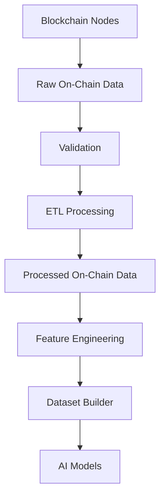
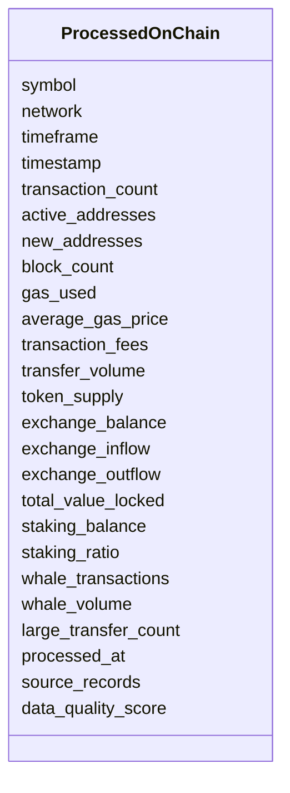

# Processed On-Chain Data Schema

## Overview

The **Processed On-Chain Data Schema** is the standardized representation of blockchain data after completing the ETL (Extract, Transform, Load) pipeline.

Unlike the Raw On-Chain Schema, this layer contains **clean, validated, normalized, synchronized, and aggregated blockchain metrics** that are ready for:

- Feature Engineering
- AI/ML Model Training
- Quantitative Research
- Market Regime Detection
- Risk Management
- Strategy Development

This schema converts blockchain activity into structured numerical features suitable for machine learning and trading systems.

---

# Pipeline Position



---

# Raw Data Sources

The Processed On-Chain Schema integrates multiple blockchain data providers.

```mermaid
flowchart TD

Glassnode

--> Processed

CryptoQuant

--> Processed

Dune Analytics

--> Processed

Santiment

--> Processed

IntoTheBlock

--> Processed

Blockchain Nodes

--> Processed

Processed

--> Feature Engineering
```

---

# Processing Objectives

The ETL pipeline performs:

- Data cleaning
- Exchange and provider normalization
- Timestamp alignment
- Missing value handling
- Duplicate removal
- Data aggregation
- Quality validation
- Feature preparation

---

# Schema Structure



---

# Field Definitions

| Field | Type | Description |
|--------|------|-------------|
| symbol | string | Trading symbol |
| network | string | Blockchain network |
| timeframe | string | Aggregation interval |
| timestamp | datetime | Observation timestamp |
| transaction_count | integer | Number of blockchain transactions |
| active_addresses | integer | Active wallet addresses |
| new_addresses | integer | Newly created addresses |
| block_count | integer | Blocks produced |
| gas_used | float | Total gas consumed |
| average_gas_price | float | Average gas price |
| transaction_fees | float | Network fees |
| transfer_volume | float | Asset transfer volume |
| token_supply | float | Current token supply |
| exchange_balance | float | Assets held on exchanges |
| exchange_inflow | float | Coins sent to exchanges |
| exchange_outflow | float | Coins withdrawn from exchanges |
| total_value_locked | float | Total Value Locked (TVL) |
| staking_balance | float | Total staked assets |
| staking_ratio | float | Percentage of supply staked |
| whale_transactions | integer | Number of whale transactions |
| whale_volume | float | Whale transfer volume |
| large_transfer_count | integer | Large blockchain transfers |
| processed_at | datetime | Processing timestamp |
| source_records | integer | Number of raw records |
| data_quality_score | float | Overall quality score |

---

# ETL Workflow

```mermaid
flowchart LR

Raw On-Chain Data

-->

Cleaning

-->

Normalization

-->

Aggregation

-->

Validation

-->

Quality Check

-->

Processed On-Chain Data
```

---

# Validation Rules

```mermaid
flowchart TD

Incoming Data

-->

Network Validation

-->

Timeframe Validation

-->

Timestamp Validation

-->

Quality Score

-->

Accept
```

Validation includes:

- Supported blockchain network
- Supported timeframe
- Valid timestamp
- Positive source record count
- Data quality score between 0 and 1

---

# Supported Networks

```
Ethereum

Bitcoin

BNB Chain

Arbitrum

Optimism

Base

Polygon

Solana
```

---

# Supported Timeframes

```
5m

15m

30m

1h

4h

1d
```

---

# Example Record

```json
{
  "symbol": "ETH",
  "network": "ethereum",
  "timeframe": "1h",
  "timestamp": "2026-08-05T12:00:00Z",

  "transaction_count": 1248215,
  "active_addresses": 654321,
  "new_addresses": 21894,
  "block_count": 301,
  "gas_used": 18453291,
  "average_gas_price": 4.25,
  "transaction_fees": 642.8,

  "transfer_volume": 945623.21,
  "token_supply": 122541823,
  "exchange_balance": 15432125,
  "exchange_inflow": 5412.81,
  "exchange_outflow": 6328.12,

  "total_value_locked": 84256321452,
  "staking_balance": 38954128,
  "staking_ratio": 0.318,

  "whale_transactions": 146,
  "whale_volume": 21458.76,
  "large_transfer_count": 91,

  "processed_at": "2026-08-05T12:00:05Z",
  "source_records": 14,
  "data_quality_score": 0.99
}
```

---

# On-Chain Analytics

```mermaid
flowchart TD

Transaction Count

-->

Network Activity

Active Addresses

-->

User Growth

Exchange Flows

-->

Market Supply

Whale Activity

-->

Institutional Behavior

Staking

-->

Supply Lock

TVL

-->

DeFi Health
```

---

# Exchange Flow Interpretation

| Metric | Interpretation |
|---------|----------------|
| Exchange Inflow ↑ | Potential selling pressure |
| Exchange Outflow ↑ | Potential accumulation |
| Exchange Balance ↓ | Coins leaving exchanges |
| Exchange Balance ↑ | Coins moving to exchanges |

---

# Whale Activity Interpretation

| Metric | Interpretation |
|---------|----------------|
| Whale Volume ↑ | Large capital movement |
| Whale Transactions ↑ | Institutional activity |
| Large Transfers ↑ | Possible market impact |

---

# Network Health Indicators

| Metric | Meaning |
|---------|----------|
| Active Addresses ↑ | Growing network usage |
| New Addresses ↑ | User adoption |
| Transaction Count ↑ | Higher blockchain activity |
| TVL ↑ | DeFi ecosystem growth |
| Staking Ratio ↑ | Reduced liquid supply |

---

# Downstream Usage

```mermaid
mindmap

root((Processed On-Chain))

    Feature Engineering

    Market Regime Detection

    Whale Analysis

    Supply Analysis

    Liquidity Analysis

    AI Models

    Strategy Engine

    Risk Engine
```

---

# Relationship with Other Schemas

```mermaid
flowchart TD

Processed Market Data

-->

Feature Engineering

Processed Derivatives

-->

Feature Engineering

Processed Sentiment

-->

Feature Engineering

Processed On-Chain

-->

Feature Engineering

Feature Engineering

-->

Dataset Builder

-->

AI Models
```

---

# Storage Flow

```mermaid
flowchart TD

Raw On-Chain Storage

-->

ETL Pipeline

-->

Processed Storage

-->

Feature Store

-->

Dataset Builder

-->

AI Models
```

---

# Design Principles

```mermaid
mindmap

root((Processed On-Chain))

    Blockchain Independent

    Provider Independent

    AI Ready

    Time-Series Ready

    Quantitative

    Validated

    Extensible

    Version Controlled
```

---

# Future Enhancements

Planned improvements:

- Exchange Netflow
- Stablecoin Reserve Metrics
- Stablecoin Inflow/Outflow
- ETH Burn Rate
- ETH Issuance
- Net ETH Issuance
- Validator Count
- Beacon Chain Deposits
- Smart Contract Activity
- Layer-2 Activity
- MEV Statistics
- Wallet Clustering
- Cross-chain Bridge Flows
- DeFi Protocol Metrics
- NFT Activity

---

# Summary

The **Processed On-Chain Data Schema** transforms raw blockchain activity into standardized, validated, and machine-readable features.

It combines network activity, exchange flows, whale behavior, staking, and DeFi metrics into a unified structure for feature engineering, quantitative research, AI model training, strategy generation, and risk management.

```mermaid
flowchart TD

Raw On-Chain Data

-->

Validation

-->

ETL Processing

-->

Processed On-Chain Data

-->

Feature Engineering

-->

Dataset Builder

-->

AI Models

-->

Strategy Engine

-->

Risk Engine

-->

Execution Engine
```