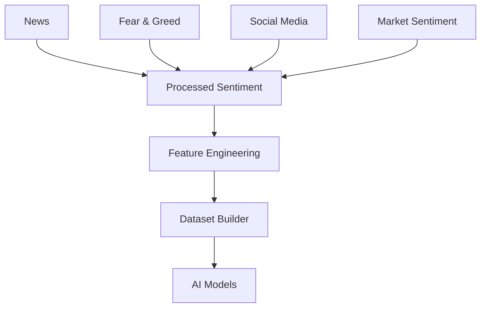
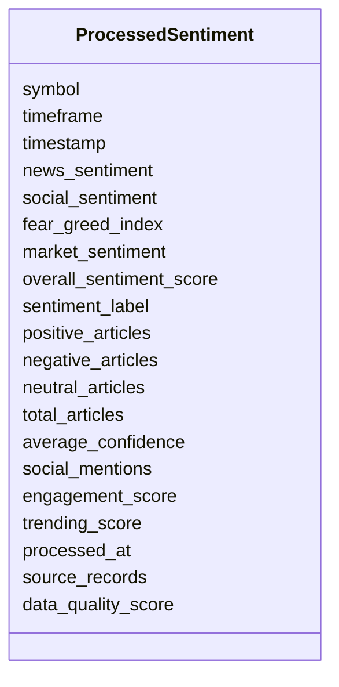

# Processed Sentiment Schema

## Overview

The **Processed Sentiment Schema** is the standardized representation of market sentiment after completing the ETL (Extract, Transform, Load) and NLP processing pipeline.

Unlike the Raw Sentiment Schema, this layer contains **clean, normalized, validated, and aggregated sentiment information** from multiple data sources.

The schema is designed for:

- AI/ML Model Training
- Feature Engineering
- Strategy Generation
- Market Regime Detection
- Risk Management
- Quantitative Research

It converts unstructured sentiment data into structured numerical features suitable for machine learning.

---

# Pipeline Position



---

# Data Processing Pipeline

```mermaid
flowchart LR

Raw News

-->

Cleaning

-->

NLP

-->

Sentiment Scoring

-->

Aggregation

-->

Validation

-->

Processed Sentiment
```

---

# Processing Objectives

The Processed Sentiment layer aims to:

- Normalize sentiment scores
- Remove duplicate news
- Aggregate multiple sentiment sources
- Generate confidence metrics
- Standardize sentiment labels
- Produce AI-ready features

---

# Schema Structure



---

# Field Definitions

| Field | Type | Description |
|--------|------|-------------|
| symbol | string | Trading symbol |
| timeframe | string | Aggregation timeframe |
| timestamp | datetime | Record timestamp |
| news_sentiment | float | Aggregated news sentiment (-1 to 1) |
| social_sentiment | float | Social media sentiment (-1 to 1) |
| fear_greed_index | integer | Fear & Greed Index (0–100) |
| market_sentiment | float | Market sentiment score |
| overall_sentiment_score | float | Combined sentiment score (-1 to 1) |
| sentiment_label | string | Overall sentiment classification |
| positive_articles | integer | Number of positive articles |
| negative_articles | integer | Number of negative articles |
| neutral_articles | integer | Number of neutral articles |
| total_articles | integer | Total processed articles |
| average_confidence | float | NLP confidence score |
| social_mentions | integer | Number of social media mentions |
| engagement_score | float | Social engagement score |
| trending_score | float | Trending score |
| processed_at | datetime | Processing timestamp |
| source_records | integer | Number of raw records |
| data_quality_score | float | Overall quality score |

---

# Sentiment Sources

```mermaid
mindmap

root((Sentiment Sources))

    News

    Fear & Greed

    Social Media

        Reddit

        Twitter/X

    Market Sentiment

    NLP Models
```

---

# NLP Processing Workflow

```mermaid
flowchart TD

Raw News

-->

Language Detection

-->

Cleaning

-->

Tokenization

-->

Embedding

-->

Transformer Model

-->

Sentiment Classification

-->

Confidence Score

-->

Processed Sentiment
```

---

# Sentiment Labels

| Label | Meaning |
|--------|---------|
| VERY_BEARISH | Strong negative sentiment |
| BEARISH | Moderately negative sentiment |
| NEUTRAL | Balanced sentiment |
| BULLISH | Moderately positive sentiment |
| VERY_BULLISH | Strong positive sentiment |

---

# Validation Rules

```mermaid
flowchart TD

Incoming Data

-->

Symbol Exists

-->

Timeframe Valid

-->

Sentiment Range

-->

Confidence Range

-->

Quality Score

-->

Accept
```

Validation includes:

- Symbol must exist
- Supported timeframe
- Sentiment score between -1 and 1
- Fear & Greed Index between 0 and 100
- Confidence score between 0 and 1
- Quality score between 0 and 1

---

# Sentiment Score Interpretation

| Score | Interpretation |
|--------|----------------|
| -1.00 | Extremely Bearish |
| -0.50 | Bearish |
| 0.00 | Neutral |
| +0.50 | Bullish |
| +1.00 | Extremely Bullish |

---

# Fear & Greed Index

| Range | Market Emotion |
|--------|----------------|
| 0–24 | Extreme Fear |
| 25–49 | Fear |
| 50 | Neutral |
| 51–74 | Greed |
| 75–100 | Extreme Greed |

---

# Example Record

```json
{
  "symbol": "ETHUSDT",
  "timeframe": "1h",
  "timestamp": "2026-08-05T12:00:00Z",

  "news_sentiment": 0.63,
  "social_sentiment": 0.54,
  "fear_greed_index": 72,
  "market_sentiment": 0.58,
  "overall_sentiment_score": 0.60,
  "sentiment_label": "BULLISH",

  "positive_articles": 42,
  "negative_articles": 11,
  "neutral_articles": 17,
  "total_articles": 70,

  "average_confidence": 0.91,

  "social_mentions": 15234,
  "engagement_score": 0.84,
  "trending_score": 0.78,

  "processed_at": "2026-08-05T12:00:05Z",
  "source_records": 128,
  "data_quality_score": 0.98
}
```

---

# Sentiment Aggregation

```mermaid
flowchart LR

News Score

-->

Overall Sentiment

Fear & Greed

-->

Overall Sentiment

Social Sentiment

-->

Overall Sentiment

Market Sentiment

-->

Overall Sentiment
```

---

# Downstream Usage

```mermaid
mindmap

root((Processed Sentiment))

    Feature Engineering

    Market Regime Detection

    Volatility Prediction

    Direction Prediction

    Risk Engine

    Strategy Engine

    AI Models
```

---

# Relationship with Other Schemas

```mermaid
flowchart TD

Processed Market Data

-->

Feature Engineering

Processed Derivatives

-->

Feature Engineering

Processed Sentiment

-->

Feature Engineering

Processed On-Chain

-->

Feature Engineering

Feature Engineering

-->

Dataset Builder

-->

AI Models
```

---

# Storage Flow

```mermaid
flowchart TD

Raw News

-->

NLP Pipeline

-->

Processed Sentiment

-->

Feature Store

-->

Dataset Builder

-->

AI Models
```

---

# Design Principles

```mermaid
mindmap

root((Processed Sentiment))

    Source Independent

    AI Ready

    NLP Optimized

    Time-Series Ready

    Quantitative

    Extensible

    Validated

    Version Controlled
```

---

# Future Enhancements

Planned improvements:

- LLM-based sentiment scoring
- Topic classification
- Entity recognition
- Event detection
- Multi-language sentiment
- Source credibility weighting
- Emotion classification
- Market impact estimation
- Real-time sentiment streaming
- Cross-source consensus score

---

# Summary

The **Processed Sentiment Schema** transforms raw textual and behavioral sentiment into standardized numerical features suitable for quantitative trading and AI.

It combines information from news, Fear & Greed, social media, and market sentiment into a validated, machine-readable format that supports feature engineering, AI model training, risk management, and strategy generation.

```mermaid
flowchart TD

Raw Sentiment Sources

-->

NLP Processing

-->

Processed Sentiment

-->

Feature Engineering

-->

Dataset Builder

-->

AI Models

-->

Strategy Engine

-->

Risk Engine

-->

Execution Engine
```