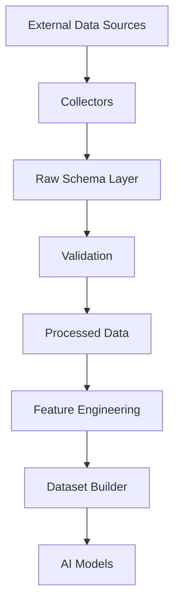
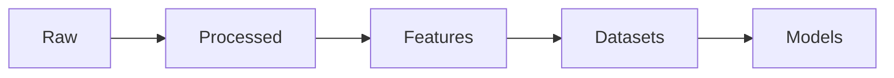

# Raw Data Schema Documentation

## Overview

The **Raw Schema Layer** is the first structured layer of the ETH Bot Data Pipeline.

Its responsibility is to convert raw external data from exchanges, blockchains, news providers, and sentiment platforms into standardized internal data models.

The Raw Schema layer does **not perform analysis or feature generation**.

Its main purpose is:

- Data normalization
- Data validation
- Schema consistency
- Exchange/provider independence
- Reliable downstream processing

---

# Data Pipeline Architecture



---

# Raw Schema Purpose

Raw schemas create a common language between different data providers.

Example:

Different exchanges provide Open Interest differently:

```text
Binance

{
openInterest: "123456"
}


Bybit

{
oi: 123456
}


OKX

{
open_interest: 123456
}
```

The Raw Schema converts all formats into:

```text
OpenInterestSchema
```

---

# Folder Structure

```text
schema/

├── README.md
│
└── raw/
    │
    ├── README.md
    │
    ├── ohlcv.py
    ├── ohlcv.md
    │
    ├── trades.py
    ├── trades.md
    │
    ├── orderbook.py
    ├── orderbook.md
    │
    ├── open_interest.py
    ├── open_interest.md
    │
    ├── liquidations.py
    ├── liquidations.md
    │
    ├── long_short_ratio.py
    ├── long_short_ratio.md
    │
    ├── option_chain.py
    ├── option_chain.md
    │
    ├── greeks.py
    ├── greeks.md
    │
    ├── implied_volatility.py
    ├── implied_volatility.md
    │
    ├── fear_greed.py
    ├── fear_greed.md
    │
    ├── whales.py
    ├── whales.md
    │
    ├── news.py
    ├── news.md
    │
    ├── onchain.py
    └── onchain.md
```

---

# Raw Data Categories

```mermaid
mindmap

root((Raw Data))

    Market Data

        OHLCV

        Trades

        Orderbook

        Open Interest

        Liquidations

        Long Short Ratio

    Derivatives

        Option Chain

        Greeks

        Implied Volatility

    Sentiment

        Fear & Greed

        News

    Blockchain

        On Chain

        Whale Activity
```

---

# Market Data Schemas

## OHLCV

Purpose:

- Price candles
- Trading history
- Technical analysis

Contains:

- Open
- High
- Low
- Close
- Volume

---

## Trades

Purpose:

- Individual trade events
- Market execution analysis

Contains:

- Price
- Quantity
- Side
- Timestamp

---

## Orderbook

Purpose:

- Liquidity analysis
- Market depth

Contains:

- Bid levels
- Ask levels
- Quantity

---

## Open Interest

Purpose:

- Futures participation
- Leverage analysis

Contains:

- Open contracts
- Notional value

---

## Liquidations

Purpose:

- Forced position closures
- Market stress detection

Contains:

- Liquidation price
- Quantity
- Side

---

## Long Short Ratio

Purpose:

- Trader positioning analysis

Contains:

- Long percentage
- Short percentage

---

# Options Schemas

```mermaid
flowchart TD

Option Chain

-->

Greeks

-->

Implied Volatility

-->

Options Features

-->

AI Models
```

---

## Option Chain

Contains:

- Strike price
- Expiration
- Call/Put
- Volume
- Open Interest

---

## Greeks

Contains:

- Delta
- Gamma
- Theta
- Vega
- Rho

---

## Implied Volatility

Contains:

- IV
- Bid IV
- Ask IV
- Historical Volatility

---

# Sentiment Schemas


---

## Fear & Greed

Used for:

- Market emotion
- Risk appetite
- Contrarian signals

---

## News

Used for:

- Event detection
- Sentiment analysis
- Market impact

---

# Blockchain Schemas

```mermaid
flowchart TD

Blockchain

-->

On Chain Data

-->

Whale Activity

-->

Market Intelligence
```

---

## On Chain

Contains:

- Transactions
- Wallet activity
- Network metrics
- Token movement

---

## Whale Activity

Contains:

- Large transfers
- Exchange inflows
- Exchange outflows

---

# Data Quality Rules

Every raw schema must support:

## Required Metadata

```text
source

provider

timestamp
```

---

## Validation

Every schema must validate:

```text
Required fields

Data types

Value ranges

Allowed categories

Timestamp validity
```

---

# Schema Design Principles

```mermaid
mindmap

root((Raw Schema))

    Standardization

    Validation

    Provider Independent

    Exchange Independent

    Time-Series Ready

    High Performance

    AI Compatible

    Extensible
```

---

# Data Flow Example

```mermaid
flowchart TD

Binance API

-->

OHLCV Collector

-->

OHLCV Raw Schema

-->

Validation

-->

Processed OHLCV

-->

Indicators

-->

Features

-->

AI Dataset
```

---

# Storage Layers



---

# Naming Convention

Python:

```text
snake_case
```

Example:

```python
open_interest
implied_volatility
long_short_ratio
```

---

Markdown:

```text
same_name.md
```

Example:

```text
open_interest.md
open_interest.py
```

---

# Timestamp Standard

All timestamps must use:

```text
UTC
```

Example:

```text
2026-08-05T12:30:00Z
```

---

# Future Schema Additions

Planned:

- Funding Rate
- ETF Flow Data
- Macro Economic Data
- Interest Rate Data
- Liquid Staking Data
- DeFi Metrics
- Social Sentiment
- Institutional Flow

---

# Integration With ETH Bot

```mermaid
flowchart TD

Raw Schemas

-->

Data Validation

-->

ETL Pipeline

-->

Feature Engineering

-->

LLM Models

-->

Strategy Engine

-->

Risk Engine

-->

Execution Engine
```

---

# Summary

The **Raw Schema Layer** provides the foundation of the ETH Bot Data Pipeline.

It transforms heterogeneous external data into reliable, validated, machine-readable structures.

Every future component depends on the quality and consistency of this layer:

- Backtesting
- Paper Trading
- Live Trading
- Risk Management
- AI Models
- Strategy Generation
```