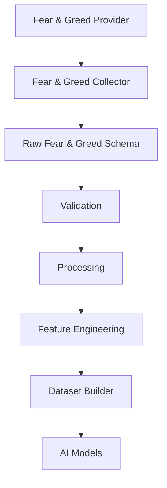
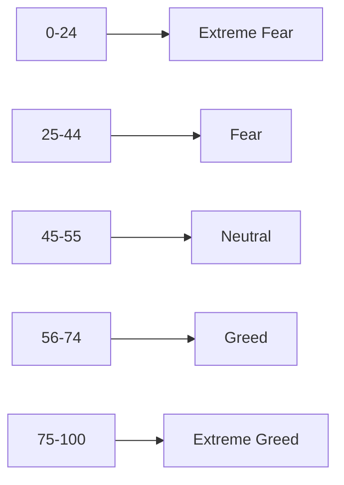
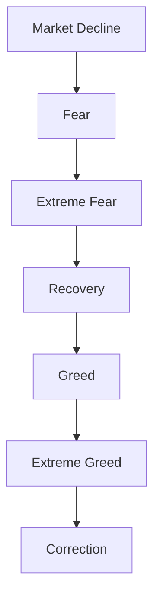
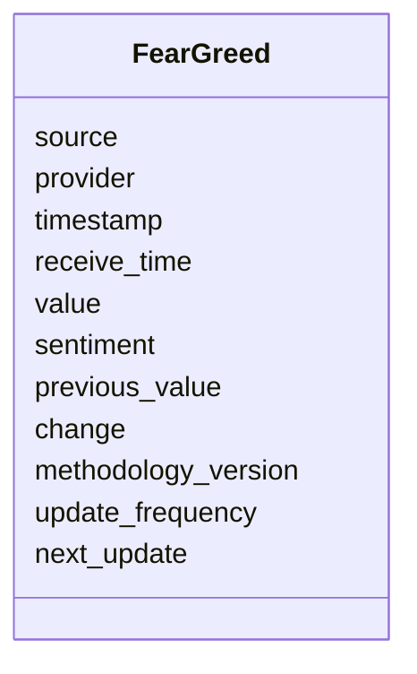
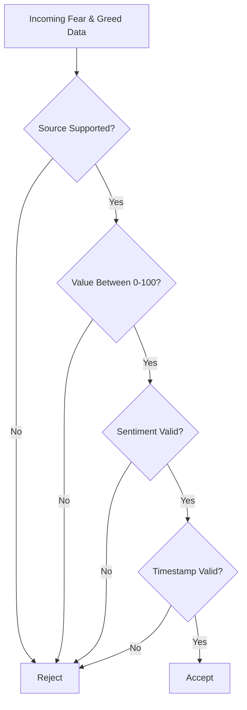
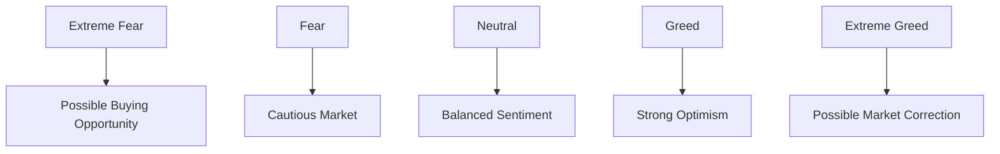
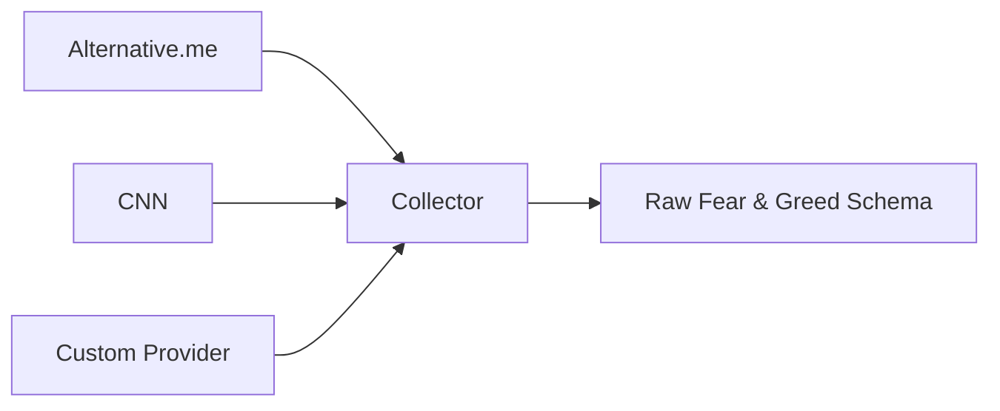

# Raw Fear & Greed Index Schema

## Overview

The **Raw Fear & Greed Index Schema** defines the canonical structure for market sentiment data collected from Fear & Greed Index providers.

The Fear & Greed Index is a market sentiment indicator that quantifies investor emotions on a scale from **0 (Extreme Fear)** to **100 (Extreme Greed)**.

Unlike technical indicators, which are derived from price and volume, the Fear & Greed Index is a **macro sentiment indicator** that reflects overall market psychology.

All provider-specific responses are normalized into this schema before entering the Data Pipeline.

---

# Pipeline Position



---

# What is the Fear & Greed Index?

The Fear & Greed Index attempts to measure the emotional state of market participants.

Markets tend to cycle between:

- Extreme Fear
- Fear
- Neutral
- Greed
- Extreme Greed

It is widely used as a **contrarian indicator**, where excessive optimism or pessimism may signal potential market turning points.

---

# Sentiment Scale



---

# Market Psychology



---

# Schema Structure



---

# Field Definitions

| Field               | Type     | Description                  |
| ------------------- | -------- | ---------------------------- |
| source              | string   | Data source identifier       |
| provider            | string   | Data provider                |
| timestamp           | datetime | Provider timestamp           |
| receive_time        | datetime | Local receive timestamp      |
| value               | integer  | Fear & Greed score (0-100)   |
| sentiment           | string   | Sentiment classification     |
| previous_value      | integer  | Previous index value         |
| change              | integer  | Change from previous value   |
| methodology_version | string   | Provider methodology version |
| update_frequency    | string   | Update interval              |
| next_update         | datetime | Expected next update         |

---

# Sentiment Categories

| Score    | Classification |
| -------- | -------------- |
| 0 - 24   | Extreme Fear   |
| 25 - 44  | Fear           |
| 45 - 55  | Neutral        |
| 56 - 74  | Greed          |
| 75 - 100 | Extreme Greed  |

---

# Example Record

```json
{
  "source": "ALTERNATIVE_ME",

  "provider": "Alternative.me",

  "timestamp": "2026-08-05T00:00:00Z",

  "receive_time": "2026-08-05T00:00:02Z",

  "value": 71,

  "sentiment": "GREED",

  "previous_value": 66,

  "change": 5,

  "methodology_version": "v2",

  "update_frequency": "1d",

  "next_update": "2026-08-06T00:00:00Z"
}
```

---

# Validation Flow



---

# Validation Rules

## Source

Supported values

```
ALTERNATIVE_ME

CNN

CUSTOM
```

---

## Provider

- Required

---

## Value

```
0 <= Value <= 100
```

---

## Previous Value

```
0 <= Previous Value <= 100
```

---

## Sentiment

Allowed values

```
EXTREME_FEAR

FEAR

NEUTRAL

GREED

EXTREME_GREED
```

---

## Timestamp

- Required
- UTC

---

# Interpretation



---

# Relationship with Other Indicators

```mermaid
flowchart LR

Fear & Greed

-->

Market Sentiment

Price

-->

Market Sentiment

Volume

-->

Market Sentiment

Open Interest

-->

Market Sentiment

Funding Rate

-->

Market Sentiment
```

The Fear & Greed Index becomes more valuable when analyzed together with:

- Price trends
- Trading volume
- Open Interest
- Funding Rate
- Liquidations
- Long/Short Ratio

---

# Downstream Usage

```mermaid
mindmap

root((Fear & Greed))

    Market Sentiment

    Contrarian Analysis

    Trend Confirmation

    Risk Monitoring

    Portfolio Allocation

    Volatility Analysis

    AI Features

    Trading Signals
```

---

# Data Sources



---

# Storage Flow

```mermaid
flowchart TD

Provider

-->

Collector

-->

Raw Fear & Greed Schema

-->

Validation

-->

Processing

-->

Storage

-->

Feature Engineering

-->

Datasets
```

---

# Relationship with Other Schemas

```mermaid
flowchart TD

Fear & Greed

-->

Processed Sentiment

-->

Feature Schema

-->

Dataset Schema

-->

AI Models
```

---

# Design Principles

```mermaid
mindmap

root((Fear & Greed Schema))

    Provider Independent

    Sentiment Focused

    Time-Series Ready

    Easy Validation

    AI Friendly

    Extensible

    Versionable
```

---

# Future Enhancements

Possible future additions:

- Regional Fear & Greed Index
- Crypto-specific Index
- Sentiment Confidence Score
- Historical Percentile
- Rolling Average
- Z-Score Normalization
- Multi-provider Aggregation
- Social Sentiment Integration
- News Sentiment Correlation
- Market Regime Classification

---

# Summary

The **Raw Fear & Greed Schema** standardizes market sentiment data from various providers into a unified format.

It provides a foundation for sentiment analysis, contrarian trading strategies, risk assessment, feature engineering, and AI model training.

```mermaid
flowchart TD

Provider

-->

Fear & Greed Collector

-->

Raw Fear & Greed Schema

-->

Validation

-->

Processing

-->

Feature Engineering

-->

Dataset Builder

-->

AI Models

-->

Risk Engine

-->

Strategy Engine
```
