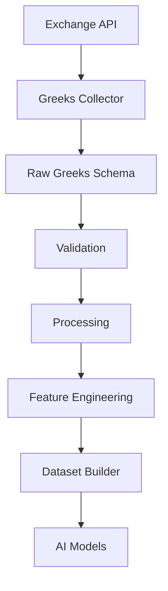
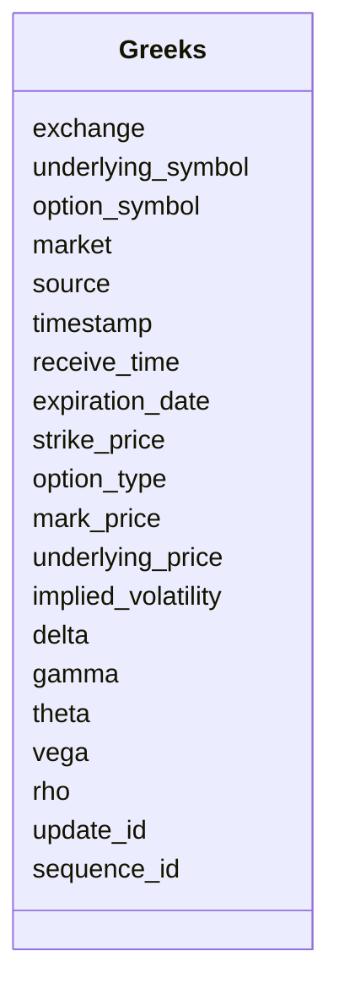
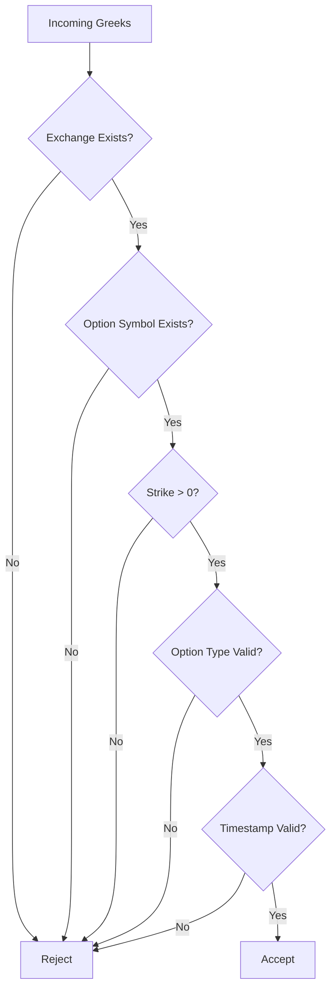
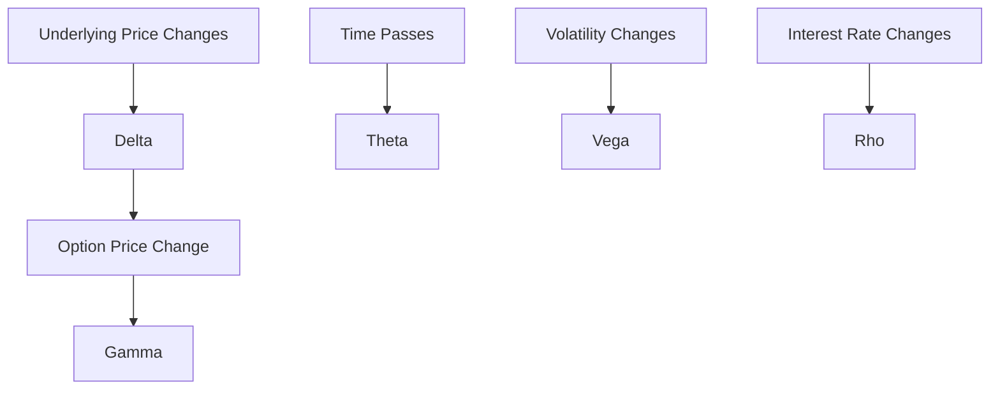
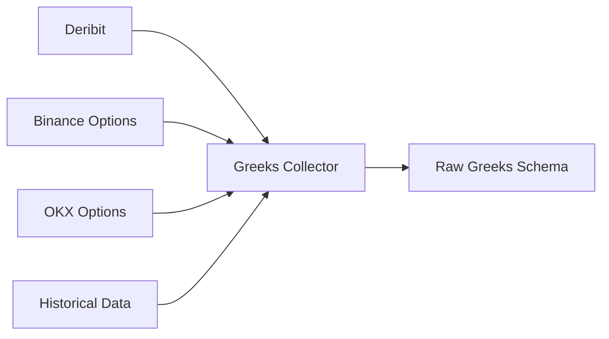

# Raw Greeks Schema

## Overview

The **Raw Greeks Schema** defines the canonical structure for option Greeks collected from cryptocurrency options exchanges.

Greeks measure how sensitive an option's value is to changes in different market variables such as:

- Price
- Volatility
- Time
- Interest Rates

Every exchange returns Greeks differently. This schema standardizes those responses into a common format before entering the Data Pipeline.

---

# Pipeline Position



---

# What are Greeks?

Greeks are risk measures derived from option pricing models.

They describe how an option reacts to changes in market conditions.

They are fundamental for:

- Option pricing
- Portfolio hedging
- Risk management
- Volatility analysis
- Options trading
- AI feature generation

---

# Primary Greeks

```mermaid
mindmap

root((Greeks))

    Delta

    Gamma

    Theta

    Vega

    Rho
```

---

# Schema Structure



---

# Field Definitions

| Field | Type | Description |
|---------|------|-------------|
| exchange | string | Exchange name |
| underlying_symbol | string | Underlying asset |
| option_symbol | string | Option contract symbol |
| market | string | Options market |
| source | string | Data source |
| timestamp | datetime | Exchange timestamp |
| receive_time | datetime | Local receive timestamp |
| expiration_date | datetime | Contract expiry |
| strike_price | float | Strike price |
| option_type | string | CALL or PUT |
| mark_price | float | Fair option price |
| underlying_price | float | Current underlying price |
| implied_volatility | float | Implied volatility |
| delta | float | Delta Greek |
| gamma | float | Gamma Greek |
| theta | float | Theta Greek |
| vega | float | Vega Greek |
| rho | float | Rho Greek |
| update_id | integer | Exchange update ID |
| sequence_id | integer | Exchange sequence number |

---

# Example Record

```json
{
  "exchange": "deribit",
  "underlying_symbol": "ETH",

  "option_symbol": "ETH-26SEP26-3500-C",

  "market": "options",

  "source": "REST API",

  "timestamp": "2026-08-05T12:30:00Z",

  "receive_time": "2026-08-05T12:30:00.130Z",

  "expiration_date": "2026-09-26T08:00:00Z",

  "strike_price": 3500,

  "option_type": "CALL",

  "mark_price": 148.20,

  "underlying_price": 3478.50,

  "implied_volatility": 0.64,

  "delta": 0.58,

  "gamma": 0.0018,

  "theta": -4.15,

  "vega": 18.24,

  "rho": 2.83,

  "update_id": 198212,

  "sequence_id": 92817312
}
```

---

# Validation Flow



---

# Validation Rules

## Exchange

- Required

---

## Underlying Symbol

- Required

---

## Option Symbol

- Required

---

## Strike Price

```
Strike Price > 0
```

---

## Option Type

Allowed values

```
CALL

PUT
```

---

## Underlying Price

```
Underlying Price > 0
```

---

## Mark Price

```
Mark Price >= 0
```

---

## Implied Volatility

```
IV >= 0
```

---

## Timestamp

- Required
- UTC

---

# Understanding the Greeks



---

# Greek Interpretation

| Greek | Measures | Typical Range |
|--------|----------|---------------|
| Delta | Price sensitivity | -1 to +1 |
| Gamma | Delta sensitivity | ≥ 0 |
| Theta | Time decay | Usually negative |
| Vega | Volatility sensitivity | Positive |
| Rho | Interest-rate sensitivity | Positive/Negative |

---

# Downstream Usage

```mermaid
mindmap

root((Greeks))

    Option Pricing

    Risk Management

    Delta Hedging

    Gamma Exposure

    Theta Decay

    Vega Analysis

    Volatility Trading

    AI Features

    Portfolio Optimization
```

---

# Relationship with Other Schemas

```mermaid
flowchart TD

Option Chain

-->

Greeks

-->

Implied Volatility

-->

Feature Engineering

-->

Datasets

-->

AI Models
```

---

# Data Sources



---

# Storage Flow

```mermaid
flowchart TD

Exchange

-->

Collector

-->

Raw Greeks Schema

-->

Validation

-->

Processing

-->

Storage

-->

Feature Engineering

-->

Datasets
```

---

# Design Principles

```mermaid
mindmap

root((Greeks Schema))

    Exchange Independent

    Option Focused

    Time-Series Ready

    Strong Validation

    AI Ready

    Extensible

    Versionable
```

---

# Future Enhancements

Possible future additions:

- Charm
- Vanna
- Vomma
- Speed
- Color
- Zomma
- Elasticity
- Dual Delta
- Higher-order Greeks
- Black-Scholes model inputs

---

# Summary

The **Raw Greeks Schema** standardizes option sensitivity metrics across cryptocurrency options exchanges.

It provides the foundation for options pricing, volatility modeling, portfolio risk analysis, feature engineering, and AI model training.

```mermaid
flowchart TD

Exchange

-->

Greeks Collector

-->

Raw Greeks Schema

-->

Validation

-->

Processing

-->

Feature Engineering

-->

Dataset Builder

-->

AI Models

-->

Risk Engine

-->

Strategy Engine
```