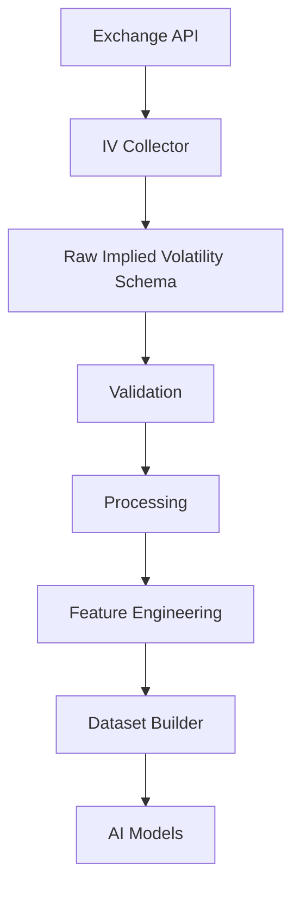
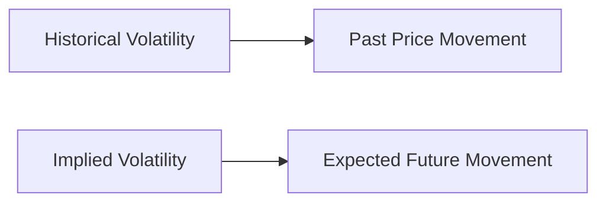
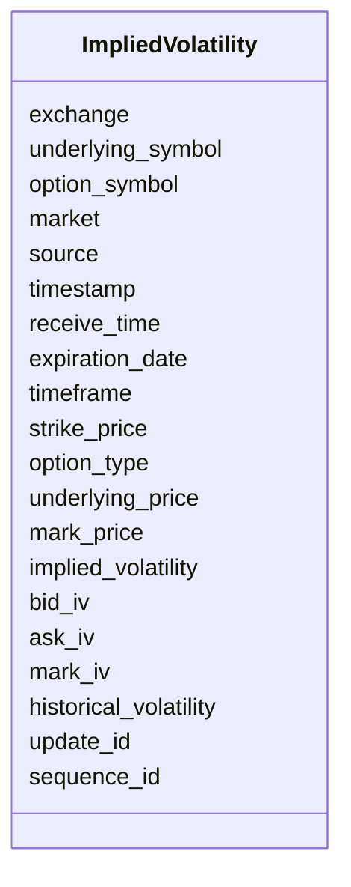
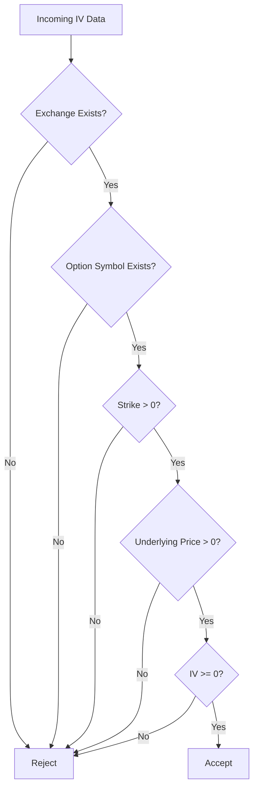
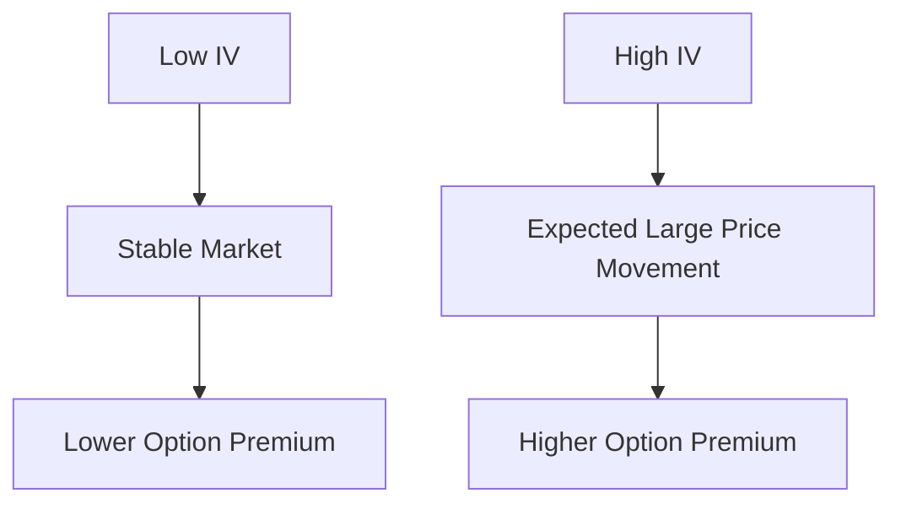
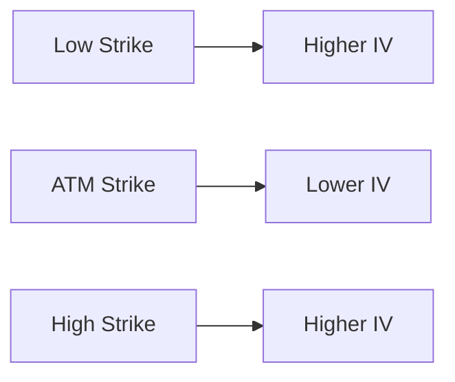
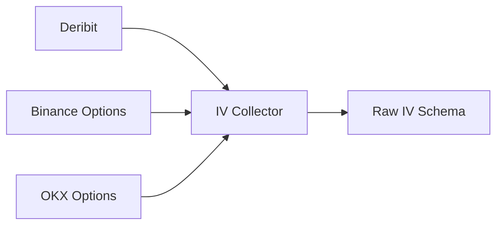

# Raw Implied Volatility (IV) Schema

## Overview

The **Raw Implied Volatility (IV) Schema** defines the canonical structure for Implied Volatility data collected from cryptocurrency options exchanges.

Implied Volatility (IV) is the market's expectation of future price volatility derived from option prices using an option pricing model (such as Black-Scholes).

Unlike Historical Volatility (HV), which measures past price movement, IV is **forward-looking** and reflects current market expectations.

Every exchange returns IV data differently. This schema standardizes all responses before they enter the Data Pipeline.

---

# Pipeline Position



---

# What is Implied Volatility?

Implied Volatility estimates how much the market expects the underlying asset to move over a given period.

High IV generally indicates:

- High uncertainty
- Large expected price movement
- Expensive options

Low IV generally indicates:

- Stable market
- Smaller expected price movement
- Cheaper options

---

# Historical vs Implied Volatility



---

# Schema Structure



---

# Field Definitions

| Field | Type | Description |
|---------|------|-------------|
| exchange | string | Exchange name |
| underlying_symbol | string | Underlying asset |
| option_symbol | string | Option contract |
| market | string | Options market |
| source | string | Data source |
| timestamp | datetime | Exchange timestamp |
| receive_time | datetime | Local receive timestamp |
| expiration_date | datetime | Option expiry |
| timeframe | string | Optional aggregation period |
| strike_price | float | Strike price |
| option_type | string | CALL or PUT |
| underlying_price | float | Current underlying price |
| mark_price | float | Fair option price |
| implied_volatility | float | Primary IV |
| bid_iv | float | IV from bid |
| ask_iv | float | IV from ask |
| mark_iv | float | Exchange mark IV |
| historical_volatility | float | Historical volatility |
| update_id | integer | Exchange update ID |
| sequence_id | integer | Exchange sequence number |

---

# Example Record

```json
{
  "exchange": "deribit",

  "underlying_symbol": "ETH",

  "option_symbol": "ETH-26SEP26-3500-C",

  "market": "options",

  "source": "REST API",

  "timestamp": "2026-08-05T13:00:00Z",

  "receive_time": "2026-08-05T13:00:00.110Z",

  "expiration_date": "2026-09-26T08:00:00Z",

  "timeframe": "1m",

  "strike_price": 3500,

  "option_type": "CALL",

  "underlying_price": 3478.42,

  "mark_price": 146.82,

  "implied_volatility": 0.642,

  "bid_iv": 0.637,

  "ask_iv": 0.648,

  "mark_iv": 0.642,

  "historical_volatility": 0.598,

  "update_id": 561812,

  "sequence_id": 92817321
}
```

---

# Validation Flow



---

# Validation Rules

## Exchange

- Required

---

## Underlying Symbol

- Required

---

## Option Symbol

- Required

---

## Market

Allowed values

```
options
```

---

## Option Type

Allowed values

```
CALL

PUT
```

---

## Strike Price

```
Strike Price > 0
```

---

## Underlying Price

```
Underlying Price > 0
```

---

## Implied Volatility

```
IV >= 0
```

---

## Bid IV

```
Bid IV >= 0
```

---

## Ask IV

```
Ask IV >= 0
```

---

## Historical Volatility

```
Historical Volatility >= 0
```

---

## Timestamp

- Required
- UTC

---

# IV Interpretation



---

# Volatility Smile



---

# Relationship with Other Metrics

```mermaid
flowchart TD

Option Prices

-->

Implied Volatility

-->

Greeks

-->

Risk Analysis

-->

Feature Engineering

-->

AI Models
```

---

# Downstream Usage

```mermaid
mindmap

root((Implied Volatility))

    Option Pricing

    Volatility Surface

    Volatility Smile

    Volatility Skew

    Vega Analysis

    Risk Management

    Market Sentiment

    Feature Engineering

    AI Features
```

---

# Data Sources



---

# Storage Flow

```mermaid
flowchart TD

Exchange

-->

Collector

-->

Raw IV Schema

-->

Validation

-->

Processing

-->

Storage

-->

Feature Engineering

-->

Datasets
```

---

# Relationship with Other Schemas

```mermaid
flowchart TD

Option Chain

-->

Greeks

-->

Implied Volatility

-->

Feature Schema

-->

Dataset Schema

-->

AI Models
```

---

# Design Principles

```mermaid
mindmap

root((IV Schema))

    Exchange Independent

    Options Focused

    Forward Looking

    Time-Series Ready

    Strong Validation

    AI Ready

    Extensible

    Versionable
```

---

# Future Enhancements

Possible future additions:

- IV Percentile
- IV Rank
- ATM IV
- 25 Delta Call IV
- 25 Delta Put IV
- Volatility Surface Coordinates
- Smile Curvature
- Skew Index
- Realized Volatility Comparison
- Exchange Aggregated IV

---

# Summary

The **Raw Implied Volatility Schema** standardizes implied volatility data across cryptocurrency options exchanges.

It provides the foundation for volatility analysis, options pricing, Greeks computation, feature engineering, quantitative research, and AI model training.

```mermaid
flowchart TD

Exchange

-->

IV Collector

-->

Raw Implied Volatility Schema

-->

Validation

-->

Processing

-->

Feature Engineering

-->

Dataset Builder

-->

AI Models

-->

Risk Engine

-->

Strategy Engine
```