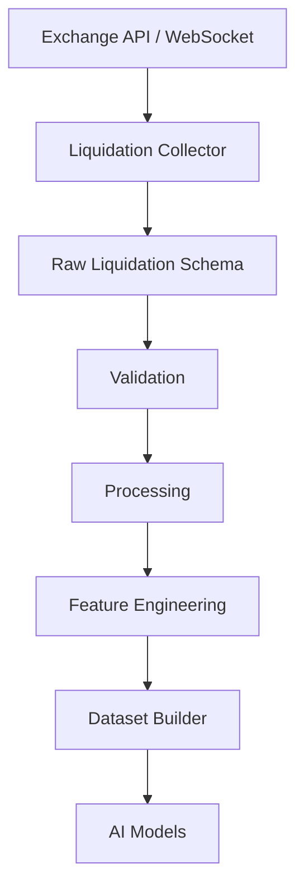
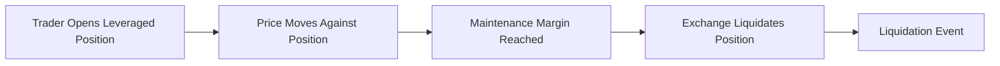
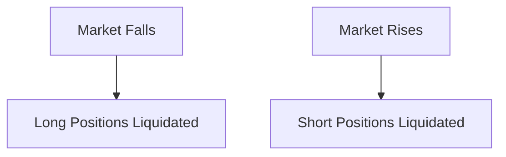
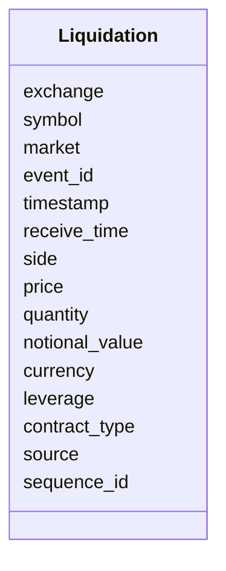
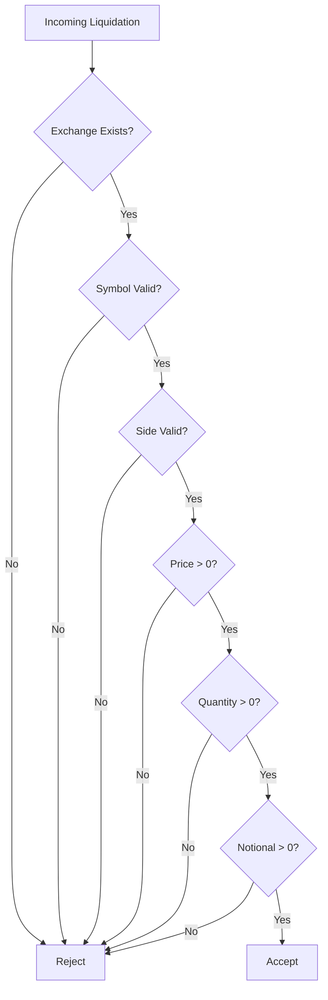
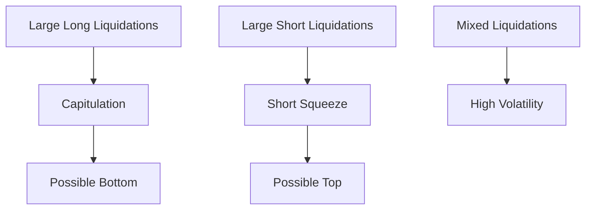
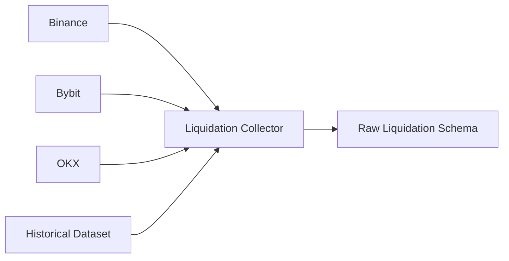

# Raw Liquidations Schema

## Overview

The **Raw Liquidations Schema** defines the canonical structure for liquidation events collected from cryptocurrency derivative exchanges.

A liquidation occurs when a leveraged position is automatically closed by the exchange because the trader's margin is insufficient to maintain the position.

Liquidation data provides valuable insights into market stress, leverage, volatility, and potential reversal zones.

All exchange-specific liquidation data is normalized into this schema before entering the Data Pipeline.

---

# Pipeline Position



---

# What is a Liquidation?

A liquidation happens when a trader's leveraged position is forcibly closed by the exchange.

Common reasons include:

- Margin exhaustion
- Maintenance margin violation
- Extreme market volatility
- High leverage

Large liquidation events often coincide with sharp price movements.

---

# Liquidation Lifecycle



---

# Long vs Short Liquidations



---

# Schema Structure



---

# Field Definitions

| Field | Type | Description |
|---------|------|-------------|
| exchange | string | Exchange name |
| symbol | string | Trading pair |
| market | string | Futures / Coin-M / Options |
| event_id | string | Unique liquidation identifier |
| timestamp | datetime | Exchange event timestamp |
| receive_time | datetime | Local receive timestamp |
| side | string | LONG or SHORT liquidation |
| price | float | Liquidation execution price |
| quantity | float | Liquidated contract quantity |
| notional_value | float | USD/USDT value of liquidation |
| currency | string | Settlement currency |
| leverage | float | Estimated leverage |
| contract_type | string | Perpetual, Quarterly, etc. |
| source | string | Data source |
| sequence_id | integer | Exchange sequence number |

---

# Example Record

```json
{
  "exchange": "binance",
  "symbol": "ETHUSDT",
  "market": "futures",

  "event_id": "LQ987654",

  "timestamp": "2026-08-05T11:05:10Z",

  "receive_time": "2026-08-05T11:05:10.135Z",

  "side": "LONG",

  "price": 3488.50,

  "quantity": 125.75,

  "notional_value": 438623.13,

  "currency": "USDT",

  "leverage": 20,

  "contract_type": "PERPETUAL",

  "source": "WebSocket",

  "sequence_id": 89217341
}
```

---

# Validation Flow



---

# Validation Rules

## Exchange

- Required

---

## Symbol

- Required

---

## Market

Supported values:

```
futures

coinm

options
```

---

## Side

Allowed values:

```
LONG

SHORT
```

---

## Price

```
Price > 0
```

---

## Quantity

```
Quantity > 0
```

---

## Notional Value

```
Notional Value > 0
```

---

## Timestamp

- Required
- UTC
- Must be valid

---

# Market Interpretation



---

# Relationship with Other Market Data

```mermaid
flowchart LR

Price

--> Liquidations

Open Interest

--> Liquidations

Funding Rate

--> Liquidations

Leverage

--> Liquidations
```

Liquidations are most informative when analyzed together with:

- Price action
- Open Interest
- Funding Rate
- Volume
- Order Book

---

# Downstream Usage

Liquidation data supports:

```mermaid
mindmap

root((Liquidations))

    Market Stress

    Long Squeeze Detection

    Short Squeeze Detection

    Capitulation Detection

    Volatility Prediction

    Trend Exhaustion

    Risk Monitoring

    Feature Engineering

    AI Models
```

---

# Data Sources



---

# Storage Flow

```mermaid
flowchart TD

Exchange

-->

Collector

-->

Raw Liquidation Schema

-->

Validation

-->

Processing

-->

Storage

-->

Feature Engineering

-->

Datasets
```

---

# Relationship with Other Schemas

```mermaid
flowchart TD

Raw Liquidation

-->

Processed Liquidation

-->

Feature Schema

-->

Dataset Schema

-->

AI Models
```

---

# Design Principles

```mermaid
mindmap

root((Liquidation Schema))

    Exchange Independent

    Market Independent

    Event Based

    Time-Series Ready

    Strong Validation

    Extensible

    Versionable
```

---

# Future Enhancements

Possible future additions:

- Liquidation reason
- Margin ratio
- Margin mode (Cross / Isolated)
- Position size before liquidation
- Remaining position size
- Estimated liquidation price
- Account type
- Exchange latency
- Multi-exchange aggregation
- Liquidation clusters

---

# Summary

The **Raw Liquidations Schema** provides a standardized representation of forced liquidation events across cryptocurrency derivative exchanges.

It forms the foundation for leverage analysis, squeeze detection, volatility modeling, feature engineering, and AI model training.

```mermaid
flowchart TD

Exchange

-->

Liquidation Collector

-->

Raw Liquidation Schema

-->

Validation

-->

Processing

-->

Feature Engineering

-->

Dataset Builder

-->

AI Models

-->

Strategy Engine
```