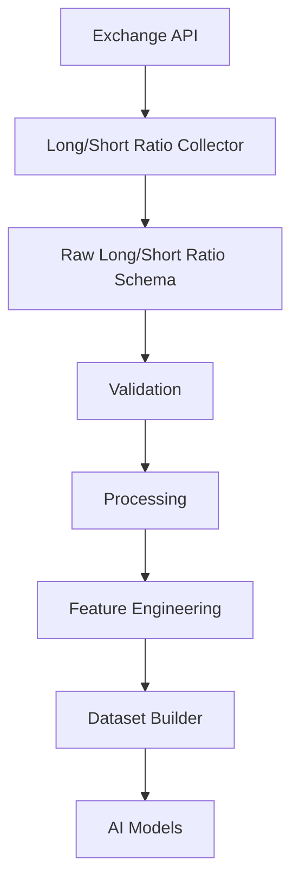
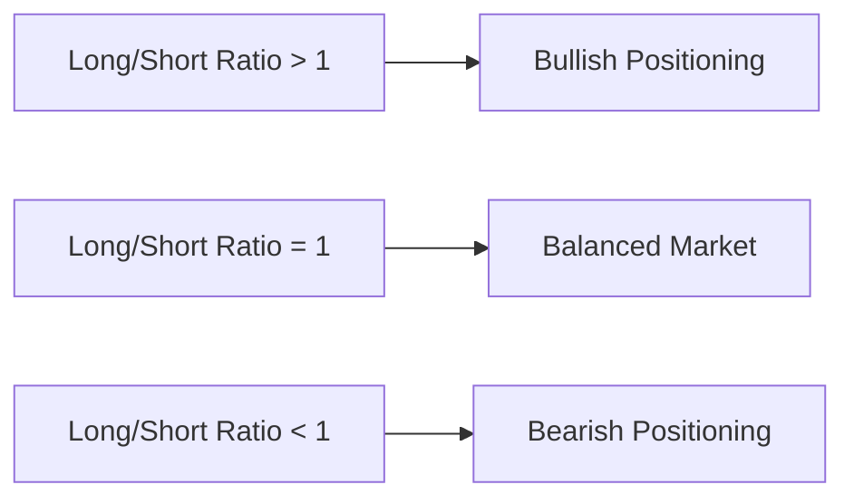
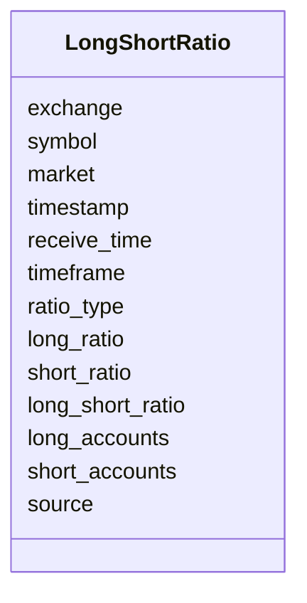
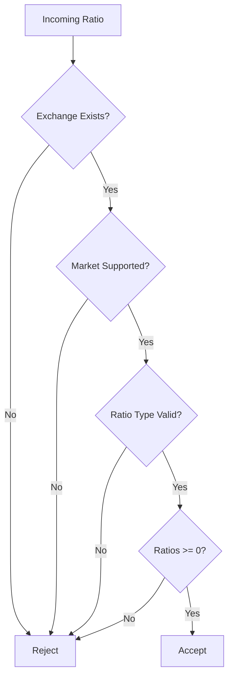
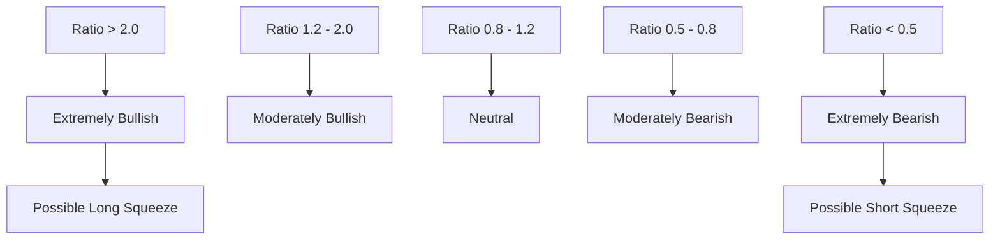
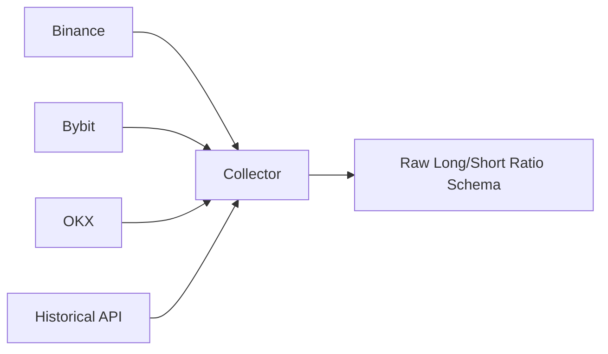

# Raw Long / Short Ratio Schema

## Overview

The **Raw Long/Short Ratio Schema** defines the canonical structure for Long/Short Ratio data collected from cryptocurrency derivative exchanges.

The Long/Short Ratio measures the balance between bullish (long) and bearish (short) market positioning.

Unlike Open Interest, which measures the number of open contracts, the Long/Short Ratio measures **how those contracts are distributed between long and short traders**.

All exchange-specific responses are normalized into this schema before entering the Data Pipeline.

---

# Pipeline Position



---

# What is the Long/Short Ratio?

The Long/Short Ratio indicates whether traders are predominantly bullish or bearish.

Examples:

- More long positions than short positions
- More short positions than long positions
- Balanced market positioning

It is one of the most commonly used sentiment indicators in futures markets.

---

# Ratio Interpretation



---

# Types of Long/Short Ratios

Different exchanges provide different ratio calculations.

```mermaid
mindmap

root((Ratio Types))

    Global Ratio

    Account Ratio

    Position Ratio

    Top Trader Account Ratio

    Top Trader Position Ratio
```

---

# Schema Structure



---

# Field Definitions

| Field | Type | Description |
|---------|------|-------------|
| exchange | string | Exchange name |
| symbol | string | Trading pair |
| market | string | Futures / Coin-M |
| timestamp | datetime | Exchange timestamp |
| receive_time | datetime | Local receive timestamp |
| timeframe | string | Aggregation interval |
| ratio_type | string | Type of ratio |
| long_ratio | float | Percentage of long positions |
| short_ratio | float | Percentage of short positions |
| long_short_ratio | float | Long divided by Short |
| long_accounts | integer | Number of long accounts |
| short_accounts | integer | Number of short accounts |
| source | string | Data source |

---

# Ratio Types

| Ratio Type | Description |
|------------|-------------|
| GLOBAL | Overall market ratio |
| ACCOUNT | Account-based ratio |
| POSITION | Position-based ratio |
| TOP_TRADER_ACCOUNT | Top trader accounts |
| TOP_TRADER_POSITION | Top trader positions |

---

# Example Record

```json
{
  "exchange": "binance",

  "symbol": "ETHUSDT",

  "market": "futures",

  "timestamp": "2026-08-05T12:00:00Z",

  "receive_time": "2026-08-05T12:00:00.120Z",

  "timeframe": "5m",

  "ratio_type": "TOP_TRADER_POSITION",

  "long_ratio": 0.62,

  "short_ratio": 0.38,

  "long_short_ratio": 1.63,

  "long_accounts": 6200,

  "short_accounts": 3800,

  "source": "REST API"
}
```

---

# Validation Flow



---

# Validation Rules

## Exchange

- Required

---

## Symbol

- Required

---

## Market

Supported values

```
futures

coinm
```

---

## Ratio Type

Allowed values

```
GLOBAL

ACCOUNT

POSITION

TOP_TRADER_ACCOUNT

TOP_TRADER_POSITION
```

---

## Long Ratio

```
Long Ratio >= 0
```

---

## Short Ratio

```
Short Ratio >= 0
```

---

## Long/Short Ratio

```
Long/Short Ratio >= 0
```

---

## Timestamp

- Required
- UTC

---

# Market Interpretation



---

# Relationship with Other Indicators

```mermaid
flowchart LR

Price

--> Market Sentiment

Funding Rate

--> Market Sentiment

Open Interest

--> Market Sentiment

Liquidations

--> Market Sentiment

Long/Short Ratio

--> Market Sentiment
```

The Long/Short Ratio becomes significantly more informative when combined with:

- Price
- Open Interest
- Funding Rate
- Liquidations
- Volume

---

# Downstream Usage

```mermaid
mindmap

root((Long/Short Ratio))

    Sentiment Analysis

    Trend Confirmation

    Crowd Positioning

    Contrarian Signals

    Squeeze Detection

    Feature Engineering

    AI Features

    Strategy Signals
```

---

# Data Sources



---

# Storage Flow

```mermaid
flowchart TD

Exchange

-->

Collector

-->

Raw Long/Short Ratio Schema

-->

Validation

-->

Processing

-->

Storage

-->

Feature Engineering

-->

Datasets
```

---

# Relationship with Other Schemas

```mermaid
flowchart TD

Raw Long/Short Ratio

-->

Processed Long/Short Ratio

-->

Feature Schema

-->

Dataset Schema

-->

AI Models
```

---

# Design Principles

```mermaid
mindmap

root((Long/Short Ratio Schema))

    Exchange Independent

    Futures Focused

    Time-Series Ready

    Easy Validation

    Extensible

    Versionable

    AI Friendly
```

---

# Future Enhancements

Possible future additions:

- Exchange-weighted ratios
- Historical percentile
- Long/Short Ratio Delta
- Rolling averages
- Z-score normalization
- Multi-exchange aggregation
- Whale-only ratios
- Retail-only ratios
- Institutional positioning
- Sentiment confidence score

---

# Summary

The **Raw Long/Short Ratio Schema** provides a standardized representation of trader positioning across cryptocurrency derivatives exchanges.

It is an essential sentiment indicator used for market analysis, squeeze detection, feature engineering, and AI model training.

```mermaid
flowchart TD

Exchange

-->

Long/Short Ratio Collector

-->

Raw Long/Short Ratio Schema

-->

Validation

-->

Processing

-->

Feature Engineering

-->

Dataset Builder

-->

AI Models

-->

Strategy Engine
```