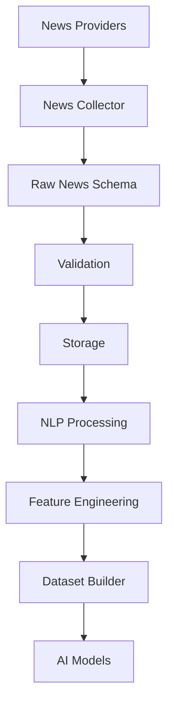
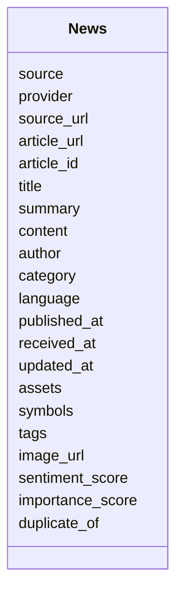
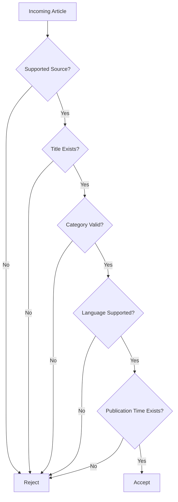
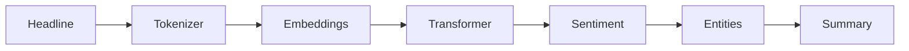
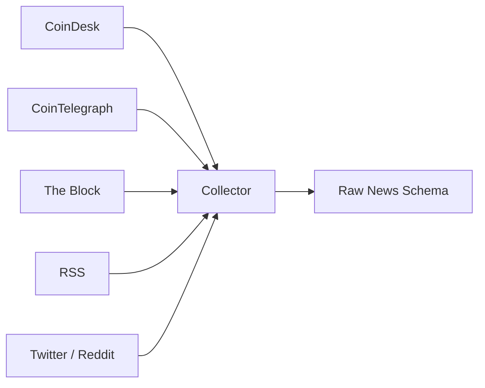

# Raw News Schema

## Overview

The **Raw News Schema** defines the canonical structure for cryptocurrency news collected from news websites, RSS feeds, exchange announcements, social media platforms, and market intelligence providers.

News is one of the most influential alternative datasets in quantitative trading because it directly impacts market sentiment, volatility, and investor behavior.

This schema stores news in its **raw, unprocessed form** before any Natural Language Processing (NLP), sentiment analysis, entity extraction, summarization, or AI feature generation.

All provider-specific responses are normalized into this schema before entering the Data Pipeline.

---

# Pipeline Position



---

# Why News Matters

News is often responsible for sudden market movements.

Examples include:

- Exchange listings
- ETF approvals
- SEC announcements
- Large hacks
- Macroeconomic reports
- Whale announcements
- Blockchain upgrades
- Interest-rate decisions

News frequently influences markets before technical indicators react.

---

# News Sources

```mermaid
mindmap

root((News Sources))

    CoinDesk

    CoinTelegraph

    The Block

    Decrypt

    Binance

    Bybit

    OKX

    RSS Feeds

    Twitter/X

    Reddit

    Custom Sources
```

---

# Schema Structure



---

# Field Definitions

| Field | Type | Description |
|---------|------|-------------|
| source | string | Source identifier |
| provider | string | News provider |
| source_url | string | Provider homepage |
| article_url | string | Original article URL |
| article_id | string | Unique article ID |
| title | string | News headline |
| summary | string | Short summary |
| content | string | Full article text |
| author | string | Article author |
| category | string | News category |
| language | string | Language code |
| published_at | datetime | Publication time |
| received_at | datetime | Collector receive time |
| updated_at | datetime | Last update time |
| assets | list | Mentioned assets |
| symbols | list | Trading symbols |
| tags | list | Keywords |
| image_url | string | Thumbnail or image |
| sentiment_score | float | NLP sentiment (-1 to 1) |
| importance_score | float | Relative importance (0 to 1) |
| duplicate_of | string | Original article if duplicate |

---

# Supported Categories

```
MARKET

MACRO

REGULATION

EXCHANGE

BLOCKCHAIN

DEFI

NFT

SECURITY

HACK

MINING

ONCHAIN

AI

GENERAL
```

---

# Supported Languages

```
en

es

fr

de

ja

ko

zh

hi
```

---

# Example Record

```json
{
  "source": "COINDESK",

  "provider": "CoinDesk",

  "source_url": "https://www.coindesk.com",

  "article_url": "https://www.coindesk.com/example",

  "article_id": "cd-20260805-001",

  "title": "Ethereum ETF Sees Record Inflows",

  "summary": "Institutional demand continues to increase.",

  "content": "Full article text...",

  "author": "Jane Doe",

  "category": "MARKET",

  "language": "en",

  "published_at": "2026-08-05T10:12:00Z",

  "received_at": "2026-08-05T10:12:08Z",

  "updated_at": null,

  "assets": [
    "ETH"
  ],

  "symbols": [
    "ETHUSDT"
  ],

  "tags": [
    "ETF",
    "Ethereum",
    "Institutional"
  ],

  "image_url": "https://...",

  "sentiment_score": 0.73,

  "importance_score": 0.91,

  "duplicate_of": null
}
```

---

# Validation Flow



---

# Validation Rules

## Source

Must be one of the supported providers.

---

## Provider

- Required

---

## Article ID

- Required
- Must be unique

---

## Title

- Required

---

## Category

Must match one of the supported categories.

---

## Language

Must be one of the supported language codes.

---

## Published Time

- Required
- UTC

---

## Sentiment Score

```
-1 <= Score <= 1
```

---

## Importance Score

```
0 <= Score <= 1
```

---

# News Processing Pipeline

```mermaid
flowchart TD

Raw News

-->

Duplicate Detection

-->

Cleaning

-->

Language Detection

-->

Entity Extraction

-->

Keyword Extraction

-->

Sentiment Analysis

-->

Summarization

-->

Feature Engineering
```

---

# NLP Pipeline



---

# Relationship with Other Data

```mermaid
flowchart LR

News

-->

Sentiment

Price

-->

Sentiment

Fear & Greed

-->

Sentiment

Whales

-->

Market Analysis

Open Interest

-->

Market Analysis
```

Combining news with market data enables:

- Event-driven trading
- Sentiment analysis
- Volatility prediction
- Risk monitoring
- AI forecasting

---

# Downstream Usage

```mermaid
mindmap

root((News))

    Sentiment Analysis

    NLP

    Event Detection

    Entity Recognition

    Topic Modeling

    Trend Detection

    Volatility Prediction

    AI Features

    Trading Signals
```

---

# Data Sources



---

# Storage Flow

```mermaid
flowchart TD

Provider

-->

Collector

-->

Raw News Schema

-->

Validation

-->

Storage

-->

NLP Processing

-->

Feature Engineering

-->

Datasets
```

---

# Relationship with Other Schemas

```mermaid
flowchart TD

Raw News

-->

Processed News

-->

Sentiment Features

-->

Feature Schema

-->

Dataset Schema

-->

AI Models
```

---

# Design Principles

```mermaid
mindmap

root((News Schema))

    Provider Independent

    NLP Ready

    Event Driven

    Time-Series Ready

    AI Ready

    Strong Validation

    Extensible

    Versionable
```

---

# Future Enhancements

Possible future additions:

- News embeddings
- LLM-generated summaries
- Topic clustering
- Named entity confidence
- Fake news detection
- Source credibility score
- Multi-language translation
- Breaking news priority
- Market impact estimation
- Cross-source article linking

---

# Summary

The **Raw News Schema** standardizes cryptocurrency news from multiple providers into a unified structure suitable for NLP, sentiment analysis, feature engineering, quantitative research, and AI model training.

```mermaid
flowchart TD

Provider

-->

News Collector

-->

Raw News Schema

-->

Validation

-->

Storage

-->

NLP Processing

-->

Feature Engineering

-->

Dataset Builder

-->

AI Models

-->

Strategy Engine
```