# Raw OHLCV Schema

## Overview

The **Raw OHLCV Schema** defines the standard structure for candlestick (Kline) data collected from cryptocurrency exchanges.

Every exchange has its own response format. Before entering the data pipeline, all OHLCV data is transformed into this common schema.

This ensures every downstream component works with a single standardized format.

---

# Pipeline Position

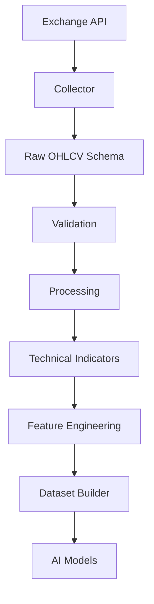

---

# Purpose

The schema provides a universal structure for market candles.

Supported exchanges include:

- Binance
- Bybit
- OKX

Future exchanges can be integrated without changing downstream components.

---

# Supported Markets

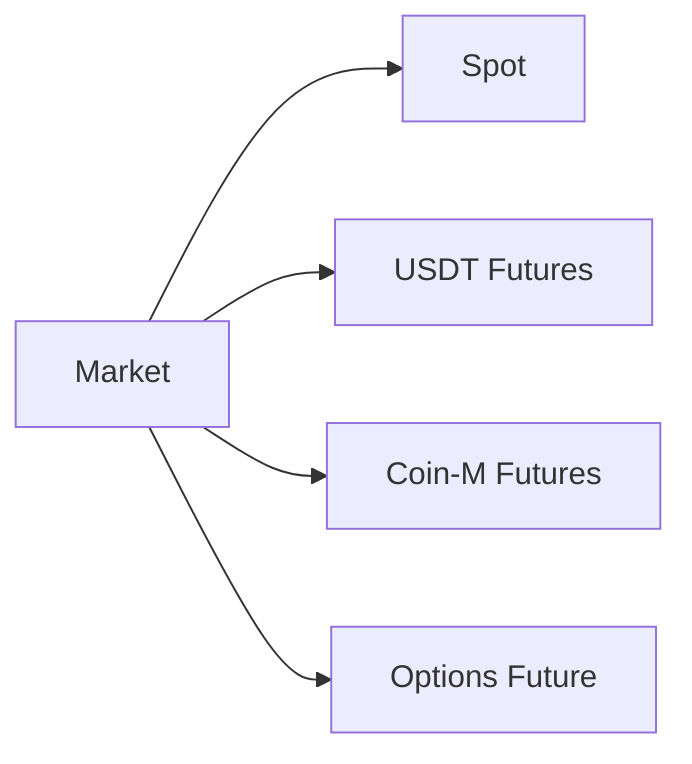

---

# Supported Timeframes

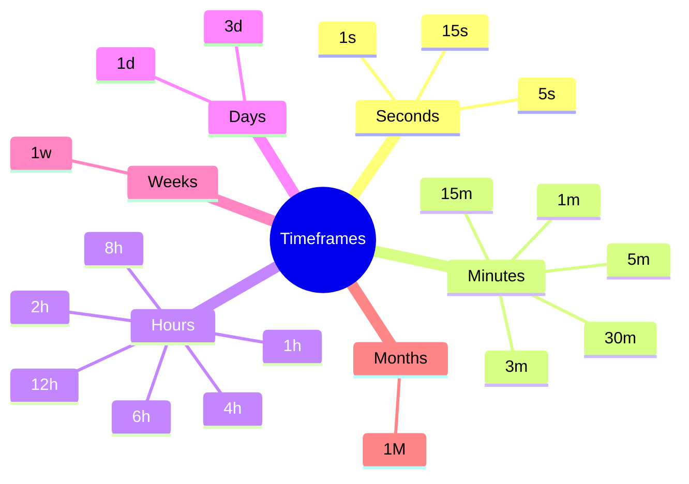

The schema is identical for every timeframe.

Only the candle duration changes.

---

# OHLCV Structure

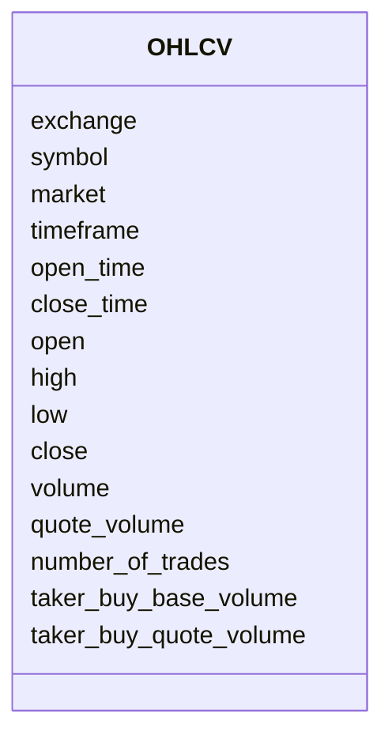

---

# Field Definitions

| Field | Type | Description |
|---------|------|-------------|
| exchange | string | Exchange name |
| symbol | string | Trading symbol |
| market | string | Spot / Futures |
| timeframe | string | Candle interval |
| open_time | datetime | Candle start |
| close_time | datetime | Candle end |
| open | float | Opening price |
| high | float | Highest price |
| low | float | Lowest price |
| close | float | Closing price |
| volume | float | Base asset volume |
| quote_volume | float | Quote asset volume |
| number_of_trades | integer | Number of trades |
| taker_buy_base_volume | float | Buy volume |
| taker_buy_quote_volume | float | Buy quote volume |

---

# Example Record

```json
{
  "exchange": "binance",
  "symbol": "ETHUSDT",
  "market": "futures",
  "timeframe": "1h",

  "open_time": "2026-08-01T10:00:00Z",
  "close_time": "2026-08-01T10:59:59Z",

  "open": 3510.25,
  "high": 3528.40,
  "low": 3498.15,
  "close": 3521.90,

  "volume": 12453.20,
  "quote_volume": 43874210.15,

  "number_of_trades": 14520,

  "taker_buy_base_volume": 6325.42,
  "taker_buy_quote_volume": 22340015.92
}
```

---

# Validation Rules

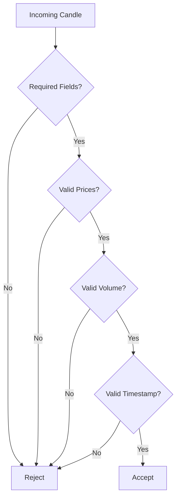

---

# Price Rules

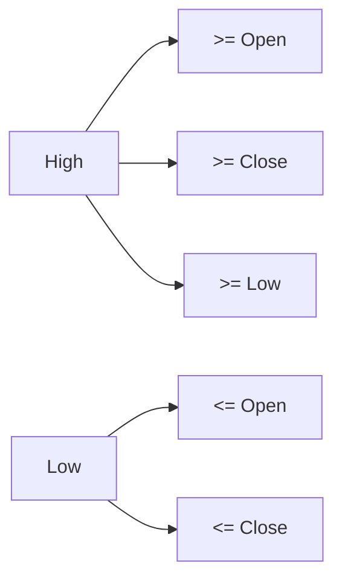

---

# Data Processing Lifecycle

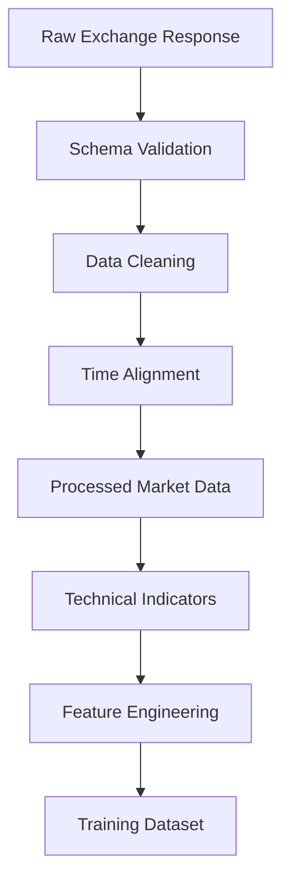

---

# Data Sources

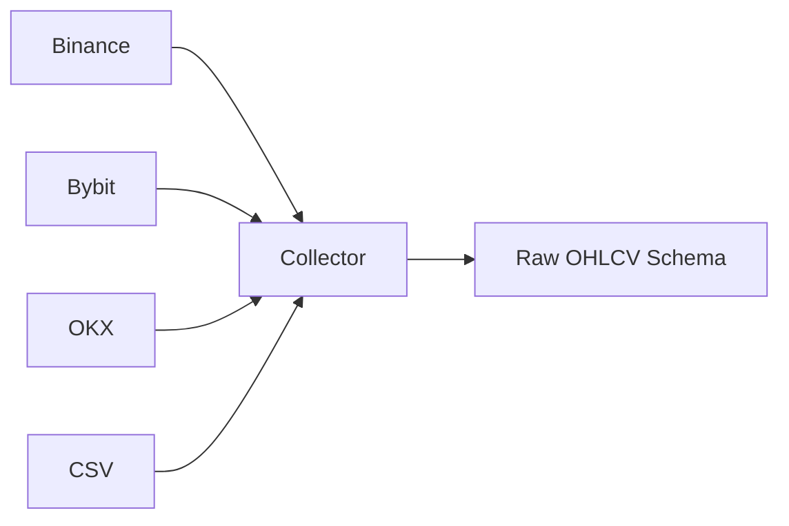

---

# Relationship With Other Schemas

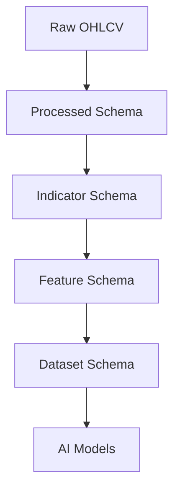

---

# Design Principles

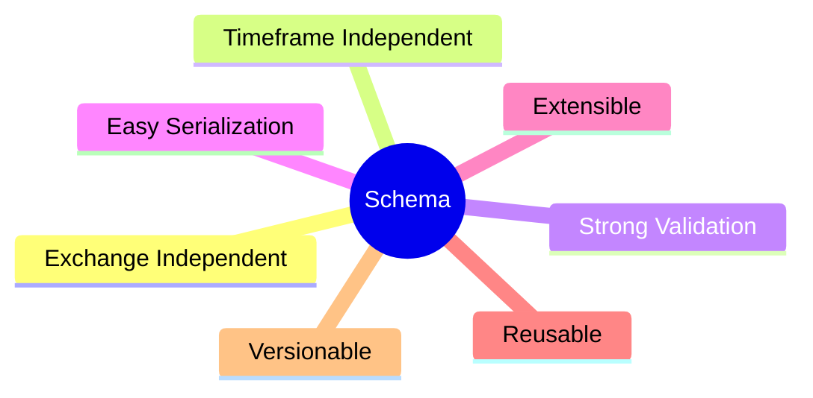

---

# Future Extensions

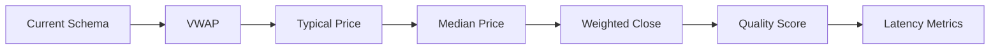

---

# Complete Data Flow

```mermaid
flowchart TD

Exchange

--> Collector

--> Raw OHLCV Schema

--> Validation

--> Processing

--> Technical Indicators

--> Feature Engineering

--> Dataset Builder

--> AI Models

--> Strategy Engine

--> Risk Engine

--> Execution Engine
```

---

# Summary

The Raw OHLCV Schema is the canonical representation of candlestick market data within the project.

Every exchange-specific response is transformed into this standardized schema before moving through validation, processing, feature engineering, dataset creation, and AI model training. It provides a consistent, reliable foundation for the entire trading system.