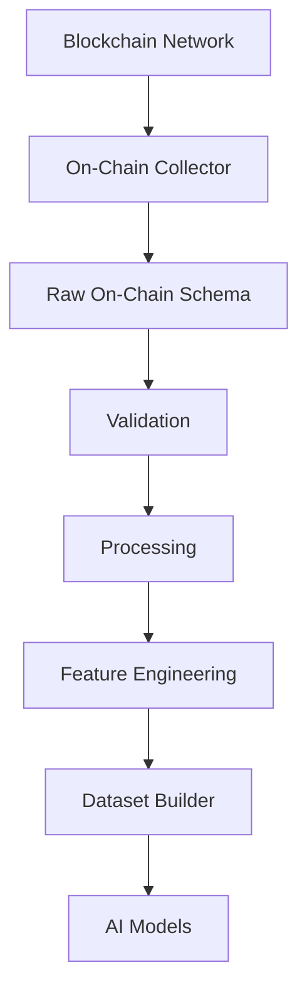
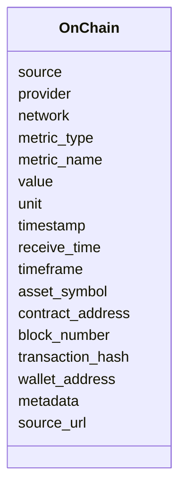
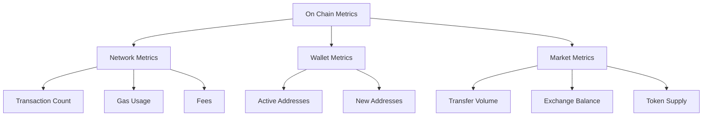
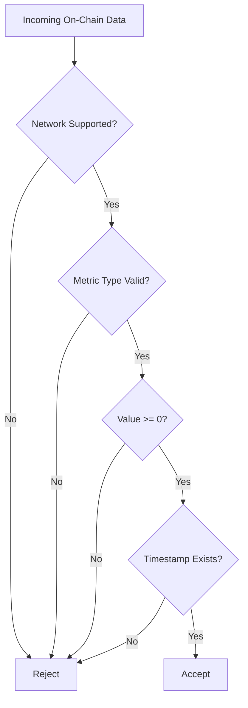
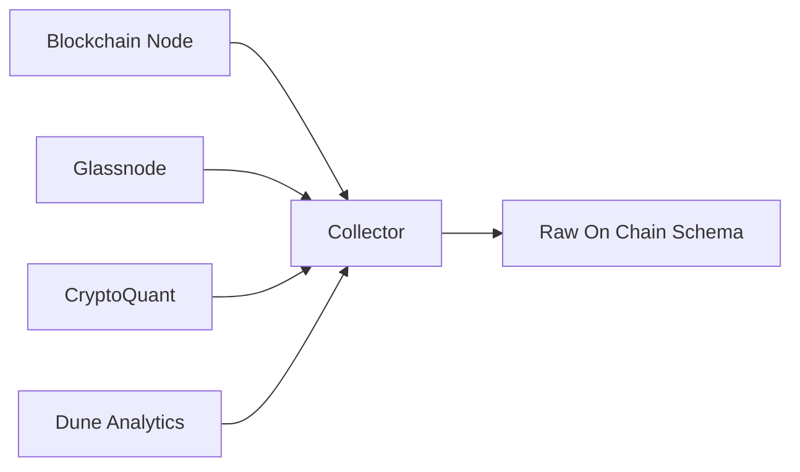

# Raw On-Chain Data Schema

## Overview

The **Raw On-Chain Data Schema** defines the canonical structure for blockchain activity data collected from blockchain nodes, analytics providers, and on-chain intelligence platforms.

On-chain data represents activity occurring directly on a blockchain network.

It includes:

- Transaction activity
- Wallet behavior
- Network usage
- Token movement
- Exchange flows
- Gas activity
- Protocol metrics
- Blockchain health indicators

This schema stores raw blockchain metrics before processing, aggregation, feature engineering, and AI modeling.

All provider-specific responses are normalized into this schema before entering the Data Pipeline.

---

# Pipeline Position



---

# What is On-Chain Data?

On-chain data is information directly recorded on a blockchain.

Examples:

- Number of transactions
- Active wallets
- ETH transfers
- Gas consumption
- Exchange balances
- Token supply changes
- Smart contract activity

Unlike exchange data, on-chain data represents actual blockchain activity.

---

# On-Chain Data Categories

```mermaid
mindmap

root((On-Chain Data))

    Network Activity

        Transactions

        Blocks

        Fees

        Gas

    Wallet Activity

        Active Addresses

        New Addresses

        Balances

    Token Activity

        Supply

        Transfers

        Holders

    Market Flow

        Exchange Inflow

        Exchange Outflow

        Whale Movement

    Protocol Data

        TVL

        Staking

        DeFi Activity
```

---

# Supported Networks

```
ETHEREUM

BITCOIN

BNB

ARBITRUM

OPTIMISM

BASE

POLYGON

SOLANA
```

---

# Schema Structure



---

# Field Definitions

| Field | Type | Description |
|---|---|---|
| source | string | Data source |
| provider | string | Analytics provider |
| network | string | Blockchain network |
| metric_type | string | Type of metric |
| metric_name | string | Metric identifier |
| value | float | Metric value |
| unit | string | Measurement unit |
| timestamp | datetime | Blockchain timestamp |
| receive_time | datetime | Collector timestamp |
| timeframe | string | Aggregation period |
| asset_symbol | string | Asset identifier |
| contract_address | string | Token contract |
| block_number | integer | Blockchain block |
| transaction_hash | string | Transaction reference |
| wallet_address | string | Wallet reference |
| metadata | object | Additional information |
| source_url | string | Data source URL |

---

# Metric Types



---

# Supported Metrics

```
TRANSACTION_COUNT

ACTIVE_ADDRESSES

NEW_ADDRESSES

GAS_USAGE

GAS_PRICE

BLOCK_COUNT

TRANSFER_VOLUME

TOKEN_SUPPLY

EXCHANGE_BALANCE

WALLET_BALANCE

TVL

STAKING

FEES
```

---

# Example Record

```json
{
  "source": "GLASSNODE",

  "provider": "Glassnode",

  "network": "ETHEREUM",

  "metric_type": "ACTIVE_ADDRESSES",

  "metric_name": "ethereum_active_addresses",

  "value": 562481,

  "unit": "addresses",

  "timestamp": "2026-08-05T12:00:00Z",

  "receive_time": "2026-08-05T12:00:05Z",

  "timeframe": "1h",

  "asset_symbol": "ETH",

  "contract_address": null,

  "block_number": 25482123,

  "transaction_hash": null,

  "wallet_address": null,

  "metadata": {},

  "source_url": "https://example.com"
}
```

---

# Validation Flow



---

# Validation Rules

## Source

Required.

---

## Provider

Required.

---

## Network

Must be:

```
ETHEREUM

BITCOIN

BNB

ARBITRUM

OPTIMISM

BASE

POLYGON

SOLANA
```

---

## Metric Type

Must belong to supported metric categories.

---

## Value

```
Value >= 0
```

---

## Timeframe

Allowed:

```
1m

5m

15m

1h

4h

1d

1w
```

---

## Timestamp

- Required
- UTC

---

# On-Chain Data Flow

```mermaid
flowchart LR

Blockchain

-->

Node

-->

Collector

-->

Raw Schema

-->

Validation

-->

Processing

-->

Features
```

---

# Relationship With Market Data

```mermaid
flowchart LR

On Chain

-->

Market Analysis

Price

-->

Market Analysis

Volume

-->

Market Analysis

Open Interest

-->

Market Analysis

Liquidations

-->

Market Analysis
```

---

# Trading Applications

On-chain data can help identify:

- Exchange accumulation
- Exchange selling pressure
- Whale movements
- Network activity changes
- Investor behavior
- Market cycles

---

# Downstream Usage

```mermaid
mindmap

root((On Chain Data))

    Market Analysis

    Whale Tracking

    Network Health

    Sentiment Analysis

    Liquidity Analysis

    Feature Engineering

    AI Prediction

    Risk Management
```

---

# Data Sources



---

# Storage Flow

```mermaid
flowchart TD

Blockchain

-->

Collector

-->

Raw On Chain Schema

-->

Validation

-->

Processing

-->

Storage

-->

Feature Engineering

-->

Datasets
```

---

# Relationship With Other Schemas

```mermaid
flowchart TD

On Chain

-->

Whales

-->

Exchange Flow

-->

Market Features

-->

Dataset Schema

-->

AI Models
```

---

# Design Principles

```mermaid
mindmap

root((On Chain Schema))

    Blockchain Agnostic

    Provider Independent

    Event Driven

    Time-Series Ready

    High Frequency Support

    AI Ready

    Extensible

    Versionable
```

---

# Future Enhancements

Possible additions:

- Smart contract events
- Token holder distribution
- Wallet clustering
- Exchange reserve tracking
- MEV activity
- Bridge transactions
- DeFi protocol metrics
- NFT activity
- Real-time alerts
- On-chain anomaly detection

---

# Summary

The **Raw On-Chain Data Schema** provides a standardized structure for blockchain activity data.

It enables:

- Blockchain analytics
- Whale tracking
- Market intelligence
- Feature engineering
- Quantitative research
- AI trading models

```mermaid
flowchart TD

Blockchain

-->

On Chain Collector

-->

Raw On Chain Schema

-->

Validation

-->

Processing

-->

Feature Engineering

-->

Dataset Builder

-->

AI Models

-->

Risk Engine

-->

Strategy Engine
```