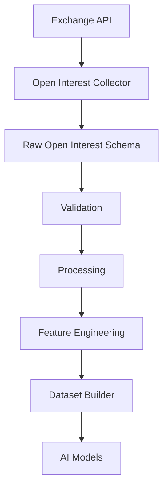
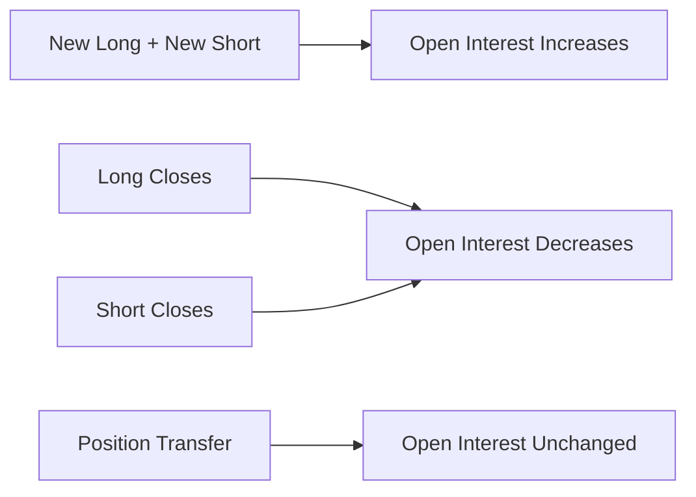
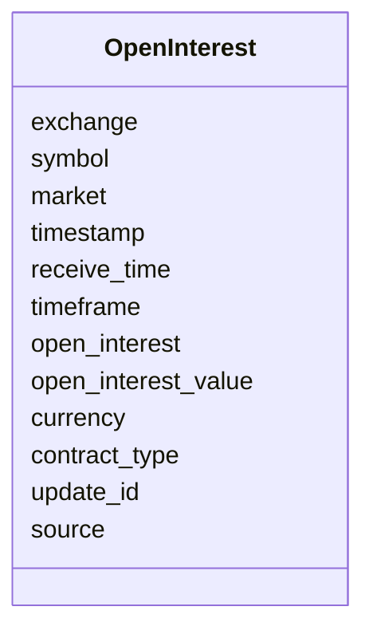
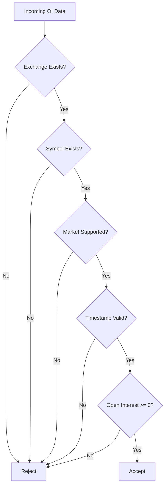
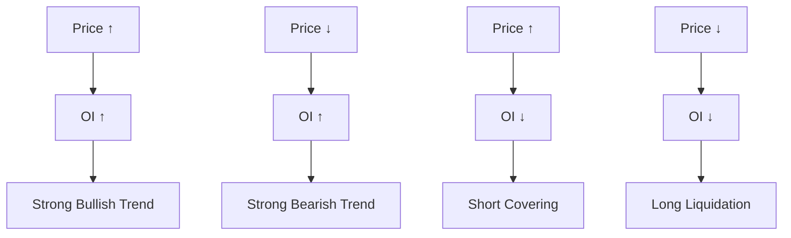
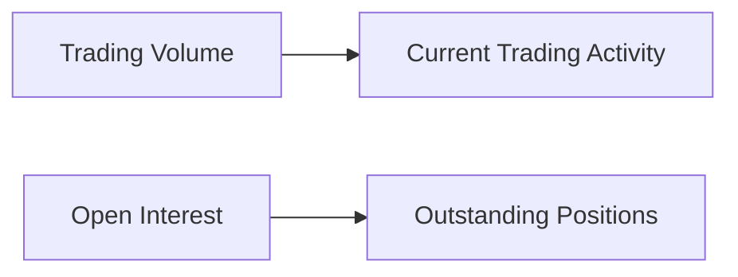
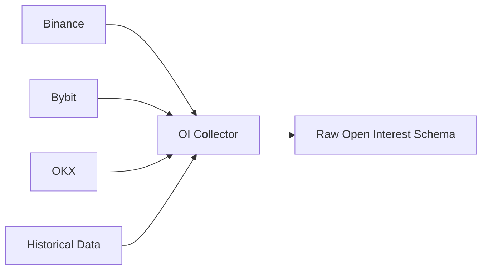

# Raw Open Interest Schema

## Overview

The **Raw Open Interest (OI) Schema** defines the canonical structure for Open Interest data collected from cryptocurrency derivative exchanges.

Open Interest represents the **total number of outstanding derivative contracts** that remain open at a specific point in time.

Unlike trading volume, Open Interest increases when new positions are opened and decreases when positions are closed.

All exchanges are normalized into this schema before entering the Data Pipeline.

---

# Pipeline Position



---

# What is Open Interest?

Open Interest measures the number of active contracts in the market.

It is widely used to determine:

- Market participation
- Trend strength
- Position buildup
- Position unwinding
- Bullish sentiment
- Bearish sentiment

---

# Open Interest Lifecycle



---

# Schema Structure



---

# Field Definitions

| Field | Type | Description |
|---------|------|-------------|
| exchange | string | Exchange name |
| symbol | string | Trading pair |
| market | string | Futures / Coin-M / Options |
| timestamp | datetime | Exchange timestamp |
| receive_time | datetime | Local receive timestamp |
| timeframe | string | Optional aggregation interval |
| open_interest | float | Number of open contracts |
| open_interest_value | float | Notional value of contracts |
| currency | string | Settlement currency |
| contract_type | string | Perpetual, Quarterly, etc. |
| update_id | integer | Exchange update identifier |
| source | string | Data source |

---

# Example Record

```json
{
    "exchange": "binance",
    "symbol": "ETHUSDT",
    "market": "futures",

    "timestamp": "2026-08-05T10:30:00Z",

    "receive_time": "2026-08-05T10:30:00.115Z",

    "timeframe": "5m",

    "open_interest": 245678.32,

    "open_interest_value": 865423412.15,

    "currency": "USDT",

    "contract_type": "PERPETUAL",

    "update_id": 238912,

    "source": "REST API"
}
```

---

# Validation Flow



---

# Validation Rules

## Exchange

- Required

---

## Symbol

- Required

---

## Market

Allowed values:

```
futures

coinm

options
```

---

## Timestamp

- Required
- UTC

---

## Open Interest

```
Open Interest >= 0
```

---

## Open Interest Value

```
Open Interest Value >= 0
```

---

# Market Interpretation



---

# Relationship with Volume



Volume measures **activity**.

Open Interest measures **existing exposure**.

---

# Downstream Usage

Open Interest is commonly used for:

```mermaid
mindmap

root((Open Interest))

    Trend Confirmation

    Position Build-up

    Position Unwinding

    Bull/Bear Strength

    Liquidation Prediction

    Market Participation

    Futures Analysis

    AI Features

    Strategy Signals
```

---

# Data Sources



---

# Storage Flow

```mermaid
flowchart TD

Exchange

-->

Collector

-->

Raw Open Interest Schema

-->

Validation

-->

Processing

-->

Storage

-->

Feature Engineering

-->

Datasets
```

---

# Relationship with Other Schemas

```mermaid
flowchart TD

Raw Open Interest

-->

Processed Open Interest

-->

Feature Schema

-->

Dataset Schema

-->

AI Models
```

---

# Design Principles

```mermaid
mindmap

root((Open Interest Schema))

    Exchange Independent

    Market Independent

    Snapshot Based

    Time-Series Ready

    Easy Validation

    Extensible

    Versionable
```

---

# Future Enhancements

Possible future additions:

- Open Interest Change
- Percentage Change
- Long Open Interest
- Short Open Interest
- Exchange Dominance
- Historical Ranking
- Moving Averages
- OI Momentum
- OI Delta
- Aggregated Multi-Exchange OI

---

# Summary

The Raw Open Interest Schema standardizes Open Interest data across derivative exchanges.

It serves as the foundation for futures market analysis, trend confirmation, feature engineering, and AI model training.

```mermaid
flowchart TD

Exchange

-->

Open Interest Collector

-->

Raw Open Interest Schema

-->

Validation

-->

Processing

-->

Feature Engineering

-->

Dataset Builder

-->

AI Models

-->

Strategy Engine
```