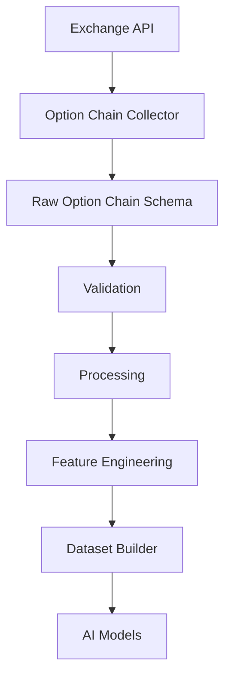
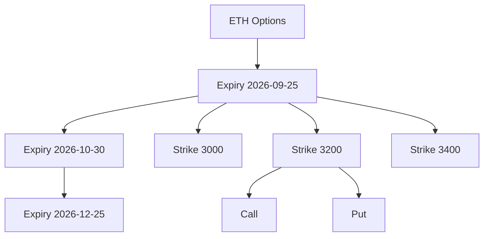
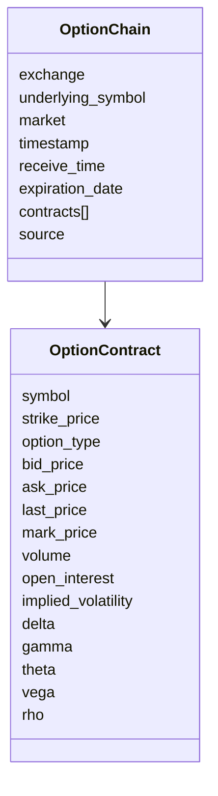
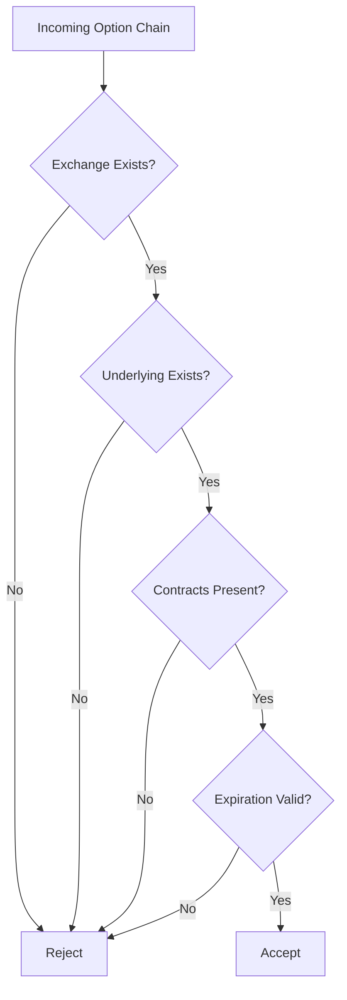
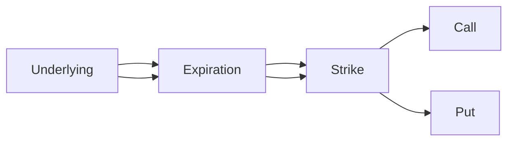
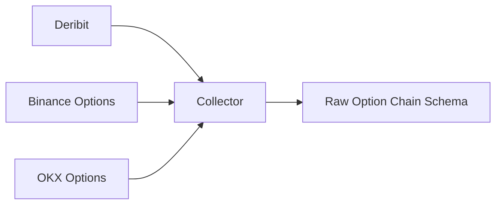

# Raw Option Chain Schema

## Overview

The **Raw Option Chain Schema** defines the canonical structure for option chain data collected from cryptocurrency options exchanges.

An option chain is the complete list of available option contracts for an underlying asset, grouped by expiration date and strike price.

Unlike futures data, option chain data contains hundreds or even thousands of contracts simultaneously, making it one of the richest sources of derivatives information.

All exchange-specific option chain responses are normalized into this schema before entering the Data Pipeline.

---

# Pipeline Position



---

# What is an Option Chain?

An option chain contains every available option contract for an underlying asset.

Each contract has:

- Strike Price
- Expiration Date
- Call or Put
- Bid Price
- Ask Price
- Last Price
- Volume
- Open Interest
- Greeks
- Implied Volatility

---

# Option Chain Structure



---

# Schema Structure



---

# Option Chain Fields

| Field | Type | Description |
|---------|------|-------------|
| exchange | string | Exchange name |
| underlying_symbol | string | Underlying asset |
| market | string | Options |
| timestamp | datetime | Exchange timestamp |
| receive_time | datetime | Local receive timestamp |
| expiration_date | datetime | Expiration |
| contracts | List | Option contracts |
| source | string | Data source |

---

# Option Contract Fields

| Field | Type | Description |
|---------|------|-------------|
| symbol | string | Contract symbol |
| strike_price | float | Strike price |
| option_type | string | CALL / PUT |
| bid_price | float | Highest bid |
| ask_price | float | Lowest ask |
| last_price | float | Last traded price |
| mark_price | float | Fair value |
| volume | float | Trading volume |
| open_interest | float | Open contracts |
| implied_volatility | float | IV |
| delta | float | Delta Greek |
| gamma | float | Gamma Greek |
| theta | float | Theta Greek |
| vega | float | Vega Greek |
| rho | float | Rho Greek |

---

# Example

```text
ETH Options

Expiry

2026-09-25

Strike

3000

CALL

Bid 520

Ask 528

IV 62%

OI 1200

----------------

PUT

Bid 12

Ask 14

IV 64%

OI 320
```

---

# Validation Flow



---

# Validation Rules

## Exchange

Required

---

## Underlying

Required

---

## Strike Price

```
Strike > 0
```

---

## Bid

```
Bid >= 0
```

---

## Ask

```
Ask >= Bid
```

---

## Last Price

```
Last >= 0
```

---

## Volume

```
Volume >= 0
```

---

## Open Interest

```
Open Interest >= 0
```

---

## Implied Volatility

```
IV >= 0
```

---

# Greeks

```mermaid
mindmap

root((Greeks))

    Delta

    Gamma

    Theta

    Vega

    Rho
```

---

# Relationship Between Contracts



---

# Downstream Usage

```mermaid
mindmap

root((Option Chain))

    IV Surface

    Smile

    Skew

    Gamma Exposure

    Delta Exposure

    Dealer Positioning

    Max Pain

    AI Features

    Risk Analysis
```

---

# Data Sources



---

# Storage Flow

```mermaid
flowchart TD

Exchange

-->

Collector

-->

Raw Option Chain Schema

-->

Validation

-->

Processing

-->

Storage

-->

Feature Engineering

-->

Datasets
```

---

# Relationship with Other Schemas

```mermaid
flowchart TD

Option Chain

-->

Greeks

-->

Implied Volatility

-->

Features

-->

Datasets

-->

AI Models
```

---

# Design Principles

```mermaid
mindmap

root((Option Chain Schema))

    Exchange Independent

    Expiration Based

    Strike Based

    Greeks Ready

    IV Ready

    Easy Validation

    Extensible

    Versionable
```

---

# Future Enhancements

Possible future additions:

- Bid/Ask Size
- Market Maker Quotes
- Historical IV
- Historical Greeks
- Gamma Exposure
- Dealer Positioning
- Max Pain
- Put/Call Ratio
- Volatility Surface
- Volatility Smile

---

# Summary

The **Raw Option Chain Schema** standardizes option contract data across cryptocurrency options exchanges.

It serves as the foundation for implied volatility analysis, options pricing, Greeks calculation, feature engineering, risk modeling, and AI model training.

```mermaid
flowchart TD

Exchange

-->

Option Chain Collector

-->

Raw Option Chain Schema

-->

Validation

-->

Processing

-->

Feature Engineering

-->

Dataset Builder

-->

AI Models

-->

Strategy Engine
```