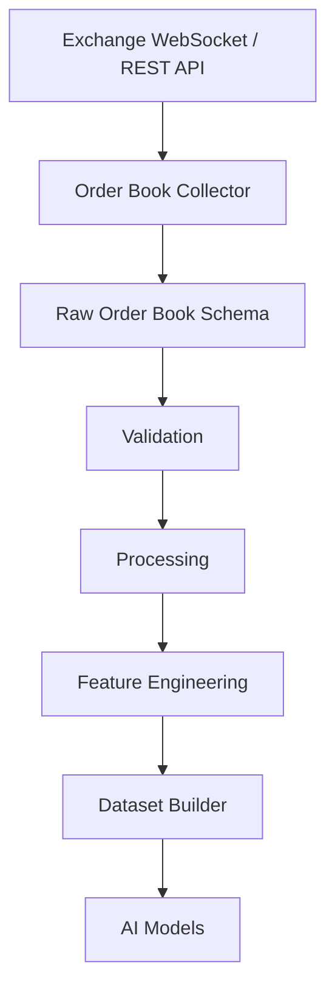
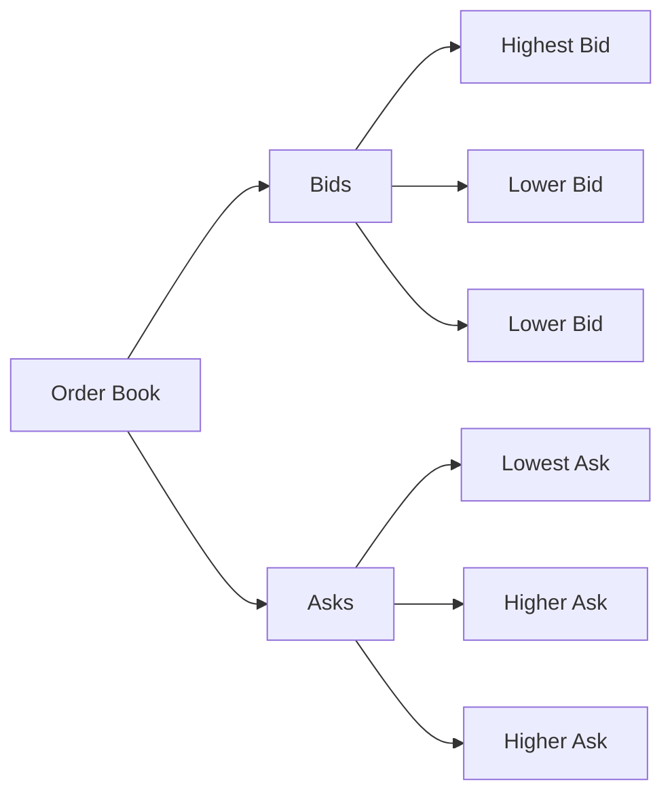
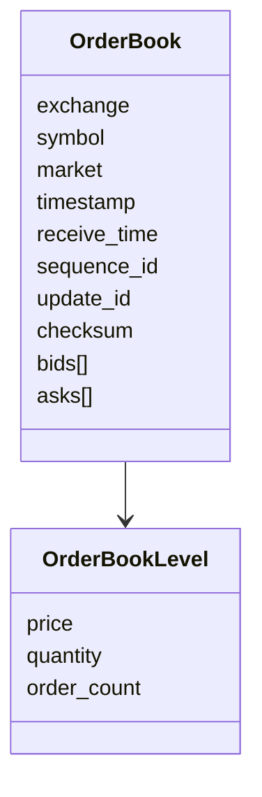
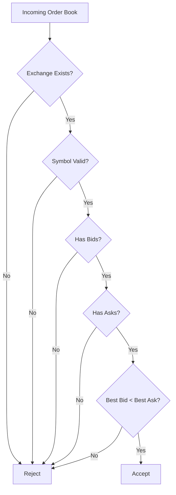
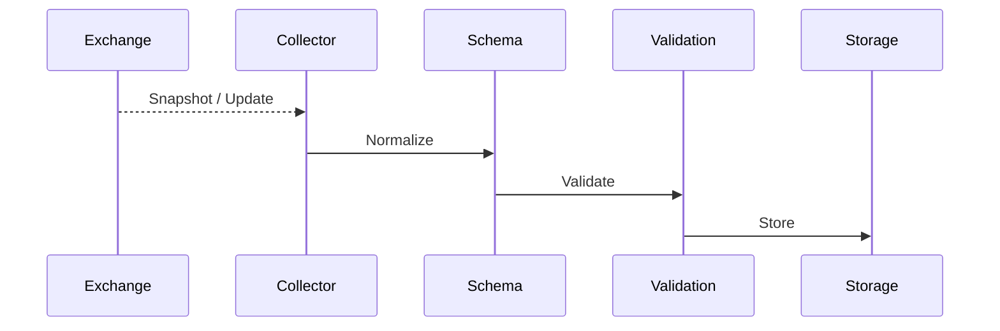

# Raw Order Book Schema

## Overview

The **Raw Order Book Schema** defines the canonical structure for market depth (Level 2) data collected from cryptocurrency exchanges.

Unlike OHLCV or Trades, the Order Book represents **all active buy and sell limit orders** waiting to be matched.

This schema standardizes order book data from different exchanges before it enters the Data Pipeline.

---

# Pipeline Position



---

# What is an Order Book?

An order book contains all **pending limit orders**.

It consists of two sides:

- **Bids** → Buy orders
- **Asks** → Sell orders

The highest bid and lowest ask determine the current market spread.

---

# Order Book Structure



---

# Schema Structure



---

# OrderBook Fields

| Field | Type | Description |
|---------|------|-------------|
| exchange | string | Exchange name |
| symbol | string | Trading pair |
| market | string | Spot / Futures |
| timestamp | datetime | Exchange timestamp |
| receive_time | datetime | Local receive timestamp |
| sequence_id | integer | Sequence number |
| update_id | integer | Update identifier |
| checksum | string | Exchange checksum |
| bids | List | Buy-side levels |
| asks | List | Sell-side levels |

---

# OrderBookLevel Fields

| Field | Type | Description |
|---------|------|-------------|
| price | float | Limit price |
| quantity | float | Quantity available |
| order_count | integer | Number of orders at this level |

---

# Example

```text
ASKS

3523.00   2.10 ETH

3522.50   1.60 ETH

3522.00   0.80 ETH

---------------------

3521.90  ← Best Ask

3521.80  ← Best Bid

---------------------

3521.50   1.20 ETH

3521.00   4.50 ETH

3520.50   6.20 ETH

BIDS
```

---

# JSON Example

```json
{
  "exchange": "binance",

  "symbol": "ETHUSDT",

  "market": "futures",

  "timestamp": "2026-08-05T10:15:05Z",

  "receive_time": "2026-08-05T10:15:05.150Z",

  "sequence_id": 928173812,

  "update_id": 55428122,

  "checksum": "abc123",

  "bids": [
    {
      "price": 3521.80,
      "quantity": 2.15,
      "order_count": 12
    }
  ],

  "asks": [
    {
      "price": 3521.90,
      "quantity": 1.65,
      "order_count": 8
    }
  ]
}
```

---

# Validation Flow



---

# Validation Rules

## Exchange

- Required

---

## Symbol

- Required

---

## Timestamp

- Required
- UTC

---

## Bids

- Cannot be empty

---

## Asks

- Cannot be empty

---

## Price

```
Price > 0
```

---

## Quantity

```
Quantity >= 0
```

---

## Spread Rule

```
Best Bid < Best Ask
```

---

# Derived Values

The schema can calculate:

```mermaid
mindmap

root((Derived Values))

    Best Bid

    Best Ask

    Mid Price

    Spread

    Bid Depth

    Ask Depth

    Total Liquidity

    Bid/Ask Ratio
```

---

# Order Book Lifecycle



---

# Downstream Usage

Order book data is used for:

```mermaid
mindmap

root((Order Book))

    Liquidity Analysis

    Market Depth

    Bid Ask Spread

    Order Imbalance

    Slippage Estimation

    Whale Detection

    Spoofing Detection

    Price Impact

    Microstructure Features

    AI Features
```

---

# Relationship to Other Market Data

```mermaid
flowchart TD

Trades

--> Market Activity

OHLCV

--> Historical Prices

Order Book

--> Current Liquidity

Funding Rate

--> Futures Bias

Open Interest

--> Position Size

All

--> Feature Engineering
```

---

# Storage Flow

```mermaid
flowchart TD

Exchange

-->

Collector

-->

Raw Order Book Schema

-->

Validation

-->

Processing

-->

Storage

-->

Feature Engineering

-->

Datasets
```

---

# Relationship with Other Schemas

```mermaid
flowchart TD

Raw Order Book

-->

Processed Order Book

-->

Feature Schema

-->

Dataset Schema

-->

AI Models
```

---

# Design Principles

```mermaid
mindmap

root((Order Book Schema))

    Exchange Independent

    Market Independent

    Snapshot Based

    Incremental Update Ready

    Easy Validation

    Extensible

    Versionable
```

---

# Future Enhancements

Possible future additions:

- Level 3 Order Book
- Individual Order IDs
- Order Book Delta
- Order Book Compression
- Market Impact Metrics
- Queue Position
- Hidden Liquidity Detection
- Iceberg Order Detection
- Liquidity Heatmaps
- Order Book Replay

---

# Summary

The Raw Order Book Schema provides a standardized representation of market depth across exchanges.

It is the foundation for liquidity analysis, order flow research, market microstructure, feature engineering, and AI model training.

```mermaid
flowchart TD

Exchange

-->

Order Book Collector

-->

Raw Order Book Schema

-->

Validation

-->

Processing

-->

Feature Engineering

-->

Dataset Builder

-->

AI Models

-->

Strategy Engine
```