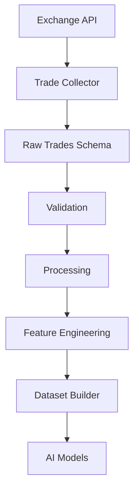
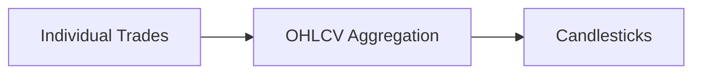
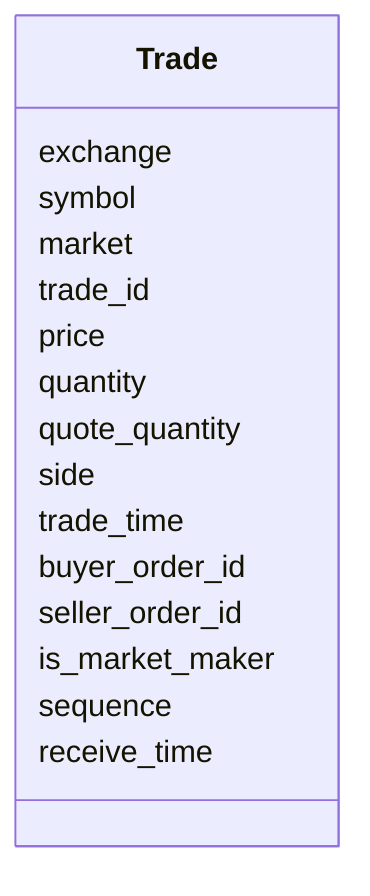
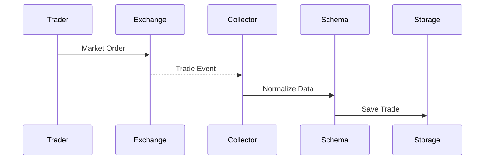
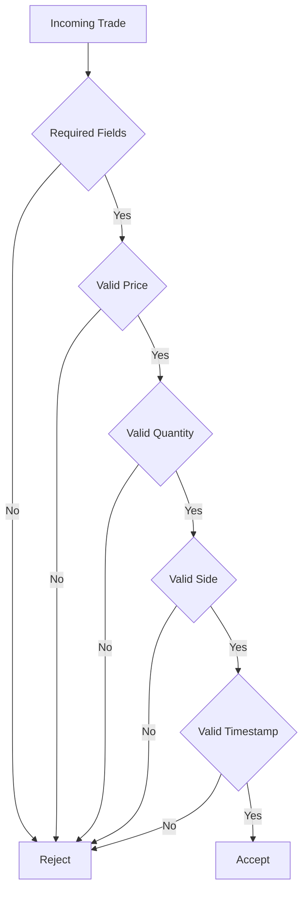
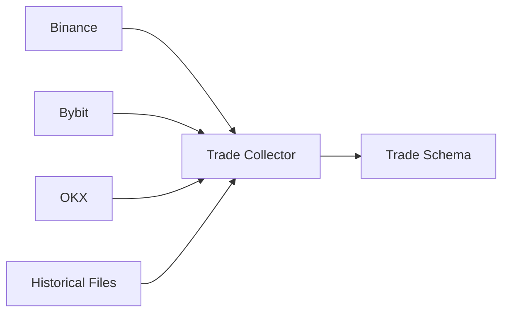
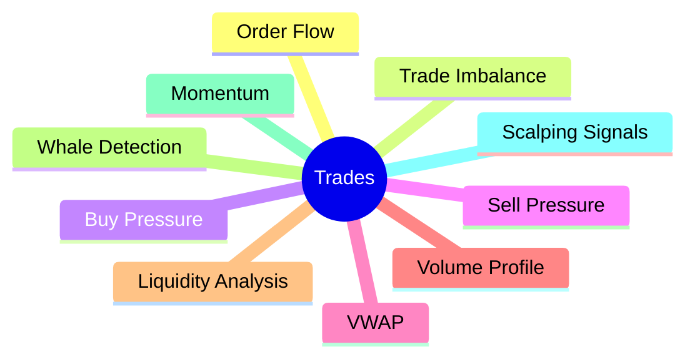

# Raw Trades Schema

## Overview

The **Raw Trades Schema** defines the canonical structure for individual trade (tick) data collected from cryptocurrency exchanges.

Unlike OHLCV data, which aggregates trading activity into candles, trade data represents **every executed trade** on the exchange.

This schema standardizes trade data from different exchanges before it enters the Data Pipeline.

---

# Pipeline Position



---

# Why Collect Raw Trades?

Raw trades provide much more detailed market information than candlesticks.

Examples:

- Order flow
- Aggressive buying
- Aggressive selling
- Buy/Sell imbalance
- Trade frequency
- Volume spikes
- Whale detection
- Short-term momentum

Many quantitative trading strategies rely heavily on tick-level trade data.

---

# Relationship with OHLCV



Thousands of trades are aggregated into a single OHLCV candle.

---

# Schema Structure



---

# Required Fields

| Field | Type | Description |
|---------|------|-------------|
| exchange | string | Exchange name |
| symbol | string | Trading pair |
| market | string | Spot / Futures |
| trade_id | string | Unique trade identifier |
| price | float | Executed trade price |
| quantity | float | Base asset quantity |
| quote_quantity | float | Quote asset quantity |
| side | string | BUY or SELL |
| trade_time | datetime | Exchange execution timestamp |

---

# Optional Fields

| Field | Description |
|---------|-------------|
| buyer_order_id | Buy order ID |
| seller_order_id | Sell order ID |
| is_market_maker | Whether the buyer/seller was maker |
| sequence | Exchange sequence number |
| receive_time | Time received by the collector |

---

# Example Record

```json
{
    "exchange": "binance",
    "symbol": "ETHUSDT",
    "market": "futures",

    "trade_id": "987654321",

    "price": 3521.45,

    "quantity": 0.75,

    "quote_quantity": 2641.09,

    "side": "BUY",

    "trade_time": "2026-08-05T10:15:03.251Z",

    "buyer_order_id": "78123912",

    "seller_order_id": "78123920",

    "is_market_maker": false,

    "sequence": 123456789,

    "receive_time": "2026-08-05T10:15:03.300Z"
}
```

---

# Trade Lifecycle



---

# Validation Flow



---

# Validation Rules

## Trade ID

- Required
- Must be unique within the exchange

---

## Price

```
Price > 0
```

---

## Quantity

```
Quantity > 0
```

---

## Quote Quantity

```
Quote Quantity >= 0
```

---

## Side

Allowed values:

```
BUY

SELL
```

---

## Timestamp

Rules:

- Must exist
- UTC format
- Cannot be invalid

---

# Data Sources



---

# Downstream Usage

Trade data is used for:



---

# Storage Flow

```mermaid
flowchart TD

Trades

-->

Raw Schema

-->

Validation

-->

Processing

-->

Storage

-->

Feature Engineering

-->

Datasets
```

---

# Relationship to Other Schemas

```mermaid
flowchart TD

Trade Schema

-->

Processed Trade Schema

-->

Feature Schema

-->

Dataset Schema

-->

AI Models
```

---

# Design Principles

```mermaid
mindmap

root((Trade Schema))

    Exchange Independent

    Market Independent

    Tick Accurate

    Easy Validation

    Easy Serialization

    Extensible

    Versionable
```

---

# Future Enhancements

Possible future fields:

- Trade latency
- Exchange server timestamp
- Local timestamp
- Aggressor side confidence
- Fee information
- Trade condition
- Trade flags
- Matching engine ID
- Liquidity score

---

# Summary

The Raw Trades Schema is the standardized representation of every executed trade collected from cryptocurrency exchanges.

It serves as the foundation for order flow analysis, market microstructure research, feature engineering, and AI model training.

```mermaid
flowchart TD

Exchange

-->

Trade Collector

-->

Raw Trades Schema

-->

Validation

-->

Processing

-->

Feature Engineering

-->

Dataset Builder

-->

AI Models

-->

Strategy Engine
```