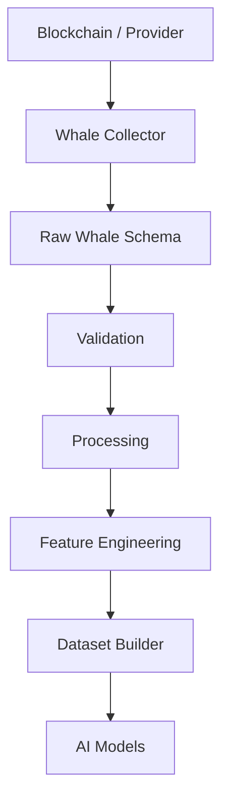
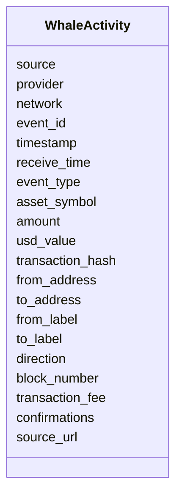
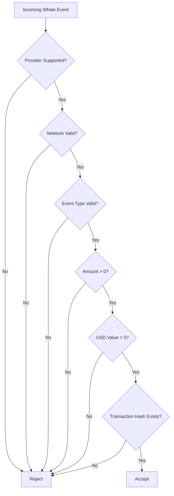
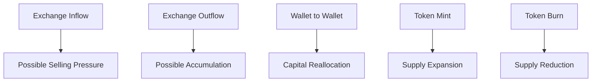
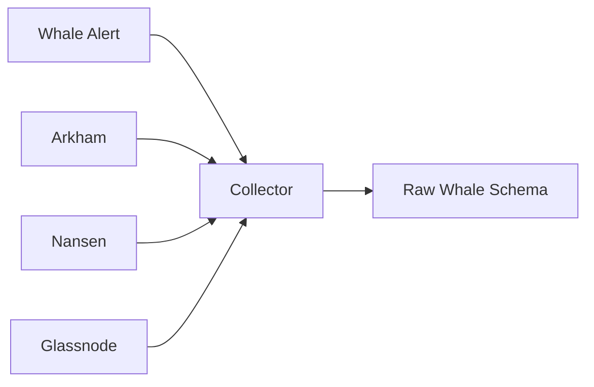

# Raw Whale Activity Schema

## Overview

The **Raw Whale Activity Schema** defines the canonical structure for whale transaction data collected from blockchain analytics platforms, on-chain data providers, and exchange monitoring services.

A **whale** is typically an individual, institution, exchange, fund, or smart contract that controls a significant amount of cryptocurrency and can influence market prices through large transactions.

Whale activity is one of the most valuable on-chain datasets for understanding capital flow, institutional behavior, and potential market direction.

All provider-specific responses are normalized into this schema before entering the Data Pipeline.

---

# Pipeline Position



---

# What is Whale Activity?

Whale activity represents large cryptocurrency transfers involving:

- Exchanges
- Institutional wallets
- Investment funds
- OTC desks
- Smart contracts
- High-net-worth investors

Monitoring these movements provides insights into market sentiment and liquidity.

---

# Typical Whale Events

```mermaid
mindmap

root((Whale Events))

    Large Transfer

    Exchange Inflow

    Exchange Outflow

    Whale Alert

    Token Mint

    Token Burn
```

---

# Why Whale Tracking Matters

Large transactions often precede:

- Increased volatility
- Buying pressure
- Selling pressure
- Exchange deposits
- Exchange withdrawals
- Institutional accumulation
- Profit taking

Although not every whale transaction affects the market, repeated patterns can reveal important trends.

---

# Schema Structure



---

# Field Definitions

| Field | Type | Description |
|---------|------|-------------|
| source | string | Data source identifier |
| provider | string | Analytics provider |
| network | string | Blockchain network |
| event_id | string | Unique event identifier |
| timestamp | datetime | Blockchain timestamp |
| receive_time | datetime | Local receive timestamp |
| event_type | string | Whale event type |
| asset_symbol | string | Cryptocurrency symbol |
| amount | float | Asset amount transferred |
| usd_value | float | Estimated USD value |
| transaction_hash | string | Blockchain transaction hash |
| from_address | string | Sender wallet |
| to_address | string | Receiver wallet |
| from_label | string | Known sender label |
| to_label | string | Known receiver label |
| direction | string | IN, OUT or INTERNAL |
| block_number | integer | Blockchain block number |
| transaction_fee | float | Transaction fee |
| confirmations | integer | Confirmation count |
| source_url | string | Reference URL |

---

# Supported Networks

```
ETHEREUM

BITCOIN

BNB

ARBITRUM

OPTIMISM

BASE

POLYGON

SOLANA
```

---

# Event Types

```
TRANSFER

EXCHANGE_INFLOW

EXCHANGE_OUTFLOW

WHALE_ALERT

TOKEN_MINT

TOKEN_BURN
```

---

# Direction Values

```
IN

OUT

INTERNAL
```

---

# Example Record

```json
{
  "source": "WHALE_ALERT",

  "provider": "Whale Alert",

  "network": "ETHEREUM",

  "event_id": "WA-829182",

  "timestamp": "2026-08-05T13:25:18Z",

  "receive_time": "2026-08-05T13:25:20Z",

  "event_type": "EXCHANGE_INFLOW",

  "asset_symbol": "ETH",

  "amount": 12850.25,

  "usd_value": 45201873.50,

  "transaction_hash": "0x4bc8...8fa2",

  "from_address": "0x123...abc",

  "to_address": "0x987...xyz",

  "from_label": "Unknown Wallet",

  "to_label": "Binance",

  "direction": "IN",

  "block_number": 25481234,

  "transaction_fee": 0.0031,

  "confirmations": 18,

  "source_url": "https://example.com"
}
```

---

# Validation Flow



---

# Validation Rules

## Source

- Required

---

## Provider

- Required

---

## Network

Must be one of the supported blockchain networks.

---

## Event Type

Must match one of the supported whale event types.

---

## Asset Symbol

- Required

---

## Amount

```
Amount > 0
```

---

## USD Value

```
USD Value > 0
```

---

## Transaction Hash

- Required

---

## Wallet Addresses

Both sender and receiver addresses are required.

---

## Timestamp

- Required
- UTC

---

# Whale Flow Interpretation



---

# Relationship with Other Datasets

```mermaid
flowchart LR

Whale Activity

-->

On-Chain Analysis

Price

-->

On-Chain Analysis

Open Interest

-->

Market Analysis

Funding Rate

-->

Market Analysis

News

-->

Sentiment Analysis
```

Whale activity becomes significantly more informative when analyzed together with:

- Price action
- Trading volume
- Open Interest
- Funding Rate
- Liquidations
- News events
- On-chain metrics

---

# Downstream Usage

```mermaid
mindmap

root((Whale Activity))

    Capital Flow Analysis

    Institutional Tracking

    Exchange Monitoring

    Market Sentiment

    Liquidity Analysis

    Volatility Prediction

    Feature Engineering

    AI Features

    Trading Signals
```

---

# Data Sources



---

# Storage Flow

```mermaid
flowchart TD

Provider

-->

Collector

-->

Raw Whale Schema

-->

Validation

-->

Processing

-->

Storage

-->

Feature Engineering

-->

Datasets
```

---

# Relationship with Other Schemas

```mermaid
flowchart TD

Raw Whale Schema

-->

Processed Whale Data

-->

Feature Schema

-->

Dataset Schema

-->

AI Models
```

---

# Design Principles

```mermaid
mindmap

root((Whale Schema))

    Provider Independent

    Blockchain Agnostic

    Event Driven

    Time-Series Ready

    Strong Validation

    AI Ready

    Extensible

    Versionable
```

---

# Future Enhancements

Possible future additions:

- Wallet risk score
- Wallet entity classification
- Smart money tags
- Stablecoin flow analysis
- Exchange reserve tracking
- Multi-chain transaction linking
- Whale cluster detection
- Cross-chain bridge transfers
- Historical wallet behavior
- Real-time alert priority

---

# Summary

The **Raw Whale Activity Schema** standardizes large blockchain transaction events from multiple providers into a unified format.

It serves as the foundation for on-chain analytics, capital flow monitoring, institutional tracking, feature engineering, quantitative research, and AI model training.

```mermaid
flowchart TD

Provider

-->

Whale Collector

-->

Raw Whale Schema

-->

Validation

-->

Processing

-->

Feature Engineering

-->

Dataset Builder

-->

AI Models

-->

Risk Engine

-->

Strategy Engine
```