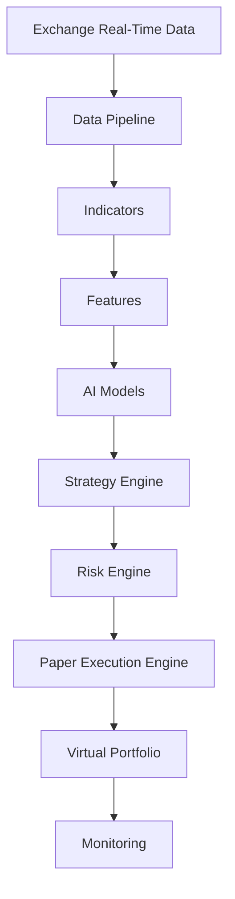
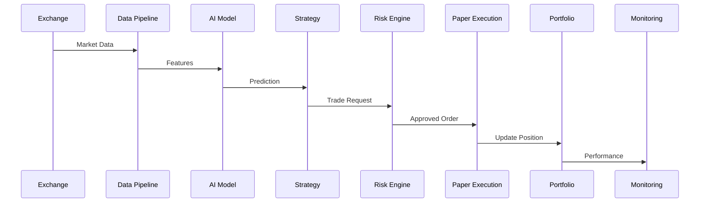
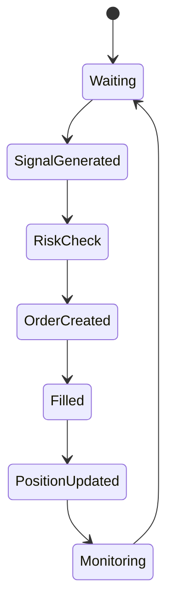
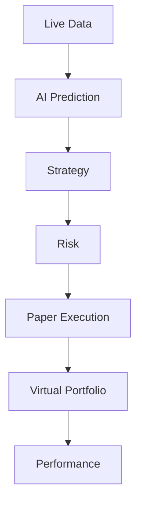

# ETH Bot - Paper Trading System

## Overview

The Paper Trading System is the bridge between backtesting and live trading.

It runs the complete trading system using real-time market data but executes simulated trades without real capital.

The purpose is to validate:

- AI model predictions
- Strategy behavior
- Risk management
- Execution logic
- Portfolio management
- System stability


Pipeline:


```
Live Market Data

↓

Data Pipeline

↓

AI Models

↓

Strategy Engine

↓

Risk Engine

↓

Paper Execution

↓

Virtual Portfolio

↓

Performance Analysis
```


---

# Purpose


Paper trading answers:


- Does the system work in real market conditions?
- Are backtesting results realistic?
- Are predictions useful?
- Does execution logic behave correctly?
- Are risk controls working?


---

# Paper Trading Architecture





---

# Backtesting vs Paper Trading vs Live Trading


| System | Data | Money | Purpose |
|-|-|-|-|
| Backtesting | Historical | Simulated | Strategy research |
| Paper Trading | Live Market | Simulated | Real-time validation |
| Live Trading | Live Market | Real | Production |


---

# Paper Trading Objectives


The system should:


- Use live exchange data
- Generate real-time signals
- Simulate order execution
- Track virtual positions
- Measure performance
- Detect system problems


---

# Folder Structure


```
papertrading/


├── README.md


├── config/


│   ├── paper.yaml

│   └── account.yaml


├── engine/


│   ├── paper_engine.py

│   ├── event_loop.py

│   └── simulator.py


├── execution/


│   ├── order_manager.py

│   ├── fill_simulator.py

│   └── slippage.py


├── portfolio/


│   ├── portfolio.py

│   ├── positions.py

│   └── balance.py


├── monitoring/


│   ├── tracker.py

│   └── alerts.py


├── reports/


│   ├── performance.py

│   └── dashboard.py


└── logs/
```


---

# Real-Time Paper Trading Flow





---

# Market Data


Paper trading uses live data:


## Price Data


```
OHLCV

Trades

Ticker
```


---

## Derivative Data


```
Open Interest

Funding Rate

Liquidations

Long/Short Ratio
```


---

## Market Depth


```
Order Book

Bid/Ask Spread

Liquidity
```


---

# Paper Execution Engine


## Purpose


Simulate exchange execution.


It handles:


- Order creation
- Order filling
- Fees
- Slippage
- Position updates


---

# Order Types


## Market Order


Simulation:


```
Current Market Price

+

Simulated Slippage

=

Fill Price
```


---

## Limit Order


Simulation:


```
Price Reaches Level

↓

Order Filled
```


---

# Execution Simulation


Include:


## Fees


Example:


```
Maker Fee

Taker Fee
```


---

## Slippage


Example:


```
Signal Price:

3500


Execution Price:

3502
```


---

## Latency


Simulate:


```
Signal Time

↓

Execution Delay

↓

Fill Time
```


---

# Virtual Account


Tracks:


```
Balance

Equity

Margin

Positions

Orders

PnL
```


---

# Position Management


Tracks:


## Long Position


Example:


```
Buy ETH

↓

Hold

↓

Sell
```


---

## Short Position


Example:


```
Sell ETH

↓

Hold

↓

Buy Back
```


---

# Risk Engine Integration


Before every trade:


```
Strategy Signal

↓

Risk Check

↓

Position Size

↓

Approval

↓

Execution
```


---

# Risk Checks


Examples:


## Maximum Position Size


```
Do not exceed allowed exposure
```


---

## Maximum Loss


```
Stop trading after loss limit
```


---

## Leverage Control


```
Maximum leverage allowed
```


---

# AI Model Validation


Paper trading evaluates:


## Direction Model


Example:


Prediction:


```
ETH Up

Probability:

75%
```


Result:


```
Was price actually higher?
```


---

## Trend Model


Evaluate:


```
Bullish

Bearish

Sideways
```


---

## Volatility Model


Evaluate:


```
Expected volatility

Actual volatility
```


---

# Performance Metrics


## Trading Metrics


Track:


```
Total Trades

Winning Trades

Losing Trades

Win Rate

Profit Factor
```


---

## Portfolio Metrics


Track:


```
Balance

Equity Curve

Drawdown

Sharpe Ratio
```


---

## Model Metrics


Track:


```
Prediction Accuracy

Confidence

Error Rate
```


---

# Paper Trading States





---

# Data Storage


Store:


```
papertrading/data/


├── orders/

├── trades/

├── positions/

├── portfolio/

└── predictions/
```


---

# Trade Record Example


```json
{
 "timestamp":"2026-08-05 10:00",

 "symbol":"ETHUSDT",

 "side":"LONG",

 "entry":3500,

 "size":1,

 "status":"OPEN"
}
```


---

# Paper Trading Reports


Generated reports:


## Daily Report


Contains:


```
Trades

Profit/Loss

Signals

Errors
```


---

## Weekly Report


Contains:


```
Performance

Risk

Model accuracy
```


---

# Monitoring


Monitor:


- Data connection
- Model response
- Strategy execution
- Order simulation
- Portfolio changes


---

# Alert Conditions


Critical:


```
Data stopped

Engine stopped

Unexpected position
```


Warning:


```
High drawdown

Poor model accuracy

High latency
```


---

# Configuration Example


```yaml
symbol:

 ETHUSDT


initial_balance:

 10000


leverage:

 3


mode:

 paper


fees:

 0.05


slippage:

 0.02
```


---

# Paper Trading Duration


Recommended:


```
Minimum:

1-3 months


Better:

3-6 months
```


Reason:


Capture different market conditions:


```
Trending

Sideways

High volatility

Low volatility
```


---

# Promotion To Live Trading


Before live deployment:


Required:


```
Backtesting Passed

↓

Paper Trading Passed

↓

Risk Review

↓

Small Capital Live Test

↓

Full Deployment
```


---

# Future Improvements


Add:


- Realistic order book simulation
- Exchange latency simulation
- Multi-account testing
- Automated strategy comparison
- AI performance monitoring
- Shadow trading


---

# Final Architecture





---

# Summary


Paper Trading validates the complete AI trading system in real market conditions without financial risk.


Final flow:


```
Live Market

↓

Prediction

↓

Decision

↓

Simulation

↓

Evaluation
```


Document Version:

```
v1.0
```