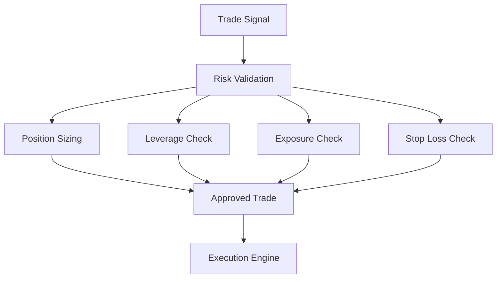
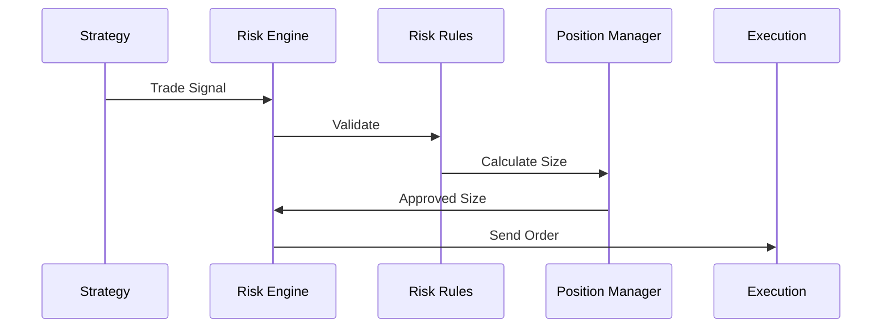
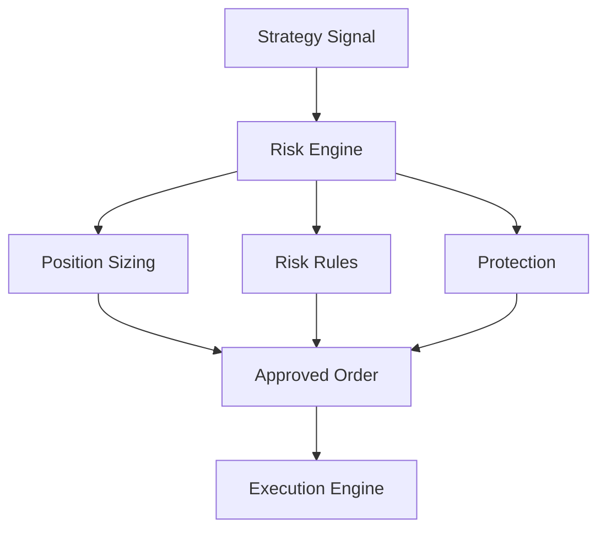

# ETH Bot - Risk Engine

## Overview

The Risk Engine is the safety and capital protection layer of the ETH Futures AI Trading System.

It controls:

- Position sizing
- Risk limits
- Leverage
- Stop loss
- Take profit
- Exposure management
- Portfolio protection


The Risk Engine operates between:

```
Strategy Engine

↓

Risk Engine

↓

Execution Engine
```


Its purpose is to ensure that every trade follows predefined risk rules before execution.


---

# Position in System Architecture


Complete trading architecture:


```
Market Data

↓

Technical Indicators

↓

Feature Engineering

↓

AI Models

↓

Strategy Engine

↓

Risk Engine

↓

Execution

↓

Portfolio

↓

Monitoring
```


---

# Risk Engine Objectives


The Risk Engine must:


- Protect trading capital
- Limit losses
- Control exposure
- Manage leverage
- Validate trade size
- Prevent dangerous positions
- Handle extreme market conditions


---

# Risk Engine Architecture





---

# Folder Structure


```
risk_engine/


├── README.md


├── config/


│   ├── risk.yaml

│   └── limits.yaml


├── core/


│   ├── risk_engine.py

│   ├── validator.py

│   └── decision.py


├── position/


│   ├── sizing.py

│   ├── exposure.py

│   └── leverage.py


├── protection/


│   ├── stop_loss.py

│   ├── take_profit.py

│   └── drawdown.py


├── portfolio/


│   ├── risk_manager.py

│   └── allocation.py


├── monitoring/


│   └── risk_alerts.py


└── tests/
```


---

# Risk Engine Flow





---

# Inputs


The Risk Engine receives:


## Strategy Signal


Example:


```json
{
 "symbol":"ETHUSDT",

 "side":"LONG",

 "confidence":0.82,

 "entry":3500
}
```


---

## Portfolio State


Includes:


```
Balance

Equity

Open Positions

Current Exposure

PnL
```


---

## Market Conditions


Includes:


```
Volatility

Liquidity

ATR

Market Regime
```


---

# Risk Rules


## 1. Position Sizing


Purpose:


Determine how much capital to allocate.


Example:


```
Account:

10000 USDT


Risk:

1%


Maximum Loss:

100 USDT
```


---

# Position Size Formula


```
Position Size =

Risk Amount

/

Stop Loss Distance
```


---

# 2. Risk Per Trade


Example:


Configuration:


```yaml
risk_per_trade:

1%
```


Meaning:


Each trade can lose maximum:


```
1% of account balance
```


---

# 3. Maximum Exposure


Controls total open positions.


Example:


```
Maximum ETH Exposure:

30% of portfolio
```


---

# 4. Leverage Management


Controls futures leverage.


Example:


```yaml
maximum_leverage:

5x
```


Rules:


```
High volatility

↓

Reduce leverage
```


---

# 5. Stop Loss Management


## Fixed Stop Loss


Example:


```
Entry:

3500


Stop:

3430
```


---

## ATR Based Stop Loss


Formula:


```
Stop Distance = ATR × Multiplier
```


Example:


```
ATR:

40


Multiplier:

2


Stop:

80 points
```


---

# 6. Take Profit Management


Methods:


## Fixed Target


Example:


```
Risk Reward:

1:3
```


---

## Dynamic Target


Based on:


```
Trend Strength

Volatility

Market Conditions
```


---

# 7. Drawdown Protection


Purpose:


Stop trading during large losses.


Example:


```yaml
maximum_drawdown:

10%
```


Action:


```
Drawdown reached

↓

Reduce trading

or

Stop system
```


---

# 8. Daily Loss Limit


Example:


```yaml
daily_loss_limit:

3%
```


If reached:


```
Disable new trades
```


---

# 9. Correlation Risk


Prevent:


```
Multiple similar positions
```


Example:


```
Long ETH

+

Long ETH derivative

=

High exposure
```


---

# 10. Market Condition Risk


Adjust risk based on:


## High Volatility


Action:


```
Reduce position size
```


---

## Low Liquidity


Action:


```
Avoid trading
```


---

## Extreme Events


Action:


```
Emergency protection
```


---

# Risk Scoring


Each trade can receive a risk score.


Example:


```
Risk Score:

85/100
```


Factors:


```
AI Confidence

Volatility

Liquidity

Market Trend

Exposure
```


---

# Trade Approval Logic


Example:


```
IF

Risk Score > 70

AND

Exposure OK

AND

Loss Limit OK


THEN


Approve Trade


ELSE


Reject Trade
```


---

# Risk Decision Example


Approved:


```json
{
 "status":"APPROVED",

 "position_size":2,

 "leverage":3,

 "stop_loss":3400,

 "take_profit":3700
}
```


Rejected:


```json
{
 "status":"REJECTED",

 "reason":"Maximum exposure reached"
}
```


---

# Portfolio Risk Management


Monitor:


```
Total Capital

Open Positions

Margin Usage

Unrealized PnL

Realized PnL
```


---

# Emergency Controls


## Kill Switch


Purpose:


Immediately stop trading.


Triggers:


```
Exchange failure

Extreme loss

System error
```


---

## Reduce Only Mode


Purpose:


Allow closing positions only.


---

# Risk Monitoring


Track:


```
Risk Exposure

Drawdown

Leverage

Margin Ratio

Loss Rate
```


---

# Configuration Example


```yaml
account:

 balance:

 10000


risk:

 per_trade:

 1%


 maximum_drawdown:

 10%


 leverage:

 maximum:

 5
```


---

# Risk Metrics


Important metrics:


## Maximum Drawdown


Largest portfolio decline.


---

## Value At Risk (VaR)


Estimated potential loss.


---

## Expected Shortfall


Loss during extreme events.


---

## Risk Reward Ratio


```
Expected Profit

/

Expected Loss
```


---

# Testing


Risk Engine must be tested with:


```
Backtesting

↓

Stress Testing

↓

Paper Trading

↓

Live Simulation
```


---

# Stress Testing


Scenarios:


```
50% ETH crash

Extreme volatility

Exchange outage

High funding rate
```


---

# Future Improvements


Add:


- Machine learning risk prediction
- Dynamic risk adjustment
- Portfolio optimization
- Advanced VaR models
- Monte Carlo risk simulation
- Automated hedging


---

# Final Architecture





---

# Summary


The Risk Engine protects the trading system by ensuring every trade follows strict capital management rules.


Final flow:


```
Signal

↓

Risk Check

↓

Position Size

↓

Protection Rules

↓

Execution
```


Document Version:

```
v1.0
```