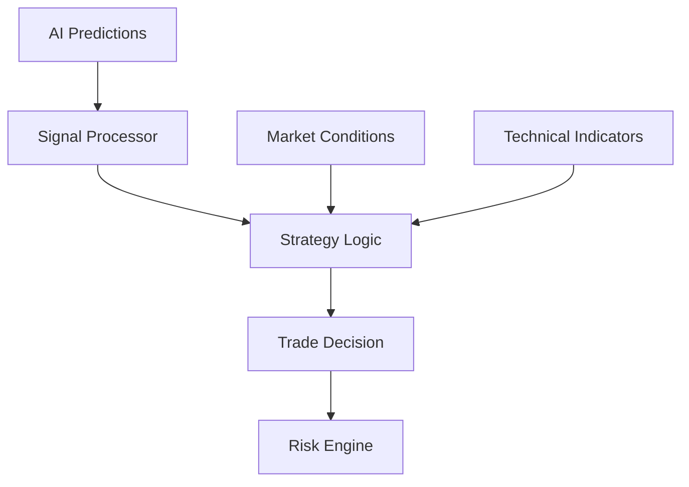
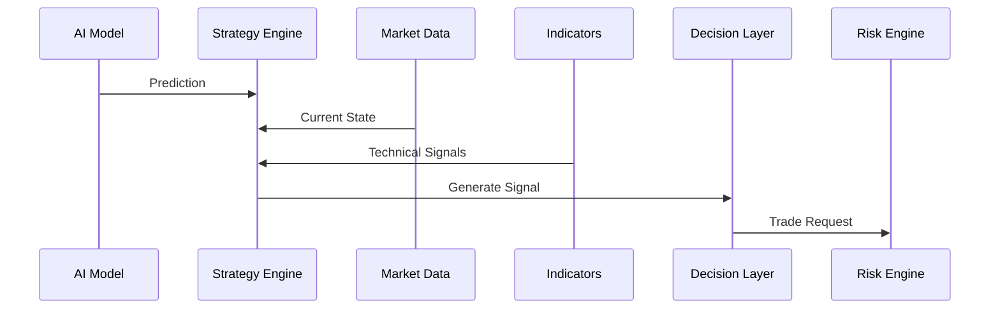
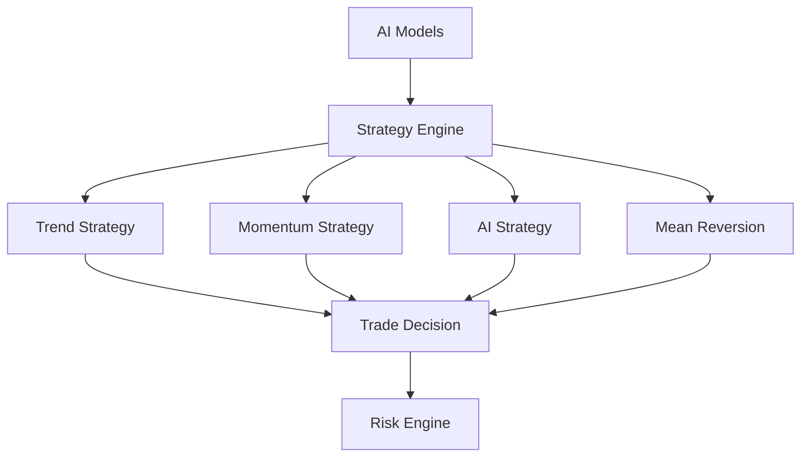

# ETH Bot - Strategy Engine

## Overview

The Strategy Engine is the decision-making layer of the ETH Futures AI Trading System.

It converts:

- AI model predictions
- Technical indicators
- Market conditions
- Risk information

into actionable trading decisions.

The Strategy Engine decides:

- When to enter a trade
- When to exit a trade
- Trade direction
- Position type
- Trade confidence


---

# Position in System Architecture


Complete trading pipeline:


```
Market Data

↓

Technical Indicators

↓

Feature Engineering

↓

AI Models

↓

Strategy Engine

↓

Risk Engine

↓

Execution

↓

Portfolio

↓

Monitoring
```


---

# Strategy Engine Objectives


The Strategy Engine must:


- Combine multiple signals
- Convert predictions into actions
- Apply trading rules
- Manage entry and exit logic
- Avoid low-quality trades
- Generate explainable decisions


---

# Strategy Engine Architecture





---

# Folder Structure


```
strategyengine/


├── README.md


├── config/


│   ├── strategy.yaml

│   └── rules.yaml


├── core/


│   ├── strategy_engine.py

│   ├── signal.py

│   └── decision.py


├── strategies/


│   ├── trend_following.py

│   ├── momentum.py

│   ├── breakout.py

│   ├── mean_reversion.py

│   └── ai_strategy.py


├── signals/


│   ├── ai_signal.py

│   ├── indicator_signal.py

│   └── market_signal.py


├── filters/


│   ├── market_regime.py

│   ├── volatility_filter.py

│   └── liquidity_filter.py


├── backtest/


│   └── strategy_test.py


├── reports/


│   └── performance.py


└── tests/
```


---

# Strategy Engine Flow





---

# Inputs


The Strategy Engine receives:


## AI Model Outputs


Examples:


```
Direction Probability

Trend State

Volatility Prediction

Reversal Probability
```


---

## Technical Indicators


Examples:


```
RSI

MACD

EMA

ATR

Bollinger Bands
```


---

## Market Data


Examples:


```
Price

Volume

Order Book

Funding Rate

Open Interest
```


---

# AI Prediction Integration


Example:


AI output:


```json
{
 "direction":"LONG",

 "probability":0.78,

 "trend":"BULLISH",

 "volatility":"MEDIUM"
}
```


Strategy converts:


```
Prediction

↓

Trading Decision
```


---

# Strategy Types


## 1. Trend Following Strategy


Purpose:


Capture strong market movements.


Logic:


```
Bullish Trend

+

Positive AI Direction

=

Long Entry
```


---

# 2. Momentum Strategy


Uses:


```
Price Momentum

Volume

Indicators
```


Example:


```
Strong breakout

↓

Enter Position
```


---

# 3. Breakout Strategy


Detects:


```
Support Break

Resistance Break
```


Example:


```
Price breaks resistance

↓

Long
```


---

# 4. Mean Reversion Strategy


Purpose:


Trade price returning to average.


Example:


```
Extreme deviation

↓

Reversal trade
```


---

# 5. AI Strategy


Uses:


```
AI Prediction

+

Market Features

+

Risk Rules
```


---

# Signal Generation


A signal contains:


```json
{
 "symbol":"ETHUSDT",

 "direction":"LONG",

 "confidence":0.80,

 "reason":[
  "Bullish trend",
  "Positive AI prediction"
 ]
}
```


---

# Signal Types


## LONG


Expectation:


```
Price Increase
```


---

## SHORT


Expectation:


```
Price Decrease
```


---

## HOLD


Condition:


```
No clear opportunity
```


---

# Strategy Decision Logic


Example:


```
IF

AI probability > 70%

AND

Trend = Bullish

AND

Volatility acceptable


THEN


Generate LONG signal
```


---

# Multi Model Decision


The engine can combine:


```
Direction Model

+

Trend Model

+

Volatility Model

+

Reversal Model
```


Example:


```
Direction:

LONG 80%


Trend:

Bullish


Volatility:

Normal


Decision:

LONG
```


---

# Market Regime Detection


The strategy should identify:


## Trending Market


Use:


```
Trend Following
```


---

## Sideways Market


Use:


```
Mean Reversion
```


---

## High Volatility


Use:


```
Reduced Position Size
```


---

# Strategy Filters


Before generating trade:


## Liquidity Filter


Check:


```
Spread

Order Book Depth
```


---

## Volatility Filter


Check:


```
ATR

Market Conditions
```


---

## Time Filter


Avoid:


```
Low liquidity periods
```


---

# Entry Logic


Example:


```
Signal Generated

↓

Check Conditions

↓

Calculate Entry

↓

Send To Risk Engine
```


---

# Exit Logic


Exit conditions:


## Take Profit


```
Target reached
```


---

## Stop Loss


```
Maximum loss reached
```


---

## AI Exit


Example:


```
Prediction changed

LONG → BEARISH
```


---

# Strategy Configuration


Example:


```yaml
strategy:

 name:

  ai_trend_strategy


entry:

 confidence:

 0.75


exit:

 stop_loss:

 2%


 take_profit:

 5%
```


---

# Strategy Performance Metrics


Measure:


## Trading


```
Win Rate

Profit Factor

Average Trade

Trade Frequency
```


---

## Risk


```
Maximum Drawdown

Risk Reward

Loss Streak
```


---

## AI


```
Prediction Accuracy

Signal Quality

Confidence Calibration
```


---

# Strategy Testing


Every strategy must pass:


```
Backtesting

↓

Walk Forward Testing

↓

Paper Trading

↓

Live Testing
```


---

# Strategy Registry


Future:


```
strategies/


trend_v1

ai_strategy_v1

breakout_v2
```


Track:


```
Version

Parameters

Performance
```


---

# Future Improvements


Add:


- Reinforcement learning strategies
- Strategy ensemble
- Adaptive strategies
- Automatic parameter optimization
- Market regime switching
- Strategy marketplace


---

# Final Architecture





---

# Summary


The Strategy Engine is the intelligence layer that transforms predictions into trading actions.


Final flow:


```
Prediction

↓

Strategy

↓

Decision

↓

Risk Check

↓

Execution
```


Document Version:

```
v1.0
```