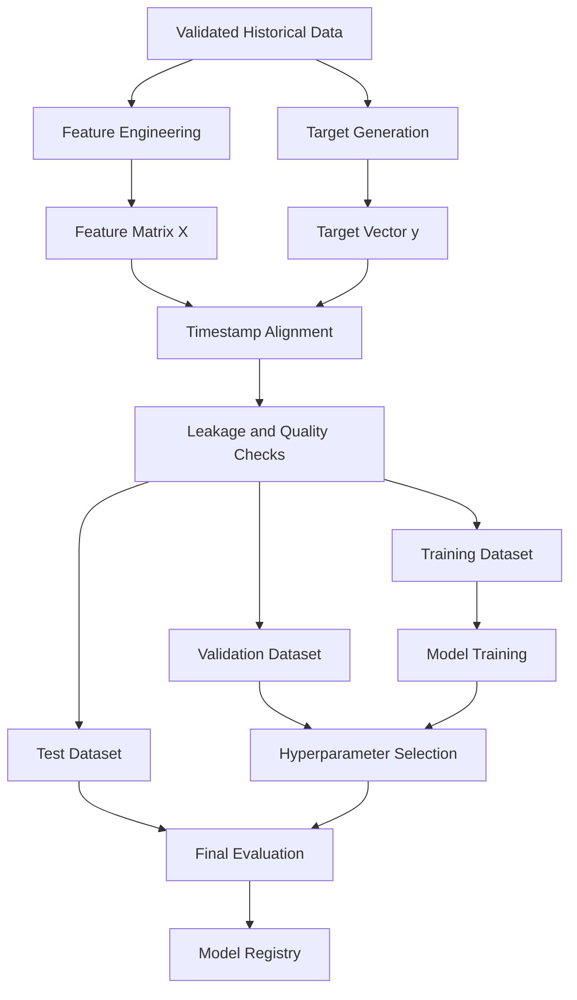
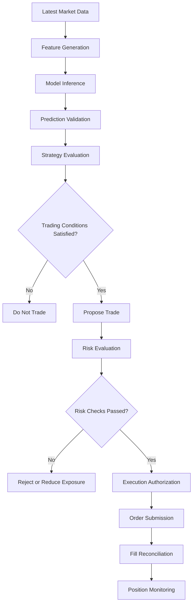
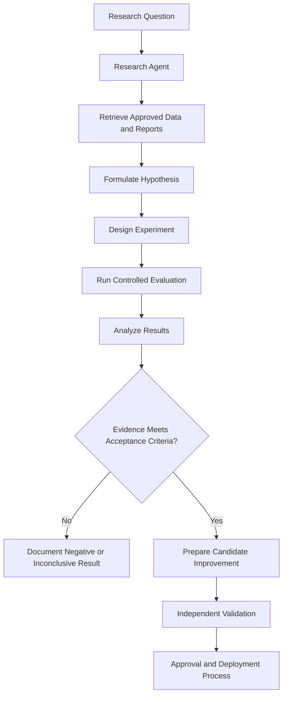

# What Is ETH Bot?

> **ETH Bot v2** is an automated Ethereum trading research and execution system designed to analyze market conditions, predict market behavior using machine learning, evaluate trading opportunities through a risk engine, and execute trades according to predefined rules.

---

## 1. Overview

ETH Bot is a modular algorithmic trading system focused on the Ethereum (ETH) market.

The system combines market data collection, feature engineering, machine learning, risk management, and automated execution to develop a systematic approach to trading.

Instead of relying on manual chart analysis and discretionary trading decisions, ETH Bot aims to transform market data into structured predictions and evaluate those predictions through a controlled decision-making process.

The system is designed around five fundamental principles:

1. **Data-driven decisions:** Use historical and real-time market data rather than relying exclusively on intuition.
2. **Machine learning:** Identify statistical patterns in market volatility, momentum, and price behavior.
3. **Risk-first architecture:** Evaluate potential trades against predefined risk constraints before execution.
4. **Modularity:** Separate data collection, modeling, risk management, and execution into independent components.
5. **Automation:** Reduce the need for continuous human involvement in research, analysis, and trading operations.

The ultimate objective is to build a system that can operate systematically while maintaining transparency, measurable performance, and strict risk controls.

---

## 2. Why ETH Bot Exists

Financial markets operate continuously, and cryptocurrency markets introduce additional challenges through their volatility, liquidity fluctuations, and rapid changes in market conditions.

Manual trading can require continuous monitoring, repetitive analysis, and consistent execution of predefined rules.

ETH Bot aims to address these challenges through automation.

### Problems the System Aims to Address

| Problem                       | System Approach                                                                    |
| ----------------------------- | ---------------------------------------------------------------------------------- |
| Continuous market monitoring  | Automated market data collection                                                   |
| Complex market conditions     | Statistical analysis and feature engineering                                       |
| Changing volatility           | Volatility estimation and regime analysis                                          |
| Uncertain price direction     | Machine learning-based probabilistic predictions                                   |
| Inconsistent decision-making  | Explicit decision rules and model outputs                                          |
| Uncontrolled trading risk     | Dedicated risk management engine                                                   |
| Manual order placement        | Automated execution through an exchange interface                                  |
| Difficult strategy evaluation | Historical backtesting and performance analysis                                    |
| Manual research               | Research agents that investigate defined questions and produce structured findings |
| System failures               | Logging, validation, monitoring, and recovery mechanisms                           |

These approaches can improve consistency and operational efficiency, but they do not guarantee profitable trading.

---

## 3. Core Objectives

ETH Bot is designed to pursue the following objectives.

### 3.1 Market Understanding

Collect and analyze market information to characterize the current state of ETH.

Relevant information may include:

* Open, high, low, and close prices.
* Trading volume.
* Returns and price changes.
* Historical and realized volatility.
* Momentum indicators.
* Market structure.
* Order book liquidity.
* Funding rates.
* Futures open interest.
* Liquidations.
* Options implied volatility and Greeks, where reliable data is available.
* Market sentiment indicators.

The availability of each feature depends on the configured data sources and exchange interfaces.

### 3.2 Predictive Modeling

Develop machine learning models that estimate specific market properties.

Examples include:

* Future volatility.
* Short-term price direction.
* Momentum persistence.
* Probability of a price increase or decrease.
* Expected return over a defined horizon.
* Probability of reaching a price threshold.
* Market regime classification.

Each model should have a clearly defined target, prediction horizon, training dataset, and evaluation methodology.

### 3.3 Risk-Controlled Decisions

Evaluate model predictions before allowing them to influence trading decisions.

The risk engine should determine whether a proposed trade satisfies the configured requirements for:

* Position size.
* Maximum exposure.
* Stop-loss placement.
* Expected transaction costs.
* Available margin.
* Leverage.
* Drawdown limits.
* Market liquidity.
* Trading frequency.
* Exchange constraints.

A model prediction must never override a mandatory risk restriction.

### 3.4 Automated Execution

Where enabled, the execution system translates approved trading decisions into exchange orders.

Its responsibilities include:

* Order creation.
* Order submission.
* Order status monitoring.
* Fill reconciliation.
* Position tracking.
* Stop-loss and take-profit management.
* Exchange error handling.
* Duplicate-order prevention.
* Emergency shutdown procedures.

Execution must remain subject to the risk engine and system-level safety controls.

### 3.5 Autonomous Research

A research agent can investigate market behavior, examine model performance, identify possible improvements, and generate structured research reports.

The agent should support the development process rather than operate as an unrestricted trading authority.

Research findings should be validated through reproducible experiments before being used in production.

---

## 4. High-Level Architecture

ETH Bot follows a modular architecture in which each component has a defined responsibility.

```drawio
<mxfile>
  <diagram id="7QKLpFVDo1QL6uYPUhiX" name="Page-1">
    <mxGraphModel dx="1794" dy="1657" grid="1" gridSize="10" guides="1" tooltips="0" connect="1" arrows="1" fold="1" page="1" pageScale="1" pageWidth="850" pageHeight="1100" math="0" shadow="0">
      <root>
        <mxCell id="EXHuQ_r8uI5bZ5jILitO-0" />
        <mxCell id="EXHuQ_r8uI5bZ5jILitO-1" parent="EXHuQ_r8uI5bZ5jILitO-0" />
        <UserObject label="" mermaidData="{&#xa;  &quot;data&quot;: &quot;flowchart TD\r\n    A[\&quot;Market Data Sources\&quot;] --&gt; B[\&quot;Data Collection\&quot;]\r\n    B --&gt; C[\&quot;Raw Data Storage\&quot;]\r\n    C --&gt; D[\&quot;Validation and Normalization\&quot;]\r\n    D --&gt; E[\&quot;Feature Engineering\&quot;]\r\n    E --&gt; F[\&quot;Dataset Builders\&quot;]\r\n\r\n    F --&gt; G[\&quot;Model Training\&quot;]\r\n    G --&gt; H[\&quot;Model Evaluation\&quot;]\r\n    H --&gt; I[\&quot;Validated Model Artifacts\&quot;]\r\n\r\n    D --&gt; J[\&quot;Live Market Data\&quot;]\r\n    J --&gt; K[\&quot;Live Feature Pipeline\&quot;]\r\n    I --&gt; L[\&quot;Inference Engine\&quot;]\r\n    K --&gt; L\r\n\r\n    L --&gt; M[\&quot;Prediction Outputs\&quot;]\r\n    M --&gt; N[\&quot;Trading Strategy\&quot;]\r\n    N --&gt; O[\&quot;Risk Engine\&quot;]\r\n\r\n    O --&gt;|Approved| P[\&quot;Execution Engine\&quot;]\r\n    O --&gt;|Rejected| Q[\&quot;Decision Log\&quot;]\r\n\r\n    P --&gt; R[\&quot;Exchange Interface\&quot;]\r\n    R --&gt; S[\&quot;Position and Order Reconciliation\&quot;]\r\n    S --&gt; T[\&quot;Performance Monitoring\&quot;]\r\n\r\n    T --&gt; U[\&quot;Research Agent\&quot;]\r\n    U --&gt; V[\&quot;Research Reports and Experiments\&quot;]\r\n    V --&gt; G&quot;,&#xa;  &quot;config&quot;: null&#xa;}" id="iNxILMY5-ORsGIE5bxBx-0">
          <mxCell connectable="0" parent="EXHuQ_r8uI5bZ5jILitO-1" style="group;transparentBounds=1;editIcon=1;lockedGroup=0;groupPadding=10;" vertex="1">
            <mxGeometry as="geometry" />
          </mxCell>
        </UserObject>
        <UserObject label="Market Data Sources" mermaidId="n:A" mermaidBaseStyle="html=1;whiteSpace=wrap;strokeWidth=1;fillColor=light-dark(#ECECFF,#1f2020);strokeColor=light-dark(#9370DB,#cccccc);fontColor=light-dark(#333333,#cccccc);fontFamily=Trebuchet MS,Verdana,Arial,sans-serif;fontSize=16;" mermaidBaseValue="Market Data Sources" id="EXHuQ_r8uI5bZ5jILitO-2">
          <mxCell parent="iNxILMY5-ORsGIE5bxBx-0" style="html=1;whiteSpace=wrap;strokeWidth=1;fillColor=light-dark(#ECECFF,#1f2020);strokeColor=light-dark(#9370DB,#cccccc);fontColor=light-dark(#333333,#cccccc);fontFamily=Trebuchet MS,Verdana,Arial,sans-serif;fontSize=16;" vertex="1">
            <mxGeometry height="54" width="206" x="165" y="10" as="geometry" />
          </mxCell>
        </UserObject>
        <UserObject label="Data Collection" mermaidId="n:B" mermaidBaseStyle="html=1;whiteSpace=wrap;strokeWidth=1;fillColor=light-dark(#ECECFF,#1f2020);strokeColor=light-dark(#9370DB,#cccccc);fontColor=light-dark(#333333,#cccccc);fontFamily=Trebuchet MS,Verdana,Arial,sans-serif;fontSize=16;" mermaidBaseValue="Data Collection" id="EXHuQ_r8uI5bZ5jILitO-3">
          <mxCell parent="iNxILMY5-ORsGIE5bxBx-0" style="html=1;whiteSpace=wrap;strokeWidth=1;fillColor=light-dark(#ECECFF,#1f2020);strokeColor=light-dark(#9370DB,#cccccc);fontColor=light-dark(#333333,#cccccc);fontFamily=Trebuchet MS,Verdana,Arial,sans-serif;fontSize=16;" vertex="1">
            <mxGeometry height="54" width="170" x="183" y="114" as="geometry" />
          </mxCell>
        </UserObject>
        <UserObject label="Raw Data Storage" mermaidId="n:C" mermaidBaseStyle="html=1;whiteSpace=wrap;strokeWidth=1;fillColor=light-dark(#ECECFF,#1f2020);strokeColor=light-dark(#9370DB,#cccccc);fontColor=light-dark(#333333,#cccccc);fontFamily=Trebuchet MS,Verdana,Arial,sans-serif;fontSize=16;" mermaidBaseValue="Raw Data Storage" id="EXHuQ_r8uI5bZ5jILitO-4">
          <mxCell parent="iNxILMY5-ORsGIE5bxBx-0" style="html=1;whiteSpace=wrap;strokeWidth=1;fillColor=light-dark(#ECECFF,#1f2020);strokeColor=light-dark(#9370DB,#cccccc);fontColor=light-dark(#333333,#cccccc);fontFamily=Trebuchet MS,Verdana,Arial,sans-serif;fontSize=16;" vertex="1">
            <mxGeometry height="54" width="186" x="175" y="218" as="geometry" />
          </mxCell>
        </UserObject>
        <UserObject label="Validation and Normalization" mermaidId="n:D" mermaidBaseStyle="html=1;whiteSpace=wrap;strokeWidth=1;fillColor=light-dark(#ECECFF,#1f2020);strokeColor=light-dark(#9370DB,#cccccc);fontColor=light-dark(#333333,#cccccc);fontFamily=Trebuchet MS,Verdana,Arial,sans-serif;fontSize=16;" mermaidBaseValue="Validation and Normalization" id="EXHuQ_r8uI5bZ5jILitO-5">
          <mxCell parent="iNxILMY5-ORsGIE5bxBx-0" style="html=1;whiteSpace=wrap;strokeWidth=1;fillColor=light-dark(#ECECFF,#1f2020);strokeColor=light-dark(#9370DB,#cccccc);fontColor=light-dark(#333333,#cccccc);fontFamily=Trebuchet MS,Verdana,Arial,sans-serif;fontSize=16;" vertex="1">
            <mxGeometry height="54" width="267" x="135" y="322" as="geometry" />
          </mxCell>
        </UserObject>
        <UserObject label="Feature Engineering" mermaidId="n:E" mermaidBaseStyle="html=1;whiteSpace=wrap;strokeWidth=1;fillColor=light-dark(#ECECFF,#1f2020);strokeColor=light-dark(#9370DB,#cccccc);fontColor=light-dark(#333333,#cccccc);fontFamily=Trebuchet MS,Verdana,Arial,sans-serif;fontSize=16;" mermaidBaseValue="Feature Engineering" id="EXHuQ_r8uI5bZ5jILitO-6">
          <mxCell parent="iNxILMY5-ORsGIE5bxBx-0" style="html=1;whiteSpace=wrap;strokeWidth=1;fillColor=light-dark(#ECECFF,#1f2020);strokeColor=light-dark(#9370DB,#cccccc);fontColor=light-dark(#333333,#cccccc);fontFamily=Trebuchet MS,Verdana,Arial,sans-serif;fontSize=16;" vertex="1">
            <mxGeometry height="54" width="204" x="28" y="426" as="geometry" />
          </mxCell>
        </UserObject>
        <UserObject label="Dataset Builders" mermaidId="n:F" mermaidBaseStyle="html=1;whiteSpace=wrap;strokeWidth=1;fillColor=light-dark(#ECECFF,#1f2020);strokeColor=light-dark(#9370DB,#cccccc);fontColor=light-dark(#333333,#cccccc);fontFamily=Trebuchet MS,Verdana,Arial,sans-serif;fontSize=16;" mermaidBaseValue="Dataset Builders" id="EXHuQ_r8uI5bZ5jILitO-7">
          <mxCell parent="iNxILMY5-ORsGIE5bxBx-0" style="html=1;whiteSpace=wrap;strokeWidth=1;fillColor=light-dark(#ECECFF,#1f2020);strokeColor=light-dark(#9370DB,#cccccc);fontColor=light-dark(#333333,#cccccc);fontFamily=Trebuchet MS,Verdana,Arial,sans-serif;fontSize=16;" vertex="1">
            <mxGeometry height="54" width="177" x="42" y="530" as="geometry" />
          </mxCell>
        </UserObject>
        <UserObject label="Model Training" mermaidId="n:G" mermaidBaseStyle="html=1;whiteSpace=wrap;strokeWidth=1;fillColor=light-dark(#ECECFF,#1f2020);strokeColor=light-dark(#9370DB,#cccccc);fontColor=light-dark(#333333,#cccccc);fontFamily=Trebuchet MS,Verdana,Arial,sans-serif;fontSize=16;" mermaidBaseValue="Model Training" id="EXHuQ_r8uI5bZ5jILitO-8">
          <mxCell parent="iNxILMY5-ORsGIE5bxBx-0" style="html=1;whiteSpace=wrap;strokeWidth=1;fillColor=light-dark(#ECECFF,#1f2020);strokeColor=light-dark(#9370DB,#cccccc);fontColor=light-dark(#333333,#cccccc);fontFamily=Trebuchet MS,Verdana,Arial,sans-serif;fontSize=16;" vertex="1">
            <mxGeometry height="54" width="164" x="48" y="634" as="geometry" />
          </mxCell>
        </UserObject>
        <UserObject label="Model Evaluation" mermaidId="n:H" mermaidBaseStyle="html=1;whiteSpace=wrap;strokeWidth=1;fillColor=light-dark(#ECECFF,#1f2020);strokeColor=light-dark(#9370DB,#cccccc);fontColor=light-dark(#333333,#cccccc);fontFamily=Trebuchet MS,Verdana,Arial,sans-serif;fontSize=16;" mermaidBaseValue="Model Evaluation" id="EXHuQ_r8uI5bZ5jILitO-9">
          <mxCell parent="iNxILMY5-ORsGIE5bxBx-0" style="html=1;whiteSpace=wrap;strokeWidth=1;fillColor=light-dark(#ECECFF,#1f2020);strokeColor=light-dark(#9370DB,#cccccc);fontColor=light-dark(#333333,#cccccc);fontFamily=Trebuchet MS,Verdana,Arial,sans-serif;fontSize=16;" vertex="1">
            <mxGeometry height="54" width="182" x="39" y="738" as="geometry" />
          </mxCell>
        </UserObject>
        <UserObject label="Validated Model Artifacts" mermaidId="n:I" mermaidBaseStyle="html=1;whiteSpace=wrap;strokeWidth=1;fillColor=light-dark(#ECECFF,#1f2020);strokeColor=light-dark(#9370DB,#cccccc);fontColor=light-dark(#333333,#cccccc);fontFamily=Trebuchet MS,Verdana,Arial,sans-serif;fontSize=16;" mermaidBaseValue="Validated Model Artifacts" id="EXHuQ_r8uI5bZ5jILitO-10">
          <mxCell parent="iNxILMY5-ORsGIE5bxBx-0" style="html=1;whiteSpace=wrap;strokeWidth=1;fillColor=light-dark(#ECECFF,#1f2020);strokeColor=light-dark(#9370DB,#cccccc);fontColor=light-dark(#333333,#cccccc);fontFamily=Trebuchet MS,Verdana,Arial,sans-serif;fontSize=16;" vertex="1">
            <mxGeometry height="54" width="240" x="10" y="842" as="geometry" />
          </mxCell>
        </UserObject>
        <UserObject label="Live Market Data" mermaidId="n:J" mermaidBaseStyle="html=1;whiteSpace=wrap;strokeWidth=1;fillColor=light-dark(#ECECFF,#1f2020);strokeColor=light-dark(#9370DB,#cccccc);fontColor=light-dark(#333333,#cccccc);fontFamily=Trebuchet MS,Verdana,Arial,sans-serif;fontSize=16;" mermaidBaseValue="Live Market Data" id="EXHuQ_r8uI5bZ5jILitO-11">
          <mxCell parent="iNxILMY5-ORsGIE5bxBx-0" style="html=1;whiteSpace=wrap;strokeWidth=1;fillColor=light-dark(#ECECFF,#1f2020);strokeColor=light-dark(#9370DB,#cccccc);fontColor=light-dark(#333333,#cccccc);fontFamily=Trebuchet MS,Verdana,Arial,sans-serif;fontSize=16;" vertex="1">
            <mxGeometry height="54" width="181" x="316" y="738" as="geometry" />
          </mxCell>
        </UserObject>
        <UserObject label="Live Feature Pipeline" mermaidId="n:K" mermaidBaseStyle="html=1;whiteSpace=wrap;strokeWidth=1;fillColor=light-dark(#ECECFF,#1f2020);strokeColor=light-dark(#9370DB,#cccccc);fontColor=light-dark(#333333,#cccccc);fontFamily=Trebuchet MS,Verdana,Arial,sans-serif;fontSize=16;" mermaidBaseValue="Live Feature Pipeline" id="EXHuQ_r8uI5bZ5jILitO-12">
          <mxCell parent="iNxILMY5-ORsGIE5bxBx-0" style="html=1;whiteSpace=wrap;strokeWidth=1;fillColor=light-dark(#ECECFF,#1f2020);strokeColor=light-dark(#9370DB,#cccccc);fontColor=light-dark(#333333,#cccccc);fontFamily=Trebuchet MS,Verdana,Arial,sans-serif;fontSize=16;" vertex="1">
            <mxGeometry height="54" width="212" x="300" y="842" as="geometry" />
          </mxCell>
        </UserObject>
        <UserObject label="Inference Engine" mermaidId="n:L" mermaidBaseStyle="html=1;whiteSpace=wrap;strokeWidth=1;fillColor=light-dark(#ECECFF,#1f2020);strokeColor=light-dark(#9370DB,#cccccc);fontColor=light-dark(#333333,#cccccc);fontFamily=Trebuchet MS,Verdana,Arial,sans-serif;fontSize=16;" mermaidBaseValue="Inference Engine" id="EXHuQ_r8uI5bZ5jILitO-13">
          <mxCell parent="iNxILMY5-ORsGIE5bxBx-0" style="html=1;whiteSpace=wrap;strokeWidth=1;fillColor=light-dark(#ECECFF,#1f2020);strokeColor=light-dark(#9370DB,#cccccc);fontColor=light-dark(#333333,#cccccc);fontFamily=Trebuchet MS,Verdana,Arial,sans-serif;fontSize=16;" vertex="1">
            <mxGeometry height="54" width="180" x="178" y="946" as="geometry" />
          </mxCell>
        </UserObject>
        <UserObject label="Prediction Outputs" mermaidId="n:M" mermaidBaseStyle="html=1;whiteSpace=wrap;strokeWidth=1;fillColor=light-dark(#ECECFF,#1f2020);strokeColor=light-dark(#9370DB,#cccccc);fontColor=light-dark(#333333,#cccccc);fontFamily=Trebuchet MS,Verdana,Arial,sans-serif;fontSize=16;" mermaidBaseValue="Prediction Outputs" id="EXHuQ_r8uI5bZ5jILitO-14">
          <mxCell parent="iNxILMY5-ORsGIE5bxBx-0" style="html=1;whiteSpace=wrap;strokeWidth=1;fillColor=light-dark(#ECECFF,#1f2020);strokeColor=light-dark(#9370DB,#cccccc);fontColor=light-dark(#333333,#cccccc);fontFamily=Trebuchet MS,Verdana,Arial,sans-serif;fontSize=16;" vertex="1">
            <mxGeometry height="54" width="194" x="171" y="1050" as="geometry" />
          </mxCell>
        </UserObject>
        <UserObject label="Trading Strategy" mermaidId="n:N" mermaidBaseStyle="html=1;whiteSpace=wrap;strokeWidth=1;fillColor=light-dark(#ECECFF,#1f2020);strokeColor=light-dark(#9370DB,#cccccc);fontColor=light-dark(#333333,#cccccc);fontFamily=Trebuchet MS,Verdana,Arial,sans-serif;fontSize=16;" mermaidBaseValue="Trading Strategy" id="EXHuQ_r8uI5bZ5jILitO-15">
          <mxCell parent="iNxILMY5-ORsGIE5bxBx-0" style="html=1;whiteSpace=wrap;strokeWidth=1;fillColor=light-dark(#ECECFF,#1f2020);strokeColor=light-dark(#9370DB,#cccccc);fontColor=light-dark(#333333,#cccccc);fontFamily=Trebuchet MS,Verdana,Arial,sans-serif;fontSize=16;" vertex="1">
            <mxGeometry height="54" width="177" x="180" y="1154" as="geometry" />
          </mxCell>
        </UserObject>
        <UserObject label="Risk Engine" mermaidId="n:O" mermaidBaseStyle="html=1;whiteSpace=wrap;strokeWidth=1;fillColor=light-dark(#ECECFF,#1f2020);strokeColor=light-dark(#9370DB,#cccccc);fontColor=light-dark(#333333,#cccccc);fontFamily=Trebuchet MS,Verdana,Arial,sans-serif;fontSize=16;" mermaidBaseValue="Risk Engine" id="EXHuQ_r8uI5bZ5jILitO-16">
          <mxCell parent="iNxILMY5-ORsGIE5bxBx-0" style="html=1;whiteSpace=wrap;strokeWidth=1;fillColor=light-dark(#ECECFF,#1f2020);strokeColor=light-dark(#9370DB,#cccccc);fontColor=light-dark(#333333,#cccccc);fontFamily=Trebuchet MS,Verdana,Arial,sans-serif;fontSize=16;" vertex="1">
            <mxGeometry height="54" width="141" x="198" y="1258" as="geometry" />
          </mxCell>
        </UserObject>
        <UserObject label="Execution Engine" mermaidId="n:P" mermaidBaseStyle="html=1;whiteSpace=wrap;strokeWidth=1;fillColor=light-dark(#ECECFF,#1f2020);strokeColor=light-dark(#9370DB,#cccccc);fontColor=light-dark(#333333,#cccccc);fontFamily=Trebuchet MS,Verdana,Arial,sans-serif;fontSize=16;" mermaidBaseValue="Execution Engine" id="EXHuQ_r8uI5bZ5jILitO-17">
          <mxCell parent="iNxILMY5-ORsGIE5bxBx-0" style="html=1;whiteSpace=wrap;strokeWidth=1;fillColor=light-dark(#ECECFF,#1f2020);strokeColor=light-dark(#9370DB,#cccccc);fontColor=light-dark(#333333,#cccccc);fontFamily=Trebuchet MS,Verdana,Arial,sans-serif;fontSize=16;" vertex="1">
            <mxGeometry height="54" width="182" x="69" y="1381" as="geometry" />
          </mxCell>
        </UserObject>
        <UserObject label="Decision Log" mermaidId="n:Q" mermaidBaseStyle="html=1;whiteSpace=wrap;strokeWidth=1;fillColor=light-dark(#ECECFF,#1f2020);strokeColor=light-dark(#9370DB,#cccccc);fontColor=light-dark(#333333,#cccccc);fontFamily=Trebuchet MS,Verdana,Arial,sans-serif;fontSize=16;" mermaidBaseValue="Decision Log" id="EXHuQ_r8uI5bZ5jILitO-18">
          <mxCell parent="iNxILMY5-ORsGIE5bxBx-0" style="html=1;whiteSpace=wrap;strokeWidth=1;fillColor=light-dark(#ECECFF,#1f2020);strokeColor=light-dark(#9370DB,#cccccc);fontColor=light-dark(#333333,#cccccc);fontFamily=Trebuchet MS,Verdana,Arial,sans-serif;fontSize=16;" vertex="1">
            <mxGeometry height="54" width="149" x="347" y="1381" as="geometry" />
          </mxCell>
        </UserObject>
        <UserObject label="Exchange Interface" mermaidId="n:R" mermaidBaseStyle="html=1;whiteSpace=wrap;strokeWidth=1;fillColor=light-dark(#ECECFF,#1f2020);strokeColor=light-dark(#9370DB,#cccccc);fontColor=light-dark(#333333,#cccccc);fontFamily=Trebuchet MS,Verdana,Arial,sans-serif;fontSize=16;" mermaidBaseValue="Exchange Interface" id="EXHuQ_r8uI5bZ5jILitO-19">
          <mxCell parent="iNxILMY5-ORsGIE5bxBx-0" style="html=1;whiteSpace=wrap;strokeWidth=1;fillColor=light-dark(#ECECFF,#1f2020);strokeColor=light-dark(#9370DB,#cccccc);fontColor=light-dark(#333333,#cccccc);fontFamily=Trebuchet MS,Verdana,Arial,sans-serif;fontSize=16;" vertex="1">
            <mxGeometry height="54" width="197" x="62" y="1485" as="geometry" />
          </mxCell>
        </UserObject>
        <UserObject label="Position and Order Reconciliation" mermaidId="n:S" mermaidBaseStyle="html=1;whiteSpace=wrap;strokeWidth=1;fillColor=light-dark(#ECECFF,#1f2020);strokeColor=light-dark(#9370DB,#cccccc);fontColor=light-dark(#333333,#cccccc);fontFamily=Trebuchet MS,Verdana,Arial,sans-serif;fontSize=16;" mermaidBaseValue="Position and Order Reconciliation" id="EXHuQ_r8uI5bZ5jILitO-20">
          <mxCell parent="iNxILMY5-ORsGIE5bxBx-0" style="html=1;whiteSpace=wrap;strokeWidth=1;fillColor=light-dark(#ECECFF,#1f2020);strokeColor=light-dark(#9370DB,#cccccc);fontColor=light-dark(#333333,#cccccc);fontFamily=Trebuchet MS,Verdana,Arial,sans-serif;fontSize=16;" vertex="1">
            <mxGeometry height="54" width="298" x="11" y="1589" as="geometry" />
          </mxCell>
        </UserObject>
        <UserObject label="Performance Monitoring" mermaidId="n:T" mermaidBaseStyle="html=1;whiteSpace=wrap;strokeWidth=1;fillColor=light-dark(#ECECFF,#1f2020);strokeColor=light-dark(#9370DB,#cccccc);fontColor=light-dark(#333333,#cccccc);fontFamily=Trebuchet MS,Verdana,Arial,sans-serif;fontSize=16;" mermaidBaseValue="Performance Monitoring" id="EXHuQ_r8uI5bZ5jILitO-21">
          <mxCell parent="iNxILMY5-ORsGIE5bxBx-0" style="html=1;whiteSpace=wrap;strokeWidth=1;fillColor=light-dark(#ECECFF,#1f2020);strokeColor=light-dark(#9370DB,#cccccc);fontColor=light-dark(#333333,#cccccc);fontFamily=Trebuchet MS,Verdana,Arial,sans-serif;fontSize=16;" vertex="1">
            <mxGeometry height="54" width="231" x="45" y="1693" as="geometry" />
          </mxCell>
        </UserObject>
        <UserObject label="Research Agent" mermaidId="n:U" mermaidBaseStyle="html=1;whiteSpace=wrap;strokeWidth=1;fillColor=light-dark(#ECECFF,#1f2020);strokeColor=light-dark(#9370DB,#cccccc);fontColor=light-dark(#333333,#cccccc);fontFamily=Trebuchet MS,Verdana,Arial,sans-serif;fontSize=16;" mermaidBaseValue="Research Agent" id="EXHuQ_r8uI5bZ5jILitO-22">
          <mxCell parent="iNxILMY5-ORsGIE5bxBx-0" style="html=1;whiteSpace=wrap;strokeWidth=1;fillColor=light-dark(#ECECFF,#1f2020);strokeColor=light-dark(#9370DB,#cccccc);fontColor=light-dark(#333333,#cccccc);fontFamily=Trebuchet MS,Verdana,Arial,sans-serif;fontSize=16;" vertex="1">
            <mxGeometry height="54" width="169" x="76" y="1797" as="geometry" />
          </mxCell>
        </UserObject>
        <UserObject label="Research Reports and Experiments" mermaidId="n:V" mermaidBaseStyle="html=1;whiteSpace=wrap;strokeWidth=1;fillColor=light-dark(#ECECFF,#1f2020);strokeColor=light-dark(#9370DB,#cccccc);fontColor=light-dark(#333333,#cccccc);fontFamily=Trebuchet MS,Verdana,Arial,sans-serif;fontSize=16;" mermaidBaseValue="Research Reports and Experiments" id="EXHuQ_r8uI5bZ5jILitO-23">
          <mxCell parent="iNxILMY5-ORsGIE5bxBx-0" style="html=1;whiteSpace=wrap;strokeWidth=1;fillColor=light-dark(#ECECFF,#1f2020);strokeColor=light-dark(#9370DB,#cccccc);fontColor=light-dark(#333333,#cccccc);fontFamily=Trebuchet MS,Verdana,Arial,sans-serif;fontSize=16;" vertex="1">
            <mxGeometry height="54" width="307" x="185" y="1901" as="geometry" />
          </mxCell>
        </UserObject>
        <UserObject label="" mermaidId="e:A-&gt;B#0" mermaidBaseStyle="curved=1;startArrow=none;endArrow=block;endSize=7;strokeColor=light-dark(#333333,#cccccc);exitX=0.5;exitY=1;entryX=0.5;entryY=0;" mermaidBaseValue="" id="EXHuQ_r8uI5bZ5jILitO-24">
          <mxCell edge="1" parent="iNxILMY5-ORsGIE5bxBx-0" source="EXHuQ_r8uI5bZ5jILitO-2" style="curved=1;startArrow=none;endArrow=block;endSize=7;strokeColor=light-dark(#333333,#cccccc);exitX=0.5;exitY=1;entryX=0.5;entryY=0;" target="EXHuQ_r8uI5bZ5jILitO-3">
            <mxGeometry relative="1" as="geometry">
              <Array as="points" />
            </mxGeometry>
          </mxCell>
        </UserObject>
        <UserObject label="" mermaidId="e:B-&gt;C#0" mermaidBaseStyle="curved=1;startArrow=none;endArrow=block;endSize=7;strokeColor=light-dark(#333333,#cccccc);exitX=0.5;exitY=1;entryX=0.5;entryY=0;" mermaidBaseValue="" id="EXHuQ_r8uI5bZ5jILitO-25">
          <mxCell edge="1" parent="iNxILMY5-ORsGIE5bxBx-0" source="EXHuQ_r8uI5bZ5jILitO-3" style="curved=1;startArrow=none;endArrow=block;endSize=7;strokeColor=light-dark(#333333,#cccccc);exitX=0.5;exitY=1;entryX=0.5;entryY=0;" target="EXHuQ_r8uI5bZ5jILitO-4">
            <mxGeometry relative="1" as="geometry">
              <Array as="points" />
            </mxGeometry>
          </mxCell>
        </UserObject>
        <UserObject label="" mermaidId="e:C-&gt;D#0" mermaidBaseStyle="curved=1;startArrow=none;endArrow=block;endSize=7;strokeColor=light-dark(#333333,#cccccc);exitX=0.5;exitY=1;entryX=0.5;entryY=0;" mermaidBaseValue="" id="EXHuQ_r8uI5bZ5jILitO-26">
          <mxCell edge="1" parent="iNxILMY5-ORsGIE5bxBx-0" source="EXHuQ_r8uI5bZ5jILitO-4" style="curved=1;startArrow=none;endArrow=block;endSize=7;strokeColor=light-dark(#333333,#cccccc);exitX=0.5;exitY=1;entryX=0.5;entryY=0;" target="EXHuQ_r8uI5bZ5jILitO-5">
            <mxGeometry relative="1" as="geometry">
              <Array as="points" />
            </mxGeometry>
          </mxCell>
        </UserObject>
        <UserObject label="" mermaidId="e:D-&gt;E#0" mermaidBaseStyle="curved=1;startArrow=none;endArrow=block;endSize=7;strokeColor=light-dark(#333333,#cccccc);exitX=0.23;exitY=1;entryX=0.5;entryY=0;" mermaidBaseValue="" id="EXHuQ_r8uI5bZ5jILitO-27">
          <mxCell edge="1" parent="iNxILMY5-ORsGIE5bxBx-0" source="EXHuQ_r8uI5bZ5jILitO-5" style="curved=1;startArrow=none;endArrow=block;endSize=7;strokeColor=light-dark(#333333,#cccccc);exitX=0.23;exitY=1;entryX=0.5;entryY=0;" target="EXHuQ_r8uI5bZ5jILitO-6">
            <mxGeometry relative="1" as="geometry">
              <Array as="points">
                <mxPoint x="130" y="401" />
              </Array>
            </mxGeometry>
          </mxCell>
        </UserObject>
        <UserObject label="" mermaidId="e:E-&gt;F#0" mermaidBaseStyle="curved=1;startArrow=none;endArrow=block;endSize=7;strokeColor=light-dark(#333333,#cccccc);exitX=0.5;exitY=1;entryX=0.5;entryY=0;" mermaidBaseValue="" id="EXHuQ_r8uI5bZ5jILitO-28">
          <mxCell edge="1" parent="iNxILMY5-ORsGIE5bxBx-0" source="EXHuQ_r8uI5bZ5jILitO-6" style="curved=1;startArrow=none;endArrow=block;endSize=7;strokeColor=light-dark(#333333,#cccccc);exitX=0.5;exitY=1;entryX=0.5;entryY=0;" target="EXHuQ_r8uI5bZ5jILitO-7">
            <mxGeometry relative="1" as="geometry">
              <Array as="points" />
            </mxGeometry>
          </mxCell>
        </UserObject>
        <UserObject label="" mermaidId="e:F-&gt;G#0" mermaidBaseStyle="curved=1;startArrow=none;endArrow=block;endSize=7;strokeColor=light-dark(#333333,#cccccc);exitX=0.5;exitY=1;entryX=0.5;entryY=0;" mermaidBaseValue="" id="EXHuQ_r8uI5bZ5jILitO-29">
          <mxCell edge="1" parent="iNxILMY5-ORsGIE5bxBx-0" source="EXHuQ_r8uI5bZ5jILitO-7" style="curved=1;startArrow=none;endArrow=block;endSize=7;strokeColor=light-dark(#333333,#cccccc);exitX=0.5;exitY=1;entryX=0.5;entryY=0;" target="EXHuQ_r8uI5bZ5jILitO-8">
            <mxGeometry relative="1" as="geometry">
              <Array as="points" />
            </mxGeometry>
          </mxCell>
        </UserObject>
        <UserObject label="" mermaidId="e:G-&gt;H#0" mermaidBaseStyle="curved=1;startArrow=none;endArrow=block;endSize=7;strokeColor=light-dark(#333333,#cccccc);exitX=0.5;exitY=1;entryX=0.5;entryY=0;" mermaidBaseValue="" id="EXHuQ_r8uI5bZ5jILitO-30">
          <mxCell edge="1" parent="iNxILMY5-ORsGIE5bxBx-0" source="EXHuQ_r8uI5bZ5jILitO-8" style="curved=1;startArrow=none;endArrow=block;endSize=7;strokeColor=light-dark(#333333,#cccccc);exitX=0.5;exitY=1;entryX=0.5;entryY=0;" target="EXHuQ_r8uI5bZ5jILitO-9">
            <mxGeometry relative="1" as="geometry">
              <Array as="points" />
            </mxGeometry>
          </mxCell>
        </UserObject>
        <UserObject label="" mermaidId="e:H-&gt;I#0" mermaidBaseStyle="curved=1;startArrow=none;endArrow=block;endSize=7;strokeColor=light-dark(#333333,#cccccc);exitX=0.5;exitY=1;entryX=0.5;entryY=0;" mermaidBaseValue="" id="EXHuQ_r8uI5bZ5jILitO-31">
          <mxCell edge="1" parent="iNxILMY5-ORsGIE5bxBx-0" source="EXHuQ_r8uI5bZ5jILitO-9" style="curved=1;startArrow=none;endArrow=block;endSize=7;strokeColor=light-dark(#333333,#cccccc);exitX=0.5;exitY=1;entryX=0.5;entryY=0;" target="EXHuQ_r8uI5bZ5jILitO-10">
            <mxGeometry relative="1" as="geometry">
              <Array as="points" />
            </mxGeometry>
          </mxCell>
        </UserObject>
        <UserObject label="" mermaidId="e:D-&gt;J#0" mermaidBaseStyle="curved=1;startArrow=none;endArrow=block;endSize=7;strokeColor=light-dark(#333333,#cccccc);exitX=0.77;exitY=1;entryX=0.5;entryY=0;" mermaidBaseValue="" id="EXHuQ_r8uI5bZ5jILitO-32">
          <mxCell edge="1" parent="iNxILMY5-ORsGIE5bxBx-0" source="EXHuQ_r8uI5bZ5jILitO-5" style="curved=1;startArrow=none;endArrow=block;endSize=7;strokeColor=light-dark(#333333,#cccccc);exitX=0.77;exitY=1;entryX=0.5;entryY=0;" target="EXHuQ_r8uI5bZ5jILitO-11">
            <mxGeometry relative="1" as="geometry">
              <Array as="points">
                <mxPoint x="406" y="401" />
                <mxPoint x="406" y="453" />
                <mxPoint x="406" y="505" />
                <mxPoint x="406" y="557" />
                <mxPoint x="406" y="609" />
                <mxPoint x="406" y="661" />
                <mxPoint x="406" y="713" />
              </Array>
            </mxGeometry>
          </mxCell>
        </UserObject>
        <UserObject label="" mermaidId="e:J-&gt;K#0" mermaidBaseStyle="curved=1;startArrow=none;endArrow=block;endSize=7;strokeColor=light-dark(#333333,#cccccc);exitX=0.5;exitY=1;entryX=0.5;entryY=0;" mermaidBaseValue="" id="EXHuQ_r8uI5bZ5jILitO-33">
          <mxCell edge="1" parent="iNxILMY5-ORsGIE5bxBx-0" source="EXHuQ_r8uI5bZ5jILitO-11" style="curved=1;startArrow=none;endArrow=block;endSize=7;strokeColor=light-dark(#333333,#cccccc);exitX=0.5;exitY=1;entryX=0.5;entryY=0;" target="EXHuQ_r8uI5bZ5jILitO-12">
            <mxGeometry relative="1" as="geometry">
              <Array as="points" />
            </mxGeometry>
          </mxCell>
        </UserObject>
        <UserObject label="" mermaidId="e:I-&gt;L#0" mermaidBaseStyle="curved=1;startArrow=none;endArrow=block;endSize=7;strokeColor=light-dark(#333333,#cccccc);exitX=0.5;exitY=1;entryX=0.1;entryY=0;" mermaidBaseValue="" id="EXHuQ_r8uI5bZ5jILitO-34">
          <mxCell edge="1" parent="iNxILMY5-ORsGIE5bxBx-0" source="EXHuQ_r8uI5bZ5jILitO-10" style="curved=1;startArrow=none;endArrow=block;endSize=7;strokeColor=light-dark(#333333,#cccccc);exitX=0.5;exitY=1;entryX=0.1;entryY=0;" target="EXHuQ_r8uI5bZ5jILitO-13">
            <mxGeometry relative="1" as="geometry">
              <Array as="points">
                <mxPoint x="130" y="921" />
              </Array>
            </mxGeometry>
          </mxCell>
        </UserObject>
        <UserObject label="" mermaidId="e:K-&gt;L#0" mermaidBaseStyle="curved=1;startArrow=none;endArrow=block;endSize=7;strokeColor=light-dark(#333333,#cccccc);exitX=0.5;exitY=1;entryX=0.9;entryY=0;" mermaidBaseValue="" id="EXHuQ_r8uI5bZ5jILitO-35">
          <mxCell edge="1" parent="iNxILMY5-ORsGIE5bxBx-0" source="EXHuQ_r8uI5bZ5jILitO-12" style="curved=1;startArrow=none;endArrow=block;endSize=7;strokeColor=light-dark(#333333,#cccccc);exitX=0.5;exitY=1;entryX=0.9;entryY=0;" target="EXHuQ_r8uI5bZ5jILitO-13">
            <mxGeometry relative="1" as="geometry">
              <Array as="points">
                <mxPoint x="406" y="921" />
              </Array>
            </mxGeometry>
          </mxCell>
        </UserObject>
        <UserObject label="" mermaidId="e:L-&gt;M#0" mermaidBaseStyle="curved=1;startArrow=none;endArrow=block;endSize=7;strokeColor=light-dark(#333333,#cccccc);exitX=0.5;exitY=1;entryX=0.5;entryY=0;" mermaidBaseValue="" id="EXHuQ_r8uI5bZ5jILitO-36">
          <mxCell edge="1" parent="iNxILMY5-ORsGIE5bxBx-0" source="EXHuQ_r8uI5bZ5jILitO-13" style="curved=1;startArrow=none;endArrow=block;endSize=7;strokeColor=light-dark(#333333,#cccccc);exitX=0.5;exitY=1;entryX=0.5;entryY=0;" target="EXHuQ_r8uI5bZ5jILitO-14">
            <mxGeometry relative="1" as="geometry">
              <Array as="points" />
            </mxGeometry>
          </mxCell>
        </UserObject>
        <UserObject label="" mermaidId="e:M-&gt;N#0" mermaidBaseStyle="curved=1;startArrow=none;endArrow=block;endSize=7;strokeColor=light-dark(#333333,#cccccc);exitX=0.5;exitY=1;entryX=0.5;entryY=0;" mermaidBaseValue="" id="EXHuQ_r8uI5bZ5jILitO-37">
          <mxCell edge="1" parent="iNxILMY5-ORsGIE5bxBx-0" source="EXHuQ_r8uI5bZ5jILitO-14" style="curved=1;startArrow=none;endArrow=block;endSize=7;strokeColor=light-dark(#333333,#cccccc);exitX=0.5;exitY=1;entryX=0.5;entryY=0;" target="EXHuQ_r8uI5bZ5jILitO-15">
            <mxGeometry relative="1" as="geometry">
              <Array as="points" />
            </mxGeometry>
          </mxCell>
        </UserObject>
        <UserObject label="" mermaidId="e:N-&gt;O#0" mermaidBaseStyle="curved=1;startArrow=none;endArrow=block;endSize=7;strokeColor=light-dark(#333333,#cccccc);exitX=0.5;exitY=1;entryX=0.5;entryY=0;" mermaidBaseValue="" id="EXHuQ_r8uI5bZ5jILitO-38">
          <mxCell edge="1" parent="iNxILMY5-ORsGIE5bxBx-0" source="EXHuQ_r8uI5bZ5jILitO-15" style="curved=1;startArrow=none;endArrow=block;endSize=7;strokeColor=light-dark(#333333,#cccccc);exitX=0.5;exitY=1;entryX=0.5;entryY=0;" target="EXHuQ_r8uI5bZ5jILitO-16">
            <mxGeometry relative="1" as="geometry">
              <Array as="points" />
            </mxGeometry>
          </mxCell>
        </UserObject>
        <UserObject label="Approved" mermaidId="e:O-&gt;P#0" mermaidBaseStyle="curved=1;startArrow=none;endArrow=block;endSize=7;strokeColor=light-dark(#333333,#cccccc);html=1;fontSize=16;labelBackgroundColor=light-dark(#E8E8E88D,#2a2a2a8D);fontFamily=Trebuchet MS,Verdana,Arial,sans-serif;fontColor=light-dark(#333333,#cccccc);exitX=0.16;exitY=1;entryX=0.5;entryY=0;" mermaidBaseValue="Approved" id="EXHuQ_r8uI5bZ5jILitO-39">
          <mxCell edge="1" parent="iNxILMY5-ORsGIE5bxBx-0" source="EXHuQ_r8uI5bZ5jILitO-16" style="curved=1;startArrow=none;endArrow=block;endSize=7;strokeColor=light-dark(#333333,#cccccc);html=1;fontSize=16;labelBackgroundColor=light-dark(#E8E8E88D,#2a2a2a8D);fontFamily=Trebuchet MS,Verdana,Arial,sans-serif;fontColor=light-dark(#333333,#cccccc);exitX=0.16;exitY=1;entryX=0.5;entryY=0;" target="EXHuQ_r8uI5bZ5jILitO-17">
            <mxGeometry relative="1" as="geometry">
              <Array as="points">
                <mxPoint x="160" y="1347" />
              </Array>
            </mxGeometry>
          </mxCell>
        </UserObject>
        <UserObject label="Rejected" mermaidId="e:O-&gt;Q#0" mermaidBaseStyle="curved=1;startArrow=none;endArrow=block;endSize=7;strokeColor=light-dark(#333333,#cccccc);html=1;fontSize=16;labelBackgroundColor=light-dark(#E8E8E88D,#2a2a2a8D);fontFamily=Trebuchet MS,Verdana,Arial,sans-serif;fontColor=light-dark(#333333,#cccccc);exitX=0.98;exitY=1;entryX=0.5;entryY=0;" mermaidBaseValue="Rejected" id="EXHuQ_r8uI5bZ5jILitO-40">
          <mxCell edge="1" parent="iNxILMY5-ORsGIE5bxBx-0" source="EXHuQ_r8uI5bZ5jILitO-16" style="curved=1;startArrow=none;endArrow=block;endSize=7;strokeColor=light-dark(#333333,#cccccc);html=1;fontSize=16;labelBackgroundColor=light-dark(#E8E8E88D,#2a2a2a8D);fontFamily=Trebuchet MS,Verdana,Arial,sans-serif;fontColor=light-dark(#333333,#cccccc);exitX=0.98;exitY=1;entryX=0.5;entryY=0;" target="EXHuQ_r8uI5bZ5jILitO-18">
            <mxGeometry relative="1" as="geometry">
              <Array as="points">
                <mxPoint x="422" y="1347" />
              </Array>
            </mxGeometry>
          </mxCell>
        </UserObject>
        <UserObject label="" mermaidId="e:P-&gt;R#0" mermaidBaseStyle="curved=1;startArrow=none;endArrow=block;endSize=7;strokeColor=light-dark(#333333,#cccccc);exitX=0.5;exitY=1;entryX=0.5;entryY=0;" mermaidBaseValue="" id="EXHuQ_r8uI5bZ5jILitO-41">
          <mxCell edge="1" parent="iNxILMY5-ORsGIE5bxBx-0" source="EXHuQ_r8uI5bZ5jILitO-17" style="curved=1;startArrow=none;endArrow=block;endSize=7;strokeColor=light-dark(#333333,#cccccc);exitX=0.5;exitY=1;entryX=0.5;entryY=0;" target="EXHuQ_r8uI5bZ5jILitO-19">
            <mxGeometry relative="1" as="geometry">
              <Array as="points" />
            </mxGeometry>
          </mxCell>
        </UserObject>
        <UserObject label="" mermaidId="e:R-&gt;S#0" mermaidBaseStyle="curved=1;startArrow=none;endArrow=block;endSize=7;strokeColor=light-dark(#333333,#cccccc);exitX=0.5;exitY=1;entryX=0.5;entryY=0;" mermaidBaseValue="" id="EXHuQ_r8uI5bZ5jILitO-42">
          <mxCell edge="1" parent="iNxILMY5-ORsGIE5bxBx-0" source="EXHuQ_r8uI5bZ5jILitO-19" style="curved=1;startArrow=none;endArrow=block;endSize=7;strokeColor=light-dark(#333333,#cccccc);exitX=0.5;exitY=1;entryX=0.5;entryY=0;" target="EXHuQ_r8uI5bZ5jILitO-20">
            <mxGeometry relative="1" as="geometry">
              <Array as="points" />
            </mxGeometry>
          </mxCell>
        </UserObject>
        <UserObject label="" mermaidId="e:S-&gt;T#0" mermaidBaseStyle="curved=1;startArrow=none;endArrow=block;endSize=7;strokeColor=light-dark(#333333,#cccccc);exitX=0.5;exitY=1;entryX=0.5;entryY=0;" mermaidBaseValue="" id="EXHuQ_r8uI5bZ5jILitO-43">
          <mxCell edge="1" parent="iNxILMY5-ORsGIE5bxBx-0" source="EXHuQ_r8uI5bZ5jILitO-20" style="curved=1;startArrow=none;endArrow=block;endSize=7;strokeColor=light-dark(#333333,#cccccc);exitX=0.5;exitY=1;entryX=0.5;entryY=0;" target="EXHuQ_r8uI5bZ5jILitO-21">
            <mxGeometry relative="1" as="geometry">
              <Array as="points" />
            </mxGeometry>
          </mxCell>
        </UserObject>
        <UserObject label="" mermaidId="e:T-&gt;U#0" mermaidBaseStyle="curved=1;startArrow=none;endArrow=block;endSize=7;strokeColor=light-dark(#333333,#cccccc);exitX=0.5;exitY=1;entryX=0.5;entryY=0;" mermaidBaseValue="" id="EXHuQ_r8uI5bZ5jILitO-44">
          <mxCell edge="1" parent="iNxILMY5-ORsGIE5bxBx-0" source="EXHuQ_r8uI5bZ5jILitO-21" style="curved=1;startArrow=none;endArrow=block;endSize=7;strokeColor=light-dark(#333333,#cccccc);exitX=0.5;exitY=1;entryX=0.5;entryY=0;" target="EXHuQ_r8uI5bZ5jILitO-22">
            <mxGeometry relative="1" as="geometry">
              <Array as="points" />
            </mxGeometry>
          </mxCell>
        </UserObject>
        <UserObject label="" mermaidId="e:U-&gt;V#0" mermaidBaseStyle="curved=1;startArrow=none;endArrow=block;endSize=7;strokeColor=light-dark(#333333,#cccccc);exitX=0.5;exitY=1;entryX=0.2;entryY=0;" mermaidBaseValue="" id="EXHuQ_r8uI5bZ5jILitO-45">
          <mxCell edge="1" parent="iNxILMY5-ORsGIE5bxBx-0" source="EXHuQ_r8uI5bZ5jILitO-22" style="curved=1;startArrow=none;endArrow=block;endSize=7;strokeColor=light-dark(#333333,#cccccc);exitX=0.5;exitY=1;entryX=0.2;entryY=0;" target="EXHuQ_r8uI5bZ5jILitO-23">
            <mxGeometry relative="1" as="geometry">
              <Array as="points">
                <mxPoint x="160" y="1876" />
              </Array>
            </mxGeometry>
          </mxCell>
        </UserObject>
        <UserObject label="" mermaidId="e:V-&gt;G#0" mermaidBaseStyle="curved=1;startArrow=none;endArrow=block;endSize=7;strokeColor=light-dark(#333333,#cccccc);exitX=0.85;exitY=0;entryX=1;entryY=0.69;" mermaidBaseValue="" id="EXHuQ_r8uI5bZ5jILitO-46">
          <mxCell edge="1" parent="iNxILMY5-ORsGIE5bxBx-0" source="EXHuQ_r8uI5bZ5jILitO-23" style="curved=1;startArrow=none;endArrow=block;endSize=7;strokeColor=light-dark(#333333,#cccccc);exitX=0.85;exitY=0;entryX=1;entryY=0.69;" target="EXHuQ_r8uI5bZ5jILitO-8">
            <mxGeometry relative="1" as="geometry">
              <Array as="points">
                <mxPoint x="547" y="1876" />
                <mxPoint x="547" y="1824" />
                <mxPoint x="547" y="1772" />
                <mxPoint x="547" y="1720" />
                <mxPoint x="547" y="1668" />
                <mxPoint x="547" y="1616" />
                <mxPoint x="547" y="1564" />
                <mxPoint x="547" y="1512" />
                <mxPoint x="547" y="1460" />
                <mxPoint x="547" y="1408" />
                <mxPoint x="547" y="1347" />
                <mxPoint x="547" y="1285" />
                <mxPoint x="547" y="1233" />
                <mxPoint x="547" y="1181" />
                <mxPoint x="547" y="1129" />
                <mxPoint x="547" y="1077" />
                <mxPoint x="547" y="1025" />
                <mxPoint x="547" y="973" />
                <mxPoint x="547" y="921" />
                <mxPoint x="547" y="869" />
                <mxPoint x="547" y="817" />
                <mxPoint x="547" y="765" />
                <mxPoint x="547" y="713" />
              </Array>
            </mxGeometry>
          </mxCell>
        </UserObject>
      </root>
    </mxGraphModel>
  </diagram>
</mxfile>

```; H[\&quot;Model Evaluation\&quot;]\r\n    H --&gt; I[\&quot;Validated Model Artifacts\&quot;]\r\n\r\n    D --&gt; J[\&quot;Live Market Data\&quot;]\r\n    J --&gt; K[\&quot;Live Feature Pipeline\&quot;]\r\n    I --&gt; L[\&quot;Inference Engine\&quot;]\r\n    K --&gt; L\r\n\r\n    L --&gt; M[\&quot;Prediction Outputs\&quot;]\r\n    M --&gt; N[\&quot;Trading Strategy\&quot;]\r\n    N --&gt; O[\&quot;Risk Engine\&quot;]\r\n\r\n    O --&gt;|Approved| P[\&quot;Execution Engine\&quot;]\r\n    O --&gt;|Rejected| Q[\&quot;Decision Log\&quot;]\r\n\r\n    P --&gt; R[\&quot;Exchange Interface\&quot;]\r\n    R --&gt; S[\&quot;Position and Order Reconciliation\&quot;]\r\n    S --&gt; T[\&quot;Performance Monitoring\&quot;]\r\n\r\n    T --&gt; U[\&quot;Research Agent\&quot;]\r\n    U --&gt; V[\&quot;Research Reports and Experiments\&quot;]\r\n    V --&gt; G&quot;,&#xa;  &quot;config&quot;: null&#xa;}" id="iNxILMY5-ORsGIE5bxBx-0">
          <mxCell connectable="0" parent="EXHuQ_r8uI5bZ5jILitO-1" style="group;transparentBounds=1;editIcon=1;lockedGroup=0;groupPadding=10;" vertex="1">
            <mxGeometry as="geometry" />
          </mxCell>
        </UserObject>
        <UserObject label="Market Data Sources" mermaidId="n:A" mermaidBaseStyle="html=1;whiteSpace=wrap;strokeWidth=1;fillColor=light-dark(#ECECFF,#1f2020);strokeColor=light-dark(#9370DB,#cccccc);fontColor=light-dark(#333333,#cccccc);fontFamily=Trebuchet MS,Verdana,Arial,sans-serif;fontSize=16;" mermaidBaseValue="Market Data Sources" id="EXHuQ_r8uI5bZ5jILitO-2">
          <mxCell parent="iNxILMY5-ORsGIE5bxBx-0" style="html=1;whiteSpace=wrap;strokeWidth=1;fillColor=light-dark(#ECECFF,#1f2020);strokeColor=light-dark(#9370DB,#cccccc);fontColor=light-dark(#333333,#cccccc);fontFamily=Trebuchet MS,Verdana,Arial,sans-serif;fontSize=16;" vertex="1">
            <mxGeometry height="54" width="206" x="165" y="10" as="geometry" />
          </mxCell>
        </UserObject>
        <UserObject label="Data Collection" mermaidId="n:B" mermaidBaseStyle="html=1;whiteSpace=wrap;strokeWidth=1;fillColor=light-dark(#ECECFF,#1f2020);strokeColor=light-dark(#9370DB,#cccccc);fontColor=light-dark(#333333,#cccccc);fontFamily=Trebuchet MS,Verdana,Arial,sans-serif;fontSize=16;" mermaidBaseValue="Data Collection" id="EXHuQ_r8uI5bZ5jILitO-3">
          <mxCell parent="iNxILMY5-ORsGIE5bxBx-0" style="html=1;whiteSpace=wrap;strokeWidth=1;fillColor=light-dark(#ECECFF,#1f2020);strokeColor=light-dark(#9370DB,#cccccc);fontColor=light-dark(#333333,#cccccc);fontFamily=Trebuchet MS,Verdana,Arial,sans-serif;fontSize=16;" vertex="1">
            <mxGeometry height="54" width="170" x="183" y="114" as="geometry" />
          </mxCell>
        </UserObject>
        <UserObject label="Raw Data Storage" mermaidId="n:C" mermaidBaseStyle="html=1;whiteSpace=wrap;strokeWidth=1;fillColor=light-dark(#ECECFF,#1f2020);strokeColor=light-dark(#9370DB,#cccccc);fontColor=light-dark(#333333,#cccccc);fontFamily=Trebuchet MS,Verdana,Arial,sans-serif;fontSize=16;" mermaidBaseValue="Raw Data Storage" id="EXHuQ_r8uI5bZ5jILitO-4">
          <mxCell parent="iNxILMY5-ORsGIE5bxBx-0" style="html=1;whiteSpace=wrap;strokeWidth=1;fillColor=light-dark(#ECECFF,#1f2020);strokeColor=light-dark(#9370DB,#cccccc);fontColor=light-dark(#333333,#cccccc);fontFamily=Trebuchet MS,Verdana,Arial,sans-serif;fontSize=16;" vertex="1">
            <mxGeometry height="54" width="186" x="175" y="218" as="geometry" />
          </mxCell>
        </UserObject>
        <UserObject label="Validation and Normalization" mermaidId="n:D" mermaidBaseStyle="html=1;whiteSpace=wrap;strokeWidth=1;fillColor=light-dark(#ECECFF,#1f2020);strokeColor=light-dark(#9370DB,#cccccc);fontColor=light-dark(#333333,#cccccc);fontFamily=Trebuchet MS,Verdana,Arial,sans-serif;fontSize=16;" mermaidBaseValue="Validation and Normalization" id="EXHuQ_r8uI5bZ5jILitO-5">
          <mxCell parent="iNxILMY5-ORsGIE5bxBx-0" style="html=1;whiteSpace=wrap;strokeWidth=1;fillColor=light-dark(#ECECFF,#1f2020);strokeColor=light-dark(#9370DB,#cccccc);fontColor=light-dark(#333333,#cccccc);fontFamily=Trebuchet MS,Verdana,Arial,sans-serif;fontSize=16;" vertex="1">
            <mxGeometry height="54" width="267" x="135" y="322" as="geometry" />
          </mxCell>
        </UserObject>
        <UserObject label="Feature Engineering" mermaidId="n:E" mermaidBaseStyle="html=1;whiteSpace=wrap;strokeWidth=1;fillColor=light-dark(#ECECFF,#1f2020);strokeColor=light-dark(#9370DB,#cccccc);fontColor=light-dark(#333333,#cccccc);fontFamily=Trebuchet MS,Verdana,Arial,sans-serif;fontSize=16;" mermaidBaseValue="Feature Engineering" id="EXHuQ_r8uI5bZ5jILitO-6">
          <mxCell parent="iNxILMY5-ORsGIE5bxBx-0" style="html=1;whiteSpace=wrap;strokeWidth=1;fillColor=light-dark(#ECECFF,#1f2020);strokeColor=light-dark(#9370DB,#cccccc);fontColor=light-dark(#333333,#cccccc);fontFamily=Trebuchet MS,Verdana,Arial,sans-serif;fontSize=16;" vertex="1">
            <mxGeometry height="54" width="204" x="28" y="426" as="geometry" />
          </mxCell>
        </UserObject>
        <UserObject label="Dataset Builders" mermaidId="n:F" mermaidBaseStyle="html=1;whiteSpace=wrap;strokeWidth=1;fillColor=light-dark(#ECECFF,#1f2020);strokeColor=light-dark(#9370DB,#cccccc);fontColor=light-dark(#333333,#cccccc);fontFamily=Trebuchet MS,Verdana,Arial,sans-serif;fontSize=16;" mermaidBaseValue="Dataset Builders" id="EXHuQ_r8uI5bZ5jILitO-7">
          <mxCell parent="iNxILMY5-ORsGIE5bxBx-0" style="html=1;whiteSpace=wrap;strokeWidth=1;fillColor=light-dark(#ECECFF,#1f2020);strokeColor=light-dark(#9370DB,#cccccc);fontColor=light-dark(#333333,#cccccc);fontFamily=Trebuchet MS,Verdana,Arial,sans-serif;fontSize=16;" vertex="1">
            <mxGeometry height="54" width="177" x="42" y="530" as="geometry" />
          </mxCell>
        </UserObject>
        <UserObject label="Model Training" mermaidId="n:G" mermaidBaseStyle="html=1;whiteSpace=wrap;strokeWidth=1;fillColor=light-dark(#ECECFF,#1f2020);strokeColor=light-dark(#9370DB,#cccccc);fontColor=light-dark(#333333,#cccccc);fontFamily=Trebuchet MS,Verdana,Arial,sans-serif;fontSize=16;" mermaidBaseValue="Model Training" id="EXHuQ_r8uI5bZ5jILitO-8">
          <mxCell parent="iNxILMY5-ORsGIE5bxBx-0" style="html=1;whiteSpace=wrap;strokeWidth=1;fillColor=light-dark(#ECECFF,#1f2020);strokeColor=light-dark(#9370DB,#cccccc);fontColor=light-dark(#333333,#cccccc);fontFamily=Trebuchet MS,Verdana,Arial,sans-serif;fontSize=16;" vertex="1">
            <mxGeometry height="54" width="164" x="48" y="634" as="geometry" />
          </mxCell>
        </UserObject>
        <UserObject label="Model Evaluation" mermaidId="n:H" mermaidBaseStyle="html=1;whiteSpace=wrap;strokeWidth=1;fillColor=light-dark(#ECECFF,#1f2020);strokeColor=light-dark(#9370DB,#cccccc);fontColor=light-dark(#333333,#cccccc);fontFamily=Trebuchet MS,Verdana,Arial,sans-serif;fontSize=16;" mermaidBaseValue="Model Evaluation" id="EXHuQ_r8uI5bZ5jILitO-9">
          <mxCell parent="iNxILMY5-ORsGIE5bxBx-0" style="html=1;whiteSpace=wrap;strokeWidth=1;fillColor=light-dark(#ECECFF,#1f2020);strokeColor=light-dark(#9370DB,#cccccc);fontColor=light-dark(#333333,#cccccc);fontFamily=Trebuchet MS,Verdana,Arial,sans-serif;fontSize=16;" vertex="1">
            <mxGeometry height="54" width="182" x="39" y="738" as="geometry" />
          </mxCell>
        </UserObject>
        <UserObject label="Validated Model Artifacts" mermaidId="n:I" mermaidBaseStyle="html=1;whiteSpace=wrap;strokeWidth=1;fillColor=light-dark(#ECECFF,#1f2020);strokeColor=light-dark(#9370DB,#cccccc);fontColor=light-dark(#333333,#cccccc);fontFamily=Trebuchet MS,Verdana,Arial,sans-serif;fontSize=16;" mermaidBaseValue="Validated Model Artifacts" id="EXHuQ_r8uI5bZ5jILitO-10">
          <mxCell parent="iNxILMY5-ORsGIE5bxBx-0" style="html=1;whiteSpace=wrap;strokeWidth=1;fillColor=light-dark(#ECECFF,#1f2020);strokeColor=light-dark(#9370DB,#cccccc);fontColor=light-dark(#333333,#cccccc);fontFamily=Trebuchet MS,Verdana,Arial,sans-serif;fontSize=16;" vertex="1">
            <mxGeometry height="54" width="240" x="10" y="842" as="geometry" />
          </mxCell>
        </UserObject>
        <UserObject label="Live Market Data" mermaidId="n:J" mermaidBaseStyle="html=1;whiteSpace=wrap;strokeWidth=1;fillColor=light-dark(#ECECFF,#1f2020);strokeColor=light-dark(#9370DB,#cccccc);fontColor=light-dark(#333333,#cccccc);fontFamily=Trebuchet MS,Verdana,Arial,sans-serif;fontSize=16;" mermaidBaseValue="Live Market Data" id="EXHuQ_r8uI5bZ5jILitO-11">
          <mxCell parent="iNxILMY5-ORsGIE5bxBx-0" style="html=1;whiteSpace=wrap;strokeWidth=1;fillColor=light-dark(#ECECFF,#1f2020);strokeColor=light-dark(#9370DB,#cccccc);fontColor=light-dark(#333333,#cccccc);fontFamily=Trebuchet MS,Verdana,Arial,sans-serif;fontSize=16;" vertex="1">
            <mxGeometry height="54" width="181" x="316" y="738" as="geometry" />
          </mxCell>
        </UserObject>
        <UserObject label="Live Feature Pipeline" mermaidId="n:K" mermaidBaseStyle="html=1;whiteSpace=wrap;strokeWidth=1;fillColor=light-dark(#ECECFF,#1f2020);strokeColor=light-dark(#9370DB,#cccccc);fontColor=light-dark(#333333,#cccccc);fontFamily=Trebuchet MS,Verdana,Arial,sans-serif;fontSize=16;" mermaidBaseValue="Live Feature Pipeline" id="EXHuQ_r8uI5bZ5jILitO-12">
          <mxCell parent="iNxILMY5-ORsGIE5bxBx-0" style="html=1;whiteSpace=wrap;strokeWidth=1;fillColor=light-dark(#ECECFF,#1f2020);strokeColor=light-dark(#9370DB,#cccccc);fontColor=light-dark(#333333,#cccccc);fontFamily=Trebuchet MS,Verdana,Arial,sans-serif;fontSize=16;" vertex="1">
            <mxGeometry height="54" width="212" x="300" y="842" as="geometry" />
          </mxCell>
        </UserObject>
        <UserObject label="Inference Engine" mermaidId="n:L" mermaidBaseStyle="html=1;whiteSpace=wrap;strokeWidth=1;fillColor=light-dark(#ECECFF,#1f2020);strokeColor=light-dark(#9370DB,#cccccc);fontColor=light-dark(#333333,#cccccc);fontFamily=Trebuchet MS,Verdana,Arial,sans-serif;fontSize=16;" mermaidBaseValue="Inference Engine" id="EXHuQ_r8uI5bZ5jILitO-13">
          <mxCell parent="iNxILMY5-ORsGIE5bxBx-0" style="html=1;whiteSpace=wrap;strokeWidth=1;fillColor=light-dark(#ECECFF,#1f2020);strokeColor=light-dark(#9370DB,#cccccc);fontColor=light-dark(#333333,#cccccc);fontFamily=Trebuchet MS,Verdana,Arial,sans-serif;fontSize=16;" vertex="1">
            <mxGeometry height="54" width="180" x="178" y="946" as="geometry" />
          </mxCell>
        </UserObject>
        <UserObject label="Prediction Outputs" mermaidId="n:M" mermaidBaseStyle="html=1;whiteSpace=wrap;strokeWidth=1;fillColor=light-dark(#ECECFF,#1f2020);strokeColor=light-dark(#9370DB,#cccccc);fontColor=light-dark(#333333,#cccccc);fontFamily=Trebuchet MS,Verdana,Arial,sans-serif;fontSize=16;" mermaidBaseValue="Prediction Outputs" id="EXHuQ_r8uI5bZ5jILitO-14">
          <mxCell parent="iNxILMY5-ORsGIE5bxBx-0" style="html=1;whiteSpace=wrap;strokeWidth=1;fillColor=light-dark(#ECECFF,#1f2020);strokeColor=light-dark(#9370DB,#cccccc);fontColor=light-dark(#333333,#cccccc);fontFamily=Trebuchet MS,Verdana,Arial,sans-serif;fontSize=16;" vertex="1">
            <mxGeometry height="54" width="194" x="171" y="1050" as="geometry" />
          </mxCell>
        </UserObject>
        <UserObject label="Trading Strategy" mermaidId="n:N" mermaidBaseStyle="html=1;whiteSpace=wrap;strokeWidth=1;fillColor=light-dark(#ECECFF,#1f2020);strokeColor=light-dark(#9370DB,#cccccc);fontColor=light-dark(#333333,#cccccc);fontFamily=Trebuchet MS,Verdana,Arial,sans-serif;fontSize=16;" mermaidBaseValue="Trading Strategy" id="EXHuQ_r8uI5bZ5jILitO-15">
          <mxCell parent="iNxILMY5-ORsGIE5bxBx-0" style="html=1;whiteSpace=wrap;strokeWidth=1;fillColor=light-dark(#ECECFF,#1f2020);strokeColor=light-dark(#9370DB,#cccccc);fontColor=light-dark(#333333,#cccccc);fontFamily=Trebuchet MS,Verdana,Arial,sans-serif;fontSize=16;" vertex="1">
            <mxGeometry height="54" width="177" x="180" y="1154" as="geometry" />
          </mxCell>
        </UserObject>
        <UserObject label="Risk Engine" mermaidId="n:O" mermaidBaseStyle="html=1;whiteSpace=wrap;strokeWidth=1;fillColor=light-dark(#ECECFF,#1f2020);strokeColor=light-dark(#9370DB,#cccccc);fontColor=light-dark(#333333,#cccccc);fontFamily=Trebuchet MS,Verdana,Arial,sans-serif;fontSize=16;" mermaidBaseValue="Risk Engine" id="EXHuQ_r8uI5bZ5jILitO-16">
          <mxCell parent="iNxILMY5-ORsGIE5bxBx-0" style="html=1;whiteSpace=wrap;strokeWidth=1;fillColor=light-dark(#ECECFF,#1f2020);strokeColor=light-dark(#9370DB,#cccccc);fontColor=light-dark(#333333,#cccccc);fontFamily=Trebuchet MS,Verdana,Arial,sans-serif;fontSize=16;" vertex="1">
            <mxGeometry height="54" width="141" x="198" y="1258" as="geometry" />
          </mxCell>
        </UserObject>
        <UserObject label="Execution Engine" mermaidId="n:P" mermaidBaseStyle="html=1;whiteSpace=wrap;strokeWidth=1;fillColor=light-dark(#ECECFF,#1f2020);strokeColor=light-dark(#9370DB,#cccccc);fontColor=light-dark(#333333,#cccccc);fontFamily=Trebuchet MS,Verdana,Arial,sans-serif;fontSize=16;" mermaidBaseValue="Execution Engine" id="EXHuQ_r8uI5bZ5jILitO-17">
          <mxCell parent="iNxILMY5-ORsGIE5bxBx-0" style="html=1;whiteSpace=wrap;strokeWidth=1;fillColor=light-dark(#ECECFF,#1f2020);strokeColor=light-dark(#9370DB,#cccccc);fontColor=light-dark(#333333,#cccccc);fontFamily=Trebuchet MS,Verdana,Arial,sans-serif;fontSize=16;" vertex="1">
            <mxGeometry height="54" width="182" x="69" y="1381" as="geometry" />
          </mxCell>
        </UserObject>
        <UserObject label="Decision Log" mermaidId="n:Q" mermaidBaseStyle="html=1;whiteSpace=wrap;strokeWidth=1;fillColor=light-dark(#ECECFF,#1f2020);strokeColor=light-dark(#9370DB,#cccccc);fontColor=light-dark(#333333,#cccccc);fontFamily=Trebuchet MS,Verdana,Arial,sans-serif;fontSize=16;" mermaidBaseValue="Decision Log" id="EXHuQ_r8uI5bZ5jILitO-18">
          <mxCell parent="iNxILMY5-ORsGIE5bxBx-0" style="html=1;whiteSpace=wrap;strokeWidth=1;fillColor=light-dark(#ECECFF,#1f2020);strokeColor=light-dark(#9370DB,#cccccc);fontColor=light-dark(#333333,#cccccc);fontFamily=Trebuchet MS,Verdana,Arial,sans-serif;fontSize=16;" vertex="1">
            <mxGeometry height="54" width="149" x="347" y="1381" as="geometry" />
          </mxCell>
        </UserObject>
        <UserObject label="Exchange Interface" mermaidId="n:R" mermaidBaseStyle="html=1;whiteSpace=wrap;strokeWidth=1;fillColor=light-dark(#ECECFF,#1f2020);strokeColor=light-dark(#9370DB,#cccccc);fontColor=light-dark(#333333,#cccccc);fontFamily=Trebuchet MS,Verdana,Arial,sans-serif;fontSize=16;" mermaidBaseValue="Exchange Interface" id="EXHuQ_r8uI5bZ5jILitO-19">
          <mxCell parent="iNxILMY5-ORsGIE5bxBx-0" style="html=1;whiteSpace=wrap;strokeWidth=1;fillColor=light-dark(#ECECFF,#1f2020);strokeColor=light-dark(#9370DB,#cccccc);fontColor=light-dark(#333333,#cccccc);fontFamily=Trebuchet MS,Verdana,Arial,sans-serif;fontSize=16;" vertex="1">
            <mxGeometry height="54" width="197" x="62" y="1485" as="geometry" />
          </mxCell>
        </UserObject>
        <UserObject label="Position and Order Reconciliation" mermaidId="n:S" mermaidBaseStyle="html=1;whiteSpace=wrap;strokeWidth=1;fillColor=light-dark(#ECECFF,#1f2020);strokeColor=light-dark(#9370DB,#cccccc);fontColor=light-dark(#333333,#cccccc);fontFamily=Trebuchet MS,Verdana,Arial,sans-serif;fontSize=16;" mermaidBaseValue="Position and Order Reconciliation" id="EXHuQ_r8uI5bZ5jILitO-20">
          <mxCell parent="iNxILMY5-ORsGIE5bxBx-0" style="html=1;whiteSpace=wrap;strokeWidth=1;fillColor=light-dark(#ECECFF,#1f2020);strokeColor=light-dark(#9370DB,#cccccc);fontColor=light-dark(#333333,#cccccc);fontFamily=Trebuchet MS,Verdana,Arial,sans-serif;fontSize=16;" vertex="1">
            <mxGeometry height="54" width="298" x="11" y="1589" as="geometry" />
          </mxCell>
        </UserObject>
        <UserObject label="Performance Monitoring" mermaidId="n:T" mermaidBaseStyle="html=1;whiteSpace=wrap;strokeWidth=1;fillColor=light-dark(#ECECFF,#1f2020);strokeColor=light-dark(#9370DB,#cccccc);fontColor=light-dark(#333333,#cccccc);fontFamily=Trebuchet MS,Verdana,Arial,sans-serif;fontSize=16;" mermaidBaseValue="Performance Monitoring" id="EXHuQ_r8uI5bZ5jILitO-21">
          <mxCell parent="iNxILMY5-ORsGIE5bxBx-0" style="html=1;whiteSpace=wrap;strokeWidth=1;fillColor=light-dark(#ECECFF,#1f2020);strokeColor=light-dark(#9370DB,#cccccc);fontColor=light-dark(#333333,#cccccc);fontFamily=Trebuchet MS,Verdana,Arial,sans-serif;fontSize=16;" vertex="1">
            <mxGeometry height="54" width="231" x="45" y="1693" as="geometry" />
          </mxCell>
        </UserObject>
        <UserObject label="Research Agent" mermaidId="n:U" mermaidBaseStyle="html=1;whiteSpace=wrap;strokeWidth=1;fillColor=light-dark(#ECECFF,#1f2020);strokeColor=light-dark(#9370DB,#cccccc);fontColor=light-dark(#333333,#cccccc);fontFamily=Trebuchet MS,Verdana,Arial,sans-serif;fontSize=16;" mermaidBaseValue="Research Agent" id="EXHuQ_r8uI5bZ5jILitO-22">
          <mxCell parent="iNxILMY5-ORsGIE5bxBx-0" style="html=1;whiteSpace=wrap;strokeWidth=1;fillColor=light-dark(#ECECFF,#1f2020);strokeColor=light-dark(#9370DB,#cccccc);fontColor=light-dark(#333333,#cccccc);fontFamily=Trebuchet MS,Verdana,Arial,sans-serif;fontSize=16;" vertex="1">
            <mxGeometry height="54" width="169" x="76" y="1797" as="geometry" />
          </mxCell>
        </UserObject>
        <UserObject label="Research Reports and Experiments" mermaidId="n:V" mermaidBaseStyle="html=1;whiteSpace=wrap;strokeWidth=1;fillColor=light-dark(#ECECFF,#1f2020);strokeColor=light-dark(#9370DB,#cccccc);fontColor=light-dark(#333333,#cccccc);fontFamily=Trebuchet MS,Verdana,Arial,sans-serif;fontSize=16;" mermaidBaseValue="Research Reports and Experiments" id="EXHuQ_r8uI5bZ5jILitO-23">
          <mxCell parent="iNxILMY5-ORsGIE5bxBx-0" style="html=1;whiteSpace=wrap;strokeWidth=1;fillColor=light-dark(#ECECFF,#1f2020);strokeColor=light-dark(#9370DB,#cccccc);fontColor=light-dark(#333333,#cccccc);fontFamily=Trebuchet MS,Verdana,Arial,sans-serif;fontSize=16;" vertex="1">
            <mxGeometry height="54" width="307" x="185" y="1901" as="geometry" />
          </mxCell>
        </UserObject>
        <UserObject label="" mermaidId="e:A-&gt;B#0" mermaidBaseStyle="curved=1;startArrow=none;endArrow=block;endSize=7;strokeColor=light-dark(#333333,#cccccc);exitX=0.5;exitY=1;entryX=0.5;entryY=0;" mermaidBaseValue="" id="EXHuQ_r8uI5bZ5jILitO-24">
          <mxCell edge="1" parent="iNxILMY5-ORsGIE5bxBx-0" source="EXHuQ_r8uI5bZ5jILitO-2" style="curved=1;startArrow=none;endArrow=block;endSize=7;strokeColor=light-dark(#333333,#cccccc);exitX=0.5;exitY=1;entryX=0.5;entryY=0;" target="EXHuQ_r8uI5bZ5jILitO-3">
            <mxGeometry relative="1" as="geometry">
              <Array as="points" />
            </mxGeometry>
          </mxCell>
        </UserObject>
        <UserObject label="" mermaidId="e:B-&gt;C#0" mermaidBaseStyle="curved=1;startArrow=none;endArrow=block;endSize=7;strokeColor=light-dark(#333333,#cccccc);exitX=0.5;exitY=1;entryX=0.5;entryY=0;" mermaidBaseValue="" id="EXHuQ_r8uI5bZ5jILitO-25">
          <mxCell edge="1" parent="iNxILMY5-ORsGIE5bxBx-0" source="EXHuQ_r8uI5bZ5jILitO-3" style="curved=1;startArrow=none;endArrow=block;endSize=7;strokeColor=light-dark(#333333,#cccccc);exitX=0.5;exitY=1;entryX=0.5;entryY=0;" target="EXHuQ_r8uI5bZ5jILitO-4">
            <mxGeometry relative="1" as="geometry">
              <Array as="points" />
            </mxGeometry>
          </mxCell>
        </UserObject>
        <UserObject label="" mermaidId="e:C-&gt;D#0" mermaidBaseStyle="curved=1;startArrow=none;endArrow=block;endSize=7;strokeColor=light-dark(#333333,#cccccc);exitX=0.5;exitY=1;entryX=0.5;entryY=0;" mermaidBaseValue="" id="EXHuQ_r8uI5bZ5jILitO-26">
          <mxCell edge="1" parent="iNxILMY5-ORsGIE5bxBx-0" source="EXHuQ_r8uI5bZ5jILitO-4" style="curved=1;startArrow=none;endArrow=block;endSize=7;strokeColor=light-dark(#333333,#cccccc);exitX=0.5;exitY=1;entryX=0.5;entryY=0;" target="EXHuQ_r8uI5bZ5jILitO-5">
            <mxGeometry relative="1" as="geometry">
              <Array as="points" />
            </mxGeometry>
          </mxCell>
        </UserObject>
        <UserObject label="" mermaidId="e:D-&gt;E#0" mermaidBaseStyle="curved=1;startArrow=none;endArrow=block;endSize=7;strokeColor=light-dark(#333333,#cccccc);exitX=0.23;exitY=1;entryX=0.5;entryY=0;" mermaidBaseValue="" id="EXHuQ_r8uI5bZ5jILitO-27">
          <mxCell edge="1" parent="iNxILMY5-ORsGIE5bxBx-0" source="EXHuQ_r8uI5bZ5jILitO-5" style="curved=1;startArrow=none;endArrow=block;endSize=7;strokeColor=light-dark(#333333,#cccccc);exitX=0.23;exitY=1;entryX=0.5;entryY=0;" target="EXHuQ_r8uI5bZ5jILitO-6">
            <mxGeometry relative="1" as="geometry">
              <Array as="points">
                <mxPoint x="130" y="401" />
              </Array>
            </mxGeometry>
          </mxCell>
        </UserObject>
        <UserObject label="" mermaidId="e:E-&gt;F#0" mermaidBaseStyle="curved=1;startArrow=none;endArrow=block;endSize=7;strokeColor=light-dark(#333333,#cccccc);exitX=0.5;exitY=1;entryX=0.5;entryY=0;" mermaidBaseValue="" id="EXHuQ_r8uI5bZ5jILitO-28">
          <mxCell edge="1" parent="iNxILMY5-ORsGIE5bxBx-0" source="EXHuQ_r8uI5bZ5jILitO-6" style="curved=1;startArrow=none;endArrow=block;endSize=7;strokeColor=light-dark(#333333,#cccccc);exitX=0.5;exitY=1;entryX=0.5;entryY=0;" target="EXHuQ_r8uI5bZ5jILitO-7">
            <mxGeometry relative="1" as="geometry">
              <Array as="points" />
            </mxGeometry>
          </mxCell>
        </UserObject>
        <UserObject label="" mermaidId="e:F-&gt;G#0" mermaidBaseStyle="curved=1;startArrow=none;endArrow=block;endSize=7;strokeColor=light-dark(#333333,#cccccc);exitX=0.5;exitY=1;entryX=0.5;entryY=0;" mermaidBaseValue="" id="EXHuQ_r8uI5bZ5jILitO-29">
          <mxCell edge="1" parent="iNxILMY5-ORsGIE5bxBx-0" source="EXHuQ_r8uI5bZ5jILitO-7" style="curved=1;startArrow=none;endArrow=block;endSize=7;strokeColor=light-dark(#333333,#cccccc);exitX=0.5;exitY=1;entryX=0.5;entryY=0;" target="EXHuQ_r8uI5bZ5jILitO-8">
            <mxGeometry relative="1" as="geometry">
              <Array as="points" />
            </mxGeometry>
          </mxCell>
        </UserObject>
        <UserObject label="" mermaidId="e:G-&gt;H#0" mermaidBaseStyle="curved=1;startArrow=none;endArrow=block;endSize=7;strokeColor=light-dark(#333333,#cccccc);exitX=0.5;exitY=1;entryX=0.5;entryY=0;" mermaidBaseValue="" id="EXHuQ_r8uI5bZ5jILitO-30">
          <mxCell edge="1" parent="iNxILMY5-ORsGIE5bxBx-0" source="EXHuQ_r8uI5bZ5jILitO-8" style="curved=1;startArrow=none;endArrow=block;endSize=7;strokeColor=light-dark(#333333,#cccccc);exitX=0.5;exitY=1;entryX=0.5;entryY=0;" target="EXHuQ_r8uI5bZ5jILitO-9">
            <mxGeometry relative="1" as="geometry">
              <Array as="points" />
            </mxGeometry>
          </mxCell>
        </UserObject>
        <UserObject label="" mermaidId="e:H-&gt;I#0" mermaidBaseStyle="curved=1;startArrow=none;endArrow=block;endSize=7;strokeColor=light-dark(#333333,#cccccc);exitX=0.5;exitY=1;entryX=0.5;entryY=0;" mermaidBaseValue="" id="EXHuQ_r8uI5bZ5jILitO-31">
          <mxCell edge="1" parent="iNxILMY5-ORsGIE5bxBx-0" source="EXHuQ_r8uI5bZ5jILitO-9" style="curved=1;startArrow=none;endArrow=block;endSize=7;strokeColor=light-dark(#333333,#cccccc);exitX=0.5;exitY=1;entryX=0.5;entryY=0;" target="EXHuQ_r8uI5bZ5jILitO-10">
            <mxGeometry relative="1" as="geometry">
              <Array as="points" />
            </mxGeometry>
          </mxCell>
        </UserObject>
        <UserObject label="" mermaidId="e:D-&gt;J#0" mermaidBaseStyle="curved=1;startArrow=none;endArrow=block;endSize=7;strokeColor=light-dark(#333333,#cccccc);exitX=0.77;exitY=1;entryX=0.5;entryY=0;" mermaidBaseValue="" id="EXHuQ_r8uI5bZ5jILitO-32">
          <mxCell edge="1" parent="iNxILMY5-ORsGIE5bxBx-0" source="EXHuQ_r8uI5bZ5jILitO-5" style="curved=1;startArrow=none;endArrow=block;endSize=7;strokeColor=light-dark(#333333,#cccccc);exitX=0.77;exitY=1;entryX=0.5;entryY=0;" target="EXHuQ_r8uI5bZ5jILitO-11">
            <mxGeometry relative="1" as="geometry">
              <Array as="points">
                <mxPoint x="406" y="401" />
                <mxPoint x="406" y="453" />
                <mxPoint x="406" y="505" />
                <mxPoint x="406" y="557" />
                <mxPoint x="406" y="609" />
                <mxPoint x="406" y="661" />
                <mxPoint x="406" y="713" />
              </Array>
            </mxGeometry>
          </mxCell>
        </UserObject>
        <UserObject label="" mermaidId="e:J-&gt;K#0" mermaidBaseStyle="curved=1;startArrow=none;endArrow=block;endSize=7;strokeColor=light-dark(#333333,#cccccc);exitX=0.5;exitY=1;entryX=0.5;entryY=0;" mermaidBaseValue="" id="EXHuQ_r8uI5bZ5jILitO-33">
          <mxCell edge="1" parent="iNxILMY5-ORsGIE5bxBx-0" source="EXHuQ_r8uI5bZ5jILitO-11" style="curved=1;startArrow=none;endArrow=block;endSize=7;strokeColor=light-dark(#333333,#cccccc);exitX=0.5;exitY=1;entryX=0.5;entryY=0;" target="EXHuQ_r8uI5bZ5jILitO-12">
            <mxGeometry relative="1" as="geometry">
              <Array as="points" />
            </mxGeometry>
          </mxCell>
        </UserObject>
        <UserObject label="" mermaidId="e:I-&gt;L#0" mermaidBaseStyle="curved=1;startArrow=none;endArrow=block;endSize=7;strokeColor=light-dark(#333333,#cccccc);exitX=0.5;exitY=1;entryX=0.1;entryY=0;" mermaidBaseValue="" id="EXHuQ_r8uI5bZ5jILitO-34">
          <mxCell edge="1" parent="iNxILMY5-ORsGIE5bxBx-0" source="EXHuQ_r8uI5bZ5jILitO-10" style="curved=1;startArrow=none;endArrow=block;endSize=7;strokeColor=light-dark(#333333,#cccccc);exitX=0.5;exitY=1;entryX=0.1;entryY=0;" target="EXHuQ_r8uI5bZ5jILitO-13">
            <mxGeometry relative="1" as="geometry">
              <Array as="points">
                <mxPoint x="130" y="921" />
              </Array>
            </mxGeometry>
          </mxCell>
        </UserObject>
        <UserObject label="" mermaidId="e:K-&gt;L#0" mermaidBaseStyle="curved=1;startArrow=none;endArrow=block;endSize=7;strokeColor=light-dark(#333333,#cccccc);exitX=0.5;exitY=1;entryX=0.9;entryY=0;" mermaidBaseValue="" id="EXHuQ_r8uI5bZ5jILitO-35">
          <mxCell edge="1" parent="iNxILMY5-ORsGIE5bxBx-0" source="EXHuQ_r8uI5bZ5jILitO-12" style="curved=1;startArrow=none;endArrow=block;endSize=7;strokeColor=light-dark(#333333,#cccccc);exitX=0.5;exitY=1;entryX=0.9;entryY=0;" target="EXHuQ_r8uI5bZ5jILitO-13">
            <mxGeometry relative="1" as="geometry">
              <Array as="points">
                <mxPoint x="406" y="921" />
              </Array>
            </mxGeometry>
          </mxCell>
        </UserObject>
        <UserObject label="" mermaidId="e:L-&gt;M#0" mermaidBaseStyle="curved=1;startArrow=none;endArrow=block;endSize=7;strokeColor=light-dark(#333333,#cccccc);exitX=0.5;exitY=1;entryX=0.5;entryY=0;" mermaidBaseValue="" id="EXHuQ_r8uI5bZ5jILitO-36">
          <mxCell edge="1" parent="iNxILMY5-ORsGIE5bxBx-0" source="EXHuQ_r8uI5bZ5jILitO-13" style="curved=1;startArrow=none;endArrow=block;endSize=7;strokeColor=light-dark(#333333,#cccccc);exitX=0.5;exitY=1;entryX=0.5;entryY=0;" target="EXHuQ_r8uI5bZ5jILitO-14">
            <mxGeometry relative="1" as="geometry">
              <Array as="points" />
            </mxGeometry>
          </mxCell>
        </UserObject>
        <UserObject label="" mermaidId="e:M-&gt;N#0" mermaidBaseStyle="curved=1;startArrow=none;endArrow=block;endSize=7;strokeColor=light-dark(#333333,#cccccc);exitX=0.5;exitY=1;entryX=0.5;entryY=0;" mermaidBaseValue="" id="EXHuQ_r8uI5bZ5jILitO-37">
          <mxCell edge="1" parent="iNxILMY5-ORsGIE5bxBx-0" source="EXHuQ_r8uI5bZ5jILitO-14" style="curved=1;startArrow=none;endArrow=block;endSize=7;strokeColor=light-dark(#333333,#cccccc);exitX=0.5;exitY=1;entryX=0.5;entryY=0;" target="EXHuQ_r8uI5bZ5jILitO-15">
            <mxGeometry relative="1" as="geometry">
              <Array as="points" />
            </mxGeometry>
          </mxCell>
        </UserObject>
        <UserObject label="" mermaidId="e:N-&gt;O#0" mermaidBaseStyle="curved=1;startArrow=none;endArrow=block;endSize=7;strokeColor=light-dark(#333333,#cccccc);exitX=0.5;exitY=1;entryX=0.5;entryY=0;" mermaidBaseValue="" id="EXHuQ_r8uI5bZ5jILitO-38">
          <mxCell edge="1" parent="iNxILMY5-ORsGIE5bxBx-0" source="EXHuQ_r8uI5bZ5jILitO-15" style="curved=1;startArrow=none;endArrow=block;endSize=7;strokeColor=light-dark(#333333,#cccccc);exitX=0.5;exitY=1;entryX=0.5;entryY=0;" target="EXHuQ_r8uI5bZ5jILitO-16">
            <mxGeometry relative="1" as="geometry">
              <Array as="points" />
            </mxGeometry>
          </mxCell>
        </UserObject>
        <UserObject label="Approved" mermaidId="e:O-&gt;P#0" mermaidBaseStyle="curved=1;startArrow=none;endArrow=block;endSize=7;strokeColor=light-dark(#333333,#cccccc);html=1;fontSize=16;labelBackgroundColor=light-dark(#E8E8E88D,#2a2a2a8D);fontFamily=Trebuchet MS,Verdana,Arial,sans-serif;fontColor=light-dark(#333333,#cccccc);exitX=0.16;exitY=1;entryX=0.5;entryY=0;" mermaidBaseValue="Approved" id="EXHuQ_r8uI5bZ5jILitO-39">
          <mxCell edge="1" parent="iNxILMY5-ORsGIE5bxBx-0" source="EXHuQ_r8uI5bZ5jILitO-16" style="curved=1;startArrow=none;endArrow=block;endSize=7;strokeColor=light-dark(#333333,#cccccc);html=1;fontSize=16;labelBackgroundColor=light-dark(#E8E8E88D,#2a2a2a8D);fontFamily=Trebuchet MS,Verdana,Arial,sans-serif;fontColor=light-dark(#333333,#cccccc);exitX=0.16;exitY=1;entryX=0.5;entryY=0;" target="EXHuQ_r8uI5bZ5jILitO-17">
            <mxGeometry relative="1" as="geometry">
              <Array as="points">
                <mxPoint x="160" y="1347" />
              </Array>
            </mxGeometry>
          </mxCell>
        </UserObject>
        <UserObject label="Rejected" mermaidId="e:O-&gt;Q#0" mermaidBaseStyle="curved=1;startArrow=none;endArrow=block;endSize=7;strokeColor=light-dark(#333333,#cccccc);html=1;fontSize=16;labelBackgroundColor=light-dark(#E8E8E88D,#2a2a2a8D);fontFamily=Trebuchet MS,Verdana,Arial,sans-serif;fontColor=light-dark(#333333,#cccccc);exitX=0.98;exitY=1;entryX=0.5;entryY=0;" mermaidBaseValue="Rejected" id="EXHuQ_r8uI5bZ5jILitO-40">
          <mxCell edge="1" parent="iNxILMY5-ORsGIE5bxBx-0" source="EXHuQ_r8uI5bZ5jILitO-16" style="curved=1;startArrow=none;endArrow=block;endSize=7;strokeColor=light-dark(#333333,#cccccc);html=1;fontSize=16;labelBackgroundColor=light-dark(#E8E8E88D,#2a2a2a8D);fontFamily=Trebuchet MS,Verdana,Arial,sans-serif;fontColor=light-dark(#333333,#cccccc);exitX=0.98;exitY=1;entryX=0.5;entryY=0;" target="EXHuQ_r8uI5bZ5jILitO-18">
            <mxGeometry relative="1" as="geometry">
              <Array as="points">
                <mxPoint x="422" y="1347" />
              </Array>
            </mxGeometry>
          </mxCell>
        </UserObject>
        <UserObject label="" mermaidId="e:P-&gt;R#0" mermaidBaseStyle="curved=1;startArrow=none;endArrow=block;endSize=7;strokeColor=light-dark(#333333,#cccccc);exitX=0.5;exitY=1;entryX=0.5;entryY=0;" mermaidBaseValue="" id="EXHuQ_r8uI5bZ5jILitO-41">
          <mxCell edge="1" parent="iNxILMY5-ORsGIE5bxBx-0" source="EXHuQ_r8uI5bZ5jILitO-17" style="curved=1;startArrow=none;endArrow=block;endSize=7;strokeColor=light-dark(#333333,#cccccc);exitX=0.5;exitY=1;entryX=0.5;entryY=0;" target="EXHuQ_r8uI5bZ5jILitO-19">
            <mxGeometry relative="1" as="geometry">
              <Array as="points" />
            </mxGeometry>
          </mxCell>
        </UserObject>
        <UserObject label="" mermaidId="e:R-&gt;S#0" mermaidBaseStyle="curved=1;startArrow=none;endArrow=block;endSize=7;strokeColor=light-dark(#333333,#cccccc);exitX=0.5;exitY=1;entryX=0.5;entryY=0;" mermaidBaseValue="" id="EXHuQ_r8uI5bZ5jILitO-42">
          <mxCell edge="1" parent="iNxILMY5-ORsGIE5bxBx-0" source="EXHuQ_r8uI5bZ5jILitO-19" style="curved=1;startArrow=none;endArrow=block;endSize=7;strokeColor=light-dark(#333333,#cccccc);exitX=0.5;exitY=1;entryX=0.5;entryY=0;" target="EXHuQ_r8uI5bZ5jILitO-20">
            <mxGeometry relative="1" as="geometry">
              <Array as="points" />
            </mxGeometry>
          </mxCell>
        </UserObject>
        <UserObject label="" mermaidId="e:S-&gt;T#0" mermaidBaseStyle="curved=1;startArrow=none;endArrow=block;endSize=7;strokeColor=light-dark(#333333,#cccccc);exitX=0.5;exitY=1;entryX=0.5;entryY=0;" mermaidBaseValue="" id="EXHuQ_r8uI5bZ5jILitO-43">
          <mxCell edge="1" parent="iNxILMY5-ORsGIE5bxBx-0" source="EXHuQ_r8uI5bZ5jILitO-20" style="curved=1;startArrow=none;endArrow=block;endSize=7;strokeColor=light-dark(#333333,#cccccc);exitX=0.5;exitY=1;entryX=0.5;entryY=0;" target="EXHuQ_r8uI5bZ5jILitO-21">
            <mxGeometry relative="1" as="geometry">
              <Array as="points" />
            </mxGeometry>
          </mxCell>
        </UserObject>
        <UserObject label="" mermaidId="e:T-&gt;U#0" mermaidBaseStyle="curved=1;startArrow=none;endArrow=block;endSize=7;strokeColor=light-dark(#333333,#cccccc);exitX=0.5;exitY=1;entryX=0.5;entryY=0;" mermaidBaseValue="" id="EXHuQ_r8uI5bZ5jILitO-44">
          <mxCell edge="1" parent="iNxILMY5-ORsGIE5bxBx-0" source="EXHuQ_r8uI5bZ5jILitO-21" style="curved=1;startArrow=none;endArrow=block;endSize=7;strokeColor=light-dark(#333333,#cccccc);exitX=0.5;exitY=1;entryX=0.5;entryY=0;" target="EXHuQ_r8uI5bZ5jILitO-22">
            <mxGeometry relative="1" as="geometry">
              <Array as="points" />
            </mxGeometry>
          </mxCell>
        </UserObject>
        <UserObject label="" mermaidId="e:U-&gt;V#0" mermaidBaseStyle="curved=1;startArrow=none;endArrow=block;endSize=7;strokeColor=light-dark(#333333,#cccccc);exitX=0.5;exitY=1;entryX=0.2;entryY=0;" mermaidBaseValue="" id="EXHuQ_r8uI5bZ5jILitO-45">
          <mxCell edge="1" parent="iNxILMY5-ORsGIE5bxBx-0" source="EXHuQ_r8uI5bZ5jILitO-22" style="curved=1;startArrow=none;endArrow=block;endSize=7;strokeColor=light-dark(#333333,#cccccc);exitX=0.5;exitY=1;entryX=0.2;entryY=0;" target="EXHuQ_r8uI5bZ5jILitO-23">
            <mxGeometry relative="1" as="geometry">
              <Array as="points">
                <mxPoint x="160" y="1876" />
              </Array>
            </mxGeometry>
          </mxCell>
        </UserObject>
        <UserObject label="" mermaidId="e:V-&gt;G#0" mermaidBaseStyle="curved=1;startArrow=none;endArrow=block;endSize=7;strokeColor=light-dark(#333333,#cccccc);exitX=0.85;exitY=0;entryX=1;entryY=0.69;" mermaidBaseValue="" id="EXHuQ_r8uI5bZ5jILitO-46">
          <mxCell edge="1" parent="iNxILMY5-ORsGIE5bxBx-0" source="EXHuQ_r8uI5bZ5jILitO-23" style="curved=1;startArrow=none;endArrow=block;endSize=7;strokeColor=light-dark(#333333,#cccccc);exitX=0.85;exitY=0;entryX=1;entryY=0.69;" target="EXHuQ_r8uI5bZ5jILitO-8">
            <mxGeometry relative="1" as="geometry">
              <Array as="points">
                <mxPoint x="547" y="1876" />
                <mxPoint x="547" y="1824" />
                <mxPoint x="547" y="1772" />
                <mxPoint x="547" y="1720" />
                <mxPoint x="547" y="1668" />
                <mxPoint x="547" y="1616" />
                <mxPoint x="547" y="1564" />
                <mxPoint x="547" y="1512" />
                <mxPoint x="547" y="1460" />
                <mxPoint x="547" y="1408" />
                <mxPoint x="547" y="1347" />
                <mxPoint x="547" y="1285" />
                <mxPoint x="547" y="1233" />
                <mxPoint x="547" y="1181" />
                <mxPoint x="547" y="1129" />
                <mxPoint x="547" y="1077" />
                <mxPoint x="547" y="1025" />
                <mxPoint x="547" y="973" />
                <mxPoint x="547" y="921" />
                <mxPoint x="547" y="869" />
                <mxPoint x="547" y="817" />
                <mxPoint x="547" y="765" />
                <mxPoint x="547" y="713" />
              </Array>
            </mxGeometry>
          </mxCell>
        </UserObject>
      </root>
    </mxGraphModel>
  </diagram>
</mxfile>

```
The diagram represents the intended logical architecture. Individual components may be implemented incrementally, and their presence in the architecture does not imply that every component is already operational.

### Architecture Layers

| Layer            | Responsibility                                            |
| ---------------- | --------------------------------------------------------- |
| Data             | Collect and store market information                      |
| Validation       | Detect invalid, missing, duplicated, or inconsistent data |
| Dataset          | Transform validated data into model-ready datasets        |
| Machine Learning | Train, evaluate, and version predictive models            |
| Inference        | Generate predictions from current market features         |
| Strategy         | Translate predictions into proposed trading actions       |
| Risk             | Approve, reject, or constrain proposed positions          |
| Execution        | Submit and manage exchange orders                         |
| Monitoring       | Track system health, risk, and performance                |
| Research         | Investigate model behavior and propose improvements       |

---

## 5. Market Data Pipeline

Reliable data is a prerequisite for reliable model evaluation.

ETH Bot should maintain a clear separation between raw market data, validated data, engineered features, and model-ready datasets.

### 5.1 Data Collection

The collection layer retrieves information from configured market data sources.

Potential sources include:

* Cryptocurrency exchange REST APIs.
* Exchange WebSocket streams.
* Historical OHLCV endpoints.
* Derivatives market data.
* Options market data providers.
* Funding rate and open-interest endpoints.
* Market sentiment data providers.

For example, an OHLCV record contains:

| Field     | Description                       |
| --------- | --------------------------------- |
| Timestamp | Time associated with the candle   |
| Open      | Opening price                     |
| High      | Highest price                     |
| Low       | Lowest price                      |
| Close     | Closing price                     |
| Volume    | Traded volume during the interval |

Data can be collected for multiple timeframes, such as 1-minute, 5-minute, 15-minute, 1-hour, and 4-hour candles.

The actual timeframes should be selected according to the intended trading horizon and model requirements.

### 5.2 Data Validation

Collected data should be validated before it enters downstream processing.

Validation should cover:

* Schema correctness.
* Data types.
* Timestamp consistency.
* Duplicate records.
* Missing candles.
* Invalid prices.
* Negative or impossible volume values.
* Out-of-order events.
* Stale market data.
* Unexpected API responses.

Invalid data should be rejected, quarantined, or explicitly flagged rather than silently accepted.

### 5.3 Feature Engineering

Feature engineering converts raw observations into numerical representations of market behavior.

Examples include:

**Returns**

Simple return:

$$
r_t = \frac{P_t-P_{t-1}}{P_{t-1}}
$$

Log return:

$$
r_t = \ln\left(\frac{P_t}{P_{t-1}}\right)
$$

Where:

* \(P_t\) is the current closing price.
* \(P_{t-1}\) is the previous closing price.

**Realized Volatility**

A basic rolling realized volatility estimate can be calculated from log returns:

$$
\sigma_t =
\sqrt{\sum_{i=1}^{n}r_{t-i+1}^{2}}
$$

This quantity estimates volatility over a window of \(n\) observations. Its interpretation depends on the sampling interval and the chosen annualization convention.

**Momentum**

A simple momentum measure is:

$$
M_t = \frac{P_t}{P_{t-n}}-1
$$

This measures the relative price change over \(n\) observations.

Other features can represent trend strength, volume changes, liquidity, funding rates, and derivatives positioning.

All features must be computed using information that would actually have been available at the prediction timestamp.

---

## 6. Machine Learning System

Machine learning is responsible for estimating market properties from historical observations.

ETH Bot should treat each predictive task as a separate modeling problem rather than assuming that a single model can reliably predict every aspect of the market.

### 6.1 Volatility Model

The volatility model estimates future market variability over a defined prediction horizon.

Example target:

$$
y_t^{vol} =
\sqrt{\sum_{i=1}^{h}r_{t+i}^{2}}
$$

Where:

* \(h\) is the number of future observations.
* \(r_{t+i}\) represents future returns.
* \(y_t^{vol}\) is the realized volatility target for the future horizon.

This target can be used during training because future observations are available in historical data.

However, future returns must not be included in the input features used to predict that target.

Possible applications include:

* Adjusting position sizes.
* Estimating potential price movement.
* Identifying unusually volatile conditions.
* Evaluating whether trading costs and stop distances are reasonable.

### 6.2 Direction Model

The direction model estimates the probability of a price increase or decrease over a specified horizon.

For example, a binary classification target could be defined as:

$$
y_t =
\begin{cases}
1 & \text{if } P_{t+h}>P_t\\
0 & \text{otherwise}
\end{cases}
$$

The model estimates:

$$
P(y_t=1\mid X_t)
$$

Where \(X_t\) represents features available at time \(t\).

A predicted probability is not a guarantee that the price will move in the predicted direction.

The model should be evaluated for calibration, directional accuracy, and usefulness after transaction costs.

### 6.3 Momentum Model

The momentum model estimates the strength or persistence of price movement.

Possible outputs include:

* Positive momentum.
* Negative momentum.
* Weak momentum.
* Strong momentum.
* Estimated future return.
* Probability of momentum continuation.

Momentum can be represented as a classification, regression, or ranking problem depending on the intended application.

### 6.4 Market Regime Model

A market regime model classifies market conditions into categories such as:

* Low volatility.
* High volatility.
* Trending market.
* Range-bound market.
* Strong positive momentum.
* Strong negative momentum.

These categories are modeling abstractions rather than perfectly observable market states.

Regime estimates can help determine which strategies are permitted under particular market conditions.

### 6.5 Model Outputs

A unified inference interface can expose outputs in a consistent format.

Example:

```json
{
  "symbol": "ETHUSDT",
  "timestamp": "2026-10-03T00:00:00Z",
  "volatility": {
    "predicted_value": 0.012,
    "horizon": "1h"
  },
  "direction": {
    "probability_up": 0.64,
    "probability_down": 0.36,
    "horizon": "15m"
  },
  "momentum": {
    "score": 0.57,
    "classification": "positive"
  },
  "model_version": "example-model-v1"
}
```

The values above are illustrative placeholders, not live ETH predictions or validated model outputs.

In production, the inference system should also expose relevant metadata, including model versions, data timestamps, validation status, and prediction confidence where appropriate.

---

## 7. Dataset and Training Pipeline

The dataset pipeline connects historical market observations to machine learning models.

Its responsibilities include:

1. Loading validated historical data.
2. Selecting the required timeframes and instruments.
3. Calculating features.
4. Generating prediction targets.
5. Aligning features and targets by timestamp.
6. Handling missing observations.
7. Splitting data into training, validation, and test periods.
8. Checking for data leakage.
9. Exporting datasets in the format expected by each model.

### Dataset Construction



### Preventing Data Leakage

Financial time-series datasets require special care.

The pipeline should prevent:

* Using future prices as current features.
* Randomly mixing future and past observations inappropriately.
* Fitting normalization parameters on the test dataset.
* Using revised or delayed data before its actual availability.
* Overlapping target horizons across splits without appropriate controls.
* Selecting models using test-set results.

Chronological splitting and walk-forward evaluation are appropriate starting points for time-series modeling.

---

## 8. Trading Decision Pipeline

Predictions are inputs to trading decisions, not trading decisions themselves.

ETH Bot should separate inference, strategy logic, risk validation, and order execution.

### Decision Workflow



### 8.1 Strategy Evaluation

The strategy evaluates model outputs alongside market conditions.

For example, it may consider:

* Direction probability.
* Predicted volatility.
* Momentum strength.
* Current market regime.
* Estimated fees and slippage.
* Whether a position is already open.
* Whether trading conditions are permitted.

A strategy can decide to enter a long position, enter a short position, maintain an existing position, reduce exposure, or remain inactive.

The precise rules must be defined and tested before deployment.

### 8.2 No-Trade Decisions

A no-trade decision is a valid outcome.

The system should remain inactive when:

* Predictions are unreliable.
* Market data is stale.
* Model outputs are missing.
* Trading costs are excessive.
* The risk engine rejects a proposed trade.
* Market conditions fall outside the strategy's supported operating range.
* An exchange or infrastructure failure prevents safe execution.

Automation does not require the system to trade continuously.

---

## 9. Risk Management Engine

The risk engine is a mandatory control layer between the strategy and execution systems.

Its purpose is to ensure that trading decisions remain within predefined risk limits.

The risk engine should operate independently of whether the predictive models produce bullish or bearish signals.

### 9.1 Core Responsibilities

**Position sizing**

Determine the permitted position size based on account equity, the risk budget, stop distance, contract specifications, and applicable exchange constraints.

**Exposure management**

Limit total exposure across positions and instruments.

**Leverage management**

Enforce maximum permitted leverage and margin requirements.

**Loss controls**

Monitor realized losses, unrealized losses, and configured drawdown thresholds.

**Order validation**

Check order quantity, price, symbol, minimum order size, and other exchange constraints.

**Market condition controls**

Prevent trading when data is stale, liquidity is insufficient, or market conditions exceed configured safety limits.

**Emergency controls**

Disable new entries or initiate a predefined protective procedure when critical conditions occur.

### 9.2 Position Sizing Example

A simplified risk-based position sizing formula is:

$$
Q = \frac{R}{|P_e-P_s|}
$$

Where:

* \(Q\) is the position quantity in ETH.
* \(R\) is the maximum planned loss in quote currency.
* \(P_e\) is the entry price.
* \(P_s\) is the stop-loss price.

For example, assume:

* Planned risk: 20 USDT.
* Entry price: 2,500 USDT.
* Stop-loss price: 2,480 USDT.

Then:

$$
Q = \frac{20}{|2500-2480|}
$$

$$
Q = 1\ ETH
$$

This is a simplified calculation that excludes fees, slippage, funding, liquidation mechanics, and other execution effects.

Actual position sizing must account for contract specifications, order constraints, and the possibility that a stop-loss order may fill at a worse price than expected.

### 9.3 Risk Hierarchy

The intended control hierarchy is:

1. System safety and emergency shutdown rules.
2. Account-level risk limits.
3. Position and exposure limits.
4. Order validation.
5. Strategy permissions.
6. Model-generated signals.

A predictive model must not be able to bypass higher-level restrictions.

---

## 10. Exchange Execution System

The execution system connects approved trading decisions to an exchange.

It should be isolated from the machine learning implementation so that models can be changed without rewriting order-management logic.

### Core Components

| Component          | Responsibility                                       |
| ------------------ | ---------------------------------------------------- |
| Exchange adapter   | Communicates with the exchange API                   |
| Order manager      | Tracks order creation, submission, and cancellation  |
| Position manager   | Maintains the internal view of open positions        |
| Fill reconciler    | Compares internal records with exchange fills        |
| Protection manager | Manages stop-loss and other protective orders        |
| Error handler      | Classifies and handles API failures                  |
| Execution logger   | Records decisions, requests, responses, and outcomes |

### Execution Safety

The execution system should account for:

* Network failures.
* API rate limits.
* Partial fills.
* Rejected orders.
* Duplicate requests.
* Order status uncertainty.
* Exchange maintenance.
* Unexpected position changes.
* Process restarts.
* Incorrect local position state.

After an ambiguous order-submission result, the system should reconcile exchange state before retrying.

Blind retries can create duplicate exposure.

The system should also verify that protective orders are actually accepted and active when required, rather than assuming that a successful API request guarantees protection.

---

## 11. Autonomous Research Agent

The research agent is intended to reduce the amount of manual work required to investigate market behavior and improve the trading system.

It can operate as an independent research component that interacts with approved datasets, model evaluation tools, experiment records, and documentation.

### 11.1 Research Responsibilities

The research agent may:

* Investigate market behavior.
* Formulate testable hypotheses.
* Identify potential features.
* Review model evaluation reports.
* Compare experiment results.
* Investigate model degradation.
* Suggest alternative target definitions.
* Generate research summaries.
* Propose backtesting experiments.
* Document findings and limitations.

### 11.2 Research Workflow



### 11.3 Research Agent Boundaries

The research agent should not automatically assume that a promising historical result will persist in live markets.

Its outputs should be treated as hypotheses until validated.

Recommended restrictions include:

* Read-only access to production trading records where practical.
* No unrestricted access to exchange trading credentials.
* No ability to override risk controls.
* No automatic deployment of unvalidated models.
* No unrestricted modification of production configuration.
* Reproducible experiment execution.
* Explicit acceptance criteria.
* Audit logs for research activities.

If full automation is eventually introduced, model promotion and production deployment should still follow enforceable validation and authorization rules.

---

## 12. Backtesting and Model Evaluation

Backtesting is used to determine how a strategy would have performed under a specified set of historical assumptions.

It is an essential part of evaluating the system, but it cannot establish that future performance will match historical results.

### 12.1 Model Evaluation

Classification models may be evaluated using:

* Precision.
* Recall.
* F1 score.
* ROC-AUC where appropriate.
* Log loss.
* Brier score.
* Probability calibration.

Regression models may be evaluated using:

* Mean absolute error.
* Root mean squared error.
* Directional performance.
* Error distribution.
* Performance across market regimes.

Volatility models should be evaluated against suitable volatility targets and compared with relevant baseline models.

The choice of metrics must reflect the actual prediction task.

### 12.2 Strategy Evaluation

Trading strategies require additional metrics, including:

| Metric                | Purpose                                                         |
| --------------------- | --------------------------------------------------------------- |
| Net return            | Measures returns after modeled costs                            |
| Maximum drawdown      | Measures the largest peak-to-trough decline                     |
| Sharpe ratio          | Measures risk-adjusted excess return under a defined convention |
| Sortino ratio         | Focuses on downside variability                                 |
| Profit factor         | Compares gross profits with gross losses                        |
| Win rate              | Measures the proportion of profitable trades                    |
| Average trade return  | Measures average trade-level performance                        |
| Turnover              | Measures trading activity                                       |
| Fees and slippage     | Estimate execution costs                                        |
| Exposure              | Measures how much capital is committed                          |
| Liquidation frequency | Tracks liquidation events where relevant                        |

No single metric adequately describes every aspect of trading performance.

### 12.3 Backtesting Requirements

The backtesting engine should model:

* Trading fees.
* Slippage.
* Funding payments.
* Order execution assumptions.
* Partial fills where relevant.
* Position sizing.
* Stop-loss behavior.
* Exchange trading rules.
* Leverage and margin constraints.
* Liquidation mechanics where applicable.

Backtests should also account for the timing of data availability.

A strategy that depends on information unavailable at the simulated decision time is not being evaluated realistically.

### 12.4 Evaluation Stages

A proposed model or strategy should pass through several stages:

1. Historical data validation.
2. Training and validation.
3. Chronological out-of-sample testing.
4. Walk-forward evaluation.
5. Transaction-cost sensitivity analysis.
6. Paper trading.
7. Limited live testing, if authorized.
8. Ongoing performance and risk monitoring.

Deployment should be based on documented acceptance criteria rather than a single favorable backtest.

---

## 13. Monitoring and Observability

A production trading system must monitor both its infrastructure and its trading behavior.

### System Monitoring

Track:

* Data collection failures.
* API latency.
* Missing candles.
* Data freshness.
* Feature generation failures.
* Model inference latency.
* Invalid model outputs.
* Order submission errors.
* Exchange connectivity.
* Position reconciliation discrepancies.

### Model Monitoring

Track:

* Prediction distributions.
* Prediction calibration.
* Feature distribution changes.
* Changes in prediction accuracy.
* Model performance across market regimes.
* Differences between training and live data.
* Changes in realized trading outcomes.

A shift in market conditions does not automatically mean that a model has failed, but it should trigger investigation when relevant monitoring thresholds are crossed.

### Risk Monitoring

Track:

* Current exposure.
* Margin utilization.
* Realized and unrealized P&L.
* Drawdown.
* Open-order exposure.
* Funding costs.
* Position concentration.
* Risk-limit violations.

Monitoring should be able to trigger protective actions independently of the research agent.

---

## 14. Security and Reliability

The system may interact with financial accounts and exchange APIs, making security a core architectural requirement.

### Credential Management

* Store credentials outside source code.
* Use environment variables or a dedicated secret-management mechanism.
* Restrict API permissions to the minimum required.
* Disable withdrawal permissions for trading keys.
* Avoid exposing secrets in logs.
* Rotate credentials according to a defined policy.
* Separate development and production credentials.

### Operational Reliability

* Validate configuration at startup.
* Use structured logging.
* Handle recoverable and unrecoverable failures separately.
* Reconcile internal state against exchange state after restarts.
* Implement bounded retries and backoff.
* Use timeouts for network operations.
* Persist critical order and position state.
* Support controlled shutdown.
* Provide an emergency trading-disable mechanism.

### Fail-Safe Behavior

When critical state becomes uncertain, the system should avoid opening additional risk until the problem is resolved.

Examples include:

* Stale market data.
* Missing model artifacts.
* Invalid predictions.
* Failed position reconciliation.
* Unknown order status.
* Repeated exchange errors.
* Unavailable risk configuration.

Protective behavior must be designed carefully. For example, cancelling all orders indiscriminately may remove protective stop orders, so emergency procedures must distinguish between entry orders and risk-reducing or protective orders.

---

## 15. Development Philosophy

ETH Bot should be developed incrementally, with each component validated before the next layer depends on it.

### Phase 1: Data Foundation

* Implement data collection.
* Define schemas.
* Validate raw records.
* Store historical data.
* Test timestamp alignment and missing-data handling.

### Phase 2: Dataset Engineering

* Implement reusable feature builders.
* Define prediction targets.
* Create model-specific dataset builders.
* Add chronological splitting.
* Test for data leakage.

### Phase 3: Predictive Models

* Establish simple baselines.
* Train volatility models.
* Train direction models.
* Evaluate momentum features and targets.
* Compare models using consistent datasets.
* Store model versions and evaluation results.

### Phase 4: Strategy and Risk

* Define strategy rules.
* Implement position sizing.
* Add exposure and drawdown limits.
* Implement order validation.
* Test rejection and no-trade scenarios.

### Phase 5: Backtesting

* Build a reproducible backtesting workflow.
* Include transaction costs.
* Test different market regimes.
* Run out-of-sample evaluation.
* Document limitations.

### Phase 6: Paper Trading

* Connect live market data.
* Generate live predictions.
* Simulate order execution.
* Validate position and P&L accounting.
* Test failure recovery.

### Phase 7: Controlled Live Execution

* Enable live execution only after the relevant safety checks pass.
* Apply conservative limits.
* Monitor order reconciliation and actual costs.
* Maintain an emergency shutdown procedure.

### Phase 8: Research Automation

* Connect the research agent to approved tools.
* Automate report generation.
* Introduce reproducible experiments.
* Evaluate proposed improvements.
* Add controlled model-promotion workflows.

The phases describe a suggested development sequence, not a claim that these capabilities have already been implemented.

---

## 16. Design Principles

The architecture should follow these principles.

### Separation of Responsibilities

Data collection, feature engineering, model inference, strategy evaluation, risk management, and execution should remain separate components.

### Reproducibility

Experiments should record the dataset version, feature definitions, target definitions, model configuration, evaluation period, and results.

### Explicit Contracts

Components should communicate through well-defined schemas and interfaces.

For example, an inference component should produce a documented prediction object rather than relying on undocumented internal variables.

### Fail-Safe Defaults

When a mandatory safety check fails, the system should default to rejecting new risk rather than assuming that the operation is safe.

### Observability

Important decisions should be explainable through structured logs, model outputs, risk checks, and execution records.

### Testability

Core business logic should be testable without requiring live exchange connectivity.

### Controlled Automation

Automation should remove repetitive manual work without removing the safeguards required to operate a financial system.

---

## 17. What ETH Bot Is Not

ETH Bot should not be understood as:

* A guaranteed-profit trading system.
* A perfect price-prediction engine.
* A system that can eliminate market risk.
* An unrestricted AI agent with authority over financial accounts.
* A replacement for historical validation and live monitoring.
* A strategy that must always hold a position.
* A system in which a high model accuracy automatically implies profitability.

A model can be statistically accurate and still produce unprofitable trades because of transaction costs, asymmetric payoffs, poor calibration, or adverse execution.

Similarly, a strategy that performs well in historical simulations may fail when market conditions change.

The system's purpose is to make trading decisions systematic, measurable, testable, and subject to explicit controls.

---

## 18. Final System Vision

The long-term vision is to develop a modular ETH trading system that combines predictive modeling, automated risk management, reliable execution, and autonomous research.

The intended operational cycle is:

1. Collect market data.
2. Validate and normalize observations.
3. Generate model features.
4. Produce volatility, direction, momentum, and regime estimates.
5. Evaluate the predictions through predefined strategy rules.
6. Submit proposed trades to the risk engine.
7. Reject or constrain trades that violate risk limits.
8. Execute approved decisions.
9. Reconcile positions and orders.
10. Monitor model performance and account risk.
11. Investigate anomalies and research opportunities.
12. Validate proposed improvements before deployment.

The system should be designed so that research, prediction, and execution remain distinct responsibilities.

Machine learning estimates market behavior. Strategy logic determines whether those estimates justify a proposed action. The risk engine determines whether that action is permitted. The execution system carries out authorized actions and verifies their outcomes.

The research agent supports continuous improvement, but it should not bypass validation or risk controls.

**The central objective of ETH Bot is to build a reliable, measurable, and risk-controlled automated trading system—not merely a model that predicts price movements.**
